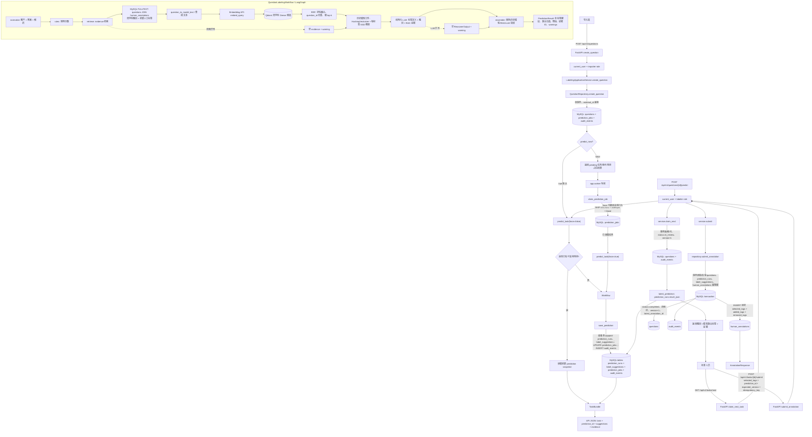
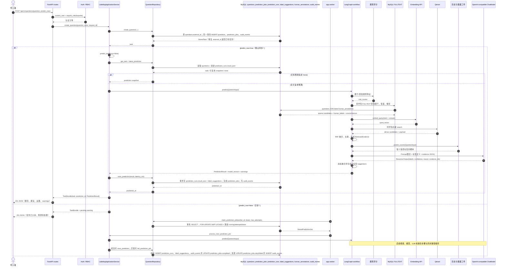
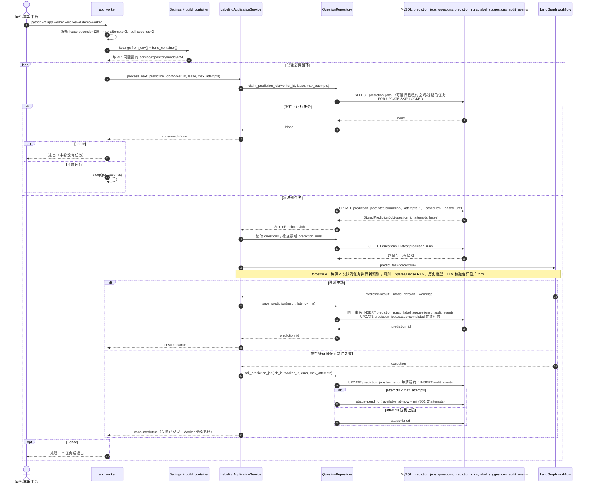
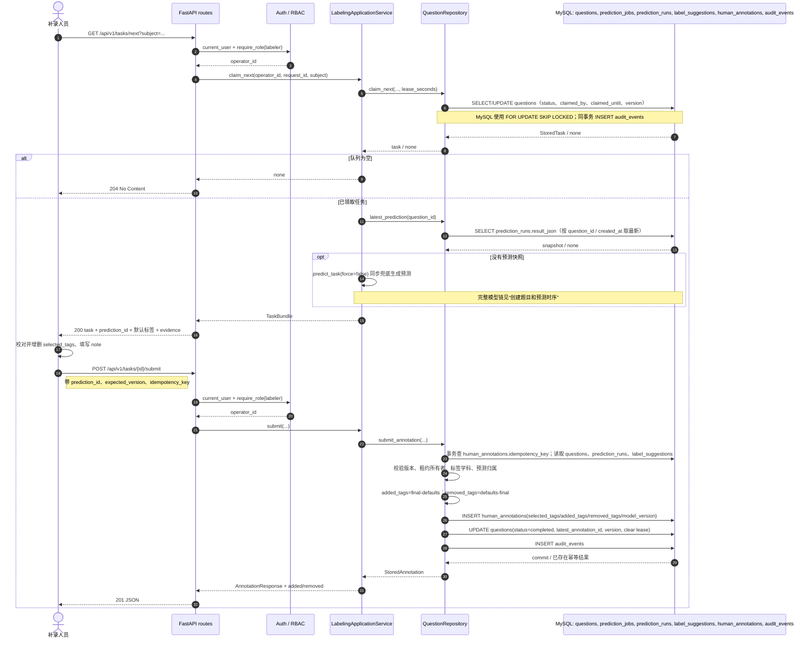
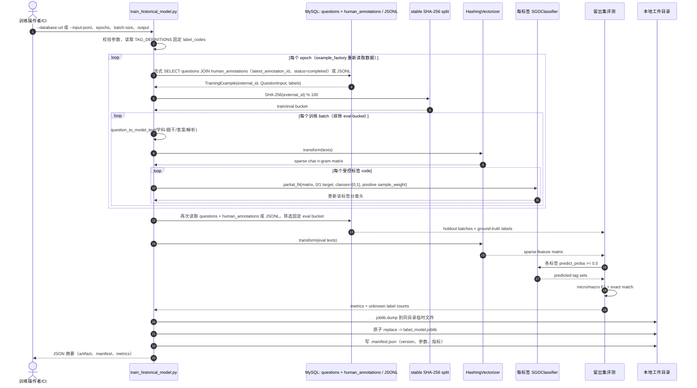
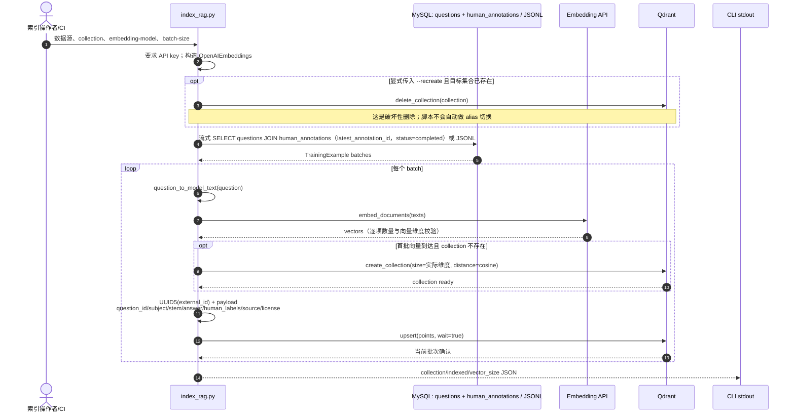
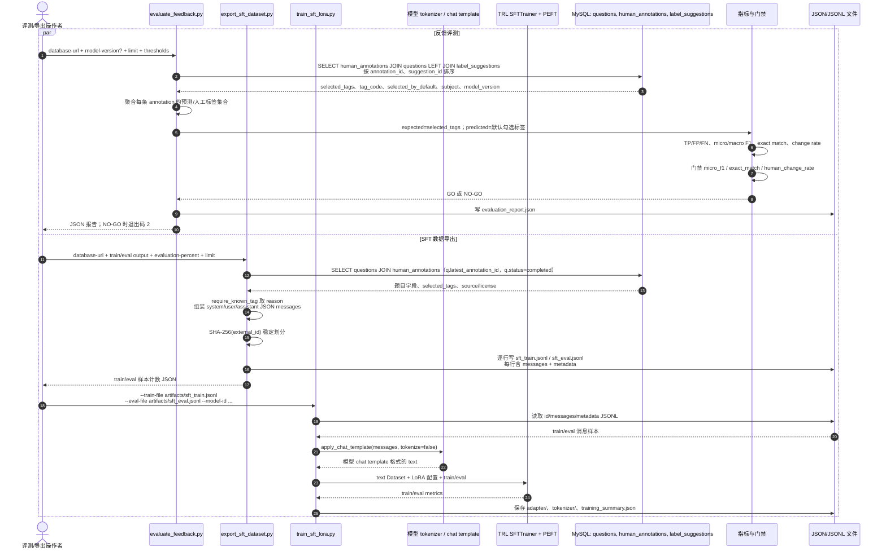

# 实现级流程图与时序图

本文按当前代码实现描述在线接口与离线脚本的数据流。图中的 MySQL 是业务事实源；Qdrant 是可重建的 Dense 检索索引；模型工件和 JSONL 是文件产物。图不表示脚本未实现的自动发布或 alias 切换。

MySQL 业务表为 `questions`（题目与人工任务状态/租约）、`prediction_jobs`（预测队列）、`prediction_runs`（预测快照）、`label_suggestions`（逐标签建议）、`human_annotations`（人工最终标签及差异）、`audit_events`（审计事件）。系统没有独立的 `tasks` 表；最新人工标注通过 `questions.latest_annotation_id` 关联。

## 1. 在线接口与预测流程



> 当前 `ReciprocalRankFusionRetriever` 的代码依次执行 MySQL Sparse 查询和 Qdrant Dense 查询，并非并发请求。`POST /questions` 默认 `predict_now=true`；设为 `false` 才由 Worker 异步消费已创建的 `prediction_jobs`。预测失败时 Worker 按租约与重试预算退避；LLM/RAG 节点可降级，历史模型错误则会使预测失败并进入 Worker 重试。

## 2. 创建题目和预测时序



## 3. 领取任务和提交人工标签时序
## 2.1 Worker 消费预测队列时序

`app.worker` 是独立的后台进程，专门消费 `prediction_jobs`。它不提供 HTTP 接口；启动时读取 `Settings.from_env()`，并通过 `build_container()` 装配与 API 相同的数据库、历史模型、RAG 和 LLM。API 使用 `predict_now=false` 入队后，由 Worker 执行实际预测。



持续运行的命令（API 和 Worker 必须使用相同 `DATABASE_URL` 与模型/RAG 配置）：

```bash
cd /Users/zhaoyonggng/work/llm-day1/question_labeling_system/backend
PYTHONPATH=. ../../.venv/bin/python -m app.worker \
  --worker-id demo-worker \
  --lease-seconds 120 \
  --max-attempts 3 \
  --poll-seconds 2
```

调试时可加 `--once`，最多处理一个队列项后退出；若队列为空则立即退出。Worker 空闲时才 sleep；处理过一项（成功或失败）后会继续下一轮。预测异常不会让整个 Worker 进程退出：租约被释放，任务按退避重新排队，或在尝试次数耗尽后进入 `failed`。

## 3. 领取任务和提交人工标签时序



## 4. 离线训练、索引、反馈评测与 SFT 导出流程

```mermaid
flowchart LR
    subgraph Source[训练数据源]
        DB[(MySQL<br/>questions JOIN human_annotations<br/>latest via questions.latest_annotation_id)]
        Snapshot[授权 JSONL 快照<br/>external_id/question/selected_tags]
    end

    subgraph Classifier[train_historical_model.py]
        DB -->|status=completed，最新标注| Reader[iter_database_examples<br/>stream_results + fetchmany]
        Snapshot -->|逐行 json.loads| JsonReader[iter_jsonl_examples]
        Reader --> Example[QuestionInput + selected_tags]
        JsonReader --> Example
        Example --> Split[SHA-256 external_id 稳定切分]
        Split -->|训练桶| Batch[epochs + 有界 batch]
        Batch --> ModelText[question_to_model_text<br/>学科/题干/答案/解析]
        ModelText --> Vectorizer[HashingVectorizer<br/>char 2-5 gram / sparse matrix]
        Vectorizer --> SGD[每个 tag 一个 SGDClassifier<br/>partial_fit + 正例 sample_weight]
        Split -->|eval 桶| Holdout[固定留出集]
        SGD --> EvalModel[每标签 predict_proba<br/>threshold=0.5]
        Holdout --> EvalModel
        EvalModel --> Metrics[micro/macro F1<br/>exact match]
        Metrics --> Artifact[(本地 joblib 工件<br/>临时文件后原子 replace)]
        Artifact --> Manifest[模型 manifest JSON<br/>version/参数/未知标签/metrics]
    end

    subgraph Index[RAG：index_rag.py]
        DB -->|同一最新人工标注读取器| IndexReader[iter_database_examples]
        Snapshot -->|可复现快照| IndexJson[iter_jsonl_examples]
        IndexReader --> IndexBatch[批次 batch_size]
        IndexJson --> IndexBatch
        IndexBatch --> EmbedText[question_to_model_text]
        EmbedText --> EmbedDocs["Embedding API<br/>embed_documents(batch)"]
        EmbedDocs --> Payload[UUID5 + vector + payload<br/>题目/subject/人工标签/source/license]
        Payload --> QCreate{集合不存在?}
        QCreate -->|是| CreateCollection[Qdrant create_collection<br/>实际向量维度 + cosine]
        QCreate -->|否| Upsert
        CreateCollection --> Upsert["Qdrant upsert(wait=true)<br/>重复点按稳定 ID 覆盖"]
        Upsert --> IndexSummary[终端 JSON 摘要<br/>collection/indexed/vector_size]
    end

    subgraph Feedback[人工反馈评测：evaluate_feedback.py]
        DB -->|human_annotations JOIN questions<br/>LEFT JOIN label_suggestions by prediction_id| FeedbackRows[按 annotation_id 聚合<br/>预测默认标签 vs 最终标签]
        FeedbackRows --> Compare[TP/FP/FN<br/>exact match / human change]
        Compare --> Report[evaluation_report.json<br/>micro/macro/per-label/per-subject/version]
        Report --> Gates{micro F1、exact match、change rate 门禁}
        Gates -->|全部通过| GO[GO，退出码 0]
        Gates -->|有门禁失败| NOGO[NO-GO，退出码 2]
    end

    subgraph SFT[指令微调数据：export_sft_dataset.py]
        DB -->|completed + latest_annotation_id| SFTReader[MySQL stream_results<br/>questions JOIN latest annotation]
        SFTReader --> SFTExample[system/user/assistant messages<br/>标签 reason 来自 taxonomy]
        SFTExample --> SFTSplit[SHA-256 external_id 固定切分]
        SFTSplit --> TrainJSONL[train JSONL<br/>OpenAI messages + metadata]
        SFTSplit --> EvalJSONL[eval JSONL<br/>同格式固定评测集]
        TrainJSONL --> SFTTrainer[train_sft_lora.py<br/>chat template -> text -> TRL SFTTrainer]
        EvalJSONL --> SFTTrainer
        SFTTrainer --> Adapter[(LoRA adapter + tokenizer<br/>training_summary.json)]
    end
```



## 5. 历史分类器训练时序



> 训练是监督学习，不调用 LLM 或 Embedding API。`trained_examples_with_repeats` 按 epoch 累加，是处理次数而非唯一训练样本数。模型工件保存后，在线 `SklearnHistoricalLabelModel` 用相同 `question_to_model_text` 和 HashingVectorizer 生成每个受控标签的概率。

## 6. Dense RAG 索引时序



## 7. 反馈评测和 SFT 导出时序



> `evaluate_feedback.py` 的预测集合来自 `label_suggestions.selected_by_default`，人工集合来自 `human_annotations.selected_tags`；它产出评测 JSON 和 GO/NO-GO，不直接训练或部署模型。`export_sft_dataset.py` 只从 MySQL 导出 JSONL，不调用 LLM，也不执行微调；同项目的 `train_sft_lora.py` 直接读取其 `messages` 格式并负责 LoRA/QLoRA 训练。

SFT 依赖与运行示例（从 `llm-day1` 根目录安装依赖；以下训练命令在后端目录执行）：

```bash
pip install -r requirements_day29_day31.txt
cd question_labeling_system/backend
PYTHONPATH=. python -m app.training.export_sft_dataset \
    --train-output ../artifacts/sft_train.jsonl \
    --eval-output ../artifacts/sft_eval.jsonl
PYTHONPATH=. python -m app.training.train_sft_lora \
    --train-file artifacts/sft_train.jsonl \
    --eval-file artifacts/sft_eval.jsonl \
    --model-id Qwen/Qwen2.5-0.5B-Instruct \
    --output-dir artifacts/sft_lora
```

加 `--qlora` 可请求 4-bit QLoRA；需要 CUDA 和 `bitsandbytes`。无 CUDA 时脚本会警告并回退到 LoRA。训练需要适用于所选模型的 tokenizer chat template。

## 8. 脚本边界速查

| 入口 | 输入事实 | 外部模型/存储调用 | 输出 | 是否修改业务 MySQL |
| --- | --- | --- | --- | --- |
| `POST /api/v1/questions` | API `QuestionInput` | 可同步触发 LangGraph | task + 可选 prediction | 是：题目、预测任务、审计；预测时追加运行和建议 |
| `app.worker` | `prediction_jobs` + `questions` | 历史模型、Sparse/Dense RAG、Chat LLM | `PredictionResult` | 是：运行快照、建议、队列状态、审计 |
| `POST /api/v1/tasks/{id}/submit` | 人工选中标签、预测 ID、版本和幂等键 | 无 LLM/RAG | 人工提交差异 | 是：最终标注、题目状态、审计 |
| `train_historical_model.py` | MySQL 最新人工标注或输入 JSONL | sklearn，不调用在线 LLM | `.joblib` + manifest JSON | 否，只读 MySQL |
| `index_rag.py` | MySQL 最新人工标注或输入 JSONL | Embedding API + Qdrant | Qdrant Dense points | 否，只读 MySQL；可写/删除 Qdrant 集合 |
| `evaluate_feedback.py` | MySQL 预测建议与人工最终标签 | 无 | evaluation JSON + GO/NO-GO | 否，只读 MySQL |
| `export_sft_dataset.py` | MySQL 最新人工最终标签 | 无 | train/eval JSONL | 否，只读 MySQL |
| `train_sft_lora.py` | exporter 的 train/eval `messages` JSONL | Hugging Face base model + TRL/PEFT；可选 bitsandbytes | LoRA adapter、tokenizer、training summary | 否 |

## 9. 实战串联：从样例题到人工反馈和微调

本节用仓库自带的原创样例 `data/sample_labeled_questions.jsonl` 和一条新导入的春天成语题串起主要脚本与 API。样例文件中的第一条大致如下：

```json
{"external_id":"train-cn-001","subject":"chinese","stem":"请写出一个描写春天的成语：____。","reference_answer":"春暖花开，其他合理答案均可。","analysis":"开放表达","source":"project_synthetic_seed","license_name":"project-authored","selected_tags":["answer_not_unique","semantic_equivalence"]}
```

其中 `selected_tags` 是人工确认标签。历史分类器、RAG 索引和 SFT exporter 都能用它，但它们产生的产物不同：分类器产出 sklearn 工件；索引脚本产出 Qdrant points；SFT exporter 产出聊天消息 JSONL。

### 9.1 训练历史标签分类器

从仓库根目录进入后端目录，并用隔离的本地 SQLite 文件运行：

```bash
cd /Users/zhaoyonggng/work/llm-day1
source .venv/bin/activate
cd question_labeling_system/backend
export DATABASE_URL="sqlite:////tmp/question-labeling-demo.db"

PYTHONPATH=. ../../.venv/bin/python -m app.training.train_historical_model \
    --input-jsonl ../data/sample_labeled_questions.jsonl \
    --output ../artifacts/demo_label_model.joblib \
    --epochs 2 \
    --batch-size 64 \
    --evaluation-percent 20
```

请使用一个尚不存在的演示数据库文件；如果该路径已存在且含有旧待办，请换一个新文件名。API 和后续评测/导出命令必须连接同一个数据库文件。

输入是每行含 `external_id/subject/stem/reference_answer/selected_tags` 的规范训练 JSONL；这里直接读文件，不查询 MySQL。输出在 `question_labeling_system/artifacts/`：

- `demo_label_model.joblib`：HashingVectorizer 和每个标签的 SGDClassifier。
- `demo_label_model.joblib.manifest.json`：模型版本、参数、留出集指标和未知标签统计。
- stdout JSON：`artifact`、`manifest`、`version` 和训练/评测摘要。

仓库样例集较小，固定哈希后评测样本数可能很少；真实训练应使用足够多且经审核的人工标注数据。

### 9.2 可选：把同一批题写入 Qdrant

Qdrant 和 Embedding 服务必须先运行。以 OpenAI-compatible 本地 Embedding 服务为例，按实际地址设置环境变量：

```bash
export QDRANT_URL="http://127.0.0.1:6333"
export OPENAI_BASE_URL="http://127.0.0.1:11434/v1"
export OPENAI_EMBEDDING_MODEL="nomic-embed-text"
export OPENAI_API_KEY="ollama"

PYTHONPATH=. ../../.venv/bin/python -m app.training.index_rag \
    --input-jsonl ../data/sample_labeled_questions.jsonl \
    --qdrant-url "$QDRANT_URL" \
    --collection demo_labeled_questions \
    --base-url "$OPENAI_BASE_URL" \
    --embedding-model "$OPENAI_EMBEDDING_MODEL" \
    --api-key "$OPENAI_API_KEY"
```

输入仍是同一个 JSONL。输出写到 Qdrant collection `demo_labeled_questions`，终端返回类似 `{"collection":"demo_labeled_questions","indexed":8,"vector_size":768}`；点数和向量维度以实际文件、Embedding 模型为准。这里不改 SQLite/MySQL。

> 本地 API 默认 `RAG_MODE=memory`，不会自动查询这个 Qdrant collection。线上 `RAG_MODE=hybrid` 才会同时走 MySQL FULLTEXT 和 Qdrant；该模式需要 MySQL（含 FULLTEXT ngram 索引）、Qdrant 和匹配的 Embedding 配置，不能仅把本地 SQLite 切到 hybrid。

### 9.3 启动本地 API 并导入一条新题

以下设置让 API 复用刚训练的历史分类器，同时保留默认内存 RAG 和禁用 LLM 的本地模式：

若只想快速把仓库的 8 条原创样例写入本地库并生成预测，可在**另一个独立数据库文件**上运行 `seed_local.py`：

```bash
DATABASE_URL="sqlite:////tmp/question-labeling-seed.db" \
    PYTHONPATH=. ../../.venv/bin/python -m app.training.seed_local
```

输出类似 `{"database_url":"sqlite:////tmp/question-labeling-seed.db","imported":8,"predicted":8}`。它会创建题目、预测快照、建议和审计记录，但不创建 `human_annotations`；因此该数据库不能直接用于后面的反馈评测和 SFT 导出。单独数据库也避免它的 8 条待办排在 API 演示题之前。

```bash
export HISTORICAL_MODEL_MODE=artifact
export HISTORICAL_MODEL_PATH="$PWD/../artifacts/demo_label_model.joblib"
export RAG_MODE=memory
export LLM_MODE=disabled

PYTHONPATH=. ../../.venv/bin/python -m uvicorn app.main:app \
    --host 127.0.0.1 --port 8010
```

在另一个终端用 `POST /api/v1/questions` 导入一条新题。开发环境默认启用调试身份；下面的角色同时包含 `importer` 和 `labeler`：

```bash
curl -sS -X POST http://127.0.0.1:8010/api/v1/questions \
    -H 'Content-Type: application/json' \
    -H 'X-Debug-User: demo-reviewer' \
    -H 'X-Debug-Roles: importer,labeler' \
    -d '{
        "question": {
            "external_id": "api-cn-spring-001",
            "subject": "chinese",
            "stem": "请写出一个描写春天的成语：____。",
            "reference_answer": "春暖花开，其他合理答案均可。",
            "analysis": "开放表达题",
            "source": "manual-demo",
            "source_uri": "",
            "license_name": "project-authored"
        },
        "predict_now": true
    }'
```

`predict_now` 默认为 `true`。接口先在 `questions`、`prediction_jobs`、`audit_events` 中创建数据，再同步执行预测，将快照和逐标签建议写入 `prediction_runs`、`label_suggestions`，并完成预测队列记录。HTTP 状态为 `201`。下面是响应节选，只展开一个建议和一条证据；实际 `suggestions` 包含该学科所有适用标签，ID 和分数由本次运行生成：

```json
{
    "task": {
        "id": 1,
        "question": {"external_id": "api-cn-spring-001", "subject": "chinese", "stem": "请写出一个描写春天的成语：____。", "reference_answer": "春暖花开，其他合理答案均可。", "analysis": "开放表达题", "source": "manual-demo", "source_uri": "", "license_name": "project-authored"},
        "status": "pending",
        "version": 1,
        "claimed_by": null,
        "claimed_until": null
    },
    "prediction_id": "<本次预测 UUID>",
    "prediction": {
        "suggestions": [
            {"code": "answer_not_unique", "name": "答案不唯一", "confidence": 0.8791, "selected_by_default": true, "high_risk": true, "reason": "...", "source_scores": {"historical_model": 0.83, "rule": 0.96, "rag": 0.9167}, "evidence_ids": ["seed-cn-1"]}
        ],
        "evidence": [
            {"evidence_id": "seed-cn-1", "question_id": "seed-cn-1", "subject": "chinese", "stem": "请写出一个描写春天的成语：____。", "reference_answer": "春暖花开；其他合理答案也可。", "human_labels": ["answer_not_unique", "semantic_equivalence"], "score": 0.9167, "source": "project_synthetic_seed", "source_uri": "", "license_name": "project-authored"}
        ],
        "requires_human_review": true,
        "model_version": "historical=...;reasoner=llm-disabled;ensemble=v1",
        "warnings": ["LLM 推理降级：RuntimeError"]
    }
}
```

这是本地降级模式的示例：`warnings` 会说明 LLM 未启用；RAG 分数对应当前内存检索示例，历史模型分数 `0.83` 和最终分数用于展示结构，实际值以训练工件运行结果为准。生产部署应使用 JWT，不能使用 `X-Debug-*`。

### 9.4 领取并提交人工最终标签

先领取语文队列中的下一题。新建的隔离数据库只有上一步这条题，因此领取到的就是它；已有其他待办时，队列按创建时间取最早任务：

```bash
CLAIM=$(curl -sS 'http://127.0.0.1:8010/api/v1/tasks/next?subject=chinese' \
    -H 'X-Debug-User: demo-reviewer' \
    -H 'X-Debug-Roles: importer,labeler')
printf '%s\n' "$CLAIM" | jq '{task: .task, prediction_id: .prediction_id, suggestions: .prediction.suggestions}'

QUESTION_ID=$(printf '%s' "$CLAIM" | jq -r '.task.id')
PREDICTION_ID=$(printf '%s' "$CLAIM" | jq -r '.prediction_id')
TASK_VERSION=$(printf '%s' "$CLAIM" | jq -r '.task.version')
```

`GET /api/v1/tasks/next` 将 `questions.status` 改为 `in_review`、增加 `version` 并设置操作员租约。操作员核对建议后，提交最终标签：

```bash
curl -sS -X POST "http://127.0.0.1:8010/api/v1/tasks/$QUESTION_ID/submit" \
    -H 'Content-Type: application/json' \
    -H 'X-Debug-User: demo-reviewer' \
    -H 'X-Debug-Roles: importer,labeler' \
    -d "{\
        \"prediction_id\": \"$PREDICTION_ID\",\
        \"selected_tags\": [\"answer_not_unique\", \"semantic_equivalence\"],\
        \"note\": \"人工核验：可接受多个合理成语\",\
        \"idempotency_key\": \"demo-spring-submit-001\",\
        \"expected_version\": $TASK_VERSION\
    }"
```

成功返回 `201`，结构为：

```json
{
    "annotation_id": 1,
    "question_id": 1,
    "selected_tags": ["answer_not_unique", "semantic_equivalence"],
    "added_tags": ["semantic_equivalence"],
    "removed_tags": [],
    "operator_id": "demo-reviewer",
    "created_at": "<UTC 时间>"
}
```

这里的 `added_tags`/`removed_tags` 是相对该次预测默认勾选项计算的，所以上例的差异数组只是示意。事务写入 `human_annotations`，同时更新 `questions.status/latest_annotation_id/version` 并写入 `audit_events`。重复使用同一幂等键会返回原标注，不会重复创建。

### 9.5 反馈评测、SFT 导出和 LoRA 训练

人工提交后，评测脚本读取 `human_annotations`、`questions` 和 `label_suggestions`，比较模型默认标签与人工最终标签：

```bash
export DATABASE_URL="sqlite:////tmp/question-labeling-demo.db"
PYTHONPATH=. ../../.venv/bin/python -m app.evaluation.evaluate_feedback \
    --database-url "$DATABASE_URL" \
    --output ../artifacts/demo_feedback_report.json
```

输出 `demo_feedback_report.json` 和 stdout JSON，字段包括 micro/macro F1、exact match、人工修改率、逐标签/逐学科指标及 `GO`/`NO-GO`。小型演示数据通常达不到默认发布门槛，脚本仍会先写报告，然后以退出码 `2` 表示 `NO-GO`；不要为了演示而把它当作生产验收结果。

导出人工最终标签为 SFT train/eval JSONL：

```bash
export DATABASE_URL="sqlite:////tmp/question-labeling-demo.db"
PYTHONPATH=. ../../.venv/bin/python -m app.training.export_sft_dataset \
    --database-url "$DATABASE_URL" \
    --train-output ../artifacts/sft_train.jsonl \
    --eval-output ../artifacts/sft_eval.jsonl \
    --evaluation-percent 20
```

每行输出形如 `{"id":"api-cn-spring-001","messages":[{"role":"system","content":"..."},{"role":"user","content":"..."},{"role":"assistant","content":"{\\"labels\\":[...],\\"warnings\\":[]}"}],"metadata":{"subject":"chinese","source":"manual-demo","source_uri":"","license_name":"project-authored"}}`。训练和评测按 `id` 的稳定 SHA-256 桶划分。两个文件都必须至少有一条记录；单条人工标注通常会导致某个 split 为空并触发 `ValueError`，因此需要足够多的已完成题目，或调整留出比例。

安装独立的 SFT 依赖后，直接把上述两个文件交给配套训练脚本：

```bash
# 在 llm-day1 仓库根目录安装已有的训练依赖清单。
cd /Users/zhaoyonggng/work/llm-day1
source .venv/bin/activate
pip install -r requirements_day29_day31.txt
cd question_labeling_system/backend

PYTHONPATH=. ../../.venv/bin/python -m app.training.train_sft_lora \
    --train-file artifacts/sft_train.jsonl \
    --eval-file artifacts/sft_eval.jsonl \
    --model-id Qwen/Qwen2.5-0.5B-Instruct \
    --output-dir artifacts/demo_sft_lora \
    --epochs 1
```

输出 `artifacts/demo_sft_lora/adapter/`、`tokenizer/` 和 `training_summary.json`。加 `--qlora` 会请求 4-bit QLoRA，需要兼容的 CUDA 环境和 `bitsandbytes`；否则使用 LoRA。adapter 是增量权重，不会自动替换线上 ChatModel；API 当前仍通过 `OPENAI_*` 配置调用在线 LLM。要在线使用该 adapter，还需额外实现并部署对应的模型加载/推理适配器。

### 9.6 异步导入分支

大批导入可用 `predict_now: false`：API 立即返回 `prediction_id: ""` 和 pending 提示，MySQL `prediction_jobs` 中保留待处理记录。另开终端、使用同一份 `DATABASE_URL` 和模型/RAG 环境启动 Worker：

```bash
cd /Users/zhaoyonggng/work/llm-day1/question_labeling_system/backend
PYTHONPATH=. ../../.venv/bin/python -m app.worker \
    --worker-id demo-worker --once
```

`--once` 最多处理一个任务；持续服务时去掉 `--once`。成功后 Worker 写入 `prediction_runs`/`label_suggestions` 并更新 `prediction_jobs`；随后调用 `GET /api/v1/tasks/{question_id}` 可读取完整预测。API 和 Worker 必须连接同一个数据库并使用一致的模型、Embedding、Qdrant 配置。
