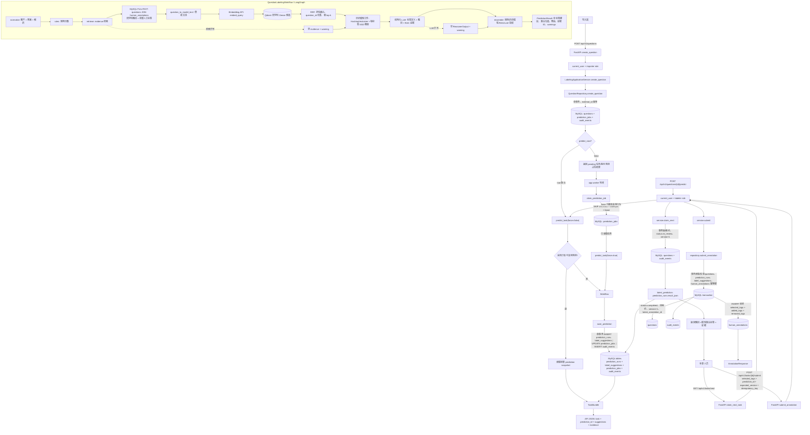
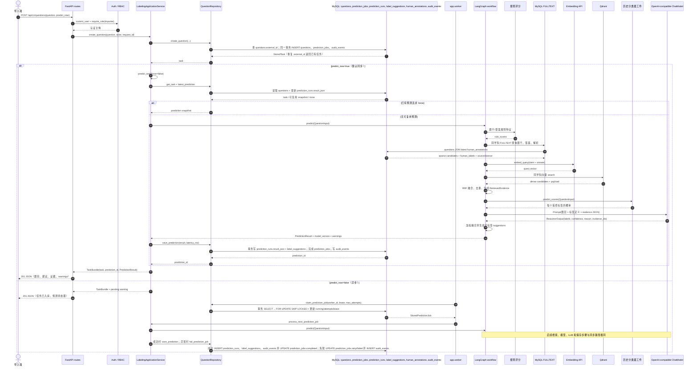
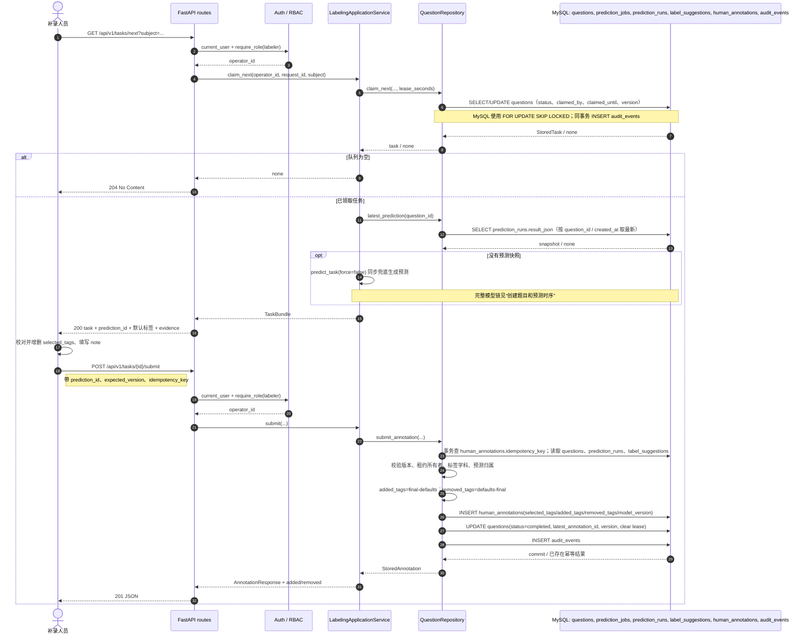
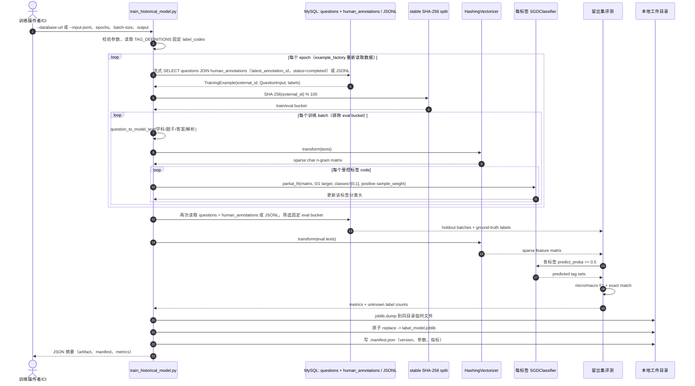
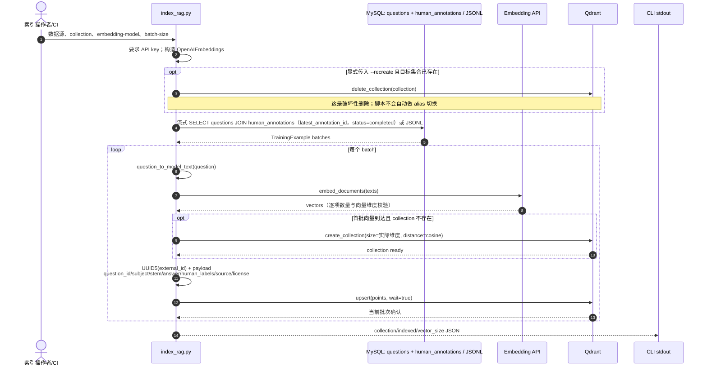
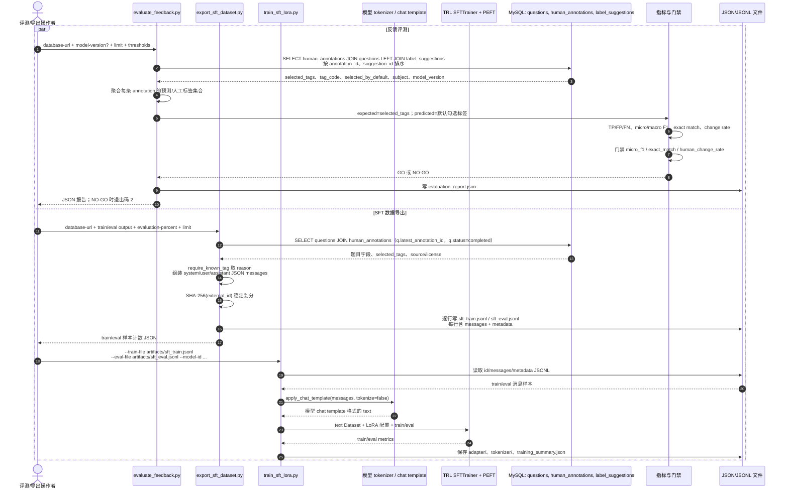

# 实现级流程图与时序图

本文按当前代码实现描述在线接口与离线脚本的数据流。图中的 MySQL 是业务事实源；Qdrant 是可重建的 Dense 检索索引；模型工件和 JSONL 是文件产物。图不表示脚本未实现的自动发布或 alias 切换。

MySQL 业务表为 `questions`（题目与人工任务状态/租约）、`prediction_jobs`（预测队列）、`prediction_runs`（预测快照）、`label_suggestions`（逐标签建议）、`human_annotations`（人工最终标签及差异）、`audit_events`（审计事件）。系统没有独立的 `tasks` 表；最新人工标注通过 `questions.latest_annotation_id` 关联。

## 1. 在线接口与预测流程



> 当前 `ReciprocalRankFusionRetriever` 的代码依次执行 MySQL Sparse 查询和 Qdrant Dense 查询，并非并发请求。`POST /questions` 默认 `predict_now=true`；设为 `false` 才由 Worker 异步消费已创建的 `prediction_jobs`。预测失败时 Worker 按租约与重试预算退避；LLM/RAG 节点可降级，历史模型错误则会使预测失败并进入 Worker 重试。

## 2. 创建题目和预测时序



## 3. 领取任务和提交人工标签时序



## 4. 离线训练、索引、反馈评测与 SFT 导出流程

```mermaid
flowchart LR
    subgraph Source[训练数据源]
        DB[(MySQL<br/>questions JOIN human_annotations<br/>latest via questions.latest_annotation_id)]
        Snapshot[授权 JSONL 快照<br/>external_id/question/selected_tags]
    end

    subgraph Classifier[train_historical_model.py]
        DB -->|status=completed，最新标注| Reader[iter_database_examples<br/>stream_results + fetchmany]
        Snapshot -->|逐行 json.loads| JsonReader[iter_jsonl_examples]
        Reader --> Example[QuestionInput + selected_tags]
        JsonReader --> Example
        Example --> Split[SHA-256 external_id 稳定切分]
        Split -->|训练桶| Batch[epochs + 有界 batch]
        Batch --> ModelText[question_to_model_text<br/>学科/题干/答案/解析]
        ModelText --> Vectorizer[HashingVectorizer<br/>char 2-5 gram / sparse matrix]
        Vectorizer --> SGD[每个 tag 一个 SGDClassifier<br/>partial_fit + 正例 sample_weight]
        Split -->|eval 桶| Holdout[固定留出集]
        SGD --> EvalModel[每标签 predict_proba<br/>threshold=0.5]
        Holdout --> EvalModel
        EvalModel --> Metrics[micro/macro F1<br/>exact match]
        Metrics --> Artifact[(本地 joblib 工件<br/>临时文件后原子 replace)]
        Artifact --> Manifest[模型 manifest JSON<br/>version/参数/未知标签/metrics]
    end

    subgraph Index[RAG：index_rag.py]
        DB -->|同一最新人工标注读取器| IndexReader[iter_database_examples]
        Snapshot -->|可复现快照| IndexJson[iter_jsonl_examples]
        IndexReader --> IndexBatch[批次 batch_size]
        IndexJson --> IndexBatch
        IndexBatch --> EmbedText[question_to_model_text]
        EmbedText --> EmbedDocs["Embedding API<br/>embed_documents(batch)"]
        EmbedDocs --> Payload[UUID5 + vector + payload<br/>题目/subject/人工标签/source/license]
        Payload --> QCreate{集合不存在?}
        QCreate -->|是| CreateCollection[Qdrant create_collection<br/>实际向量维度 + cosine]
        QCreate -->|否| Upsert
        CreateCollection --> Upsert["Qdrant upsert(wait=true)<br/>重复点按稳定 ID 覆盖"]
        Upsert --> IndexSummary[终端 JSON 摘要<br/>collection/indexed/vector_size]
    end

    subgraph Feedback[人工反馈评测：evaluate_feedback.py]
        DB -->|human_annotations JOIN questions<br/>LEFT JOIN label_suggestions by prediction_id| FeedbackRows[按 annotation_id 聚合<br/>预测默认标签 vs 最终标签]
        FeedbackRows --> Compare[TP/FP/FN<br/>exact match / human change]
        Compare --> Report[evaluation_report.json<br/>micro/macro/per-label/per-subject/version]
        Report --> Gates{micro F1、exact match、change rate 门禁}
        Gates -->|全部通过| GO[GO，退出码 0]
        Gates -->|有门禁失败| NOGO[NO-GO，退出码 2]
    end

    subgraph SFT[指令微调数据：export_sft_dataset.py]
        DB -->|completed + latest_annotation_id| SFTReader[MySQL stream_results<br/>questions JOIN latest annotation]
        SFTReader --> SFTExample[system/user/assistant messages<br/>标签 reason 来自 taxonomy]
        SFTExample --> SFTSplit[SHA-256 external_id 固定切分]
        SFTSplit --> TrainJSONL[train JSONL<br/>OpenAI messages + metadata]
        SFTSplit --> EvalJSONL[eval JSONL<br/>同格式固定评测集]
        TrainJSONL --> SFTTrainer[train_sft_lora.py<br/>chat template -> text -> TRL SFTTrainer]
        EvalJSONL --> SFTTrainer
        SFTTrainer --> Adapter[(LoRA adapter + tokenizer<br/>training_summary.json)]
    end
```



## 5. 历史分类器训练时序



> 训练是监督学习，不调用 LLM 或 Embedding API。`trained_examples_with_repeats` 按 epoch 累加，是处理次数而非唯一训练样本数。模型工件保存后，在线 `SklearnHistoricalLabelModel` 用相同 `question_to_model_text` 和 HashingVectorizer 生成每个受控标签的概率。

## 6. Dense RAG 索引时序



## 7. 反馈评测和 SFT 导出时序



> `evaluate_feedback.py` 的预测集合来自 `label_suggestions.selected_by_default`，人工集合来自 `human_annotations.selected_tags`；它产出评测 JSON 和 GO/NO-GO，不直接训练或部署模型。`export_sft_dataset.py` 只从 MySQL 导出 JSONL，不调用 LLM，也不执行微调；同项目的 `train_sft_lora.py` 直接读取其 `messages` 格式并负责 LoRA/QLoRA 训练。

SFT 依赖与运行示例（从 `llm-day1` 根目录安装依赖；以下训练命令在后端目录执行）：

```bash
pip install -r requirements_day29_day31.txt
cd question_labeling_system/backend
PYTHONPATH=. python -m app.training.export_sft_dataset \
    --train-output ../artifacts/sft_train.jsonl \
    --eval-output ../artifacts/sft_eval.jsonl
PYTHONPATH=. python -m app.training.train_sft_lora \
    --train-file artifacts/sft_train.jsonl \
    --eval-file artifacts/sft_eval.jsonl \
    --model-id Qwen/Qwen2.5-0.5B-Instruct \
    --output-dir artifacts/sft_lora
```

加 `--qlora` 可请求 4-bit QLoRA；需要 CUDA 和 `bitsandbytes`。无 CUDA 时脚本会警告并回退到 LoRA。训练需要适用于所选模型的 tokenizer chat template。

## 8. 脚本边界速查

| 入口 | 输入事实 | 外部模型/存储调用 | 输出 | 是否修改业务 MySQL |
| --- | --- | --- | --- | --- |
| `POST /api/v1/questions` | API `QuestionInput` | 可同步触发 LangGraph | task + 可选 prediction | 是：题目、预测任务、审计；预测时追加运行和建议 |
| `app.worker` | `prediction_jobs` + `questions` | 历史模型、Sparse/Dense RAG、Chat LLM | `PredictionResult` | 是：运行快照、建议、队列状态、审计 |
| `POST /api/v1/tasks/{id}/submit` | 人工选中标签、预测 ID、版本和幂等键 | 无 LLM/RAG | 人工提交差异 | 是：最终标注、题目状态、审计 |
| `train_historical_model.py` | MySQL 最新人工标注或输入 JSONL | sklearn，不调用在线 LLM | `.joblib` + manifest JSON | 否，只读 MySQL |
| `index_rag.py` | MySQL 最新人工标注或输入 JSONL | Embedding API + Qdrant | Qdrant Dense points | 否，只读 MySQL；可写/删除 Qdrant 集合 |
| `evaluate_feedback.py` | MySQL 预测建议与人工最终标签 | 无 | evaluation JSON + GO/NO-GO | 否，只读 MySQL |
| `export_sft_dataset.py` | MySQL 最新人工最终标签 | 无 | train/eval JSONL | 否，只读 MySQL |
| `train_sft_lora.py` | exporter 的 train/eval `messages` JSONL | Hugging Face base model + TRL/PEFT；可选 bitsandbytes | LoRA adapter、tokenizer、training summary | 否 |
