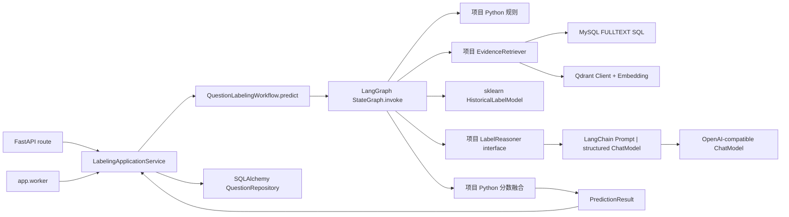
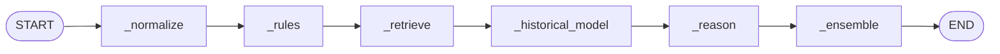
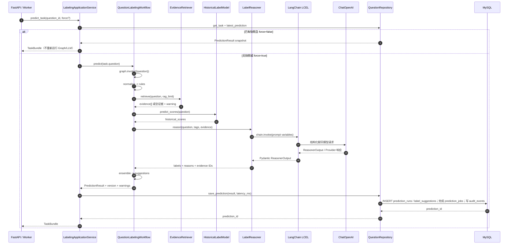

# LangChain 与 LangGraph 在本项目中的实践

本文只解释 `question_labeling_system` 中实际使用的 LangChain 和 LangGraph 代码：它们负责什么、在哪里构造、怎样被调用，以及哪些相邻逻辑并不是它们提供的。

## 一句话区分

- **LangChain**：封装与聊天模型、Prompt、结构化输出和 Embedding 服务的交互。本项目实际使用 `ChatPromptTemplate`、`ChatOpenAI`、`with_structured_output()`、LCEL 管道和 `OpenAIEmbeddings`。
- **LangGraph**：把一次题目标注的多个处理步骤组织成有状态工作流。本项目使用 `StateGraph` 注册节点和边，再通过编译图的 `invoke()` 执行。
- 二者都不会自动访问业务数据库或提交最终标签。业务状态、权限、事务、标签校验和最后融合仍由本项目自己的代码负责。



## 1. 依赖在哪里装配

应用启动时，[`Settings.from_env()`](../backend/app/core/config.py) 读取模式和地址；[`build_container()`](../backend/app/bootstrap.py) 创建模型、检索器、Reasoner 和 LangGraph 工作流，再注入 [`LabelingApplicationService`](../backend/app/services/application.py)。API 和 Worker 都通过这个装配入口使用同一套业务流程。

配置决定注入哪种实现：

| 配置 | 注入实现 | 外部调用 |
| --- | --- | --- |
| `LLM_MODE=disabled`（本地默认） | `DisabledLabelReasoner` | 不调用聊天模型；抛出明确异常，由 LangGraph 的 `_reason` 节点降级处理 |
| `LLM_MODE=openai` | `LangChainLabelReasoner` | 调用 `OPENAI_BASE_URL` 指向的兼容 ChatModel |
| `RAG_MODE=memory`（本地默认） | `InMemoryEvidenceRetriever` | 只检索代码内原创样例 |
| `RAG_MODE=hybrid` | `ReciprocalRankFusionRetriever` | 先 MySQL FULLTEXT，再 Qdrant Dense；用于生产规模检索 |

生产配置校验要求启用 `LLM_MODE=openai`、`RAG_MODE=hybrid`，并配置 MySQL、Qdrant、API Key 等。默认开发配置不会因为导入 `ChatOpenAI` 类就自动发送网络请求；只有选用真实 Reasoner 并运行其推理链时才调用模型。

## 2. LangGraph：固定顺序的预测编排

### State 与节点

[`LabelingState`](../backend/app/services/labeling_workflow.py) 是节点间共享的状态，主要字段包括：

| 字段 | 产生位置 | 后续用途 |
| --- | --- | --- |
| `question` | `graph.invoke({"question": question})` 初始输入 | 规则、检索、分类器和 Reasoner 的共同题目输入 |
| `rule_scores` | `_rules` | 融合时作为 `rule` 信号 |
| `evidence` | `_retrieve` | 传给 LLM；同时把人工标签作为 RAG 融合信号 |
| `historical_scores` | `_historical_model` | 融合时作为 `historical_model` 信号 |
| `reasoner_output` | `_reason` | 作为 LLM 标签、理由和证据引用输入融合 |
| `suggestions` | `_ensemble` | 最终对 API 返回的逐标签结果 |
| `warnings` | `_normalize` 初始为空；降级节点追加 | 返回给 API 并保存到预测快照 |

构造函数用 `StateGraph(LabelingState)` 注册 `_normalize`、`_rules`、`_retrieve`、`_historical_model`、`_reason`、`_ensemble`，随后添加固定顺序的边并 `compile()`。因此它是一个**线性有状态工作流**，没有由 LLM 决定下一步的 Agent 循环，也没有条件路由边。



`graph.invoke({"question": question})` 启动编译后的图。节点收到当前状态并返回一个字典；LangGraph 将这些键合并到状态，再把更新后的状态交给下一节点。例如 `_retrieve` 返回 `{"evidence": evidence}`，后面的 `_reason` 读取 `state["evidence"]`。

### 各节点做什么

1. `_normalize` 将题干、参考答案、解析拼成 `normalized_text`，同时初始化 `warnings`。当前后续节点仍主要从 `QuestionInput` 字段取值或由 Adapter 自己格式化文本；`normalized_text` 暂未作为统一模型输入被消费。
2. `_rules` 调用本项目的 `rule_based_scores()`，例如多空题、数学计算、答案不唯一等规则。这是普通 Python，不是 LangChain Tool。
3. `_retrieve` 调用注入的 `EvidenceRetriever`。本地是内存检索；Hybrid 模式由项目自己的 Sparse/Dense 检索和 RRF 实现。异常会转为空证据并写入 warning。
4. `_historical_model` 调用 `HistoricalLabelModel.predict_scores()`，通常由 sklearn 工件提供各标签概率；模型错误不在该节点中吞掉，会向外传播。
5. `_reason` 调用 `LabelReasoner.reason()`。真实 LangChain Reasoner 返回结构化判断；LLM 超时、限流或解析错误会被捕获，返回空 `ReasonerOutput` 并追加 warning。
6. `_ensemble` 是项目自己的 Python 逻辑：过滤当前学科外的标签，按可用信号计算加权分数、默认勾选、理由及 evidence IDs。

最终 `predict()` 从图的 `final_state` 组装 `PredictionResult`。应用服务随后记录指标、调用 Repository 写数据库。LangGraph 不负责保存 MySQL 事务。

## 3. LangChain：结构化聊天模型调用

[`llm_reasoner.py`](../backend/app/adapters/llm_reasoner.py) 是聊天模型适配器。`LangChainLabelReasoner.__init__()` 依次创建：

1. `ChatOpenAI`：模型名、Base URL、API Key、`temperature=0`、超时和有限重试。
2. `ChatPromptTemplate.from_messages()`：system 指令规定标签边界；human 模板包含学科、题干、答案、解析、允许标签 JSON 和证据 JSON。
3. `model.with_structured_output(ReasonerOutput)`：要求 Provider 或解析层按 Pydantic `ReasonerOutput` 返回数据。
4. `prompt | structured_model`：用 LCEL `|` 组合成 `_chain`。

执行 `reason()` 时，标签和 evidence 先通过 `model_dump(mode="json")` 转成 JSON 兼容对象；然后这行调用真正的链：

```python
output = self._chain.invoke({
    "subject": question.subject.value,
    "stem": question.stem,
    "answer": question.reference_answer,
    "analysis": question.analysis or "无",
    "tags_json": json.dumps(tag_payload, ensure_ascii=False),
    "evidence_json": json.dumps(evidence_payload, ensure_ascii=False),
})
```

`invoke()` 会填充 Prompt 并请求配置的 ChatModel；返回值通常已经是 `ReasonerOutput`，若 Provider 返回普通 dict，则用 `ReasonerOutput.model_validate()` 再校验。该调用是**推理**，不是训练。`DisabledLabelReasoner` 不执行这条 LCEL 链，而是抛出异常供 LangGraph 降级。

## 4. LangChain Embeddings 与 RAG 边界

LangChain 还提供 OpenAI-compatible Embedding Adapter，但向量数据库、过滤和排序不是 LangChain 在本项目里代办的：

| 用途 | LangChain 部分 | 本项目负责的部分 |
| --- | --- | --- |
| 离线 Qdrant 建索引：[`index_rag.py`](../backend/app/training/index_rag.py) | `OpenAIEmbeddings.embed_documents(texts)` 生成一批向量 | 生成稳定 UUID5、构造 payload、创建 collection、调用 Qdrant `upsert` |
| 在线 Dense 查询：[`rag.py`](../backend/app/adapters/rag.py) | `OpenAIEmbeddings.embed_query(stem + answer)` 生成查询向量 | 按 `subject` 过滤并调用 Qdrant Client `search` |
| 在线 Sparse 查询 | 无 LangChain 调用 | 项目直接执行 MySQL `MATCH ... AGAINST` SQL，并关联 `questions` 与最新 `human_annotations` |
| 两路融合 | 无 LangChain 调用 | `ReciprocalRankFusionRetriever` 按排名做 RRF、去重并截取候选 |

换句话说，LangChain 在这里负责“文本转向量”的 Provider 接口；Qdrant SDK 负责向量读写；MySQL FULLTEXT 和 RRF 是项目自有实现。

## 5. 一次真实预测的调用时序



如果 `RAG_MODE=memory`，检索器只读内存样例；`RAG_MODE=hybrid` 才会走 MySQL + Qdrant。若 `LLM_MODE=disabled`，Reasoner 会在链调用前降级，不会发出 ChatModel 请求。即使 LLM 返回了内容，最终可用标签仍受 taxonomy 校验和 `_ensemble` 控制。

## 6. 哪些地方不是 LangChain/LangGraph

- `train_historical_model.py` 使用 scikit-learn，不使用 LangChain 或 LangGraph。
- `train_sft_lora.py` 使用 Transformers、Datasets、TRL、PEFT，不使用 LangChain 或 LangGraph。
- `evaluate_feedback.py` 用 SQLAlchemy/原生 SQL 计算指标，不是 LangChain Evaluation。
- API 路由、鉴权、SQLAlchemy Repository、数据库事务、审计和重试都由 FastAPI/本项目代码完成。
- `LabelReasoner`、`EvidenceRetriever`、`HistoricalLabelModel` 是本项目定义的 Protocol 接口；LangChain Reasoner 只是其中一个 Adapter 实现。
- `LangGraph` 管理节点顺序和状态传递，不自动推理业务规则；具体规则、检索、融合都由节点调用的实现决定。

## 7. 相关文件速查

| 文件 | 对应概念 |
| --- | --- |
| [`bootstrap.py`](../backend/app/bootstrap.py) | 按环境装配 Chat Reasoner、Embedding、Retriever 和 Graph |
| [`labeling_workflow.py`](../backend/app/services/labeling_workflow.py) | `LabelingState`、StateGraph 节点/边、降级、ensemble、`graph.invoke()` |
| [`llm_reasoner.py`](../backend/app/adapters/llm_reasoner.py) | ChatPromptTemplate、ChatOpenAI、结构化输出、LCEL `invoke()` |
| [`rag.py`](../backend/app/adapters/rag.py) | Embedding 查询、MySQL FULLTEXT、Qdrant Search、RRF |
| [`index_rag.py`](../backend/app/training/index_rag.py) | `embed_documents()` 和 Qdrant 离线 upsert |
| [`application.py`](../backend/app/services/application.py) | API/Worker 调用工作流、记录耗时并持久化结果 |
| [`contracts.py`](../backend/app/services/contracts.py) | 项目定义的可替换 Adapter Protocol |

项目固定的 LangChain/LangGraph 依赖版本见 [`requirements.txt`](../backend/requirements.txt)。