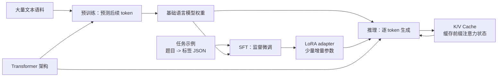

# 预训练、Transformer 与 K/V Cache 入门

这三个词经常一起出现，但它们回答的是不同问题：**预训练是怎么学习，Transformer 是模型结构，K/V Cache 是生成时怎么省重复计算。**

## 先看全景



图里的关系可以这样读：Transformer 是模型的“结构”；预训练和 SFT 是训练模型的不同阶段/方式；K/V Cache 只在推理生成时帮 Transformer 少做重复计算。

## 1. 预训练是什么

预训练是用大量文本让模型学习语言规律。常见的自回归语言模型会反复做“根据前文预测下一个 token”：

```text
上下文：北京 是 中国 的
训练目标：首都
```

训练过程中，模型产生预测，和真实的下一个 token 计算 loss，再通过反向传播更新参数。语料本身提供了预测目标，不需要人工逐条写出分类标签，所以常称为自监督预训练。

预训练后的权重通常称为**基础模型**。它学到了通用语言模式，但未必已经擅长某个特定业务任务；之后可以通过指令微调（SFT）进一步适配。

> “预训练层”容易造成误解：预训练不是 Transformer 里的某一层，而是一种训练阶段。模型内部有多层 Transformer block，但它们不是“预训练层”。

## 2. Transformer 是什么

Transformer 是处理 token 序列的神经网络架构。大致流程是：

```text
文本 -> tokenizer 切成 token -> token 向量 + 位置信息
     -> 多层 Transformer block -> 下一个 token 的概率分布
```

核心组件之一是注意力机制。可以把它想成：处理当前位置时，从上下文中寻找相关信息，再把信息汇总进当前表示。

注意力里常见三个向量：

| 名称 | 直观理解 | 作用 |
| --- | --- | --- |
| Query（Q） | 当前 token 正在寻找什么 | 发出匹配需求 |
| Key（K） | 每个历史 token 的索引特征 | 用来和 Query 计算相关程度 |
| Value（V） | 每个历史 token 携带的内容 | 按相关程度加权汇总 |

Q、K、V 是模型计算出的向量，不是实际单词或数据库字段。对于因果语言模型，当前位置只能关注当前及之前的 token，不能看未来的答案。

## 3. K/V Cache 是什么

LLM 通常逐 token 生成回答。假设模型要依次生成“植物”“利用”“阳光”：

1. 先处理完整问题，计算各层注意力所需的 K/V，并缓存起来。
2. 生成“植物”后，只需计算新 token 的 K/V；新位置可以复用问题的 K/V。
3. 生成“利用”时，复用问题和“植物”的 K/V，只为新 token 追加计算。

没有缓存时，一个朴素实现可能反复计算整段前缀；有缓存时，前缀的 K/V 可以复用。因此 K/V Cache 通常能降低长回答的重复计算和生成延迟。

需要区分：

- 缓存的是 Transformer 每层的 **Key/Value 中间向量**，不是完整回答、标签、RAG 证据或模型权重。
- 新 token 仍要计算，也仍需对历史 K/V 做注意力；缓存不是“后续不用看历史”。
- K/V Cache 以显存换速度；上下文更长、并发更多、模型层数/隐藏维度更大，通常都会增加缓存占用。
- 它不会训练模型，也不会增加模型知识；主要影响推理效率，不是预测质量指标。
- API 服务端或推理框架通常负责管理缓存；业务代码一般不会直接操作每层 K/V 张量。

## 4. 三者如何配合

```text
Transformer 架构 + 大量文本
       └─ 预训练：学习通用语言能力，得到基础模型
                 └─ SFT：用任务示例继续训练
                       └─ LoRA：只训练少量 adapter 参数的一种方法

部署推理：基础模型（+ 可选 LoRA adapter）逐 token 生成
                 └─ K/V Cache：复用已处理 token 的注意力状态
```

Transformer 是“模型怎么计算”；预训练/SFT/LoRA 是“模型怎样获得或适配能力”；K/V Cache 是“推理怎样减少重复计算”。三者不是互相替代的选项。

## 5. 对应到本项目

| 项目部件 | 使用的技术 | 和上述概念的关系 |
| --- | --- | --- |
| 历史标签模型 | scikit-learn `HashingVectorizer` + 每标签 `SGDClassifier` | 传统多标签分类器，不是 Transformer，不使用 K/V Cache |
| SFT/LoRA 训练脚本 | Transformers + PyTorch + TRL/PEFT | 从基础 instruct LLM 出发，用聊天样例做 SFT；LoRA 保存为 adapter |
| 在线 LLM Reasoner | 配置的 OpenAI-compatible ChatModel | 项目调用基础/部署模型生成结构化标签理由；若服务底层用 Transformer，K/V Cache 通常由推理服务管理 |
| RAG Embedding | Embedding API + Qdrant | 把题目映射到向量并检索相似题；这是向量检索，不是 K/V Cache |

本项目默认 SFT 基础模型为 `Qwen/Qwen2.5-0.5B-Instruct`，可通过 `--model-id` 更换。`train_sft_lora.py` 产出的 adapter 目前尚未接入在线 ChatModel；即使接入，K/V Cache 也属于推理运行时优化，不会由 LoRA 训练脚本生成。

相关专题：[实现级流程图与端到端实战串联](IMPLEMENTATION_FLOWS.md)、[LangChain 与 LangGraph 代码实践](LANGCHAIN_LANGGRAPH_GUIDE.md)、[历史模型、RAG 与反馈闭环](DATA_MODEL_AND_RAG.md)。