# 小林 Coding 分布式系统面试知识图谱

来源：[分布式面试题](https://xiaolincoding.com/interview/cap.html)。整理日期：2026-10-20。页面不只有 CAP，还包含分布式锁、ID、事务、组件、场景与一致性算法；本文按这些范围原创整理。理论模型、产品实现、部署配置与业务保证分层讨论，不把“用了共识组件”等同于端到端强一致。

## 阅读入口

[总图](#distributed-map) · [整体认知](#distributed-overview) · [节点速查](#distributed-nodes) · [问答](#distributed-questions) · [案例与代码](#distributed-example) · [逐边关系](#review-edge-index) · [自测](#distributed-recall)

## 读图约定

- 连线文字加粗、浅色底，实线表示组成或直接依赖，虚线表示条件、约束和风险；索引使用图中名称。
- CAP 的 C 按线性一致性模型讨论，ACID 的 C 是业务约束一致性；两者不能直接替换。
- 多数、租约、幂等、回滚、补偿与重试各有故障假设，不是可互换的“高可用”标签。

<a id="distributed-map"></a>

## 总图

```mermaid
---
config:
  theme: base
  themeVariables:
    edgeLabelBackground: "#fff7d6"
---
flowchart TB
    ROOT["分布式系统全景<br/>部分失败、数据合同、协调与恢复"]
    subgraph THEORY["A. 模型与理论"]
        FAILURE["部分失败与未知结果<br/>超时、分区、暂停和重启"]
        CAP["CAP 与分区取舍<br/>分区时不能同时承诺线性一致与形式化可用"]
        LINEAR["线性一致性<br/>单一实时顺序且遵守操作先后"]
        EVENTUAL["最终一致性与BASE<br/>停止更新且传播修复可行时收敛"]
        SESSION["会话与因果保证<br/>读己之写、单调读和依赖传播"]
        CONTRACT["业务不变量与SLO<br/>不超卖、时效、可用、RPO/RTO"]
    end
    subgraph LOCKS["B. 锁、租约与资源保护"]
        LEASE["租约锁与owner<br/>有效期、唯一持有身份、续期与原子释放"]
        FENCE["Fencing 资源检查<br/>可靠单调令牌与原子拒绝旧持有者"]
        REDIS["Redis 锁与Redlock<br/>单实例原子步骤和多节点时间假设"]
        ZKLOCK["ZooKeeper 临时顺序锁<br/>序号排序、前驱监听和竞争重查"]
        SESSIONEXP["会话过期与连接中断<br/>临时节点删除依赖会话判定"]
        ETCD["etcd 租约与事务<br/>revision比较、租约存活与资源端约束"]
        DBLOCK["数据库锁与条件写<br/>事务锁、唯一约束、版本与故障边界"]
        IDEMPOTENT["业务幂等记录<br/>稳定操作键、参数和结果同事务"]
    end
    subgraph IDS["C. 分布式标识"]
        ID["ID 需求合同<br/>唯一范围、长度、顺序、可枚举性"]
        UUID["UUIDv4 与UUIDv7<br/>随机或带时间信息，不代表全局严格顺序"]
        SNOW["雪花式ID<br/>时间、worker身份、序列和回拨处理"]
        SEGMENT["数据库号段与计数<br/>范围不重叠、预取、持久性和耗尽"]
    end
    subgraph TRANSACTIONS["D. 分布式事务与业务收敛"]
        ATOMIC["原子提交与隔离<br/>跨资源全有全无不自动提供业务隔离"]
        XA["XA 与两阶段提交<br/>协调者、准备、提交日志与故障阻塞"]
        THREE["三阶段提交假设<br/>额外阶段不能无条件解决任意分区"]
        TCC["TCC 资源预留<br/>Try、Confirm、Cancel和业务状态约束"]
        TCCSAFE["空回滚、防悬挂与幂等<br/>晚到Try与重复完成必须被识别"]
        SAGA["Saga 与语义补偿<br/>多个本地事务，补偿不抹去历史"]
        OUTBOX["本地消息与可靠事件<br/>业务和意图同事务，投递重试与对账"]
        SEATA["Seata TM、TC、RM<br/>XID、协调、资源代理和模式选择"]
        AT["AT 代理与全局锁<br/>镜像、undo_log、二阶段提交或回滚校验"]
    end
    subgraph COMPONENTS["E. 组件与治理"]
        RPC["RPC与截止时间<br/>协议、关联、重试预算和未知结果查询"]
        DISCOVERY["发现与健康信息<br/>租约、缓存、陈旧地址和故障域"]
        LOAD["负载均衡与亲和<br/>选路、权重和热点，不代替副本持久性"]
        LIMIT["限流与额度分配<br/>窗口、令牌、并发和全局额度守恒"]
        CIRCUIT["熔断、隔离与降级<br/>依赖保护、资源边界和合法替代结果"]
        RECONCILE["状态机与对账恢复<br/>持久事实、重试、补偿和异常终态"]
    end
    subgraph CONSENSUS["F. 一致性与共识算法"]
        QUORUM["多数派与投票成员<br/>集合交集加协议规则，不只数节点"]
        RAFT["Raft 任期与选举<br/>投票、日志新旧和旧领导者限制"]
        LOG["日志匹配与提交规则<br/>前缀修复、当前任期多数和应用进度"]
        READ["线性读协议<br/>ReadIndex或有假设的租约并等待应用"]
        PAXOS["Paxos 与Multi-Paxos<br/>提案承诺、最高已接受值和日志实例"]
        ZAB["ZAB 与ZooKeeper<br/>恢复同步、顺序广播与zxid"]
        ZKREAD["ZooKeeper读写边界<br/>有序写与可能陈旧的本地读取"]
    end
    ROOT -- "`**从故障模型出发**`" --> FAILURE
    ROOT -- "`**协调竞争但不混淆正确性**`" --> LEASE
    ROOT -- "`**跨节点唯一标识**`" --> ID
    ROOT -- "`**跨资源状态收敛**`" --> ATOMIC
    ROOT -- "`**通信与容量治理**`" --> RPC
    ROOT -- "`**理解复制决策依据**`" --> QUORUM
    FAILURE -- "`**分区暴露取舍**`" --> CAP
    CAP -- "`**一致性的形式化含义**`" --> LINEAR
    CAP -. "`**业务可能接受不同保证**`" .-> EVENTUAL
    EVENTUAL -. "`**可叠加部分会话合同**`" .-> SESSION
    CONTRACT -. "`**决定哪些操作可旧或拒绝**`" .-> CAP
    LEASE -- "`**租约到期仍有旧线程**`" --> FENCE
    REDIS -- "`**实现一类有期限互斥**`" --> LEASE
    ZKLOCK -- "`**使用临时节点寿命**`" --> SESSIONEXP
    SESSIONEXP -. "`**过期后旧客户端仍可能运行**`" .-> FENCE
    ETCD -- "`**协调租约和条件操作**`" --> LEASE
    DBLOCK -- "`**资源本身可约束写入**`" --> FENCE
    LEASE -. "`**释放后重复业务仍会重来**`" .-> IDEMPOTENT
    FENCE -. "`**防过期写不等于识别业务重复**`" .-> IDEMPOTENT
    REDIS -. "`**异步切换和时间暂停影响保证**`" .-> FAILURE
    ID -- "`**无中心候选**`" --> UUID
    ID -- "`**有序性与时钟机器约束**`" --> SNOW
    ID -- "`**可靠分配不重叠范围**`" --> SEGMENT
    SNOW -. "`**回拨重启和worker回收需处理**`" .-> FAILURE
    SEGMENT -. "`**计数回退或号段重用破坏唯一**`" .-> FAILURE
    ATOMIC -- "`**资源参与者准备后统一决定**`" --> XA
    XA -. "`**额外阶段有同步模型假设**`" .-> THREE
    ATOMIC -- "`**业务显式预留**`" --> TCC
    TCC -- "`**处理乱序和重复调用**`" --> TCCSAFE
    ATOMIC -. "`**放宽跨资源原子性后选择语义补偿**`" .-> SAGA
    ATOMIC -. "`**接受异步收敛时改用可靠事件**`" .-> OUTBOX
    SAGA -- "`**补偿失败也需继续恢复**`" --> RECONCILE
    TCCSAFE -- "`**稳定事务身份与状态**`" --> IDEMPOTENT
    OUTBOX -- "`**投递可重复但效果不重复**`" --> IDEMPOTENT
    SEATA -- "`**模式之一而非全部语义**`" --> AT
    AT -- "`**代理一阶段本地提交二阶段处理**`" --> DBLOCK
    AT -. "`**绕过代理的SQL可能不遵守全局锁**`" .-> CONTRACT
    RPC -- "`**按缓存路由找到候选服务**`" --> DISCOVERY
    DISCOVERY -- "`**给负载选择候选地址**`" --> LOAD
    RPC -. "`**未知结果先查询不能盲重试**`" .-> IDEMPOTENT
    LIMIT -- "`**保护实际在途资源**`" --> CIRCUIT
    CIRCUIT -. "`**降级仍须守正确性**`" .-> CONTRACT
    DISCOVERY -. "`**健康检查不能消除部分失败**`" .-> FAILURE
    QUORUM -- "`**为选举和日志复制提供交集**`" --> RAFT
    RAFT -- "`**复制并按规则推进提交**`" --> LOG
    LOG -- "`**线性读必须等已提交状态应用**`" --> READ
    READ -- "`**在假设成立时实现**`" --> LINEAR
    RAFT -. "`**隔离旧Leader不一定立刻停止自认**`" .-> FAILURE
    QUORUM -- "`**需承诺和提案选择规则**`" --> PAXOS
    QUORUM -- "`**投票成员参与恢复和提交**`" --> ZAB
    ZAB -- "`**写顺序不代表任意本地读最新**`" --> ZKREAD
    ZKLOCK -- "`**节点排序依赖协调服务**`" --> ZAB
    ETCD -- "`**控制状态通过共识复制**`" --> RAFT
    RECONCILE -- "`**追踪并实现业务约定终态**`" --> CONTRACT
    classDef root fill:#fff4bf,stroke:#8b7500,color:#302900,stroke-width:2px;
    classDef theory fill:#eaf3ff,stroke:#34699a,color:#13293d;
    classDef locks fill:#e9f7f7,stroke:#347d7d,color:#153838;
    classDef ids fill:#f2eef9,stroke:#7d65a5,color:#332441;
    classDef transactions fill:#eaf8ee,stroke:#3f7d4e,color:#173c22;
    classDef components fill:#fff1e6,stroke:#a65f26,color:#4a2811;
    classDef consensus fill:#fcecef,stroke:#a64c62,color:#4a1e2a;
    class ROOT root;
    class FAILURE,CAP,LINEAR,EVENTUAL,SESSION,CONTRACT theory;
    class LEASE,FENCE,REDIS,ZKLOCK,SESSIONEXP,ETCD,DBLOCK,IDEMPOTENT locks;
    class ID,UUID,SNOW,SEGMENT ids;
    class ATOMIC,XA,THREE,TCC,TCCSAFE,SAGA,OUTBOX,SEATA,AT transactions;
    class RPC,DISCOVERY,LOAD,LIMIT,CIRCUIT,RECONCILE components;
    class QUORUM,RAFT,LOG,READ,PAXOS,ZAB,ZKREAD consensus;
    linkStyle 0,23,24,31,32,33,35,41,46,53 stroke:#2563eb,stroke-width:3px;
    linkStyle 1,19,36,39,42,47,51,52 stroke:#0f766e,stroke-width:3px;
    linkStyle 2 stroke:#16a34a,stroke-width:3px;
    linkStyle 3 stroke:#ca8a04,stroke-width:3px;
    linkStyle 4 stroke:#ea580c,stroke-width:3px;
    linkStyle 5 stroke:#dc2626,stroke-width:3px;
    linkStyle 6,7,9,10,11,12,13,14,15,16,18,20,25,26,28,34,37,38,40,43,44,45,50 stroke:#2563eb,stroke-width:2px;
    linkStyle 8,17,21,27,48 stroke:#0f766e,stroke-width:2px;
    linkStyle 22,29,49 stroke:#16a34a,stroke-width:2px;
    linkStyle 30 stroke:#ca8a04,stroke-width:2px;
```



<a id="distributed-overview"></a>

## 整体认知

分布式系统的核心难点是**只看到局部证据，却要守住跨节点合同**。超时不能区分未执行、执行中、成功但响应丢失。于是需要明确权威状态、持久身份、协调协议和恢复路径，而不是多加几个副本就认为问题解决。

三条主线：理论定义能承诺什么；锁、ID、事务、组件决定如何实现业务；共识复制关键协调状态。共识可保护令牌或元数据，却不自动把任意外部副作用纳入自己的事务。

<a id="distributed-nodes"></a>

## 节点速查

| 图中节点 | 定义与边界 |
| --- | --- |
| **分布式系统全景** | 部分失败下的状态合同与恢复全貌。 |
| **部分失败与未知结果** | 本地成功、通信成功与对端成功不能直接互推。 |
| **CAP 与分区取舍** | 发生分区时的不可兼得，不是任意时候三选二。 |
| **线性一致性** | 每个操作仿佛在调用与响应之间瞬时生效并守实时先后。 |
| **最终一致性与BASE** | 有前提的最终收敛，不自带固定收敛时限。 |
| **会话与因果保证** | 读己之写、单调读、因果等具体合同，不等于线性一致。 |
| **业务不变量与SLO** | 正确性、时效、故障恢复与成本的实际目标。 |
| **租约锁与owner** | 有期限授权，原子释放只能保护当前锁值。 |
| **Fencing 资源检查** | 下游原子拒绝旧 token，生成与高水位保存都需可靠。 |
| **Redis 锁与Redlock** | 单实例与多独立节点的假设不同，不是无条件互斥证明。 |
| **ZooKeeper 临时顺序锁** | 最小序号持有，其余监听直接前驱并处理竞争窗口。 |
| **会话过期与连接中断** | 断线非立即过期，临时节点也非断线即删。 |
| **etcd 租约与事务** | 依租约和条件事务协调，外部资源仍需约束。 |
| **数据库锁与条件写** | 行/唯一/版本合同，外部调用不自动被锁包含。 |
| **业务幂等记录** | 稳定操作身份和效果事务绑定，不能只先查再写。 |
| **ID 需求合同** | 明确唯一、长度、有序、生成吞吐与暴露信息。 |
| **UUIDv4 与UUIDv7** | 随机或时间布局，各自随机源与实现假设需成立。 |
| **雪花式ID** | 时间、Worker 与序列拼接，防组合重复。 |
| **数据库号段与计数** | 可靠范围分配，空洞可接受，重用和回退有风险。 |
| **原子提交与隔离** | 提交原子性不同于可串行化或全局业务不变量。 |
| **XA 与两阶段提交** | 参与者准备并持久记录，协调者决定与故障恢复。 |
| **三阶段提交假设** | 有额外时序、故障假设，不在任意异步分区下万能。 |
| **TCC 资源预留** | 应用显式冻结并确认或取消，侵入业务但可设计隔离。 |
| **空回滚、防悬挂与幂等** | Cancel 可先到，晚到 Try 不得重新扣，完成调用可重复。 |
| **Saga 与语义补偿** | 已提交步骤可观察，补偿是另一个可能失败的业务动作。 |
| **本地消息与可靠事件** | 持久意图、可重复投递、消费幂等和对账。 |
| **Seata TM、TC、RM** | 发起者、协调者、资源管理者，XID 贯穿。 |
| **AT 代理与全局锁** | 代理 SQL 与 undo_log，一阶段本地提交，遵守模式限制。 |
| **RPC与截止时间** | 调用合同、资源占用、预算与未知结果处理。 |
| **发现与健康信息** | 候选位置和健康观测，缓存可能陈旧。 |
| **负载均衡与亲和** | 选路而非数据备份，一致性哈希不等于一致复制。 |
| **限流与额度分配** | 局部效率与全局精度、故障放行策略之间取舍。 |
| **熔断、隔离与降级** | 停故障调用、限资源竞争、给合法替代结果。 |
| **状态机与对账恢复** | 按持久事实继续工作，异常最终有人负责。 |
| **多数派与投票成员** | 3/5 投票节点需 2/3，观察者不能补投票数。 |
| **Raft 任期与选举** | 选票、任期与日志资格，旧 Leader 可暂时自认在位。 |
| **日志匹配与提交规则** | 修复未提交分歧，不可覆盖已提交日志，按规则推进。 |
| **线性读协议** | 确认领导权或合法租约，等待状态机应用到安全位置。 |
| **Paxos 与Multi-Paxos** | 单值安全选择与多实例日志，不是跨库两阶段提交。 |
| **ZAB 与ZooKeeper** | 恢复同步和有序广播，zxid 包含 epoch 与计数。 |
| **ZooKeeper读写边界** | 写入顺序保证不等于任何节点本地读取都最新。 |

<a id="distributed-questions"></a>

## 面试问答

### Q01：CAP 为什么不是任意挑两个？

**回答：** 在允许网络分区的模型里，分区期间若两边都必须完成合法读写，就无法同时保证全局实时单一顺序；选择一致的一侧通常拒绝或等待部分请求。无分区时没有必须牺牲一项的三选二菜单，P 也不是正常运行时想关就能关。

### Q02：返回错误也算 CAP 可用吗？

**回答：** 形式化可用要求非故障节点收到的请求最终按操作规格完成，单纯快速报错不等于满足数据操作可用。工程可用率是另一个 SLO，应说明分母、操作、超时和降级。少数派拒写可保护一致，但此类请求不可用。

### Q03：BASE、最终一致性会保证一秒内收敛吗？

**回答：** 不自带时限。无新更新、消息最终到达、冲突可解与修复机制工作等前提下才谈收敛；丢失事件且无补偿可能永不收敛。需要有业务时效 SLO、传播监测、重试与对账，不能用“最终”掩盖无限等待。

### Q04：读己之写、因果、顺序与线性一致有什么区别？

**回答：** 读己之写只管会话后续不落后于自己的写；因果要求保留依赖顺序；顺序一致允许一个统一顺序但未必守真实时间先后；线性一致还守非重叠操作的实时关系。产品读主、读副本和读协议可提供不同保证，不笼统说“强/弱”。

### Q05：Redis 锁最小正确步骤是什么？

**回答：** NX 和 TTL 同命令，本次持有独特 owner，比较 owner 与删除/续期原子完成；等待、退避、续期和失败明确。它约束租约有效期间，不证明数据库副作用最多一次。重要业务仍靠唯一操作号、条件更新或资源端令牌。

### Q06：锁过期后旧线程恢复，为什么只校验 owner 不够？

**回答：** 校验 owner 能防删掉新锁，不能阻止旧线程继续写数据库。fencing 需可靠单调 token，资源端将最高水位检查和写入原子绑定并持久保存；旧 token 被拒。异步复制且可能回退的计数器不能无条件充当可靠 token 源。

### Q07：续期和 Redlock 能消除所有暂停与分区吗？

**回答：** 不能。长暂停会丢续期，多节点锁要讨论独立故障、有效期、时钟漂移和请求耗时假设。它不是在同一异步主从的每个节点重复加锁。无论选何协调器，资源端仍应守业务不变量，不把客户端租约当永久授权。

### Q08：ZooKeeper 顺序锁为什么监听前驱而不是父目录？

**回答：** 同一锁目录创建临时顺序节点，最小者持有，其余监听直接前驱，减少释放时惊群。列目录到设置监听间前驱可能已删，exists/watch 与返回值需配合循环重查；创建结果未知也要防重复节点。实际用成熟客户端配方。

### Q09：ZooKeeper 断线是否立即删临时节点？

**回答：** 否，连接中断和会话过期不同，服务端按会话判定寿命；重连可恢复尚未过期会话。会话已过期后旧客户端线程也未必停止，应取消本地任务并让资源端拒旧 token。watch 通知也不当作不会丢细节的业务事件日志。

### Q10：etcd 或数据库锁可以替代所有 Redis 锁问题吗？

**回答：** 共识租约、事务比较或数据库原生锁可提供不同协调保证，但超时、旧客户端和外部副作用仍存在。长时间持数据库事务会占连接与锁；DB 唯一/版本在资源处的约束往往更直接。先定临界资源和故障合同，再选工具。

### Q11：分布式 ID 为什么不能直接承诺连续无洞？

**回答：** 唯一、紧凑、时间趋势、严格全局顺序与无洞是不同要求。UUIDv4/v7、雪花和号段各有随机源、机器身份、时钟或范围分配前提；事务失败和重启会产生空洞。审计编号真要无洞需独立受控流程，不能复用已发 ID。

### Q12：Snowflake 与 Redis INCR 的故障假设是什么？

**回答：** 雪花防 Worker 复用、时钟回拨与序列耗尽，重启也要守已用水位；INCR 在单节点原子不等于故障切换后计数永不回退。数据库号段需事务分配不重叠范围、持久水位且不复用剩余号码，具体方案按容错要求选。

### Q13：跨库原子提交就等于 ACID 全部和 CAP 一致吗？

**回答：** 不等。原子提交只决定各参与分支共同提交/回滚；隔离等级、约束和外部读可见性仍要定义。ACID 一致性是业务约束，CAP C 是实时操作历史。不能把“用了 XA”推导为任意外部接口都线性一致。

### Q14：2PC/XA 为什么会阻塞，协调者日志有什么用？

**回答：** prepare 后参与者持久准备状态并可能保留锁，最终决定未知时不能随意一方提交一方回滚。协调者日志用于恢复决策，参与者需恢复与询问；协议正确性依赖持久记录和故障模型。高可用协调者可改善恢复，不等于消除所有等待。

### Q15：3PC 是不是完全解决 2PC？

**回答：** 不是。增加阶段和超时规则在特定同步与故障假设下改善阻塞，但任意网络分区和长延迟下仍需面对安全/活性取舍。不能让两侧凭超时独立决定不同结果；实际选型看成熟协议与业务模型，不只阶段数量。

### Q16：TCC 的 Try、空回滚、防悬挂分别是什么？

**回答：** Try 真实预留可确认资源；Confirm 幂等确认，Cancel 幂等释放。Cancel 在 Try 成功前先到要能记取消状态，晚到 Try 必须拒绝，避免释放后又冻结；并发重复用事务 ID 与业务状态机约束。不是只为原方法补两个空接口。

### Q17：Saga 补偿能让用户完全看不见中间结果吗？

**回答：** 通常不能，本地步骤已提交可被观察，补偿是退款、撤销等新业务操作，不是历史从未发生。它本身也可失败，要幂等、重试、人工处理和可逆性分析；已寄出的货或已发送消息未必可真正回滚。

**选型边界：** Saga 和 Outbox 可以帮助业务最终收敛，但不提供与 XA 相同的跨资源原子提交；图中的虚线表示取舍，不表示它们实现了同一种隔离或回滚保证。

### Q18：可靠消息事务方案的正确闭环是什么？

**回答：** 本地业务加消息意图同事务，投递器保留稳定事件身份确认发布，消费者本地事务幂等后再确认，异常重试、死信与对账。结果可能重复到达但效果不重复；只在数据库提交后直接 send 一次仍有宕机丢失窗口。

### Q19：Seata AT 的 undo_log 与全局锁能保护绕过代理的 SQL 吗？

**回答：** AT 代理采集前后镜像，与业务写同本地事务保留 undo_log，一阶段提交，二阶段成功清理或按镜像校验回滚。全局锁约束遵守协议的分支，普通绕过代理写不自动受保护，可能脏写而使回滚校验失败。TM/TC/RM 与其他模式不可混为一谈。

### Q20：RPC 超时后为什么不能直接换节点重试？

**回答：** 可能已经扣款或提交只是响应丢了；必须按业务幂等键查询已有结果，有界重试且全链剩余截止时间一致。读操作也需考虑昂贵负载与重试风暴。取消请求不是保证对端事务立即回滚，晚到响应要安全清理。

### Q21：注册中心健康与一致性哈希能否保证请求正确成功？

**回答：** 健康是有延迟观测，缓存地址可能陈旧，网络可部分故障；客户端仍要连接失败处理、超时与刷新。一致性哈希减少映射变更，不能提供数据副本、持久性或事务一致性。入口高可用和服务故障域也要设计。

### Q22：分布式限流如何处理全局精度与可用性？

**回答：** 集中原子额度可更精确但需访问协调点，本地预分配减少延迟却有利用不均、额度回收和时效问题。固定/滑动窗口、令牌桶和并发限制各管不同合同；故障放行或拒绝按业务定义，不能失联就把同额度发两次。

### Q23：熔断、降级、隔离与限流是同一回事吗？

**回答：** 限流控制准入，隔离限制资源相互影响，熔断按故障信号暂避依赖并探测恢复，降级提供允许的替代业务结果。支付可以返回处理中，不能把缓存猜测伪装扣款成功；这些机制保护容量，不替代一致性协议。

### Q24：Raft 为什么不是得票多的人随便覆盖日志？

**回答：** 每任期投票受日志新旧约束，AppendEntries 检查前缀并修复未提交分歧；Leader 不能任意删除已提交内容。按多数复制直接推进时，还涉及当前任期日志的提交规则，旧任期条目由后续提交带入。持久状态和实现规则共同保证安全。

### Q25：Leader 直接读内存为什么未必线性一致？

**回答：** 隔离旧 Leader 可暂时自认在位，新 Leader 已提交更新而旧节点仍读旧值。需要合法 ReadIndex/多数确认，或满足时钟等假设的租约读，并等本地状态机应用到安全索引；读 Follower 更要明确读协议，不能只凭节点称谓。

### Q26：Paxos 的两阶段为何不等于事务两阶段提交？

**回答：** Basic Paxos 为一个值达成安全选择，Prepare/Promise 与 Accept 要遵守承诺和最高已接受提案选择，交集本身还不够。Multi-Paxos 将多实例组成日志并复用稳定领导路径；2PC 决定多个资源分支是否共同提交，目标和失败行为不同。

### Q27：ZooKeeper 用 ZAB，为什么读仍可能旧？

**回答：** ZAB 用恢复同步和原子广播维持写顺序，投票成员参与法定多数，Observer 不计票；本地节点读取可能落后于别处已完成写。需要明确同会话顺序、同步与读语义，不能把 zxid 有序直接推成每个本地读都线性一致。

### Q28：3 节点与 5 节点究竟容忍什么？

**回答：** 常见多数协议 3 个投票者需 2、5 个需 3，分别可容忍 1/2 个投票节点不可用而保持多数，前提是余下互通、存储有效且满足协议。安全不等于总能继续服务；同故障域同时损坏、误删、拜占庭或外部数据库问题另算。

<a id="distributed-example"></a>

## 贯穿案例与代码

库存服务收到重复扣减请求：入口稳定操作号传到数据库，唯一流水与库存更新同事务。长任务可用租约协调，但暂停的旧线程恢复后仍可能运行，所以真正库存资源检查业务条件或可靠 token；跨系统通知用可靠事件与对账。协调层、资源端与幂等分别处理不同风险。

以下纯内存代码只演示 **资源看到新 token 后拒绝旧 token**。数字是测试中手工给出的可信顺序，不实现分布式锁、共识发号、持久性或线程安全；生产必须使用可靠协调器，并把高水位检查和业务写原子持久化。

```python
class FencedResource:
    def __init__(self):
        self.highest_token = 0
        self.value = None

    def write(self, token, value):
        if token < self.highest_token:
            return False
        self.highest_token = token
        self.value = value
        return True

resource = FencedResource()
assert resource.write(1, "old holder starts")
assert resource.write(2, "new holder commits")
assert not resource.write(1, "paused old holder resumes")
assert resource.value == "new holder commits"
assert resource.highest_token == 2
print(resource.value, resource.highest_token)
```

输出 `new holder commits 2`。token 相同可允许同持有者继续多次写，不等于业务幂等；旧持有者的其他外部副作用也不会被此内存对象自动保护。若高水位丢失、token 回退或检查写入不原子，示例的关键前提就不成立。

<a id="distributed-recall"></a>

## 闭卷自测

1. 少数派快速返回错误为什么不是同时获得 C 和形式化 A？见 Q01/Q02。
2. owner 校验防止误解锁，谁阻止过期线程写入资源？见 Q05/Q06。
3. Cancel 比 Try 先到，怎样避免晚到 Try 再冻结？见 Q16。
4. AT 全局锁能否限制未经过数据源代理的 SQL？见 Q19。
5. 多数复制、状态机应用、线性读取是同一时刻吗？见 Q24/Q25。

关联：[Redis](../xiaolincoding_redis_analysis/REDIS_KNOWLEDGE_GRAPH.md)、[MySQL](../xiaolincoding_mysql_analysis/MYSQL_KNOWLEDGE_GRAPH.md)、[消息队列](../xiaolincoding_mq_analysis/MQ_KNOWLEDGE_GRAPH.md)、[系统设计](../xiaolincoding_systemdesign_analysis/SYSTEM_DESIGN_KNOWLEDGE_GRAPH.md) 知识图谱。文末逐边索引用名称逐条对照实际连线。

<a id="review-edge-index"></a>

## 逐边关系索引

本图包含 **41 个节点、54 条连线、54 组不同关系**。以下按源节点所在主题逐边对应；完全相同关系仅列一次，不同标签或线型分别保留。第一列和第三列均使用图中显示名称。

### 总览入口

| 源节点 | 关系（图上文字） | 目标节点 | 线型 |
| --- | --- | --- | --- |
| **分布式系统全景** | 从故障模型出发 | **部分失败与未知结果** | 实线 |
| **分布式系统全景** | 协调竞争但不混淆正确性 | **租约锁与owner** | 实线 |
| **分布式系统全景** | 跨节点唯一标识 | **ID 需求合同** | 实线 |
| **分布式系统全景** | 跨资源状态收敛 | **原子提交与隔离** | 实线 |
| **分布式系统全景** | 通信与容量治理 | **RPC与截止时间** | 实线 |
| **分布式系统全景** | 理解复制决策依据 | **多数派与投票成员** | 实线 |

### A. 模型与理论

| 源节点 | 关系（图上文字） | 目标节点 | 线型 |
| --- | --- | --- | --- |
| **部分失败与未知结果** | 分区暴露取舍 | **CAP 与分区取舍** | 实线 |
| **CAP 与分区取舍** | 一致性的形式化含义 | **线性一致性** | 实线 |
| **CAP 与分区取舍** | 业务可能接受不同保证 | **最终一致性与BASE** | 虚线 |
| **最终一致性与BASE** | 可叠加部分会话合同 | **会话与因果保证** | 虚线 |
| **业务不变量与SLO** | 决定哪些操作可旧或拒绝 | **CAP 与分区取舍** | 虚线 |

### B. 锁、租约与资源保护

| 源节点 | 关系（图上文字） | 目标节点 | 线型 |
| --- | --- | --- | --- |
| **租约锁与owner** | 租约到期仍有旧线程 | **Fencing 资源检查** | 实线 |
| **Redis 锁与Redlock** | 实现一类有期限互斥 | **租约锁与owner** | 实线 |
| **ZooKeeper 临时顺序锁** | 使用临时节点寿命 | **会话过期与连接中断** | 实线 |
| **会话过期与连接中断** | 过期后旧客户端仍可能运行 | **Fencing 资源检查** | 虚线 |
| **etcd 租约与事务** | 协调租约和条件操作 | **租约锁与owner** | 实线 |
| **数据库锁与条件写** | 资源本身可约束写入 | **Fencing 资源检查** | 实线 |
| **租约锁与owner** | 释放后重复业务仍会重来 | **业务幂等记录** | 虚线 |
| **Fencing 资源检查** | 防过期写不等于识别业务重复 | **业务幂等记录** | 虚线 |
| **Redis 锁与Redlock** | 异步切换和时间暂停影响保证 | **部分失败与未知结果** | 虚线 |
| **ZooKeeper 临时顺序锁** | 节点排序依赖协调服务 | **ZAB 与ZooKeeper** | 实线 |
| **etcd 租约与事务** | 控制状态通过共识复制 | **Raft 任期与选举** | 实线 |

### C. 分布式标识

| 源节点 | 关系（图上文字） | 目标节点 | 线型 |
| --- | --- | --- | --- |
| **ID 需求合同** | 无中心候选 | **UUIDv4 与UUIDv7** | 实线 |
| **ID 需求合同** | 有序性与时钟机器约束 | **雪花式ID** | 实线 |
| **ID 需求合同** | 可靠分配不重叠范围 | **数据库号段与计数** | 实线 |
| **雪花式ID** | 回拨重启和worker回收需处理 | **部分失败与未知结果** | 虚线 |
| **数据库号段与计数** | 计数回退或号段重用破坏唯一 | **部分失败与未知结果** | 虚线 |

### D. 分布式事务与业务收敛

| 源节点 | 关系（图上文字） | 目标节点 | 线型 |
| --- | --- | --- | --- |
| **原子提交与隔离** | 资源参与者准备后统一决定 | **XA 与两阶段提交** | 实线 |
| **XA 与两阶段提交** | 额外阶段有同步模型假设 | **三阶段提交假设** | 虚线 |
| **原子提交与隔离** | 业务显式预留 | **TCC 资源预留** | 实线 |
| **TCC 资源预留** | 处理乱序和重复调用 | **空回滚、防悬挂与幂等** | 实线 |
| **原子提交与隔离** | 放宽跨资源原子性后选择语义补偿 | **Saga 与语义补偿** | 虚线 |
| **原子提交与隔离** | 接受异步收敛时改用可靠事件 | **本地消息与可靠事件** | 虚线 |
| **Saga 与语义补偿** | 补偿失败也需继续恢复 | **状态机与对账恢复** | 实线 |
| **空回滚、防悬挂与幂等** | 稳定事务身份与状态 | **业务幂等记录** | 实线 |
| **本地消息与可靠事件** | 投递可重复但效果不重复 | **业务幂等记录** | 实线 |
| **Seata TM、TC、RM** | 模式之一而非全部语义 | **AT 代理与全局锁** | 实线 |
| **AT 代理与全局锁** | 代理一阶段本地提交二阶段处理 | **数据库锁与条件写** | 实线 |
| **AT 代理与全局锁** | 绕过代理的SQL可能不遵守全局锁 | **业务不变量与SLO** | 虚线 |

### E. 组件与治理

| 源节点 | 关系（图上文字） | 目标节点 | 线型 |
| --- | --- | --- | --- |
| **RPC与截止时间** | 按缓存路由找到候选服务 | **发现与健康信息** | 实线 |
| **发现与健康信息** | 给负载选择候选地址 | **负载均衡与亲和** | 实线 |
| **RPC与截止时间** | 未知结果先查询不能盲重试 | **业务幂等记录** | 虚线 |
| **限流与额度分配** | 保护实际在途资源 | **熔断、隔离与降级** | 实线 |
| **熔断、隔离与降级** | 降级仍须守正确性 | **业务不变量与SLO** | 虚线 |
| **发现与健康信息** | 健康检查不能消除部分失败 | **部分失败与未知结果** | 虚线 |
| **状态机与对账恢复** | 追踪并实现业务约定终态 | **业务不变量与SLO** | 实线 |

### F. 一致性与共识算法

| 源节点 | 关系（图上文字） | 目标节点 | 线型 |
| --- | --- | --- | --- |
| **多数派与投票成员** | 为选举和日志复制提供交集 | **Raft 任期与选举** | 实线 |
| **Raft 任期与选举** | 复制并按规则推进提交 | **日志匹配与提交规则** | 实线 |
| **日志匹配与提交规则** | 线性读必须等已提交状态应用 | **线性读协议** | 实线 |
| **线性读协议** | 在假设成立时实现 | **线性一致性** | 实线 |
| **Raft 任期与选举** | 隔离旧Leader不一定立刻停止自认 | **部分失败与未知结果** | 虚线 |
| **多数派与投票成员** | 需承诺和提案选择规则 | **Paxos 与Multi-Paxos** | 实线 |
| **多数派与投票成员** | 投票成员参与恢复和提交 | **ZAB 与ZooKeeper** | 实线 |
| **ZAB 与ZooKeeper** | 写顺序不代表任意本地读最新 | **ZooKeeper读写边界** | 实线 |
