# 小林 Coding Docker 面试知识图谱

来源：[Docker 面试题](https://xiaolincoding.com/interview/docker.html)。整理日期：2026-10-20。按隔离、镜像、构建、存储、网络、运行与编排原创归纳。以 Linux 容器与现代 Docker/Compose 语境讨论，macOS 的 Linux 容器一般运行在 Linux VM 中；版本、平台与驱动差异需现场核实。

## 阅读入口

[总图](#docker-map) · [整体认知](#docker-overview) · [节点速查](#docker-nodes) · [问答](#docker-questions) · [案例与模板](#docker-example) · [逐边关系](#review-edge-index) · [自测](#docker-recall)

## 读图约定

- 连线关系加粗、浅色底；实线表示组成、读写或直接配置，虚线表示前提、约束和风险，索引使用节点显示名称。
- 容器是受约束进程，不是独立 Linux 内核；镜像可重复交付，不意味着代码、依赖和运行配置天然可重复。
- 本文只新增文档，不执行 Docker 构建、启动、删除、prune、挂载或权限变更；模板静态检查不等于运行实测。

<a id="docker-map"></a>

## 总图

```mermaid
---
config:
  theme: base
  themeVariables:
    edgeLabelBackground: "#fff7d6"
---
flowchart TB
    ROOT["Docker 全景<br/>受约束进程、可交付镜像与可恢复运行"]
    subgraph ISOLATION["A. 运行基础与隔离"]
        PROCESS["容器与共享内核<br/>Linux进程、生命周期与宿主故障域"]
        VM["虚拟机与Docker Desktop<br/>独立客体内核或平台提供Linux VM"]
        NAMESPACE["Namespaces视图隔离<br/>PID、mount、net、IPC、UTS和user等"]
        CGROUP["cgroups资源约束<br/>v2统一层级、CPU节流与内存上限"]
        SECURITY["最小权限与系统调用边界<br/>非root、能力、seccomp和只读文件系统"]
        SOCKET["宿主接口与逃逸面<br/>Docker socket、特权和敏感挂载"]
    end
    subgraph IMAGE["B. 镜像与分层文件系统"]
        IMAGEOBJ["镜像清单与配置<br/>层摘要、平台、默认运行参数和内容寻址"]
        REGISTRY["Registry与标签摘要<br/>可变tag与固定digest、认证和扫描"]
        LAYER["只读层与元数据<br/>文件系统差异不同于每条构建指令"]
        WRITABLE["容器可写层与COW<br/>首次修改复制、容器删除丢失"]
        CONTEXT["构建上下文与dockerignore<br/>传入范围、缓存输入与敏感内容排除"]
        DOCKERFILE["Dockerfile声明构建<br/>基础、依赖、文件和默认启动"]
        RUN["RUN、ARG与ENV<br/>构建执行、构建参数和运行环境分层"]
        COPY["COPY与ADD<br/>默认显式复制，额外提取下载特性需确认"]
        COMMAND["CMD与ENTRYPOINT<br/>默认命令参数、覆盖规则和exec形式"]
    end
    subgraph BUILD["C. 构建质量与供应链"]
        MULTI["多阶段与目标构建<br/>编译环境分离，选定target产出运行镜像"]
        CACHE["BuildKit缓存与失效<br/>依赖输入、顺序和缓存挂载"]
        REPRODUCE["版本固定与可重现<br/>基础摘要、依赖锁、架构、时间和外部输入"]
        SECRET["构建和运行秘密<br/>专用secret挂载，不烘焙到ARG或ENV"]
        SIZE["镜像体积与兼容性<br/>精简层、同层清理、libc、架构与证书"]
        VERIFY["构建验证与产物证据<br/>静态检查、构建、运行、健康和回滚"]
    end
    subgraph STORAGE["D. 数据持久化"]
        VOLUME["命名卷<br/>独立于容器生命周期，不等于灾备"]
        BIND["Bind Mount<br/>明确宿主路径、权限和平台共享"]
        TMPFS["tmpfs临时挂载<br/>内存约束、丢失与可能的系统交换"]
        MOUNT["挂载遮蔽与属主<br/>目标路径原内容被遮蔽，UID/GID需兼容"]
        BACKUP["数据备份与一致恢复<br/>应用一致性、校验、保留和恢复演练"]
    end
    subgraph NETWORK["E. 网络与服务发现"]
        BRIDGE["自定义Bridge与DNS<br/>同网络容器互通和服务名解析"]
        PUBLISH["EXPOSE与端口发布<br/>镜像声明不等于对宿主监听"]
        ADDRESS["绑定地址与localhost<br/>回环属于当前网络命名空间<br/>独立容器与host或共享网络需区分"]
        MODE["Host、None与Overlay<br/>平台、隔离和编排条件各不同"]
        COMPOSE["Compose声明与服务<br/>项目网络、构建、卷、端口和环境"]
        READY["健康、依赖与重试<br/>启动顺序不同于应用可用"]
    end
    subgraph OPERATIONS["F. 运行、诊断与编排"]
        LIFECYCLE["前台主进程与PID1<br/>进程退出、信号、子进程回收和init"]
        RUNEXEC["run与exec<br/>创建容器不同于进入既有运行容器执行"]
        OBS["logs、inspect与stats<br/>退出状态、配置、挂载、事件和资源"]
        EXIT["退出码与OOM证据<br/>137表示SIGKILL，原因需交叉验证"]
        STOP["停止与优雅排空<br/>TERM、宽限时间、业务停机和最终KILL"]
        CLEAN["空间核查与受控清理<br/>对象归属、保留、备份与显式批准"]
        CRI["Kubernetes与CRI运行时<br/>containerd或CRI-O仍可运行兼容镜像"]
    end
    ROOT -- "`**容器本质**`" --> PROCESS
    ROOT -- "`**镜像作为交付载体**`" --> IMAGEOBJ
    ROOT -- "`**控制构建质量**`" --> MULTI
    ROOT -- "`**数据与容器分离**`" --> VOLUME
    ROOT -- "`**连接与服务协作**`" --> BRIDGE
    ROOT -- "`**运行与恢复闭环**`" --> LIFECYCLE
    VM -- "`**不同平台提供内核边界**`" --> PROCESS
    PROCESS -- "`**隔离可见对象**`" --> NAMESPACE
    PROCESS -- "`**约束资源消耗**`" --> CGROUP
    NAMESPACE -. "`**视图隔离不等于绝对安全**`" .-> SECURITY
    SECURITY -. "`**高权限接口可破坏边界**`" .-> SOCKET
    IMAGEOBJ -- "`**经仓库分发并按摘要识别**`" --> REGISTRY
    IMAGEOBJ -- "`**引用文件层与运行配置**`" --> LAYER
    LAYER -- "`**启动时叠加可写层**`" --> WRITABLE
    DOCKERFILE -- "`**声明镜像构建过程**`" --> IMAGEOBJ
    CONTEXT -- "`**提供可复制的构建输入**`" --> DOCKERFILE
    DOCKERFILE -- "`**构建执行和环境合同**`" --> RUN
    DOCKERFILE -- "`**将所需文件加入目标阶段**`" --> COPY
    DOCKERFILE -- "`**设置运行默认值**`" --> COMMAND
    RUN -- "`**可能产生文件差异或配置变化**`" --> LAYER
    COPY -- "`**文件更改形成层差异**`" --> LAYER
    COMMAND -- "`**控制默认前台进程**`" --> LIFECYCLE
    MULTI -- "`**选定阶段复制必要产物**`" --> COPY
    MULTI -- "`**减少编译依赖留在运行产物**`" --> SIZE
    CACHE -. "`**有效性依赖构建输入变化**`" .-> CONTEXT
    CACHE -. "`**命中缓存不代表外部源可重现**`" .-> REPRODUCE
    REPRODUCE -- "`**基础与依赖固定验证**`" --> VERIFY
    SECRET -. "`**不通过普通构建参数烘焙**`" .-> RUN
    SIZE -. "`**更小不保证ABI和平台兼容**`" .-> VERIFY
    VOLUME -- "`**挂到容器目录**`" --> MOUNT
    BIND -- "`**宿主权限和数据直接影响**`" --> MOUNT
    TMPFS -- "`**提供非持久临时路径**`" --> MOUNT
    MOUNT -. "`**读写可绕过普通可写层**`" .-> WRITABLE
    VOLUME -- "`**仍需异地或独立备份**`" --> BACKUP
    BIND -- "`**容器化不代替数据备份**`" --> BACKUP
    CGROUP -. "`**临时内存和缓存也占资源**`" .-> TMPFS
    BRIDGE -- "`**服务名指向网络内目标**`" --> ADDRESS
    PUBLISH -- "`**宿主端口转到容器监听**`" --> ADDRESS
    MODE -. "`**网络能力随平台和编排变化**`" .-> NAMESPACE
    COMPOSE -- "`**创建声明的服务网络**`" --> BRIDGE
    COMPOSE -- "`**声明发布与绑定范围**`" --> PUBLISH
    COMPOSE -- "`**配置健康和依赖条件**`" --> READY
    READY -. "`**应用仍需处理运行后依赖故障**`" .-> LIFECYCLE
    RUNEXEC -- "`**exec不创建新的完整容器配置**`" --> LIFECYCLE
    LIFECYCLE -- "`**退出后检查原因**`" --> OBS
    OBS -- "`**关联退出、事件与内核证据**`" --> EXIT
    CGROUP -- "`**达到限制可节流或OOM**`" --> EXIT
    STOP -- "`**信号必须到达正确主进程**`" --> LIFECYCLE
    OBS -- "`**确认对象和空间归属再清理**`" --> CLEAN
    CLEAN -. "`**删除卷前先验证恢复能力**`" .-> BACKUP
    CRI -- "`**镜像格式兼容不要求dockershim**`" --> IMAGEOBJ
    VERIFY -- "`**运行探测和故障恢复验证**`" --> READY
    classDef root fill:#fff4bf,stroke:#8b7500,color:#302900,stroke-width:2px;
    classDef isolation fill:#eaf3ff,stroke:#34699a,color:#13293d;
    classDef image fill:#e9f7f7,stroke:#347d7d,color:#153838;
    classDef build fill:#eaf8ee,stroke:#3f7d4e,color:#173c22;
    classDef storage fill:#f2eef9,stroke:#7d65a5,color:#332441;
    classDef network fill:#fff1e6,stroke:#a65f26,color:#4a2811;
    classDef operations fill:#fcecef,stroke:#a64c62,color:#4a1e2a;
    class ROOT root;
    class PROCESS,VM,NAMESPACE,CGROUP,SECURITY,SOCKET isolation;
    class IMAGEOBJ,REGISTRY,LAYER,WRITABLE,CONTEXT,DOCKERFILE,RUN,COPY,COMMAND image;
    class MULTI,CACHE,REPRODUCE,SECRET,SIZE,VERIFY build;
    class VOLUME,BIND,TMPFS,MOUNT,BACKUP storage;
    class BRIDGE,PUBLISH,ADDRESS,MODE,COMPOSE,READY network;
    class LIFECYCLE,RUNEXEC,OBS,EXIT,STOP,CLEAN,CRI operations;
    linkStyle 0,21,22,24,27,32,35,38,42,49,50,51 stroke:#2563eb,stroke-width:3px;
    linkStyle 1,46 stroke:#0f766e,stroke-width:3px;
    linkStyle 2 stroke:#16a34a,stroke-width:3px;
    linkStyle 3 stroke:#ca8a04,stroke-width:3px;
    linkStyle 4 stroke:#ea580c,stroke-width:3px;
    linkStyle 5 stroke:#dc2626,stroke-width:3px;
    linkStyle 6,7,9,10,11,13,14,15,19,20,26,28,29,30,31,36,37,39,43,44,45,47 stroke:#2563eb,stroke-width:2px;
    linkStyle 8,12,16,23,25,33,34,40,48 stroke:#0f766e,stroke-width:2px;
    linkStyle 17,41 stroke:#16a34a,stroke-width:2px;
    linkStyle 18 stroke:#ca8a04,stroke-width:2px;
```



<a id="docker-overview"></a>

## 整体认知

Docker 把应用作为受隔离与限额的进程运行，用镜像固定大部分文件系统和默认配置。**镜像是什么、容器怎么运行、数据放哪里、服务怎么连、故障怎么恢复**是五个不同合同。能 build 只证明构建路径的一部分，不能证明上线后的数据、信号与网络都正确。

原文的原理和对比对应隔离层，镜像/Dockerfile 对应交付层，卷与网络对应运行配置，Compose/Kubernetes 对应协作编排，常用命令和空间处理对应诊断与恢复。先懂模型再记命令，不以镜像大小或启动毫秒数作绝对结论。

<a id="docker-nodes"></a>

## 节点速查

| 图中节点 | 含义与边界 |
| --- | --- |
| **Docker 全景** | 构建、运行、数据和恢复的全貌。 |
| **容器与共享内核** | Linux 容器共享宿主 Linux 内核，隔离是条件化边界。 |
| **虚拟机与Docker Desktop** | VM 有客体内核，macOS Linux 容器需 Linux 环境承载。 |
| **Namespaces视图隔离** | 隔离进程看到的对象，不自动限制资源消耗。 |
| **cgroups资源约束** | 控 CPU/内存等，v2 统一层级；上限不等于可用保证。 |
| **最小权限与系统调用边界** | 非 root、drop capabilities、seccomp、只读及 rootless 等协同。 |
| **宿主接口与逃逸面** | socket/privileged/敏感挂载可能给极高宿主权限。 |
| **镜像清单与配置** | 层与平台和运行默认值，不含启动后的完整状态。 |
| **Registry与标签摘要** | tag 可变，digest 固定特定内容；认证与扫描另有责任。 |
| **只读层与元数据** | 文件层不是每条 Dockerfile 指令必定新增一层。 |
| **容器可写层与COW** | 修改复制有成本，删除容器通常丢可写层。 |
| **构建上下文与dockerignore** | 决定发送/可访问输入，排秘密但不能修复已写入历史。 |
| **Dockerfile声明构建** | 记录过程而非对手工容器状态的事后猜测。 |
| **RUN、ARG与ENV** | RUN 在构建执行，ARG/ENV 生命周期不同；ARG 可在 FROM 前。 |
| **COPY与ADD** | 普通复制优先 COPY；ADD 的提取/远端能力需显式需要。 |
| **CMD与ENTRYPOINT** | 镜像默认命令/参数，可由运行配置覆盖。 |
| **多阶段与目标构建** | 选择 target 或默认末阶段产出，其他阶段/缓存仍可保留。 |
| **BuildKit缓存与失效** | 输入和依赖决定复用，不是每次远端都重新检查。 |
| **版本固定与可重现** | 摘要、锁文件与外部源固定，仍需验证平台与环境。 |
| **构建和运行秘密** | secret mount/运行时秘密系统，不放层、日志或镜像配置。 |
| **镜像体积与兼容性** | 体积、漏洞面和 libc/架构/证书兼容要一起验证。 |
| **构建验证与产物证据** | 静态、构建、运行和业务验收分级留证。 |
| **命名卷** | 与容器分离，由 Docker/驱动管理，删除卷或宿主坏仍可丢。 |
| **Bind Mount** | 具体宿主路径，权限和平台共享直接影响容器。 |
| **tmpfs临时挂载** | 临时内存挂载，可能涉及系统 Swap，不当持久存储。 |
| **挂载遮蔽与属主** | 挂载遮蔽路径原内容，文件 UID/GID 和访问策略需匹配。 |
| **数据备份与一致恢复** | 在线应用一致性、独立备份、校验与恢复演练。 |
| **自定义Bridge与DNS** | 同网络按名称发现，默认 bridge 的行为不能全等同。 |
| **EXPOSE与端口发布** | 声明、-p/ports 和宿主绑定范围三层分开。 |
| **绑定地址与localhost** | 回环属于当前网络命名空间，服务需正确 bind。 |
| **Host、None与Overlay** | 平台和编排条件不同，overlay 不等于所有 Kubernetes 网络。 |
| **Compose声明与服务** | 单个项目的服务网络和配置，不自动变成多机高可用。 |
| **健康、依赖与重试** | 启动顺序、健康检查、应用可服务是不同证据。 |
| **前台主进程与PID1** | 生命周期、信号与子进程回收，exec 形式也不自动修好应用。 |
| **run与exec** | 新建容器与在运行容器内执行，不是进入同一持久虚拟机。 |
| **logs、inspect与stats** | 输出、声明配置与资源观测，注意日志中的秘密。 |
| **退出码与OOM证据** | 137 的 SIGKILL 需要关联 OOM 标志、内核和事件。 |
| **停止与优雅排空** | 停新请求、完成工作、处理信号与宽限时间。 |
| **空间核查与受控清理** | 区分镜像、容器、卷、缓存和日志，不自动 prune。 |
| **Kubernetes与CRI运行时** | dockershim 移除不代表兼容镜像失效，运行时与镜像分层。 |

<a id="docker-questions"></a>

## 面试问答

### Q01：容器与虚拟机的本质区别是什么？

**回答：** 常见 Linux 容器是共享 Linux 内核的受约束进程，VM 有客体内核与虚拟硬件边界。macOS 的 Linux 容器通常在 Linux VM 中，不是直接共享 Darwin 内核。开销与隔离取决于实现和配置，不承诺固定快几倍或一定占几 MB。

### Q02：namespace、cgroup、安全策略分别做什么？

**回答：** namespace 管视图，cgroup 管资源，capabilities/seccomp/LSM/user namespace 等限制权限和系统调用。它们协同但不是绝对安全墙；共享内核漏洞、socket 和特权挂载仍重要。CPU 限额控制上限与节流，不意味着一定得到该算力。

### Q03：镜像、容器、Registry 的关系？

**回答：** Registry 分发镜像内容与清单，镜像提供只读文件层、平台和运行默认值，容器加运行配置与可写层成为进程实例。一个镜像可起多个容器，tag 可更新而 digest 标识内容；volume、运行 secrets 和启动后数据不全在镜像里。

### Q04：每条 Dockerfile 指令都会产生文件系统层吗？

**回答：** 不会。RUN/COPY 等通常产生文件变化层，ENV/CMD/ENTRYPOINT 等主要改配置或历史元数据，构建器也影响表示。多阶段构建更不能把所有历史层相加当最终产物。检查实际 manifest/history，不靠指令行数估体积。

### Q05：COW 与删除大文件为什么可能仍不缩镜像？

**回答：** 首次修改只读文件可能复制到可写层，删除通常是遮蔽，不移除下层原字节。后一层 rm 不能消掉前层秘密或大依赖。构建时同层临时清理或多阶段只取必要产物，体积和泄露风险需按实际层检查。

### Q06：构建上下文与 dockerignore 为什么重要？

**回答：** COPY 的可访问范围和缓存输入依上下文而定，不是可任意读宿主路径。排无关大目录、Git 元数据与秘密可减传输和误入风险，但忽略不能清已生成层。秘密还需专用传入机制，构建日志也要脱敏。

### Q07：RUN、ARG、ENV 与秘密怎么区分？

**回答：** RUN 在构建执行，ARG 为构建参数且有作用域，ENV 进入后续构建/运行配置；ARG 可在 FROM 前用于基础镜像选择，阶段内作用域另看。ARG/ENV 不是安全 secret 存储，可能入历史、配置或证明资料，用 BuildKit secret 和运行时秘密管理。

### Q08：CMD、ENTRYPOINT 和 exec 形式如何组合？

**回答：** 常用 exec ENTRYPOINT 指可执行程序，CMD 给默认参数；运行追加参数通常替换 CMD，--entrypoint 可覆盖入口。shell 形式影响展开和信号，exec 形式避免额外 shell，但应用作为 PID1 仍需正确处理终止与回收。不是写方括号就自动优雅。

### Q09：COPY 与 ADD 为什么通常优先前者？

**回答：** COPY 明确复制，ADD 有本地归档提取与特定远端源等额外行为，平台/BuildKit 功能需核对。只有确实需要时用额外能力，并固定校验输入。不能说 ADD 会自动解开任何来自网络的压缩文件。

### Q10：多阶段构建是否意味着只保留最后阶段的一切？

**回答：** 最终产物是所选择 target，默认常是末阶段，可从前阶段复制产物；其他阶段可在构建缓存里，相关前层也由实际引用决定。运行阶段仍需动态库、证书与架构兼容，不盲把任意编译产物放 scratch。

### Q11：能命中构建缓存就代表可重现吗？

**回答：** 不代表。缓存输入与远端可变源、浮动 tag、未锁依赖、时间和架构仍影响新机器构建。固定基础摘要、依赖和受控输入，使用合适缓存挂载加速，最终测试产物。固定也需后续计划更新与安全修复。

### Q12：最小镜像是否总是最好？

**回答：** 不一定，需权衡漏洞面、兼容、证书、DNS/时区、调试和维护。Alpine 的 musl 与 glibc 依赖可能不兼容，静态/动态链接与多架构需验证。减无用工具好，但不以删除必要依赖换取不能运行的小包。

### Q13：可写层、volume、bind、tmpfs 怎么选？

**回答：** 可写层存临时容器状态，volume 管与容器分离的数据，bind 映射明确宿主路径，tmpfs 放可丢的临时数据。挂载目标会遮蔽原路径，UID/GID 与只读权限需匹配；volume 的生命周期也不意味着宿主损坏时不丢。

### Q14：给数据库挂了 volume 是否就完成备份？

**回答：** 没有，它只分离容器与存储生命周期。卷误删、主机故障、损坏仍会丢；运行中直接复制文件也未必一致。用数据库支持的备份与恢复流程，独立存储、保留与定期恢复演练，删除任何卷前确认所有者和恢复证据。

### Q15：Bridge、Host、None、Overlay 怎样解释？

**回答：** 自定义 bridge 提供单宿主网络与名称发现，host 共享相应宿主网络语义且平台有条件，none 无普通外部网络，overlay 常用于受支持编排的跨宿主网络。Docker Desktop 与原生 Linux 不同，Kubernetes 可用不同 CNI，不把所有网络都称 Docker bridge。

### Q16：EXPOSE、-p、0.0.0.0 与 localhost 什么关系？

**回答：** EXPOSE 是镜像端口声明，-p/Compose ports 配宿主发布；应用还需监听可达地址。在独立容器网络命名空间中，127.0.0.1 只指该空间，同 bridge 上的其他容器通常用服务名访问；host 模式或显式共享网络命名空间时，回环范围不同。宿主回环绑定也需核对平台和访问路径，不能忽略网络模式。

### Q17：Compose 是否替代 Dockerfile 或自动多机高可用？

**回答：** Dockerfile 定镜像构建，Compose 定项目的服务、网络、卷、端口与运行配置，可引用镜像或 build。它不自动提供多宿主调度、跨机故障接管与数据库 HA；环境插值、秘密和配置合并也需检查最终结果。

### Q18：depends_on 能保证数据库已经可用吗？

**回答：** 普通依赖顺序只影响启动流程，支持的健康条件可等 healthcheck，但探针是否代表可处理业务仍由你定义。运行后依赖还会故障，应用必须有超时、退避与幂等恢复。不要以固定 sleep 替代就绪协议。

### Q19：容器启动后马上退出，后台化为什么常有问题？

**回答：** 容器主进程结束生命周期就结束，应用若自行 daemonize 让入口退出，容器可能停止。应以前台主进程运行，并检查退出码、日志、配置、权限与依赖；用 tail 空文件保活只掩盖主业务已死，不能算修复。

### Q20：run、exec、build、commit 的边界？

**回答：** run 新建并启动实例，exec 在已运行容器里起额外进程，build 按构建说明产镜像，commit 可保存部分容器文件差异但不是完整可重现部署。挂载数据和外部配置不自动纳入 commit；线上临时修补要回归源码与构建流程。

### Q21：退出 137 就是内存不够吗？

**回答：** 137 通常是 SIGKILL，可能 OOM、人工、停机超时或编排动作。查 inspect 的 OOM 标志、事件、cgroup memory.events、内核与管理器证据。不能只加内存，也不能用主机 free 还有空间就排除容器触限。

### Q22：cgroup v2 下 CPU 与内存限制能保证什么？

**回答：** CPU quota 到期会节流，cpuset 是可运行 CPU 集合，二者不同；内存高压与 hard limit 有相应回收/拒绝或 OOM 行为。限制不是独占预约，进程、缓存、临时挂载与内核账目按具体规则计入。以实测限额与指标核验，不只看宿主总量。

### Q23：非 root、只读、drop capabilities 就足够安全吗？

**回答：** 都有价值但非充分条件，还需内核更新、seccomp/LSM、镜像来源、secret、网络与挂载治理。给容器 Docker socket 可能相当于给极高宿主管理权；不要为方便直接 privileged、挂宿主根目录或关闭防护。

### Q24：磁盘满能否直接 system prune -a --volumes？

**回答：** 不应默认。先区分镜像、停止容器、日志、构建缓存和持久卷，核对象归属、保留和恢复。清理“未使用”也可能伤到待恢复数据或回滚镜像，批量删除须明确批准。本文不执行任何 prune 或卷删除。

### Q25：Kubernetes 去掉 dockershim，Docker 镜像不能用了吗？

**回答：** 不是。变化是 kubelet 对接运行时的 CRI 路径，containerd/CRI-O 等仍可运行兼容镜像；镜像格式与 Docker Engine API 是不同层。平台、架构和运行配置仍需匹配，不把运行时适配移除说成镜像全部失效。

### Q26：如何证明容器交付方案真正可用？

**回答：** 静态看 Dockerfile/Compose，构建看上下文、依赖和产物，再运行查非 root、端口、健康、限额、数据、信号与恢复；用目标平台业务请求验收。静态校验没有构建/启动证据就应明确写未验证，不说“已部署”。

<a id="docker-example"></a>

## 贯穿案例与模板

交付一个本地静态站点演示：构建只复制所需页面，非 root 在容器内监听所有接口，由宿主只发布回环端口；rootfs 只读，临时路径单独挂载，配置健康、限额与停止宽限。真实生产改用适合的服务器并验证目标平台，示例的 Python http.server 只用于学习，不作生产服务器推荐。

以下是**文档模板**，未在工作区创建 Dockerfile 或站点目录。应用上下文需自行具备 `site/index.html`，基础镜像 tag 为可读演示，正式产物应选已核验平台/版本并固定摘要。模板没有传入 secret。

```dockerfile
FROM python:3.12-slim
ENV PYTHONDONTWRITEBYTECODE=1 \
    PYTHONUNBUFFERED=1
RUN groupadd --system app && useradd --system --gid app --no-create-home app
WORKDIR /srv/site
COPY --chown=app:app site/ ./
USER app
EXPOSE 8080
HEALTHCHECK --interval=30s --timeout=3s --start-period=5s --retries=3 \
    CMD ["python", "-c", "import urllib.request; urllib.request.urlopen('http://127.0.0.1:8080/', timeout=2).close()"]
CMD ["python", "-m", "http.server", "8080", "--bind", "0.0.0.0"]
```

对应的现代 Compose 模板：

```yaml
name: interview-demo
services:
  web:
    build: .
    init: true
    ports:
      - "127.0.0.1:8080:8080"
    read_only: true
    tmpfs:
      - /tmp
    cap_drop:
      - ALL
    security_opt:
      - no-new-privileges:true
    mem_limit: 128m
    cpus: 0.50
    stop_grace_period: 15s
    restart: "no"
```

静态检查只能核字段、JSON 命令数组、探针脚本语法与端口对齐；本任务未拉镜像、未 build、未运行容器或验证健康。后续真实验收还要检查页面返回、绑定范围、非 root、限额、停止行为和目标架构。没有声明数据卷，因为此例站点来自镜像且不接受持久写入。

<a id="docker-recall"></a>

## 闭卷自测

1. ENV/CMD 是否各新增文件系统层，后层 rm 为什么不能清下层秘密？见 Q04/Q05。
2. 固定 tag、命中缓存、固定 digest 分别证明什么？见 Q03/Q11。
3. EXPOSE 8080 后宿主一定可访问吗，localhost 到底是谁？见 Q16。
4. 健康、启动、就绪、运行后依赖恢复为何分开验？见 Q18/Q26。
5. 137、volume 持久、prune 未使用这些词分别不能直接推出什么？见 Q14/Q21/Q24。

关联：[Linux](../xiaolincoding_linux_analysis/LINUX_KNOWLEDGE_GRAPH.md)、[网络](../xiaolincoding_network_analysis/NETWORK_KNOWLEDGE_GRAPH.md)、[Git](../xiaolincoding_git_analysis/GIT_KNOWLEDGE_GRAPH.md)、[系统设计](../xiaolincoding_systemdesign_analysis/SYSTEM_DESIGN_KNOWLEDGE_GRAPH.md) 知识图谱。文末逐边索引使用节点名称对应全部实际关系。

<a id="review-edge-index"></a>

## 逐边关系索引

本图包含 **40 个节点、52 条连线、52 组不同关系**。以下按源节点所在主题逐边对应；完全相同关系仅列一次，不同标签或线型分别保留。第一列和第三列均使用图中显示名称。

### 总览入口

| 源节点 | 关系（图上文字） | 目标节点 | 线型 |
| --- | --- | --- | --- |
| **Docker 全景** | 容器本质 | **容器与共享内核** | 实线 |
| **Docker 全景** | 镜像作为交付载体 | **镜像清单与配置** | 实线 |
| **Docker 全景** | 控制构建质量 | **多阶段与目标构建** | 实线 |
| **Docker 全景** | 数据与容器分离 | **命名卷** | 实线 |
| **Docker 全景** | 连接与服务协作 | **自定义Bridge与DNS** | 实线 |
| **Docker 全景** | 运行与恢复闭环 | **前台主进程与PID1** | 实线 |

### A. 运行基础与隔离

| 源节点 | 关系（图上文字） | 目标节点 | 线型 |
| --- | --- | --- | --- |
| **虚拟机与Docker Desktop** | 不同平台提供内核边界 | **容器与共享内核** | 实线 |
| **容器与共享内核** | 隔离可见对象 | **Namespaces视图隔离** | 实线 |
| **容器与共享内核** | 约束资源消耗 | **cgroups资源约束** | 实线 |
| **Namespaces视图隔离** | 视图隔离不等于绝对安全 | **最小权限与系统调用边界** | 虚线 |
| **最小权限与系统调用边界** | 高权限接口可破坏边界 | **宿主接口与逃逸面** | 虚线 |
| **cgroups资源约束** | 临时内存和缓存也占资源 | **tmpfs临时挂载** | 虚线 |
| **cgroups资源约束** | 达到限制可节流或OOM | **退出码与OOM证据** | 实线 |

### B. 镜像与分层文件系统

| 源节点 | 关系（图上文字） | 目标节点 | 线型 |
| --- | --- | --- | --- |
| **镜像清单与配置** | 经仓库分发并按摘要识别 | **Registry与标签摘要** | 实线 |
| **镜像清单与配置** | 引用文件层与运行配置 | **只读层与元数据** | 实线 |
| **只读层与元数据** | 启动时叠加可写层 | **容器可写层与COW** | 实线 |
| **Dockerfile声明构建** | 声明镜像构建过程 | **镜像清单与配置** | 实线 |
| **构建上下文与dockerignore** | 提供可复制的构建输入 | **Dockerfile声明构建** | 实线 |
| **Dockerfile声明构建** | 构建执行和环境合同 | **RUN、ARG与ENV** | 实线 |
| **Dockerfile声明构建** | 将所需文件加入目标阶段 | **COPY与ADD** | 实线 |
| **Dockerfile声明构建** | 设置运行默认值 | **CMD与ENTRYPOINT** | 实线 |
| **RUN、ARG与ENV** | 可能产生文件差异或配置变化 | **只读层与元数据** | 实线 |
| **COPY与ADD** | 文件更改形成层差异 | **只读层与元数据** | 实线 |
| **CMD与ENTRYPOINT** | 控制默认前台进程 | **前台主进程与PID1** | 实线 |

### C. 构建质量与供应链

| 源节点 | 关系（图上文字） | 目标节点 | 线型 |
| --- | --- | --- | --- |
| **多阶段与目标构建** | 选定阶段复制必要产物 | **COPY与ADD** | 实线 |
| **多阶段与目标构建** | 减少编译依赖留在运行产物 | **镜像体积与兼容性** | 实线 |
| **BuildKit缓存与失效** | 有效性依赖构建输入变化 | **构建上下文与dockerignore** | 虚线 |
| **BuildKit缓存与失效** | 命中缓存不代表外部源可重现 | **版本固定与可重现** | 虚线 |
| **版本固定与可重现** | 基础与依赖固定验证 | **构建验证与产物证据** | 实线 |
| **构建和运行秘密** | 不通过普通构建参数烘焙 | **RUN、ARG与ENV** | 虚线 |
| **镜像体积与兼容性** | 更小不保证ABI和平台兼容 | **构建验证与产物证据** | 虚线 |
| **构建验证与产物证据** | 运行探测和故障恢复验证 | **健康、依赖与重试** | 实线 |

### D. 数据持久化

| 源节点 | 关系（图上文字） | 目标节点 | 线型 |
| --- | --- | --- | --- |
| **命名卷** | 挂到容器目录 | **挂载遮蔽与属主** | 实线 |
| **Bind Mount** | 宿主权限和数据直接影响 | **挂载遮蔽与属主** | 实线 |
| **tmpfs临时挂载** | 提供非持久临时路径 | **挂载遮蔽与属主** | 实线 |
| **挂载遮蔽与属主** | 读写可绕过普通可写层 | **容器可写层与COW** | 虚线 |
| **命名卷** | 仍需异地或独立备份 | **数据备份与一致恢复** | 实线 |
| **Bind Mount** | 容器化不代替数据备份 | **数据备份与一致恢复** | 实线 |

### E. 网络与服务发现

| 源节点 | 关系（图上文字） | 目标节点 | 线型 |
| --- | --- | --- | --- |
| **自定义Bridge与DNS** | 服务名指向网络内目标 | **绑定地址与localhost** | 实线 |
| **EXPOSE与端口发布** | 宿主端口转到容器监听 | **绑定地址与localhost** | 实线 |
| **Host、None与Overlay** | 网络能力随平台和编排变化 | **Namespaces视图隔离** | 虚线 |
| **Compose声明与服务** | 创建声明的服务网络 | **自定义Bridge与DNS** | 实线 |
| **Compose声明与服务** | 声明发布与绑定范围 | **EXPOSE与端口发布** | 实线 |
| **Compose声明与服务** | 配置健康和依赖条件 | **健康、依赖与重试** | 实线 |
| **健康、依赖与重试** | 应用仍需处理运行后依赖故障 | **前台主进程与PID1** | 虚线 |

### F. 运行、诊断与编排

| 源节点 | 关系（图上文字） | 目标节点 | 线型 |
| --- | --- | --- | --- |
| **run与exec** | exec不创建新的完整容器配置 | **前台主进程与PID1** | 实线 |
| **前台主进程与PID1** | 退出后检查原因 | **logs、inspect与stats** | 实线 |
| **logs、inspect与stats** | 关联退出、事件与内核证据 | **退出码与OOM证据** | 实线 |
| **停止与优雅排空** | 信号必须到达正确主进程 | **前台主进程与PID1** | 实线 |
| **logs、inspect与stats** | 确认对象和空间归属再清理 | **空间核查与受控清理** | 实线 |
| **空间核查与受控清理** | 删除卷前先验证恢复能力 | **数据备份与一致恢复** | 虚线 |
| **Kubernetes与CRI运行时** | 镜像格式兼容不要求dockershim | **镜像清单与配置** | 实线 |
