# 小林 Coding Git 面试知识图谱

来源：[Git 面试题](https://xiaolincoding.com/interview/git.html)。整理日期：2026-10-20。围绕状态模型、对象图、分支协作、历史操作与恢复原创归纳。Git 行为受版本、配置与选项影响，尤其是 pull、restore、merge 与 rebase；本文中的历史改写命令仅作解释，不对当前仓库执行。

## 阅读入口

[总图](#git-map) · [整体认知](#git-overview) · [节点速查](#git-nodes) · [问答](#git-questions) · [案例与代码](#git-example) · [逐边关系](#review-edge-index) · [自测](#git-recall)

## 读图约定

- 关系标签加粗并配浅色底，表格与索引都用节点显示名称；实线表示对象或操作流，虚线表示前提、风险和可选策略。
- 文件状态、提交对象与引用移动是三件事。先说明命令读哪里、改哪里，再讨论是否影响已共享历史。
- 本文不自动 reset、clean、force push、删除分支或重写历史；恢复能力不是允许随意破坏未保存修改的理由。

<a id="git-map"></a>

## 总图

```mermaid
---
config:
  theme: base
  themeVariables:
    edgeLabelBackground: "#fff7d6"
---
flowchart TB
    ROOT["Git 全景<br/>工作状态、对象图、引用协作与恢复边界"]
    subgraph STATE["A. 工作状态与文件流"]
        WORKTREE["工作区<br/>当前检出的文件与本地编辑"]
        INDEX["暂存区与下一快照<br/>路径、模式与对象信息，不是文件夹副本"]
        COMMIT["本地提交<br/>树、父提交、元数据与提交说明"]
        STATUS["status与diff<br/>工作区、暂存区、提交之间比较"]
        ADD["add与部分暂存<br/>把选定内容准备为下一快照"]
        RESTORE["restore文件状态<br/>源与目标显式区分，可能覆盖未保存编辑"]
        IGNORE["未跟踪与忽略规则<br/>gitignore不自动停止跟踪已有文件"]
    end
    subgraph OBJECTS["B. 内容对象与引用"]
        BLOB["blob内容对象<br/>内容寻址，不包含路径名"]
        TREE["tree目录对象<br/>名字、模式、子树与blob关联"]
        DAG["提交DAG<br/>父指针记录历史，分支合并形成多父节点"]
        REF["分支引用与HEAD<br/>分支指向提交，HEAD通常符号指向分支"]
        DETACHED["分离HEAD<br/>直接检出提交，新增提交需引用保存"]
        TAG["轻量与附注标签<br/>发布标记、对象与可验证签名"]
        REFLOG["reflog与对象回收<br/>本地引用移动记录，非永久或远程备份"]
    end
    subgraph BRANCHES["C. 分支与整合策略"]
        SWITCH["switch与分支切换<br/>移动检出目标，安全检查不等于永不冲突"]
        MERGE["merge与快进<br/>后代可快进，分叉可产生合并提交"]
        REBASE["rebase重放<br/>在新基底重建提交，不按时间戳排序"]
        PICK["cherry-pick选择应用<br/>重做指定修改，通常得到新提交"]
        CONFLICT["冲突与继续或中止<br/>保留双方意图，解决后测试"]
        WORKFLOW["团队工作流<br/>短分支、保护主干、PR和发布策略"]
    end
    subgraph REMOTE["D. 远端与团队协作"]
        REMOTEURL["远端别名与仓库<br/>origin/upstream是本地约定名称"]
        REMOTEREF["远端跟踪引用<br/>本地保存的上次远端分支视图"]
        FETCH["fetch与对象交换<br/>更新取得的对象和远端跟踪信息"]
        PULL["pull整合当前分支<br/>fetch加merge或rebase或仅快进策略"]
        PUSH["push引用更新<br/>传对象并请求远端移动引用"]
        LEASE["force-with-lease条件<br/>检查预期远端值，不替代改写授权"]
        PR["Fork、Clone与PR<br/>托管协作流程与本地Git操作分层"]
        PRUNE["分支删除与prune<br/>本地分支、远端引用和缓存分别处理"]
    end
    subgraph HISTORY["E. 历史变更与恢复"]
        RESET["reset三种常用模式<br/>移动当前提交位置，并按模式更新暂存和工作区"]
        REVERT["revert反向提交<br/>保留旧历史，新增逆修改也可能冲突"]
        AMEND["amend替换提交<br/>新对象替代分支尖端，不原地修改旧对象"]
        STASH["stash临时保存<br/>默认跟踪内容，未跟踪和忽略需显式选择"]
        INSPECT["log、show与blame<br/>历史证据与定位，不直接归因责任"]
        BISECT["bisect二分定位<br/>好坏版本和稳定判定，修改工作区前需保护"]
        SECRET["泄露凭据与历史清理<br/>先撤销轮换，再协调移除与审计"]
        SAFE["操作前状态与备份<br/>确认本地修改、共享历史、授权和恢复范围"]
    end
    ROOT -- "`**先理解三个内容视图**`" --> WORKTREE
    ROOT -- "`**理解对象与指针**`" --> BLOB
    ROOT -- "`**理解历史整合**`" --> MERGE
    ROOT -- "`**理解本地与远端差异**`" --> REMOTEURL
    ROOT -- "`**变更前确认恢复边界**`" --> SAFE
    WORKTREE -- "`**选定内容进入**`" --> ADD
    ADD -- "`**记录即将提交的快照**`" --> INDEX
    INDEX -- "`**commit据此创建**`" --> COMMIT
    STATUS -- "`**比较实际文件与暂存**`" --> WORKTREE
    STATUS -- "`**比较暂存与HEAD**`" --> INDEX
    RESTORE -- "`**按源恢复目标文件**`" --> WORKTREE
    RESTORE -- "`**staged时修改暂存**`" --> INDEX
    IGNORE -. "`**只影响未跟踪匹配的常规发现**`" .-> WORKTREE
    TREE -- "`**为内容提供名字与路径结构**`" --> BLOB
    COMMIT -- "`**引用根目录快照**`" --> TREE
    COMMIT -- "`**通过父指针组成历史**`" --> DAG
    REF -- "`**分支尖端指向**`" --> COMMIT
    DETACHED -- "`**HEAD不再经分支引用**`" --> COMMIT
    TAG -- "`**标记对象或提交**`" --> COMMIT
    REFLOG -- "`**记录本地引用曾经指向**`" --> REF
    REFLOG -. "`**不可达对象最终可能回收**`" .-> DAG
    SWITCH -- "`**切换HEAD及检出状态**`" --> REF
    SWITCH -- "`**按目标更新文件和暂存**`" --> WORKTREE
    MERGE -- "`**整合提交祖先关系**`" --> DAG
    REBASE -- "`**新基底重建后代提交**`" --> DAG
    PICK -- "`**挑选修改重做而非复制引用**`" --> DAG
    MERGE -- "`**改动不兼容时处理**`" --> CONFLICT
    REBASE -- "`**重放时逐次处理**`" --> CONFLICT
    CONFLICT -- "`**解决后暂存并继续对应流程**`" --> INDEX
    WORKFLOW -. "`**统一团队整合与保护规则**`" .-> MERGE
    REMOTEURL -- "`**本地记录观察到的远端分支**`" --> REMOTEREF
    FETCH -- "`**更新取得的远端跟踪视图**`" --> REMOTEREF
    FETCH -- "`**下载本地缺少对象**`" --> DAG
    PULL -- "`**先取得远端更新**`" --> FETCH
    PULL -- "`**按配置或参数选择整合**`" --> MERGE
    PULL -. "`**可显式选择重放路径**`" .-> REBASE
    PUSH -- "`**请求更新远端分支或标签**`" --> REMOTEURL
    LEASE -. "`**强制更新附加预期值检查**`" .-> PUSH
    PR -- "`**提交协作与审查请求**`" --> WORKFLOW
    PRUNE -- "`**清理已不存在的远端跟踪引用**`" --> REMOTEREF
    PRUNE -. "`**不自动等于删除本地开发分支**`" .-> REF
    RESET -- "`**移动当前分支或HEAD位置**`" --> REF
    RESET -- "`**mixed与hard会更新**`" --> INDEX
    RESET -. "`**hard可能覆盖本地文件**`" .-> WORKTREE
    REVERT -- "`**新增反向修改历史**`" --> DAG
    AMEND -- "`**创建替代尖端的新提交**`" --> REF
    STASH -- "`**临时保存并可重新应用**`" --> WORKTREE
    STASH -. "`**pop冲突时不一定删除条目**`" .-> CONFLICT
    INSPECT -- "`**沿提交与路径找证据**`" --> DAG
    BISECT -- "`**在好坏提交间缩小范围**`" --> DAG
    SECRET -. "`**忽略规则不能清除已追踪历史**`" .-> IGNORE
    SAFE -. "`**改写前确认是否已共享**`" .-> REBASE
    SAFE -. "`**防未提交编辑被覆盖**`" .-> RESTORE
    SAFE -. "`**本地恢复线索但非永久备份**`" .-> REFLOG
    classDef root fill:#fff4bf,stroke:#8b7500,color:#302900,stroke-width:2px;
    classDef state fill:#eaf3ff,stroke:#34699a,color:#13293d;
    classDef objects fill:#e9f7f7,stroke:#347d7d,color:#153838;
    classDef branches fill:#eaf8ee,stroke:#3f7d4e,color:#173c22;
    classDef remote fill:#fff1e6,stroke:#a65f26,color:#4a2811;
    classDef history fill:#fcecef,stroke:#a64c62,color:#4a1e2a;
    class ROOT root;
    class WORKTREE,INDEX,COMMIT,STATUS,ADD,RESTORE,IGNORE state;
    class BLOB,TREE,DAG,REF,DETACHED,TAG,REFLOG objects;
    class SWITCH,MERGE,REBASE,PICK,CONFLICT,WORKFLOW branches;
    class REMOTEURL,REMOTEREF,FETCH,PULL,PUSH,LEASE,PR,PRUNE remote;
    class RESET,REVERT,AMEND,STASH,INSPECT,BISECT,SECRET,SAFE history;
    linkStyle 0,14,16,17,18,21,23,24,25,28,38,41,44,45,46,48,49,50,51 stroke:#2563eb,stroke-width:3px;
    linkStyle 1,15,22,32,34,40,42,47,52 stroke:#0f766e,stroke-width:3px;
    linkStyle 2,35,43,53 stroke:#16a34a,stroke-width:3px;
    linkStyle 3 stroke:#ca8a04,stroke-width:3px;
    linkStyle 4 stroke:#ea580c,stroke-width:3px;
    linkStyle 5,6,7,8,10,12,13,19,29,30,31,33,36,37,39 stroke:#2563eb,stroke-width:2px;
    linkStyle 9,11,20,26,27 stroke:#0f766e,stroke-width:2px;
```



<a id="git-overview"></a>

## 整体认知

**内容是对象，历史是图，分支是可移动引用。** 工作区改动未必在暂存区，暂存区也未必等于 HEAD；本地分支、远端跟踪引用和服务器真实分支又是三份概念。多数误操作源于把这些层混在一起。

回答命令四问：来源是什么、目标是什么、是否创建新提交、是否改写已共享历史。撤销本地编辑、改尖端提交和反向已发布修改，不应都用同一套 reset 命令解决。

<a id="git-nodes"></a>

## 节点速查

| 图中节点 | 含义与边界 |
| --- | --- |
| **Git 全景** | 状态、对象、引用与协作的统一模型。 |
| **工作区** | 当前文件，可有未跟踪、已修改与忽略内容。 |
| **暂存区与下一快照** | 构建下次提交的路径/对象信息，可与当前文件不同。 |
| **本地提交** | 目录树和父提交组成快照历史，不只是补丁文件。 |
| **status与diff** | 比较不同状态层，默认 diff 不覆盖全部未跟踪文件。 |
| **add与部分暂存** | 选内容与片段，add 后继续编辑仍需再次暂存。 |
| **restore文件状态** | 显式 source 与工作区/staged 目标，恢复可丢未保存内容。 |
| **未跟踪与忽略规则** | ignore 不是访问控制，也不清已跟踪历史。 |
| **blob内容对象** | Git 对象头加内容参与对象 ID 计算，路径归 tree。 |
| **tree目录对象** | 名称、模式和对象引用组成目录快照。 |
| **提交DAG** | 父指针决定历史关系，不按时间戳重排。 |
| **分支引用与HEAD** | 引用尖端与当前检出位置，HEAD 通常符号引用。 |
| **分离HEAD** | 无分支直接检出提交，新工作需显式引用保留。 |
| **轻量与附注标签** | 轻量为引用，附注有额外对象与元数据，可签名。 |
| **reflog与对象回收** | 本地引用移动记录有过期与 GC 边界。 |
| **switch与分支切换** | 改当前检出，不保证所有未提交状态都可带过去。 |
| **merge与快进** | 整合祖先，既可能只移指针也可能多父提交。 |
| **rebase重放** | 在新基底创建新对象，通常改后代 ID。 |
| **cherry-pick选择应用** | 应用选定改动到当前历史，需防重复与依赖缺失。 |
| **冲突与继续或中止** | Git 不能自动决定业务意图，解决后必须验证。 |
| **团队工作流** | 主干保护、PR、分支寿命与发布策略。 |
| **远端别名与仓库** | origin 不必是官方仓库，upstream 也非内置特殊权限。 |
| **远端跟踪引用** | 本地的远端视图，不会实时自动更新。 |
| **fetch与对象交换** | 取得远端对象和引用，不自动整合当前分支。 |
| **pull整合当前分支** | fetch 后按参数/配置处理分叉或仅允许快进。 |
| **push引用更新** | 远端可因非快进、权限、保护或 hooks 拒绝。 |
| **force-with-lease条件** | 与期望远端值比较，检查通过仍须团队授权。 |
| **Fork、Clone与PR** | Fork/PR 常是托管平台流程，clone 是本地复制。 |
| **分支删除与prune** | 本地开发分支、远端真实分支、远端跟踪缓存分开删。 |
| **reset三种常用模式** | soft/mixed/hard 对引用、暂存和工作区影响不同。 |
| **revert反向提交** | 不抹旧历史，反向操作也可冲突或不能真正撤回外部结果。 |
| **amend替换提交** | 创建新提交，已共享时是历史改写。 |
| **stash临时保存** | 默认不收所有未跟踪/忽略内容，不是异地备份。 |
| **log、show与blame** | 看对象、关系与行历史，最后修改者未必根因作者。 |
| **bisect二分定位** | 稳定判定和可复现环境必需，开始前保护本地状态。 |
| **泄露凭据与历史清理** | 先撤销/轮换，远端副本和缓存不保证全清。 |
| **操作前状态与备份** | 核本地修改、未跟踪数据、共享引用与恢复办法。 |

<a id="git-questions"></a>

## 面试问答

### Q01：工作区、暂存区、HEAD 为什么可能都不一样？

**回答：** 编辑改变工作区，add 把当时选定内容放暂存，之后继续编辑不自动更新暂存；commit 使用暂存快照。HEAD 指当前提交或分支位置。提交前看 status、diff 与 diff --cached，确认每层实际内容，不只看编辑器当前文件。

### Q02：Git 记录快照还是增量，文件名在 blob 里吗？

**回答：** 逻辑模型按 tree/commit 表示快照，blob 只存内容，路径名归 tree；相同内容可共享对象。物理打包可用压缩和 delta，不能据此说每个提交逻辑上只是顺序补丁。仓库对象格式有 SHA-1/SHA-256 差异。

### Q03：三种常见 diff 各比较哪层？

**回答：** 默认 diff 比工作区与暂存，diff --cached 比暂存与 HEAD，diff HEAD 看已跟踪文件相对 HEAD 的综合变化；未跟踪文件通常还看 status。比较两个提交时看参数，不把默认 diff 的空输出当工作区完全干净。

### Q04：为什么部分暂存能帮助代码审查？

**回答：** 可把不同目的改动分成独立提交，但必须检视暂存快照自洽且能通过相关测试；只测试工作区可能依赖尚未暂存部分。不要靠批量 add 把日志、凭据或无关用户改动一起纳入。

### Q05：restore 默认从哪里来，是否等同 reset？

**回答：** 默认恢复工作区时源通常为暂存区，指定 --staged 时默认源为 HEAD；--source 可显式指定。它主要恢复文件状态，不像 reset 提交形式移动分支尖端。覆盖未提交编辑可能不可恢复，执行前先确认差异和备份。

### Q06：reset --soft、--mixed、--hard 怎样区分？

**回答：** 对提交位置的常见用法：soft 移动引用而保留暂存与工作区；mixed 再更新暂存；hard 再更新工作区，覆盖本地修改，阻碍检出的部分未跟踪路径也可能受影响。路径形式 reset 又有不同语义，不能把所有 reset 都说成删除历史。

### Q07：共享分支撤销错误为什么通常选 revert？

**回答：** 新增逆修改提交，保留协作历史，避免其他人基于旧提交再接分叉。它仍可能冲突，也不撤回已执行的数据迁移或外部发信。合并提交 revert 还要选主线父并理解后续再合并影响，不机械套命令。

### Q08：分离 HEAD 是坏状态吗，怎样保留新提交？

**回答：** 不是，适合查某提交或临时验证；HEAD 直接指提交而非分支。若产生要保留的新工作，应创建合适引用，不能切走后只赌 reflog 永不失效。切换本身不会自动把这些提交并回原分支。

### Q09：merge 是否一定多一个合并提交？

**回答：** 不一定，当前尖端是目标祖先且允许快进时可只移分支；真正分叉或显式 no-ff 可产生多父提交。ff-only 不满足就拒绝。合并保留祖先关系，不保证业务行为自动正确，解决冲突后仍要测。

### Q10：rebase 会按提交时间重新排序吗？

**回答：** 不是，它在新基底按选定历史重放改动，通常生成新对象 ID；时间戳不是拓扑依据。交互式 rebase 可人为重排、合并，但需理解依赖。已共享分支改写要协调授权，不以“历史好看”优先破坏协作。

### Q11：pull 一定等于 fetch 加 merge 吗？

**回答：** 不一定，整合方式受命令参数与配置控制，可 merge、rebase 或仅允许快进；分叉时也可能要求明确策略。先 fetch 再检查关系最利于理解，不替用户擅自改全局配置或假定所有团队统一 rebase。

### Q12：origin/main、main 与服务器 main 是一回事吗？

**回答：** main 是本地分支，origin/main 是本地远端跟踪引用，服务器 main 是远端真实引用；fetch 后视图才更新。上游跟踪配置为 pull/push 提供默认关系，但名称与权限不自动相同。

### Q13：cherry-pick 与 merge 有什么区别？

**回答：** cherry-pick 把选定改动应用到当前历史，通常成新提交，不把整个分支祖先关系都整合进来。适合小范围补丁回移，但需依赖、冲突和后续重复整合分析；挑一个提交不意味着它的前置改动也跟来了。

### Q14：amend 是原地修改上一提交吗？

**回答：** 不是，按当前暂存与信息创建替代提交并移动分支，旧对象可能暂时仍在。改说明也通常改提交 ID，已 push 就涉及共享历史。不要在用户不相关修改已暂存时盲 amend，先看完整暂存内容。

### Q15：stash 保存什么，pop 冲突后是否已删除？

**回答：** 默认主要跟踪文件的工作区/暂存改动，未跟踪需 -u，忽略还涉及 -a；具体模式可更细。apply 不删条目，pop 成功后通常删除，冲突时常保留以便恢复。stash 是本地临时对象，不是远程安全备份。

### Q16：发生冲突后怎么处理而不丢掉双方意图？

**回答：** 先识别 merge/rebase/pick 等当前流程，读共同基底与双方修改，完成业务上的整合后检查标记、暂存并继续对应流程；不确定可用流程对应 abort。不能只全选 ours/theirs，变基中这些名称更要理解语境；最终跑相关验证。

### Q17：本地 -d、-D 与删除远端分支有什么差别？

**回答：** 本地 -d 带合并检查，-D 可强删本地引用，不直接删除远端。远端分支删除是请求服务器删引用，受权限与保护限制。删除前确认未合并工作与团队责任，删除引用也不保证对象和秘密立即从所有地方消失。

### Q18：fetch --prune 会删除我所有本地分支吗？

**回答：** 通常按 fetch refspec 清理不存在的远端跟踪引用，不自动删除本地开发分支；自定义 refspec 或标签相关选项需另看。远端分支删了、本地缓存没刷新和本地开发分支仍在，是不同状态。

### Q19：加到 gitignore 为什么仍在 diff 里？

**回答：** 文件已跟踪，ignore 不停止跟踪也不清历史。是否移出索引要明确仓库策略并保护本地需要的文件；机密更不能仅 ignore 结束。忽略规则不是文件权限，也不能阻止已复制内容泄露。

### Q20：误提交 token 的第一动作是什么？

**回答：** 撤销或轮换凭据、评估访问与影响，再按团队流程清当前内容和历史并通知相关方。改写可能需要强制更新和协作重置，远端缓存、Fork、克隆和日志不保证全清；不能宣称删除最新提交就秘密从未存在。

### Q21：Fork、Clone、PR 是 Git 内置的同一种操作吗？

**回答：** clone 创建本地仓库副本，Fork 常是托管平台创建关联仓库，PR/MR 是平台上的审查与整合请求。origin/upstream 是本地别名约定；PR 不必已获合并，网络权限、签名和保护策略仍由平台与团队决定。

### Q22：Git Flow 与主干开发怎么选？

**回答：** 按发布频率、维护版本、回归成本与团队规模决定，不只图形复杂度。主干开发通常依短分支、频繁验证和特性开关，多版本维护可有发布/补丁分支。关键是保护规则、可回滚交付与审查，不把每种仓库强套固定流程。

### Q23：log、blame、bisect 怎样用于故障定位？

**回答：** log/show 查提交与改动，blame 查行历史但不直接归责；bisect 用已知好坏和稳定测试二分缩小范围， flaky 判定要先处理。切换旧版本会碰工作区、依赖和迁移，需先保护本地状态，不在真实环境自动回放危险动作。

### Q24：轻量标签、附注标签与签名证明什么？

**回答：** 轻量是引用，附注有 tag 对象、说明与标记者，可附签名。验证签名须信任密钥与身份，不能证明代码绝无漏洞；标签作为发布点应受保护，引用技术上仍可能被重建，不因叫 tag 就天然不可更改。

### Q25：force-with-lease 为什么不等于“可以安全强推”？

**回答：** 它按预期远端值判断是否可更新，防误覆盖部分未预期变更；默认期望可能依本地远端跟踪视图，后台 fetch 等会影响判断，显式期望更清楚。即使检查通过也可能破坏别人依赖的历史，仍需明确授权、协调与保护规则。

### Q26：reset 后 reflog 总能救回吗？

**回答：** 只对曾成为对象/引用的内容存在机会，受 reflog 过期、GC、仓库与本地范围影响；从未暂存提交的被覆盖编辑未必有对象。引用恢复也不能恢复外部副作用。先保护工作区、未跟踪文件和重要引用，不能把 reflog 当永久备份。

<a id="git-example"></a>

## 贯穿案例与代码

团队修复一个线上问题：先查看状态和历史，在授权的独立工作范围形成小变更，检视暂存与测试结果，通过 PR 合入；已发布错误通常新增 revert，而不是擅自移动公共历史。调试时用 log/show/bisect 收集证据，秘密泄露先轮换，不把“删提交”当安全处置。

以下代码只在临时空目录计算 **SHA-1 格式 blob 对象 ID**，不初始化仓库、不加 `-w` 写对象、不创建提交或分支，不修改当前项目。用标准库独立计算 Git 的对象头加内容，核对真实 Git 命令输出；SHA-256 仓库需相应算法，不混用此演示。

```python
import hashlib
import os
import subprocess
import tempfile

payload = b"hello git\n"
header = b"blob " + str(len(payload)).encode("ascii") + b"\0"
expected = hashlib.sha1(header + payload).hexdigest()
environment = os.environ.copy()
environment["GIT_DEFAULT_HASH"] = "sha1"

with tempfile.TemporaryDirectory(prefix="git-blob-readonly-") as directory:
    result = subprocess.run(
        ["git", "hash-object", "--stdin"],
        input=payload,
        stdout=subprocess.PIPE,
        stderr=subprocess.PIPE,
        check=True,
        cwd=directory,
        env=environment,
    )

actual = result.stdout.decode("ascii").strip()
assert actual == expected
assert hashlib.sha1(payload).hexdigest() != actual
print("blob hash verified", actual)
```

关键结论：Git 对象哈希不只是对裸文件算同名摘要，类型与字节长度也参与；路径归 tree，不在 blob。相同内容可共享对象，而移动文件是否影响提交仍由目录树决定。此测试只验证哈希模型，不代表已经跑过任何协作或恢复操作。

<a id="git-recall"></a>

## 闭卷自测

1. add 后再改文件，commit 会提交哪一版？见 Q01/Q04。
2. 默认 restore 与 restore --staged 的默认源一样吗？见 Q05。
3. merge 是否总有多父提交，rebase 是否按时间排？见 Q09/Q10。
4. 远端分支删掉后，本地 main 与 origin/main 谁可能还在？见 Q12/Q18。
5. 凭据已泄露或历史已共享，为什么不能只 hard reset 再强推？见 Q20/Q25/Q26。

关联：[Linux](../xiaolincoding_linux_analysis/LINUX_KNOWLEDGE_GRAPH.md)、[系统设计](../xiaolincoding_systemdesign_analysis/SYSTEM_DESIGN_KNOWLEDGE_GRAPH.md) 知识图谱。文末逐边索引逐条使用可见名称对应真实连线。

<a id="review-edge-index"></a>

## 逐边关系索引

本图包含 **37 个节点、54 条连线、54 组不同关系**。以下按源节点所在主题逐边对应；完全相同关系仅列一次，不同标签或线型分别保留。第一列和第三列均使用图中显示名称。

### 总览入口

| 源节点 | 关系（图上文字） | 目标节点 | 线型 |
| --- | --- | --- | --- |
| **Git 全景** | 先理解三个内容视图 | **工作区** | 实线 |
| **Git 全景** | 理解对象与指针 | **blob内容对象** | 实线 |
| **Git 全景** | 理解历史整合 | **merge与快进** | 实线 |
| **Git 全景** | 理解本地与远端差异 | **远端别名与仓库** | 实线 |
| **Git 全景** | 变更前确认恢复边界 | **操作前状态与备份** | 实线 |

### A. 工作状态与文件流

| 源节点 | 关系（图上文字） | 目标节点 | 线型 |
| --- | --- | --- | --- |
| **工作区** | 选定内容进入 | **add与部分暂存** | 实线 |
| **add与部分暂存** | 记录即将提交的快照 | **暂存区与下一快照** | 实线 |
| **暂存区与下一快照** | commit据此创建 | **本地提交** | 实线 |
| **status与diff** | 比较实际文件与暂存 | **工作区** | 实线 |
| **status与diff** | 比较暂存与HEAD | **暂存区与下一快照** | 实线 |
| **restore文件状态** | 按源恢复目标文件 | **工作区** | 实线 |
| **restore文件状态** | staged时修改暂存 | **暂存区与下一快照** | 实线 |
| **未跟踪与忽略规则** | 只影响未跟踪匹配的常规发现 | **工作区** | 虚线 |
| **本地提交** | 引用根目录快照 | **tree目录对象** | 实线 |
| **本地提交** | 通过父指针组成历史 | **提交DAG** | 实线 |

### B. 内容对象与引用

| 源节点 | 关系（图上文字） | 目标节点 | 线型 |
| --- | --- | --- | --- |
| **tree目录对象** | 为内容提供名字与路径结构 | **blob内容对象** | 实线 |
| **分支引用与HEAD** | 分支尖端指向 | **本地提交** | 实线 |
| **分离HEAD** | HEAD不再经分支引用 | **本地提交** | 实线 |
| **轻量与附注标签** | 标记对象或提交 | **本地提交** | 实线 |
| **reflog与对象回收** | 记录本地引用曾经指向 | **分支引用与HEAD** | 实线 |
| **reflog与对象回收** | 不可达对象最终可能回收 | **提交DAG** | 虚线 |

### C. 分支与整合策略

| 源节点 | 关系（图上文字） | 目标节点 | 线型 |
| --- | --- | --- | --- |
| **switch与分支切换** | 切换HEAD及检出状态 | **分支引用与HEAD** | 实线 |
| **switch与分支切换** | 按目标更新文件和暂存 | **工作区** | 实线 |
| **merge与快进** | 整合提交祖先关系 | **提交DAG** | 实线 |
| **rebase重放** | 新基底重建后代提交 | **提交DAG** | 实线 |
| **cherry-pick选择应用** | 挑选修改重做而非复制引用 | **提交DAG** | 实线 |
| **merge与快进** | 改动不兼容时处理 | **冲突与继续或中止** | 实线 |
| **rebase重放** | 重放时逐次处理 | **冲突与继续或中止** | 实线 |
| **冲突与继续或中止** | 解决后暂存并继续对应流程 | **暂存区与下一快照** | 实线 |
| **团队工作流** | 统一团队整合与保护规则 | **merge与快进** | 虚线 |

### D. 远端与团队协作

| 源节点 | 关系（图上文字） | 目标节点 | 线型 |
| --- | --- | --- | --- |
| **远端别名与仓库** | 本地记录观察到的远端分支 | **远端跟踪引用** | 实线 |
| **fetch与对象交换** | 更新取得的远端跟踪视图 | **远端跟踪引用** | 实线 |
| **fetch与对象交换** | 下载本地缺少对象 | **提交DAG** | 实线 |
| **pull整合当前分支** | 先取得远端更新 | **fetch与对象交换** | 实线 |
| **pull整合当前分支** | 按配置或参数选择整合 | **merge与快进** | 实线 |
| **pull整合当前分支** | 可显式选择重放路径 | **rebase重放** | 虚线 |
| **push引用更新** | 请求更新远端分支或标签 | **远端别名与仓库** | 实线 |
| **force-with-lease条件** | 强制更新附加预期值检查 | **push引用更新** | 虚线 |
| **Fork、Clone与PR** | 提交协作与审查请求 | **团队工作流** | 实线 |
| **分支删除与prune** | 清理已不存在的远端跟踪引用 | **远端跟踪引用** | 实线 |
| **分支删除与prune** | 不自动等于删除本地开发分支 | **分支引用与HEAD** | 虚线 |

### E. 历史变更与恢复

| 源节点 | 关系（图上文字） | 目标节点 | 线型 |
| --- | --- | --- | --- |
| **reset三种常用模式** | 移动当前分支或HEAD位置 | **分支引用与HEAD** | 实线 |
| **reset三种常用模式** | mixed与hard会更新 | **暂存区与下一快照** | 实线 |
| **reset三种常用模式** | hard可能覆盖本地文件 | **工作区** | 虚线 |
| **revert反向提交** | 新增反向修改历史 | **提交DAG** | 实线 |
| **amend替换提交** | 创建替代尖端的新提交 | **分支引用与HEAD** | 实线 |
| **stash临时保存** | 临时保存并可重新应用 | **工作区** | 实线 |
| **stash临时保存** | pop冲突时不一定删除条目 | **冲突与继续或中止** | 虚线 |
| **log、show与blame** | 沿提交与路径找证据 | **提交DAG** | 实线 |
| **bisect二分定位** | 在好坏提交间缩小范围 | **提交DAG** | 实线 |
| **泄露凭据与历史清理** | 忽略规则不能清除已追踪历史 | **未跟踪与忽略规则** | 虚线 |
| **操作前状态与备份** | 改写前确认是否已共享 | **rebase重放** | 虚线 |
| **操作前状态与备份** | 防未提交编辑被覆盖 | **restore文件状态** | 虚线 |
| **操作前状态与备份** | 本地恢复线索但非永久备份 | **reflog与对象回收** | 虚线 |
