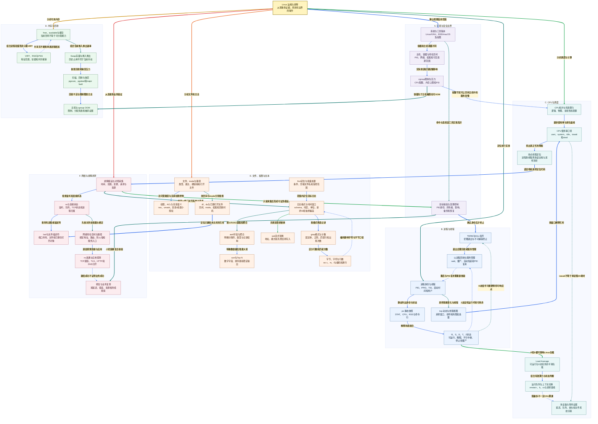

# 小林 Coding Linux 面试知识图谱

来源：[Linux 面试题](https://xiaolincoding.com/interview/linux.html)。整理日期：2026-10-20。按命令、进程、CPU、内存、网络和文本处理原创归纳，并补充判断边界。诊断命令主要采用 Linux、procps、GNU 工具语境；当前工作环境是 macOS，不能把未执行的 Linux 采集当作本机实测结果。

## 阅读入口

[总图](#linux-map) · [整体认知](#linux-overview) · [节点速查](#linux-nodes) · [问答](#linux-questions) · [案例与命令](#linux-example) · [逐边关系](#review-edge-index) · [自测](#linux-recall)

## 读图约定

- 箭头写明操作与证据关系，文字加粗并加浅色底；表格按图中名称对应。
- 实线表示采集、包含或直接分析，虚线表示约束、排除和不能直接推出的结论。
- 命令返回值是观测，不是自动诊断。优先只读、有限次数采集；终止进程、改权限、删文件等动作需确认目标与影响。

<a id="linux-map"></a>

## 总图



<a id="linux-overview"></a>

## 整体认知

排障是一条证据链：确认现象和影响范围，限定主机/容器与时间窗口，找到占资源的实体，再从线程、I/O、连接、日志验证假设，最后小范围修复并业务复测。先有问题再选命令，不能把 `top` 截图当成结论。

命令分三类：只读采集通常风险低但仍需限范围；监听/采样要有限时长和可控开销；终止、权限、替换和清理是变更，不应顺手执行。文中的操作示例不授权对任何真实服务执行破坏性命令。

<a id="linux-nodes"></a>

## 节点速查

| 图中节点 | 含义与边界 |
| --- | --- |
| **Linux 运维与排障** | 观测、推断、变更和验收的闭环。 |
| **系统与工具版本** | GNU/BSD、内核和权限影响字段及选项。 |
| **主机、容器与命名空间** | 不同视图中相同数字 PID 或地址可不是同对象。 |
| **cgroup限制与压力** | 配额节流、内存限额和压力等待，独立于主机总量。 |
| **目标核验与变更控制** | 核身份与影响，不用未确认 PID 或批量模糊匹配。 |
| **进程身份与线程** | 进程资源与线程执行，PID 还需结合启动时间。 |
| **ps 静态快照** | 某时刻观测，CPU 口径可能是生命周期平均。 |
| **top 动态与线程视图** | 窗口采样，归一化模式影响百分比。 |
| **R、S、D、T、Z状态** | R 可运行不必正占 CPU，Z 已退出待父进程回收。 |
| **TERM与KILL信号** | TERM 可处理做清理，KILL 不可捕获但不保证马上脱离所有等待。 |
| **父进程回收与服务管理** | wait 回收僵尸，服务管理器可能自动拉起。 |
| **CPU拓扑与有效算力** | 逻辑线程数、物理核、亲和与 cgroup 份额分开。 |
| **CPU使用率口径** | user/system/idle 等是时间分类，不是每请求成本。 |
| **Load Average** | Linux 可运行与不可中断任务平滑数量，不是 CPU 百分比。 |
| **运行队列与上下文切换** | r、b、cs 需结合窗口、核数与历史基线。 |
| **热点线程定位** | 从 PID 到 TID 到语言栈，再以采样确认热点。 |
| **块设备与等待证据** | I/O 延迟、队列与吞吐共同判断，不能只看利用率。 |
| **free、available与缓存** | available 是估计可用量，低 free 本身非泄漏。 |
| **VIRT、RSS与PSS** | 虚拟空间、驻留和按共享摊销，不能互换。 |
| **Swap存量与换入换出** | 已占用可为历史，持续 si/so、缺页与时延更能反映当前压力。 |
| **扫描、回收与缺页** | 扫描和成功回收分开，major fault 不必来自 Swap。 |
| **主机与cgroup OOM** | 查内核、事件与限额，不从退出码单独猜原因。 |
| **文件、inode与路径** | inode 存元数据，目录建立名字关联，打开引用可独立于名字存活。 |
| **权限、ACL与目录语义** | 目录 x 是遍历，删文件还看父目录权限和 sticky 等约束。 |
| **df、du与已删打开文件** | 文件系统分配与可遍历文件统计有不同范围。 |
| **find定位与批量处理** | 先 print，空格换行文件名用安全分隔，不直接拼 shell。 |
| **grep模式与计数** | -F 固定串、正则匹配、行计数与出现次数不同。 |
| **sed流式替换** | 默认输出，不默认原地覆盖；GNU/BSD 的 -i 语法不同。 |
| **awk字段与聚合** | 按明确记录格式处理，JSON 应选结构化解析器。 |
| **sort与Top N** | 指明字段边界、数字与方向，不按字符串误排数值。 |
| **字节、字符与行数** | -c 字节、-m 字符、-l 换行数，字符不等于屏幕宽度。 |
| **日志格式与时间窗口** | 时间、单位、字段、请求身份和采样决定能否比较。 |
| **ss与连接状态** | 监听/连接与队列快照，字段语义依连接状态。 |
| **lsof与文件描述符** | 网络连接也是描述符，进程信息可受权限限制。 |
| **nc连通与应用探测** | TCP 可达只证明该层，不能推出 TLS 或业务正常。 |
| **网络命名空间与路径** | bind、地址、路由、防火墙、代理和容器入口逐层查。 |
| **排障假设与对照采集** | 同一窗口关联现象，不因同时发生就认定因果。 |
| **修复与业务复测** | 客户侧响应、尾延迟、错误与资源共同验收。 |

<a id="linux-questions"></a>

## 面试问答

### Q01：ps 和 top 有什么不同，哪个 CPU 数字可信？

**回答：** 两者都要看口径：ps 通常是快照且 CPU 可为生命周期比例，top 常看采样间隔变化；线程视图和按核归一化设置也影响百分比。先声明工具实现、字段和窗口，不用一个瞬时值代表整段故障。

### Q02：ps 常看哪些字段，为什么不能只用 PID 认进程？

**回答：** PID、PPID、用户、启动时间、STAT、CPU、RSS、命令行，必要时看 cgroup 与命名空间。PID 可复用，命令名可相似；准备变更前重新核验启动时间和所属服务。命令行可能带秘密，采集与分享须脱敏。

### Q03：R、D、Z 分别意味着什么？

**回答：** R 包括运行和等待 CPU，D 是不可中断等待，常见于部分内核/I/O 路径，不等于每次都硬盘坏；Z 已退出只留回收信息，不再跑代码。还要看停止态 T 与睡眠 S，STAT 的附加字符另有含义。

### Q04：为什么 kill -9 后进程还在，僵尸为何杀不掉？

**回答：** 核验是否同一进程、权限和服务自动重启；D 态可能在可响应点前延迟退出。Z 已经死了，需父进程 wait，不能再杀掉其执行代码。不要为清一个 Z 盲杀所有父进程，先查服务责任与恢复路径。

### Q05：安全终止服务的顺序是什么？

**回答：** 优先服务管理器或应用优雅停机，确认 PID/用户/启动时间与影响，再 TERM，观察有界等待与业务排空；只有确认必要才 KILL。避免未知进程批量 pkill、全局 kill 或负 PID，信号不会替你保证数据一致。

### Q06：如何定位端口占用，查不到进程是否就没监听？

**回答：** Linux 可用 `ss -lntp` 看 TCP 监听，UDP 用对应选项，再用 lsof 确认持有者。进程字段可能需要权限，容器网络命名空间不同也会看不到。netstat、ss、lsof 选项不全跨平台，端口号还要结合协议与地址。

### Q07：nc 连通为什么不能证明接口可用？

**回答：** TCP 建连只证明该时刻到该地址端口的连接层；后面仍有 TLS、SNI、证书、HTTP 路由、鉴权与业务。对照 DNS 解析、代理和直连，使用有超时的只读健康请求，不能把真实写接口当无副作用探针。

### Q08：逻辑 CPU 数等于物理核数或容器可用算力吗？

**回答：** 不等。超线程、虚拟机、CPU 亲和与 cgroup 配额都会改变有效能力。Linux 的 `lscpu` 或 /proc 信息、cpuset 与 quota 需结合；不要在 macOS 用同名假设得出 Linux 容器 CPU 配额。

### Q09：Load Average 超过核数就是 CPU 满了吗？

**回答：** 不一定，Linux 负载还包括 D 态任务，且是时间平滑值；需配合 CPU 忙闲、r/b 队列、I/O 和实际配额。有核数比例参考但无普适“1.5 倍就严重”的阈值，服务 P99 和历史基线决定影响。

### Q10：CPU 100% 的排查链是什么？

**回答：** 确认进程或主机口径，再到热点线程与语言栈，用合适采样剖析区分业务计算、GC、锁自旋和系统调用。JVM 的线程本地 ID 映射等按工具格式核对；一次栈快照不是 CPU 证据，采样开销和权限也需评估。

### Q11：iowait、steal 高分别说明什么？

**回答：** iowait 是特定记账口径下 CPU 空闲且有待完成 I/O 的时间，不等于某进程 I/O 总时长，多核下解释也有限；steal 常表示虚拟化环境未获调度时间。结合设备延迟、队列、宿主和配额，而非见 iowait 就换盘。

### Q12：vmstat r、b、si、so、cs 如何读？

**回答：** r 看可运行排队，b 看不可中断阻塞，si/so 看换入换出速率，cs 看上下文切换。首行可能是启动以来统计而后续是区间统计，单位和工具版本需核对。高 cs 或大 r 需按有效核数、并发与基线判断。

### Q13：free 很少、buff/cache 很多说明泄漏吗？

**回答：** 不说明。Linux 利用内存缓存，available 估计在不触发明显交换时可用量更有参考价值，仍需看限额、压力与缺页。缓存并非所有都能立即无成本回收，不能把 free+cache 全当零成本空闲。

### Q14：VIRT、RSS、PSS 能否直接相加看占用？

**回答：** VIRT 是虚拟地址范围，不代表已占等量物理内存；RSS 包括共享页，多进程相加重复；PSS 按共享者摊销，更适合某些归因，但采集本身有成本。容器账目与进程 RSS 还可能不同，不能混口径。

### Q15：Swap 用了几 GB 就一定在抖动吗？

**回答：** 可能是历史换出冷页，当前没有持续换入换出；看 si/so、major fault、内存 PSI、回收和业务延迟。反过来没有 Swap 也可能因限额或回收卡顿。不要为让数字归零就在线盲执行 swapoff。

### Q16：sar -B 的扫描、回收、缺页如何区分？

**回答：** pgscan 类指标看扫描，pgsteal 看成功回收页，不是简单把扫描项相加；可结合有效回收比例。major fault 需读存储，也可来自文件映射，不只 Swap；字段、单位与内核工具版本相关，page-in 字节与页数量别混算。

### Q17：退出码 137 能证明 OOM 吗？

**回答：** 常表示收到 SIGKILL，原因可为 OOM、人工终止、超时或管理器动作。要查内核日志、cgroup memory.events、容器 OOM 标志与编排事件。主机可用很多时容器仍可能触自己上限，单看 free 排除不了。

### Q18：chmod 的数字权限与目录权限怎么解释？

**回答：** r/w/x 分别是 4/2/1，三组表示属主/组/其他；目录读是列名字，x 是遍历，w 与 x 组合影响增删。删文件主要看父目录及 sticky/ACL 等约束，不仅文件自身 w。先检查属主与需求，不用 777 当通用修复。

### Q19：df 已满但 du 对不上，可能是什么？

**回答：** 文件已删除但进程仍开着、挂载遮蔽、统计权限、稀疏/共享块和文件系统保留空间都可能造成差异；inode 满又是另一种情况。限定同挂载与权限，lsof 查引用，优雅让所属程序关闭，不盲清其他目录或截断未知描述符。

### Q20：grep -c、grep -o 与 wc 分别计什么？

**回答：** grep -c 计匹配行，不计每行出现次数；常见实现的 -o 输出匹配片段，可再计非空匹配数，空模式和重叠规则需声明。固定字符串用 -F，正则元字符别误用。wc -l 计换行、-c 计字节、-m 按 locale 计字符，不等于字形数量。

### Q21：sed、awk 与结构化解析器怎样选择？

**回答：** sed 适合受控逐行替换，先输出预览再考虑原地写，GNU/BSD 的 -i 不同；awk 适合已定义字段、筛选和聚合。JSON 用 jq/标准解析器，CSV 用能处理引号的解析器，不把空格分列用于所有日志。

### Q22：找最慢十条为何要明确数字排序键？

**回答：** 字符串排序会把 90 排在 100 前，需明确字段、单位与数值排序，例如固定第三列毫秒按 `sort -k3,3nr`。混日志版本、非法字段、时区或带单位字符串先规范化，head 只截结果不会保证输入本身正确。

### Q23：生产排障怎样避免诊断本身制造事故？

**回答：** 先只读、限范围、有限次数，用既有指标和请求 ID 形成假设；大目录遍历、全量日志、堆转储和高频 profiler 也有成本。权限不足不自动提权，不打印凭据，变更先确认目标和回滚，修复后从业务侧复测。

### Q24：接口慢但主机资源看着空闲，下一步查什么？

**回答：** 查容器 quota/节流、连接池和线程池等待、锁、下游、DNS/TLS、网关与网络；资源图时间窗口是否匹配。空闲 CPU 不能排除 I/O 与远程等待，主机平均也能隐藏单线程或单分片热点。

<a id="linux-example"></a>

## 贯穿案例与命令

支付接口 P99 上升：先取故障时段、范围与请求 ID，对齐日志和容器指标；再区分 CPU 计算、配额节流、I/O、线程/连接池与网络等待。Linux 上可选有限批次的 ps/top/vmstat/ss 采集，但必须核对工具、视图与权限。此文没有对本机执行服务终止或 Linux 专属诊断。

下面示例只处理内置样本，不读取业务日志、不改文件。记录合同是**四个不含空格的字段：UTC时间、路径、毫秒、状态码**；筛选成功的 `/pay`，拒绝非数字耗时，数值降序取三条。它可在当前 macOS 的 awk/sort 上验证，不等于已验证 Linux 宿主排障结果。

```bash
printf '%s\n' \
  '2026-10-20T10:00:01Z /pay 23 200' \
  '2026-10-20T10:00:02Z /pay 110 200' \
  '2026-10-20T10:00:03Z /query 900 200' \
  '2026-10-20T10:00:04Z /pay 230 200' \
  '2026-10-20T10:00:05Z /pay 999 500' \
  '2026-10-20T10:00:06Z /pay invalid 200' \
  | awk 'NF == 4 && $2 == "/pay" && $4 == 200 && $3 ~ /^[0-9]+([.][0-9]+)?$/ {print $1, $2, $3, $4}' \
  | LC_ALL=C sort -k3,3nr \
  | head -n 3
```

预期依次为 `230`、`110`、`23` 毫秒的三条成功请求。排除错误请求只是本例筛选合同，真正事故分析必须另外看 5xx 与超时，不可因筛选成功日志就声称全站正常。

<a id="linux-recall"></a>

## 闭卷自测

1. Load 很高但 CPU 空闲，哪个进程状态和 I/O 证据要看？见 Q03/Q09/Q11。
2. 命令名相同且 PID 变了，为什么不直接继续 kill？见 Q02/Q05。
3. free 低、Swap 存量高，哪些速率才能说明当前压力？见 Q13/Q15/Q16。
4. grep 匹配一行出现三次，-c 会给多少？UTF-8 字节与字符呢？见 Q20。
5. nc 成功但接口超时，后面还有哪些层？见 Q07/Q24。

关联：[操作系统](../xiaolincoding_os_analysis/OS_KNOWLEDGE_GRAPH.md)、[网络](../xiaolincoding_network_analysis/NETWORK_KNOWLEDGE_GRAPH.md)、[系统设计](../xiaolincoding_systemdesign_analysis/SYSTEM_DESIGN_KNOWLEDGE_GRAPH.md) 知识图谱。文末逐边索引按节点名称逐条对应关系。

<a id="review-edge-index"></a>

## 逐边关系索引

本图包含 **38 个节点、50 条连线、50 组不同关系**。以下按源节点所在主题逐边对应；完全相同关系仅列一次，不同标签或线型分别保留。第一列和第三列均使用图中显示名称。

### 总览入口

| 源节点 | 关系（图上文字） | 目标节点 | 线型 |
| --- | --- | --- | --- |
| **Linux 运维与排障** | 确认观测适用范围 | **系统与工具版本** | 实线 |
| **Linux 运维与排障** | 定位执行实体 | **进程身份与线程** | 实线 |
| **Linux 运维与排障** | 分析调度与计算 | **CPU拓扑与有效算力** | 实线 |
| **Linux 运维与排障** | 分析可用内存 | **free、available与缓存** | 实线 |
| **Linux 运维与排障** | 分析文件和日志 | **文件、inode与路径** | 实线 |
| **Linux 运维与排障** | 从连接到业务验证 | **排障假设与对照采集** | 实线 |

### A. 环境与安全边界

| 源节点 | 关系（图上文字） | 目标节点 | 线型 |
| --- | --- | --- | --- |
| **系统与工具版本** | 容器和主机视图不同 | **主机、容器与命名空间** | 实线 |
| **主机、容器与命名空间** | 实际资源还受配额影响 | **cgroup限制与压力** | 实线 |
| **系统与工具版本** | 命令与选项因工具实现而异 | **目标核验与变更控制** | 实线 |
| **目标核验与变更控制** | 确认身份后才终止 | **TERM与KILL信号** | 实线 |
| **cgroup限制与压力** | 配额节流可让空闲主机中的服务变慢 | **CPU拓扑与有效算力** | 虚线 |
| **cgroup限制与压力** | 容器先于主机触限也可OOM | **主机与cgroup OOM** | 实线 |
| **目标核验与变更控制** | 小范围修复后核验 | **修复与业务复测** | 实线 |

### B. 进程与线程

| 源节点 | 关系（图上文字） | 目标节点 | 线型 |
| --- | --- | --- | --- |
| **进程身份与线程** | 静态列出身份与状态 | **ps 静态快照** | 实线 |
| **进程身份与线程** | 采样观察变化与线程 | **top 动态与线程视图** | 实线 |
| **ps 静态快照** | 解释状态组合 | **R、S、D、T、Z状态** | 实线 |
| **top 动态与线程视图** | 按窗口解释忙闲 | **CPU使用率口径** | 实线 |
| **TERM与KILL信号** | 退出后需回收或服务管理 | **父进程回收与服务管理** | 实线 |
| **R、S、D、T、Z状态** | Z态没有运行代码可再杀 | **父进程回收与服务管理** | 虚线 |
| **R、S、D、T、Z状态** | D态信号可能要等待可响应点 | **TERM与KILL信号** | 虚线 |
| **父进程回收与服务管理** | 重启与PID复用需重新核验 | **进程身份与线程** | 虚线 |
| **R、S、D、T、Z状态** | R和D都可影响Linux负载 | **Load Average** | 实线 |

### C. CPU与调度

| 源节点 | 关系（图上文字） | 目标节点 | 线型 |
| --- | --- | --- | --- |
| **CPU拓扑与有效算力** | 提供使用率与排队基线 | **CPU使用率口径** | 实线 |
| **Load Average** | 结合有效算力与状态判断 | **运行队列与上下文切换** | 实线 |
| **CPU使用率口径** | 找出真正忙的线程 | **热点线程定位** | 实线 |
| **热点线程定位** | 语言栈和采样定位代码 | **排障假设与对照采集** | 实线 |
| **运行队列与上下文切换** | 阻塞多不一定CPU算满 | **块设备与等待证据** | 虚线 |
| **CPU使用率口径** | iowait不等于单进程I/O耗时 | **块设备与等待证据** | 虚线 |

### D. 内存与回收

| 源节点 | 关系（图上文字） | 目标节点 | 线型 |
| --- | --- | --- | --- |
| **free、available与缓存** | 结合进程驻留而非只看VIRT | **VIRT、RSS与PSS** | 实线 |
| **free、available与缓存** | 结合当前换入换出速率 | **Swap存量与换入换出** | 实线 |
| **Swap存量与换入换出** | 核查回收和缺页压力 | **扫描、回收与缺页** | 实线 |
| **扫描、回收与缺页** | 回收不足与限制需查日志 | **主机与cgroup OOM** | 实线 |
| **VIRT、RSS与PSS** | 共享页不能简单逐进程相加 | **free、available与缓存** | 虚线 |

### E. 文件、权限与文本

| 源节点 | 关系（图上文字） | 目标节点 | 线型 |
| --- | --- | --- | --- |
| **文件、inode与路径** | 访问受路径与目录权限控制 | **权限、ACL与目录语义** | 实线 |
| **文件、inode与路径** | 块空间与inode分别检查 | **df、du与已删打开文件** | 实线 |
| **df、du与已删打开文件** | 定位已删但未关闭的引用 | **lsof与文件描述符** | 实线 |
| **find定位与批量处理** | 范围内定位目标日志 | **日志格式与时间窗口** | 实线 |
| **日志格式与时间窗口** | 按模式筛选记录 | **grep模式与计数** | 实线 |
| **日志格式与时间窗口** | 按schema提取和聚合 | **awk字段与聚合** | 实线 |
| **grep模式与计数** | 区分行数和匹配次数 | **字节、字符与行数** | 实线 |
| **日志格式与时间窗口** | 先预览受控替换 | **sed流式替换** | 实线 |
| **awk字段与聚合** | 明确数值键后取最大项 | **sort与Top N** | 实线 |
| **字节、字符与行数** | 编码影响字符与字节口径 | **日志格式与时间窗口** | 虚线 |

### F. 网络与排障闭环

| 源节点 | 关系（图上文字） | 目标节点 | 线型 |
| --- | --- | --- | --- |
| **排障假设与对照采集** | 检查监听和连接状态 | **ss与连接状态** | 实线 |
| **ss与连接状态** | 查持有进程或描述符 | **lsof与文件描述符** | 实线 |
| **ss与连接状态** | 先核对所处视图与绑定 | **网络命名空间与路径** | 实线 |
| **网络命名空间与路径** | 逐层探测连接与应用 | **nc连通与应用探测** | 实线 |
| **nc连通与应用探测** | 建连成功不证明业务成功 | **修复与业务复测** | 虚线 |
| **排障假设与对照采集** | 用同一窗口对齐系统与请求 | **日志格式与时间窗口** | 实线 |
| **排障假设与对照采集** | 只读采集后形成可证伪假设 | **目标核验与变更控制** | 实线 |
