# 小林 Coding 消息队列面试知识图谱

来源：[消息队列面试题](https://xiaolincoding.com/interview/mq.html)。整理日期：2026-10-20。按通用场景、RocketMQ、Kafka、RabbitMQ 四类内容重构关系与原创问答，不复制原文整套答案。产品行为必须同时说明版本、客户端、队列类型、复制与刷盘配置。

## 阅读入口

[总图](#mq-map) · [整体认知](#mq-overview) · [节点速查](#mq-nodes) · [问答](#mq-questions) · [案例与代码](#mq-example) · [逐边关系](#review-edge-index) · [自测](#mq-recall)

## 读图约定

- 所有箭头关系加粗、浅色底；正文与索引按节点名称对应，不需要记内部标识。
- 实线表示数据、调用、组成或直接依赖，虚线表示约束、风险、优化和可选方案。
- Broker 接收确认、消费者确认、数据库提交与最终业务完成不同；Exactly Once 必须声明覆盖的系统和结果范围。

<a id="mq-map"></a>

## 总图

```mermaid
---
config:
  theme: base
  themeVariables:
    edgeLabelBackground: "#fff7d6"
---
flowchart TB
    ROOT["消息队列全景<br/>可靠事件、局部顺序、业务效果与可恢复运行"]
    subgraph MODEL["A. 通用模型与可靠性"]
        VALUE["解耦、异步与削峰<br/>收益对比时效、容量和运维代价"]
        PRODUCER["生产者与事件合同<br/>业务ID、事件ID、版本和发生时间"]
        OUTBOX["本地消息表与投递器<br/>业务与发送意图同事务，确认后标记"]
        BROKER["Broker 存储与复制<br/>日志、保留期、刷盘与副本确认"]
        SENDACK["生产确认与结果未知<br/>失败可重发，超时不等于未存储"]
        CONSUMER["消费者业务事务<br/>实际副作用和幂等记录共同提交"]
        CONSUMEACK["消费确认与进度<br/>业务成功后ACK或提交位置"]
        IDEMPOTENT["稳定业务幂等键<br/>唯一约束、参数摘要与已有结果"]
        SEMANTICS["投递与处理语义<br/>最多、至少与恰好一次的作用范围"]
        ORDER["局部顺序与状态版本<br/>发送、通道、处理和重试都需守序"]
        RETRY["重试与死信<br/>分类、退避、上限、隔离和受控重放"]
        RECONCILE["对账与补偿<br/>异常终态需要可查询和有人负责"]
    end
    subgraph KAFKA["B. Kafka 分区日志"]
        TOPIC["Topic 与 Partition<br/>分区日志、offset和局部顺序"]
        SEGMENT["日志段与存储优化<br/>追加、页缓存、批量、压缩和适用零拷贝"]
        ISR["Leader、Follower 与 ISR<br/>同步集合、最小副本与故障资格"]
        ACKS["acks 与写入条件<br/>all不是所有配置副本都同步刷盘"]
        GROUP["普通消费者组<br/>组内分区归属，组间独立进度"]
        OFFSET["连续完成与offset提交<br/>提交下次恢复位置，不跨过未完成缺口"]
        REBALANCE["Rebalance 与任务交接<br/>成员变化、轮询期限和未完成任务"]
        KAFKATX["Kafka 幂等与事务<br/>生产重试和Kafka内读处理写的边界"]
        KRAFT["KRaft 元数据共识<br/>控制器管理元数据，不转发所有消息正文"]
    end
    subgraph ROCKET["C. RocketMQ 业务消息"]
        COMMITLOG["CommitLog 与消费索引<br/>公共正文、ConsumeQueue和Key查询索引"]
        NAMESERVER["NameServer 与路由<br/>注册、缓存与刷新，不自动等于选主"]
        HALF["事务半消息与回查<br/>本地结果决定消息可见，不包办下游成功"]
        DELAY["延迟与定时消息<br/>到期可见不等于业务精确准点完成"]
        MESSAGEGROUP["队列与消息组顺序<br/>按版本控制发送与消费串行范围"]
        RCONSUME["集群、广播与消费API<br/>分担和每实例处理的语义不同"]
        RHA["Broker副本与切主模式<br/>传统主从、DLedger、Controller边界"]
    end
    subgraph RABBIT["D. RabbitMQ 路由与队列"]
        AMQP["AMQP与RabbitMQ<br/>常见交换机模型以0-9-1语境讨论"]
        CHANNEL["Connection 与 Channel<br/>连接复用、通道级错误与投递标识"]
        EXCHANGE["Exchange、Binding 与路由键<br/>Direct、Fanout、Topic和Headers"]
        QUEUE["队列与持久化属性<br/>拓扑持久、消息持久与确认分别配置"]
        CONFIRM["Confirm 与 Return<br/>发布确认与无法路由是不同信号"]
        PREFETCH["手动ACK与prefetch<br/>限制未确认量，不自动保证处理有序"]
        DLX["TTL与死信交换机<br/>延迟触发、拒绝、过期和转发条件"]
        QUORUM["仲裁队列与Streams<br/>仲裁队列以Raft复制队列状态<br/>Streams提供可保留回溯的日志模型"]
    end
    subgraph OPERATIONS["E. 运维、容量与业务约束"]
        LAG["积压、年龄与保留时间<br/>净消化速率和最老任务时限"]
        SCALE["有效扩容与热点<br/>分区归属、内部并行和下游容量"]
        TRANSFER["积压转发与迁移<br/>新目标确认后旧进度才能推进"]
        CLOSEORDER["延迟关单状态机<br/>触发只提醒检查，支付与取消需条件更新"]
        OBS["端到端证据与告警<br/>发送意图、复制、处理、死信与业务时效"]
    end
    ROOT -- "`**先解释收益与代价**`" --> VALUE
    ROOT -- "`**从发送到处理闭环**`" --> PRODUCER
    ROOT -- "`**分区日志路线**`" --> TOPIC
    ROOT -- "`**业务消息路线**`" --> COMMITLOG
    ROOT -- "`**路由队列路线**`" --> AMQP
    ROOT -- "`**容量与时效治理**`" --> LAG
    VALUE -- "`**定义事件而非直接调用**`" --> PRODUCER
    PRODUCER -- "`**可靠保存发送意图**`" --> OUTBOX
    OUTBOX -- "`**可重试地发布稳定事件**`" --> BROKER
    PRODUCER -- "`**检查发布结果**`" --> SENDACK
    BROKER -- "`**按存储复制条件确认**`" --> SENDACK
    BROKER -- "`**向应用提供事件**`" --> CONSUMER
    CONSUMER -- "`**原子去重和业务变更**`" --> IDEMPOTENT
    CONSUMER -- "`**本地成功后推进进度**`" --> CONSUMEACK
    CONSUMEACK -. "`**丢确认可能导致重投**`" .-> SEMANTICS
    SENDACK -. "`**丢确认可能导致重发**`" .-> SEMANTICS
    IDEMPOTENT -. "`**让重复投递不重复生效**`" .-> SEMANTICS
    ORDER -. "`**业务线程池也必须守序**`" .-> CONSUMER
    ORDER -. "`**失败路径不能随意越过**`" .-> RETRY
    CONSUMER -- "`**失败分类处理**`" --> RETRY
    RETRY -- "`**永久或超限异常需收尾**`" --> RECONCILE
    OUTBOX -. "`**已发标记失败仍可能重复**`" .-> IDEMPOTENT
    TOPIC -- "`**分区保存分段追加日志**`" --> SEGMENT
    TOPIC -- "`**按分区复制并接管**`" --> ISR
    ACKS -. "`**结合最小同步副本**`" .-> ISR
    ISR -- "`**决定写入安全与可用条件**`" --> BROKER
    GROUP -- "`**分配分区处理归属**`" --> TOPIC
    GROUP -- "`**分别维护恢复位置**`" --> OFFSET
    OFFSET -. "`**不能提交越过处理缺口**`" .-> CONSUMEACK
    REBALANCE -- "`**重新分配归属并交接**`" --> GROUP
    REBALANCE -. "`**未提交工作可能重复处理**`" .-> IDEMPOTENT
    KAFKATX -. "`**不能自动包括外部数据库**`" .-> CONSUMER
    KAFKATX -- "`**可原子提交Kafka结果与进度**`" --> OFFSET
    KRAFT -. "`**管理分区元数据与Leader信息**`" .-> ISR
    COMMITLOG -- "`**提供消息正文与消费目录**`" --> BROKER
    NAMESERVER -- "`**客户端选择Broker路径**`" --> COMMITLOG
    RHA -. "`**切主和确认取决于部署模式**`" .-> BROKER
    HALF -- "`**用生产端持久业务结果确认可见性**`" --> PRODUCER
    HALF -. "`**下游仍需独立事务幂等**`" .-> CONSUMER
    DELAY -- "`**到期触发而非直接定结果**`" --> CLOSEORDER
    MESSAGEGROUP -- "`**规定局部串行边界**`" --> ORDER
    RCONSUME -- "`**按客户端模式分担或广播**`" --> CONSUMER
    AMQP -- "`**用连接和通道交互**`" --> CHANNEL
    CHANNEL -- "`**在对应通道发布消息**`" --> EXCHANGE
    EXCHANGE -- "`**按绑定投递到零或多个队列**`" --> QUEUE
    CONFIRM -- "`**分别处理确认和路由失败**`" --> SENDACK
    QUEUE -- "`**按队列类型提供消息**`" --> CONSUMER
    PREFETCH -. "`**限制消费者未确认额度**`" .-> CONSUMER
    PREFETCH -- "`**业务后按投递标识确认**`" --> CONSUMEACK
    QUEUE -- "`**配置异常消息出口**`" --> DLX
    DLX -- "`**可构建待到期提醒**`" --> CLOSEORDER
    DLX -. "`**转发也有可靠性条件**`" .-> RETRY
    QUORUM -- "`**仲裁队列按Raft多数确认状态**`" --> BROKER
    QUORUM -. "`**普通集群不自动复制经典队列正文**`" .-> QUEUE
    LAG -- "`**先定位再增加有效能力**`" --> SCALE
    SCALE -. "`**新增分区不自动搬旧日志**`" .-> TOPIC
    LAG -- "`**必要时受控分流旧积压**`" --> TRANSFER
    TRANSFER -. "`**目标发布确认后再确认来源**`" .-> SENDACK
    TRANSFER -. "`**保留原业务身份与顺序**`" .-> IDEMPOTENT
    CLOSEORDER -. "`**支付或取消只按合法状态推进**`" .-> IDEMPOTENT
    OBS -- "`**跟踪等待年龄与净增长**`" --> LAG
    OBS -- "`**发现未发或未确认断点**`" --> OUTBOX
    OBS -- "`**监控重试死信与对账**`" --> RECONCILE
    classDef root fill:#fff4bf,stroke:#8b7500,color:#302900,stroke-width:2px;
    classDef model fill:#eaf3ff,stroke:#34699a,color:#13293d;
    classDef kafka fill:#e9f7f7,stroke:#347d7d,color:#153838;
    classDef rocket fill:#eaf8ee,stroke:#3f7d4e,color:#173c22;
    classDef rabbit fill:#fff1e6,stroke:#a65f26,color:#4a2811;
    classDef ops fill:#fcecef,stroke:#a64c62,color:#4a1e2a;
    class ROOT root;
    class VALUE,PRODUCER,OUTBOX,BROKER,SENDACK,CONSUMER,CONSUMEACK,IDEMPOTENT,SEMANTICS,ORDER,RETRY,RECONCILE model;
    class TOPIC,SEGMENT,ISR,ACKS,GROUP,OFFSET,REBALANCE,KAFKATX,KRAFT kafka;
    class COMMITLOG,NAMESERVER,HALF,DELAY,MESSAGEGROUP,RCONSUME,RHA rocket;
    class AMQP,CHANNEL,EXCHANGE,QUEUE,CONFIRM,PREFETCH,DLX,QUORUM rabbit;
    class LAG,SCALE,TRANSFER,CLOSEORDER,OBS ops;
    linkStyle 0,25,28,31,34,36,37,39,40,41,45,46,47,50,52,55,57,59 stroke:#2563eb,stroke-width:3px;
    linkStyle 1,30,38,48,51,58,61 stroke:#0f766e,stroke-width:3px;
    linkStyle 2,62 stroke:#16a34a,stroke-width:3px;
    linkStyle 3 stroke:#ca8a04,stroke-width:3px;
    linkStyle 4 stroke:#ea580c,stroke-width:3px;
    linkStyle 5 stroke:#dc2626,stroke-width:3px;
    linkStyle 6,7,8,10,12,14,15,16,17,20,22,24,26,29,33,35,42,43,44,54,60 stroke:#2563eb,stroke-width:2px;
    linkStyle 9,11,13,18,21,23,27,32,49,53,56 stroke:#0f766e,stroke-width:2px;
    linkStyle 19 stroke:#16a34a,stroke-width:2px;
```



<a id="mq-overview"></a>

## 整体认知

MQ 把直接调用变成可保存、可重试的事件协作，降低主流程等待，但增加时效、一致性、容量和运维合同。最重要的不是“用了哪个产品”，而是生产者意图可恢复、Broker 确认条件明确、消费者业务提交后再确认，以及所有重试都保留稳定业务身份。

**三种确认：** 发布确认不证明消费者成功，消费确认不证明其他服务成功，本地事务不自动包括 ACK。可靠投递通常接受重复，再用本地原子幂等让同一业务效果不重复。

<a id="mq-nodes"></a>

## 节点速查

| 图中节点 | 定义与关键边界 |
| --- | --- |
| **消息队列全景** | 事件、存储、消费与治理的总入口。 |
| **解耦、异步与削峰** | 减直接依赖与等待，缓冲短峰，不增加长期下游容量。 |
| **生产者与事件合同** | 稳定业务身份、事件身份、类型与 Schema 兼容。 |
| **本地消息表与投递器** | 同事务保存业务与发送意图，异步发布可重复但不应漏意图。 |
| **Broker 存储与复制** | 定义确认可抵御哪些故障，保留期与清理也重要。 |
| **生产确认与结果未知** | 确认丢失时可能已写入，重试不换业务键。 |
| **消费者业务事务** | 幂等流水与数据库变更共同成功或回滚。 |
| **消费确认与进度** | 确认此次投递或恢复位置，不是一致性万能开关。 |
| **稳定业务幂等键** | 识别同一效果，唯一约束与事务保护并发。 |
| **投递与处理语义** | 区分消息到达次数、处理调用次数和结果生效次数。 |
| **局部顺序与状态版本** | 同业务键序号、通道与串行处理，不强求无关业务全局顺序。 |
| **重试与死信** | 永久错误隔离，临时错误有界重试，重放仍需验收。 |
| **对账与补偿** | 将长期不收敛的业务引向明确终态。 |
| **Topic 与 Partition** | 独立分区日志，分区内 offset 才有确定顺序。 |
| **日志段与存储优化** | 追加、批量、压缩、页缓存与条件性零拷贝协同。 |
| **Leader、Follower 与 ISR** | 同步副本资格与故障接管条件，不把配置副本全当同步。 |
| **acks 与写入条件** | 需结合 ISR/min.insync.replicas，不等于所有盘已 fsync。 |
| **普通消费者组** | 同组分担分区，组间独立进度，普通模型下分区单归属。 |
| **连续完成与offset提交** | 提交下一待处理位置，不能仅取最大完成 offset。 |
| **Rebalance 与任务交接** | 归属变化会带停顿、未完成协调与重复风险，协议版本影响范围。 |
| **Kafka 幂等与事务** | 保证特定生产和 Kafka 内结果范围，不包 MySQL/短信/支付。 |
| **KRaft 元数据共识** | 元数据控制面，不是所有消息正文都经控制器 Raft。 |
| **CommitLog 与消费索引** | 典型 RocketMQ 公共正文加 ConsumeQueue 目录、Key 辅助查询。 |
| **NameServer 与路由** | 服务路由发现，与 DLedger/Controller 选主职责分开。 |
| **事务半消息与回查** | 使本地结果与可投递状态协调，回查需持久化事实。 |
| **延迟与定时消息** | 到期进入可投递流程，受版本、配置、积压影响。 |
| **队列与消息组顺序** | 传统顺序监听和新 API 模式不要混用结论。 |
| **集群、广播与消费API** | 组内分担或每实例接收，失败恢复和进度语义有差别。 |
| **Broker副本与切主模式** | 主从、DLedger、Controller 的恢复与确认条件不同。 |
| **AMQP与RabbitMQ** | 协议与实现，AMQP 1.0 不照搬全部 0-9-1 结构。 |
| **Connection 与 Channel** | 长连接中复用逻辑通道，通道错误与确认范围要明确。 |
| **Exchange、Binding 与路由键** | 决定路由，Exchange 不等于存储队列。 |
| **队列与持久化属性** | durable 拓扑与 persistent 消息不是同一设置。 |
| **Confirm 与 Return** | 发布接受与无法路由可先后出现，不能互相替代。 |
| **手动ACK与prefetch** | 控制未确认额度，过大可囤积、失衡和放大恢复量。 |
| **TTL与死信交换机** | 配置后的转发路径，过期与投递时间不必精确重合。 |
| **仲裁队列与Streams** | 两类复制数据结构：仲裁队列按 Raft 协调队列状态，Streams 侧重保留与回放；不要互套消费与保留语义。 |
| **积压、年龄与保留时间** | 看净增长和最老任务，不只看消息条数。 |
| **有效扩容与热点** | 分区、队列、消息组与下游容量限制扩容效果。 |
| **积压转发与迁移** | 两个系统的确认窗口需可恢复，转发可重复不能丢。 |
| **延迟关单状态机** | 事件只触发核查，数据库状态与支付事实才定结果。 |
| **端到端证据与告警** | 串联发送、复制、投递、处理与业务完成的时间和身份。 |

<a id="mq-questions"></a>

## 面试问答

### Q01：为什么引入 MQ，而不是全部继续同步 RPC？

**回答：** 允许异步的副作用可解耦、减主链等待，队列缓冲短期峰值；代价是事件合同、重复、积压、时效和恢复。关键订单成立条件不能尚未确认就报告成功。发布订阅减直接调用依赖，不消除语义耦合，也不天然规定一定 push 或异步可靠。

### Q02：如何按生产者、Broker、消费者解释可靠性？

**回答：** 生产者保存发送意图并检查确认，Broker 按正确持久化、副本和保留配置接收，消费者业务提交后再 ACK/提交进度。每段都有未知结果和崩溃窗口，还需要幂等、重试、死信、对账；“三节点集群”不是故障模型说明。

### Q03：Outbox 为什么不会自动提供只发送一次？

**回答：** 本地事务保证业务和待发记录一起落库；发送成功但标记前崩溃会重发。稳定事件 ID、可恢复领取与重试用于补发，消费者仍需幂等。已发送不证明下游业务成功，同键顺序、积压年龄和归档也需管理。

### Q04：消费者如何防止“先查再加积分”竞态？

**回答：** 用业务操作号加消费方的唯一约束，把插入流水与积分变更放同一事务。两个消费者不能只靠先 SELECT 判不存在。重复键需核对已提交成功记录及参数，其他数据库故障不能全当重复忽略；外部副作用要继续传幂等键。

### Q05：锁、乐观版本与幂等分别防什么？

**回答：** 锁协调同一时刻的执行，版本约束基于什么状态修改，幂等识别同一业务效果不重复。锁释放后的重复消息仍能再进；版本重试也可能重复累加，须有稳定操作流水。Redis 去重与数据库业务不在同一事务时仍有窗口。

### Q06：At Most Once、At Least Once、Exactly Once 怎样讲准确？

**回答：** 前者允许漏处理而不重投，至少一次通过重试降低遗漏但可重复，恰好一次要说明结果范围和实现边界。代码可能重复运行而事务结果只生效一次；MQ 内事务不能自动包含任意外部数据库、支付和发信。

### Q07：局部有序需要哪几个环节？

**回答：** 先定义谁与谁有序，再保证生产业务顺序、相同通道、消费执行与失败重试不越过。拉取顺序正确不保证线程池完成顺序正确。版本/状态机可拒绝旧事件，但依赖缺失和补偿仍需设计；时间戳不天然全局有序。

### Q08：积压怎样估计恢复时间？

**回答：** 用积压除以恢复后消费速率减新增速率，前提是净速率为正且负载近似稳定。比如百万条、消费 5000/s、新增 3000/s，约 500 秒，不是 200 秒。还看最老年龄、保留期、热点和下游容量，不能只加消费者数量。

### Q09：新增分区为何不自动清掉旧积压？

**回答：** 历史数据仍在原分区/队列，新资源主要承接后续消息。转发可增加并行但增加读写与重复风险，目标确认成功后才能推进来源，保持业务身份并评估顺序。数据库已饱和时扩消费者只会加重等待。

### Q10：Kafka 为什么吞吐高，是否一直零拷贝？

**回答：** 分区追加、页缓存、批量、压缩和分区并行分摊成本，某些路径可减少用户态拷贝。页缓存不是断电持久介质，TLS、格式和网络路径影响零拷贝，凑批也影响延迟。比较性能要固定消息大小、副本与可靠性条件。

### Q11：Kafka 组内分区归属与业务线程数是什么关系？

**回答：** 普通消费者组同一时刻一分区分给一个消费者实例，一个实例可负责多个分区；不同组独立消费。业务线程池可有更多线程，但需处理线程安全、键顺序与连续进度。不能把消费者实例限制直接当线程数硬上限。

### Q12：offset 应提交几，为什么不能取最大完成值？

**回答：** 表示下次恢复位置，0 到 9 连续完成应提交 10；若 5 未完成而 6 到 9 成功，不能直接提交 10 越过缺口。自动提交不知道异步业务是否落库，手动提交也需要幂等和交接策略。提交不立即删日志。

### Q13：acks=all 与 ISR、最小同步副本怎样配合？

**回答：** all 等待满足 ISR 确认条件，不是所有配置副本全确认或全盘同步。ISR 仅剩 Leader 且最小值允许 1 时仍有明显风险；可靠配置通常提高最小 ISR 并限制不安全选举，副本不足拒写。多盘同时损坏和误删仍需灾备。

### Q14：Kafka Rebalance 为何带来重复与停顿？

**回答：** 分区归属变化要协调旧消费者未完成任务和已提交位置，新实例可能重做未确认工作。eager、cooperative 及新协议范围不同，不一律全组暂停。处理太久超过轮询要求也会触发问题，提高超时不能掩盖卡住的业务。

### Q15：Kafka 幂等生产者和事务能保护 MySQL 吗？

**回答：** 幂等生产者主要去同生产序列中的发送重试；主动产生两次业务事件未必识别。Kafka 事务可协调 Kafka 输出和消费进度，配 read_committed 控制可见，但不能把普通 MySQL 更新或第三方扣款自动纳入。外部仍需本地事务幂等、Outbox 或协议配合。

### Q16：KRaft 与分区副本复制是不是同一条链路？

**回答：** 不是。控制器通过共识维护集群元数据，分区 Leader/Follower 保存和复制业务日志；不能说所有消息都通过控制器转发或每份分区数据直接跑同样 Raft。Kafka 版本不同协调机制不同，4.x 语境要区别早期 ZooKeeper。

### Q17：RocketMQ CommitLog、ConsumeQueue、IndexFile 分工？

**回答：** 典型本地模型中正文集中追加 CommitLog，每队列逻辑消费目录指向正文位置，IndexFile 辅助按 Key 找消息。队列不一定各存完整正文，Key 索引也不代替业务唯一约束。Topic 多仍有索引、元数据与后台代价。

### Q18：NameServer 挂了是否立刻停止收发、负责自动选主吗？

**回答：** 已有客户端的有效缓存路由可暂时使用，新注册、首次发现和故障刷新受影响。普通 NameServer 负责路由，自动切主看传统主从、DLedger、Controller 等实际模式；Controller 可共址也不等于路由职责就是共识控制职责。

### Q19：事务半消息解决了哪一段一致性？

**回答：** 协调生产者本地事务结果与消息可投递性；回查必须从持久业务流水取得结论，Unknown 不伪装成功。下游仍可能失败和重投，要幂等、重试、补偿与对账。它不让多服务数据库同时自动提交回滚。

### Q20：RocketMQ 顺序、重试和消费扩容能用一个版本结论概括吗？

**回答：** 不能。传统队列分配、顺序监听器与新消息组/消息粒度模式有差异。先声明版本与客户端，再说明有序单位和失败是否阻塞，集群/广播的进度与重试也不同。扩容要看实际分配模型和下游，不只队列数。

### Q21：延迟消息到了，如何避免把已支付订单关闭？

**回答：** 消息只提醒检查，查询权威状态并以待支付、已到截止时间等条件更新，检查影响行数。支付未知时查支付状态，不立即释放库存；关闭成功后可靠记录释放事件并幂等执行。消息晚到、漏发用兜底扫描与对账。

### Q22：RabbitMQ Exchange、Queue 和 Channel 分工？

**回答：** 0-9-1 常见模型下，生产者在 Channel 发布到 Exchange，按 Binding/路由键投零或多个 Queue，再给消费者。默认交换机也不是绕过路由。Connection 是通信连接，Channel 复用逻辑会话；AMQP 1.0 不照搬所有相同结构。

### Q23：Confirm、Return、消费者 ACK 为什么不能互换？

**回答：** Confirm 表示 Broker 按发布条件处理，Return 表示 mandatory 等条件下无法路由，消费者 ACK 表示投递已处理。可能先 Return 后 Confirm ACK，不能只看确认就宣称进入业务队列；交换机不存在还可能是通道错误。三条链都要处理。

### Q24：持久队列、持久消息、仲裁队列与集群怎样区分？

**回答：** durable 保拓扑，消息属性和发布确认涉及正文可靠性；仲裁队列用 Raft 多数确认，普通集群不自动复制经典队列正文。经典镜像队列在 RabbitMQ 4.0 起移除；Streams 是另一类可保留和回放的复制日志，不能照搬队列 ACK 与删除语义。参见 [RabbitMQ 仲裁队列说明](https://www.rabbitmq.com/docs/quorum-queues)。

### Q25：TTL+DLX 的延迟为什么不总准确，prefetch 为何不是越大越好？

**回答：** 同队列不同 TTL 可能受队头影响，过期与实际转发、消费时间不同；DLX 本身需配置且有转发可靠性条件。prefetch 限未确认额度，过大会囤积和放大宕机重投量，过小可能闲等；两者不能提高饱和数据库的容量。

### Q26：怎样形成消息系统的完整验收？

**回答：** 验发送意图可恢复、确认语义、持久副本、成功后确认、稳定幂等、顺序与异常收尾；看发送失败、复制、最老年龄、消费耗时、死信与业务对账。零 Lag 不独立证明所有业务成功，死信隔离也不是问题已解决。

<a id="mq-example"></a>

## 贯穿案例与代码

支付成功后给用户发积分：支付事务同时记 Outbox，投递器带原操作号发送；Broker 依配置确认；积分消费者把唯一业务流水与积分更新同事务提交，随后确认。确认丢失会再次收到，但已有流水让副作用不再生效。永久失败进入异常状态和对账，不返回虚假的“积分已到账”。

下例使用 SQLite 内存库验证**业务效果幂等与失败回滚**，不启动 MQ，也不声称测试 Kafka/RocketMQ/RabbitMQ 的存储保证。模拟业务成功后 ACK 丢失用重复调用表示。

```python
import sqlite3

database = sqlite3.connect(":memory:")
database.executescript("""
CREATE TABLE account (id INTEGER PRIMARY KEY, points INTEGER NOT NULL);
CREATE TABLE processed (operation_id TEXT PRIMARY KEY, amount INTEGER NOT NULL);
INSERT INTO account VALUES (1, 0);
""")

def consume(operation_id, amount, fail=False):
    try:
        with database:
            database.execute("INSERT INTO processed VALUES (?, ?)", (operation_id, amount))
            database.execute("UPDATE account SET points = points + ? WHERE id = 1", (amount,))
            if fail:
                raise RuntimeError("simulated failure before commit")
    except sqlite3.IntegrityError:
        previous = database.execute(
            "SELECT amount FROM processed WHERE operation_id = ?", (operation_id,)
        ).fetchone()
        if previous != (amount,):
            raise ValueError("same operation with different parameters")
        return False
    return True

assert consume("payment-1001:points", 100)
assert not consume("payment-1001:points", 100)
try:
    consume("payment-1002:points", 50, fail=True)
except RuntimeError:
    pass
else:
    raise AssertionError("failure expected")
assert consume("payment-1002:points", 50)
points = database.execute("SELECT points FROM account WHERE id = 1").fetchone()[0]
count = database.execute("SELECT COUNT(*) FROM processed").fetchone()[0]
assert (points, count) == (150, 2)
print(points, count)
database.close()
```

输出 `150 2`。消息可多次到达而同一积分操作只生效一次；实际消费者还需业务参数校验、数据库异常分类、并发测试、ACK 和重试协议。

<a id="mq-recall"></a>

## 闭卷自测

1. Outbox 标记已发前宕机，哪层负责防重复效果？见 Q03/Q04。
2. offset 5 失败、9 完成，为什么不能提交 10？见 Q12。
3. acks=all 只剩一个同步副本，是否满足目标故障容忍？见 Q13。
4. NameServer、Kafka 控制器、Rabbit 仲裁副本能否统称“三节点高可用”？见 Q16/Q18/Q24。
5. 延迟关单执行晚到一分钟，什么证据决定能不能关闭？见 Q21。

关联：[MySQL 图谱](../xiaolincoding_mysql_analysis/MYSQL_KNOWLEDGE_GRAPH.md)、[Redis 图谱](../xiaolincoding_redis_analysis/REDIS_KNOWLEDGE_GRAPH.md)。下方索引按节点名称逐条对应图中关系。

<a id="review-edge-index"></a>

## 逐边关系索引

本图包含 **42 个节点、63 条连线、63 组不同关系**。以下按源节点所在主题逐边对应；完全相同关系仅列一次，不同标签或线型分别保留。第一列和第三列均使用图中显示名称。

### 总览入口

| 源节点 | 关系（图上文字） | 目标节点 | 线型 |
| --- | --- | --- | --- |
| **消息队列全景** | 先解释收益与代价 | **解耦、异步与削峰** | 实线 |
| **消息队列全景** | 从发送到处理闭环 | **生产者与事件合同** | 实线 |
| **消息队列全景** | 分区日志路线 | **Topic 与 Partition** | 实线 |
| **消息队列全景** | 业务消息路线 | **CommitLog 与消费索引** | 实线 |
| **消息队列全景** | 路由队列路线 | **AMQP与RabbitMQ** | 实线 |
| **消息队列全景** | 容量与时效治理 | **积压、年龄与保留时间** | 实线 |

### A. 通用模型与可靠性

| 源节点 | 关系（图上文字） | 目标节点 | 线型 |
| --- | --- | --- | --- |
| **解耦、异步与削峰** | 定义事件而非直接调用 | **生产者与事件合同** | 实线 |
| **生产者与事件合同** | 可靠保存发送意图 | **本地消息表与投递器** | 实线 |
| **本地消息表与投递器** | 可重试地发布稳定事件 | **Broker 存储与复制** | 实线 |
| **生产者与事件合同** | 检查发布结果 | **生产确认与结果未知** | 实线 |
| **Broker 存储与复制** | 按存储复制条件确认 | **生产确认与结果未知** | 实线 |
| **Broker 存储与复制** | 向应用提供事件 | **消费者业务事务** | 实线 |
| **消费者业务事务** | 原子去重和业务变更 | **稳定业务幂等键** | 实线 |
| **消费者业务事务** | 本地成功后推进进度 | **消费确认与进度** | 实线 |
| **消费确认与进度** | 丢确认可能导致重投 | **投递与处理语义** | 虚线 |
| **生产确认与结果未知** | 丢确认可能导致重发 | **投递与处理语义** | 虚线 |
| **稳定业务幂等键** | 让重复投递不重复生效 | **投递与处理语义** | 虚线 |
| **局部顺序与状态版本** | 业务线程池也必须守序 | **消费者业务事务** | 虚线 |
| **局部顺序与状态版本** | 失败路径不能随意越过 | **重试与死信** | 虚线 |
| **消费者业务事务** | 失败分类处理 | **重试与死信** | 实线 |
| **重试与死信** | 永久或超限异常需收尾 | **对账与补偿** | 实线 |
| **本地消息表与投递器** | 已发标记失败仍可能重复 | **稳定业务幂等键** | 虚线 |

### B. Kafka 分区日志

| 源节点 | 关系（图上文字） | 目标节点 | 线型 |
| --- | --- | --- | --- |
| **Topic 与 Partition** | 分区保存分段追加日志 | **日志段与存储优化** | 实线 |
| **Topic 与 Partition** | 按分区复制并接管 | **Leader、Follower 与 ISR** | 实线 |
| **acks 与写入条件** | 结合最小同步副本 | **Leader、Follower 与 ISR** | 虚线 |
| **Leader、Follower 与 ISR** | 决定写入安全与可用条件 | **Broker 存储与复制** | 实线 |
| **普通消费者组** | 分配分区处理归属 | **Topic 与 Partition** | 实线 |
| **普通消费者组** | 分别维护恢复位置 | **连续完成与offset提交** | 实线 |
| **连续完成与offset提交** | 不能提交越过处理缺口 | **消费确认与进度** | 虚线 |
| **Rebalance 与任务交接** | 重新分配归属并交接 | **普通消费者组** | 实线 |
| **Rebalance 与任务交接** | 未提交工作可能重复处理 | **稳定业务幂等键** | 虚线 |
| **Kafka 幂等与事务** | 不能自动包括外部数据库 | **消费者业务事务** | 虚线 |
| **Kafka 幂等与事务** | 可原子提交Kafka结果与进度 | **连续完成与offset提交** | 实线 |
| **KRaft 元数据共识** | 管理分区元数据与Leader信息 | **Leader、Follower 与 ISR** | 虚线 |

### C. RocketMQ 业务消息

| 源节点 | 关系（图上文字） | 目标节点 | 线型 |
| --- | --- | --- | --- |
| **CommitLog 与消费索引** | 提供消息正文与消费目录 | **Broker 存储与复制** | 实线 |
| **NameServer 与路由** | 客户端选择Broker路径 | **CommitLog 与消费索引** | 实线 |
| **Broker副本与切主模式** | 切主和确认取决于部署模式 | **Broker 存储与复制** | 虚线 |
| **事务半消息与回查** | 用生产端持久业务结果确认可见性 | **生产者与事件合同** | 实线 |
| **事务半消息与回查** | 下游仍需独立事务幂等 | **消费者业务事务** | 虚线 |
| **延迟与定时消息** | 到期触发而非直接定结果 | **延迟关单状态机** | 实线 |
| **队列与消息组顺序** | 规定局部串行边界 | **局部顺序与状态版本** | 实线 |
| **集群、广播与消费API** | 按客户端模式分担或广播 | **消费者业务事务** | 实线 |

### D. RabbitMQ 路由与队列

| 源节点 | 关系（图上文字） | 目标节点 | 线型 |
| --- | --- | --- | --- |
| **AMQP与RabbitMQ** | 用连接和通道交互 | **Connection 与 Channel** | 实线 |
| **Connection 与 Channel** | 在对应通道发布消息 | **Exchange、Binding 与路由键** | 实线 |
| **Exchange、Binding 与路由键** | 按绑定投递到零或多个队列 | **队列与持久化属性** | 实线 |
| **Confirm 与 Return** | 分别处理确认和路由失败 | **生产确认与结果未知** | 实线 |
| **队列与持久化属性** | 按队列类型提供消息 | **消费者业务事务** | 实线 |
| **手动ACK与prefetch** | 限制消费者未确认额度 | **消费者业务事务** | 虚线 |
| **手动ACK与prefetch** | 业务后按投递标识确认 | **消费确认与进度** | 实线 |
| **队列与持久化属性** | 配置异常消息出口 | **TTL与死信交换机** | 实线 |
| **TTL与死信交换机** | 可构建待到期提醒 | **延迟关单状态机** | 实线 |
| **TTL与死信交换机** | 转发也有可靠性条件 | **重试与死信** | 虚线 |
| **仲裁队列与Streams** | 仲裁队列按Raft多数确认状态 | **Broker 存储与复制** | 实线 |
| **仲裁队列与Streams** | 普通集群不自动复制经典队列正文 | **队列与持久化属性** | 虚线 |

### E. 运维、容量与业务约束

| 源节点 | 关系（图上文字） | 目标节点 | 线型 |
| --- | --- | --- | --- |
| **积压、年龄与保留时间** | 先定位再增加有效能力 | **有效扩容与热点** | 实线 |
| **有效扩容与热点** | 新增分区不自动搬旧日志 | **Topic 与 Partition** | 虚线 |
| **积压、年龄与保留时间** | 必要时受控分流旧积压 | **积压转发与迁移** | 实线 |
| **积压转发与迁移** | 目标发布确认后再确认来源 | **生产确认与结果未知** | 虚线 |
| **积压转发与迁移** | 保留原业务身份与顺序 | **稳定业务幂等键** | 虚线 |
| **延迟关单状态机** | 支付或取消只按合法状态推进 | **稳定业务幂等键** | 虚线 |
| **端到端证据与告警** | 跟踪等待年龄与净增长 | **积压、年龄与保留时间** | 实线 |
| **端到端证据与告警** | 发现未发或未确认断点 | **本地消息表与投递器** | 实线 |
| **端到端证据与告警** | 监控重试死信与对账 | **对账与补偿** | 实线 |
