# 小林 Coding MySQL 面试知识图谱

来源：[MySQL 面试题](https://xiaolincoding.com/interview/mysql.html)。整理日期：2026-10-20。按 SQL 基础、存储引擎、索引、事务、锁、日志、调优、架构八类内容重组为原创复习资料。除非另有说明，机制讨论以 MySQL 8.0、InnoDB 为语境；具体优化计划、锁范围和持久性取决于版本、数据与配置。

## 阅读入口

[总图](#mysql-map) · [整体认知](#mysql-overview) · [节点速查](#mysql-nodes) · [面试问答](#mysql-questions) · [案例与代码](#mysql-example) · [逐边关系](#review-edge-index) · [自测](#mysql-recall)

## 读图约定

- 关系标签加粗并带浅色背景；同一源的出边依序换色，跨区加粗。节点和关系说明直接使用图中名称。
- 实线表示组成、数据、执行或依赖；虚线表示约束、优化、反馈或对比。逻辑 SQL 顺序不是物理计划的固定执行顺序。
- 原子提交、快照可见性、副本可见性和业务幂等是不同保证；“有事务”“走索引”“有主从”都不是独立的业务正确性证明。
- redo 与 binlog 的内部两阶段提交以启用 binlog、InnoDB 参与事务为讨论前提；关闭 binlog 时不能照搬这条双日志协调路径。

<a id="mysql-map"></a>

## 总图

```mermaid
---
config:
  theme: base
  themeVariables:
    edgeLabelBackground: "#fff7d6"
---
flowchart TB
    ROOT["MySQL 全景<br/>查询成本、并发正确性、持久恢复与扩展"]
    subgraph SQL["A. SQL 基础与数据合同"]
        MODEL["关系模型与范式<br/>键、函数依赖与适度反规范化"]
        TYPES["字段类型与精度<br/>字符、字节、DECIMAL、整数与二进制"]
        NULLS["NULL 与三值逻辑<br/>IS NULL、NOT IN 与计数语义"]
        CONSTRAINT["数据库约束<br/>主键、唯一、非空与外键"]
        JOIN["关联与子查询<br/>INNER、OUTER、EXISTS 与半连接"]
        LOGICAL["SQL 逻辑处理<br/>过滤、分组、投影、排序与窗口"]
        DELETE["DELETE、TRUNCATE 与 DROP<br/>事务DML和隐式提交DDL的区别"]
        REQUEST["业务请求合同<br/>库存条件、稳定请求号与结果确认"]
    end
    subgraph ENGINE["B. Server 与 InnoDB"]
        CONNECTION["连接与认证<br/>会话、权限、连接池与事务配置"]
        PARSER["解析与预处理<br/>语法树、名字解析与语义检查"]
        OPTIMIZER["优化器与执行计划<br/>统计信息、访问路径与成本估计"]
        EXECUTOR["执行器与引擎接口<br/>按计划读取和修改记录"]
        ENGINES["存储引擎选择<br/>事务、并发、索引与恢复能力"]
        BUFFER["Buffer Pool<br/>缓存数据页与索引页，不是查询结果缓存"]
        PAGE["页与表空间<br/>记录、页目录、逻辑顺序与文件布局"]
    end
    subgraph INDEX["C. 索引与访问路径"]
        BPLUS["B+ 树<br/>高扇出页导航与叶子范围遍历"]
        PRIMARY["聚簇索引与主键<br/>叶子保存行，主键宽度影响辅助索引"]
        SECONDARY["二级索引<br/>索引列与聚簇主键定位信息"]
        LOOKUP["回表与覆盖索引<br/>能否从索引取得查询所需列"]
        COMPOSITE["联合索引与最左前缀<br/>字典序、等值、范围和后续过滤"]
        ICP["索引条件下推<br/>先用索引字段过滤，再减少回表"]
        PREFIX["前缀索引与选择性<br/>空间、区分度与完整字段限制"]
        WRITEINDEX["索引维护成本<br/>更新、页分裂、空间和写放大"]
        PLANCHECK["EXPLAIN 与实际执行<br/>估计与实测、扫描、回表、排序和锁等待"]
        PAGINATION["排序与深分页<br/>联合顺序、稳定游标与偏移扫描成本"]
    end
    subgraph TRANSACTIONS["D. 事务、可见性与冲突"]
        ACID["本地事务与 ACID<br/>原子、约束、隔离与持久性"]
        ISOLATION["隔离级别<br/>RU、RC、RR、Serializable 与实际配置"]
        ANOMALY["并发异常<br/>脏读、不可重复读、幻读与丢失更新"]
        MVCC["MVCC 与版本链<br/>隐藏事务信息、undo 与快照可见性"]
        READVIEW["Read View<br/>活跃事务集合、边界与创建时机"]
        READMODES["快照读与当前读<br/>普通一致性读和锁定读或更新"]
        LONGTX["长事务代价<br/>锁、旧快照、purge、复制与DDL等待"]
        ROWLOCK["记录锁与索引记录<br/>S/X冲突，锁跟访问路径有关"]
        GAP["间隙锁与临键锁<br/>阻止插入与范围保护，依级别和谓词"]
        INTENTION["意向锁与插入意向锁<br/>表级意图和间隙插入请求不是同一个锁"]
        MDL["元数据锁<br/>保护表结构，长事务可阻塞DDL"]
        DEADLOCK["死锁与事务重试<br/>冲突环、牺牲者、回滚边界与重试预算"]
        CONDITIONAL["条件更新与业务幂等<br/>影响行数、版本号、唯一流水与同事务"]
    end
    subgraph LOGS["E. 日志与崩溃恢复"]
        UNDO["undo log<br/>回滚信息与旧版本重建"]
        REDO["redo log 与 WAL<br/>页修改恢复，先保日志再写回数据页"]
        BINLOG["binlog<br/>Server层逻辑变更、复制与时间点恢复"]
        COMMIT["内部两阶段提交<br/>启用binlog时协调引擎与Server<br/>redo prepare、binlog和引擎commit"]
        FLUSH["刷盘与组提交<br/>写入缓存、fsync与批量同步的区别"]
        CHECKPOINT["脏页与 Checkpoint<br/>推进可回收日志空间，写入受刷页能力约束"]
        DOUBLEWRITE["doublewrite<br/>完整页副本修复部分写入，不代替redo"]
        BACKUP["备份与恢复验证<br/>全量基线、日志保留、时间点和演练"]
    end
    subgraph SCALE["F. 复制、扩展与运维"]
        REPLICATION["主从复制链路<br/>binlog发送、relay log接收与事务应用"]
        SEMISYNC["异步与半同步<br/>副本接收确认不等于已经应用"]
        GTID["GTID 与位点<br/>跟踪复制事务，不是业务幂等键"]
        READWRITE["读写分离与写后读<br/>主库、指定事务等待与新快照"]
        SHARD["分库分表与路由<br/>访问路径、热点、事务边界和迁移"]
        OBS["性能与故障证据<br/>慢日志、锁等待、连接池、CPU与I/O"]
    end
    ROOT -- "`**先定数据与业务合同**`" --> MODEL
    ROOT -- "`**理解请求执行**`" --> CONNECTION
    ROOT -- "`**减少访问成本**`" --> BPLUS
    ROOT -- "`**控制并发结果**`" --> ACID
    ROOT -- "`**故障后恢复**`" --> REDO
    ROOT -- "`**容量与容灾**`" --> REPLICATION
    MODEL -- "`**落实列和编码**`" --> TYPES
    MODEL -- "`**定义完整性**`" --> CONSTRAINT
    TYPES -. "`**影响比较与空间**`" .-> BPLUS
    NULLS -. "`**改变筛选与聚合结果**`" .-> LOGICAL
    NULLS -. "`**影响唯一与非空语义**`" .-> CONSTRAINT
    JOIN -- "`**组成逻辑查询**`" --> LOGICAL
    LOGICAL -- "`**由优化器选物理路径**`" --> OPTIMIZER
    DELETE -. "`**语句类别决定回滚边界**`" .-> ACID
    REQUEST -- "`**把不变量交给数据库**`" --> CONSTRAINT
    REQUEST -- "`**检查是否真正改变状态**`" --> CONDITIONAL
    CONNECTION -- "`**请求进入语法语义处理**`" --> PARSER
    PARSER -- "`**交付可规划查询**`" --> OPTIMIZER
    OPTIMIZER -- "`**选择执行路径**`" --> EXECUTOR
    EXECUTOR -- "`**访问具体引擎能力**`" --> ENGINES
    ENGINES -- "`**InnoDB使用页缓存**`" --> BUFFER
    BUFFER -- "`**命中页或加载物理页**`" --> PAGE
    PAGE -- "`**组织索引导航**`" --> BPLUS
    BPLUS -- "`**按主键组织行**`" --> PRIMARY
    BPLUS -- "`**按其他键组织定位**`" --> SECONDARY
    SECONDARY -- "`**决定能否直接取列**`" --> LOOKUP
    LOOKUP -- "`**需要时通过主键定位行**`" --> PRIMARY
    COMPOSITE -- "`**形成连续前缀扫描范围**`" --> BPLUS
    COMPOSITE -- "`**后续索引列可先过滤**`" --> ICP
    ICP -- "`**减少完整行访问**`" --> LOOKUP
    PREFIX -. "`**权衡键宽与候选规模**`" .-> SECONDARY
    PRIMARY -. "`**宽度和随机性影响写入**`" .-> WRITEINDEX
    SECONDARY -. "`**新增索引也增加维护**`" .-> WRITEINDEX
    WRITEINDEX -- "`**修改页并生成日志**`" --> REDO
    PLANCHECK -- "`**核对估算与真实工作量**`" --> OPTIMIZER
    PAGINATION -. "`**由索引顺序与返回列决定**`" .-> COMPOSITE
    PAGINATION -. "`**偏移扫描未必被覆盖消除**`" .-> LOOKUP
    ACID -- "`**选择可见与冲突规则**`" --> ISOLATION
    ISOLATION -- "`**限定可能观察的异常**`" --> ANOMALY
    ISOLATION -- "`**决定一致性读快照时机**`" --> READVIEW
    MVCC -- "`**按快照判断版本**`" --> READVIEW
    MVCC -- "`**沿回滚信息重建历史**`" --> UNDO
    READMODES -- "`**普通读使用可见版本**`" --> MVCC
    READMODES -- "`**当前读使用冲突锁**`" --> ROWLOCK
    LONGTX -. "`**阻碍历史版本清理**`" .-> UNDO
    LONGTX -. "`**延长冲突占用**`" .-> ROWLOCK
    LONGTX -. "`**延长结构锁生命周期**`" .-> MDL
    ROWLOCK -. "`**实际加锁受索引扫描约束**`" .-> BPLUS
    GAP -. "`**保护范围内插入**`" .-> ANOMALY
    INTENTION -. "`**协调表级与记录访问**`" .-> ROWLOCK
    ROWLOCK -- "`**冲突依赖可能成环**`" --> DEADLOCK
    GAP -- "`**间隙与插入也可能成环**`" --> DEADLOCK
    CONDITIONAL -- "`**用当前值原子判断修改**`" --> ROWLOCK
    CONDITIONAL -- "`**稳定业务键防重复**`" --> CONSTRAINT
    CONDITIONAL -- "`**多步业务共同提交**`" --> ACID
    ACID -- "`**失败撤销修改**`" --> UNDO
    ACID -- "`**按策略持久化提交**`" --> COMMIT
    BUFFER -- "`**脏页异步写回**`" --> CHECKPOINT
    CHECKPOINT -- "`**相关日志需先持久化**`" --> REDO
    REDO -- "`**与逻辑变更协调结果**`" --> COMMIT
    BINLOG -- "`**参与同一事务提交判断**`" --> COMMIT
    COMMIT -- "`**依刷盘条件确认提交**`" --> FLUSH
    FLUSH -. "`**组提交减少同步次数**`" .-> COMMIT
    DOUBLEWRITE -. "`**先修完整页再重放日志**`" .-> REDO
    CHECKPOINT -. "`**刷页推进日志复用位置**`" .-> REDO
    BINLOG -- "`**配合全量基线恢复历史**`" --> BACKUP
    BINLOG -- "`**提供复制事件**`" --> REPLICATION
    REPLICATION -- "`**副本确认策略不同**`" --> SEMISYNC
    REPLICATION -- "`**记录已接收和已应用位置**`" --> GTID
    GTID -- "`**可等待目标事务应用**`" --> READWRITE
    SEMISYNC -. "`**确认接收不保证读到新值**`" .-> READWRITE
    READWRITE -. "`**副本快照也需重新建立**`" .-> READVIEW
    SHARD -. "`**跨分片约束不再本地自动覆盖**`" .-> CONSTRAINT
    SHARD -. "`**跨资源事务需重新设计**`" .-> ACID
    OBS -- "`**区分扫描慢与等锁**`" --> PLANCHECK
    OBS -- "`**查实际锁等待与牺牲者**`" --> DEADLOCK
    OBS -- "`**查复制传输或应用瓶颈**`" --> REPLICATION
    BACKUP -. "`**单机恢复不能替代灾备演练**`" .-> REPLICATION
    classDef root fill:#fff4bf,stroke:#8b7500,color:#302900,stroke-width:2px;
    classDef sql fill:#eaf3ff,stroke:#34699a,color:#13293d;
    classDef engine fill:#e9f7f7,stroke:#347d7d,color:#153838;
    classDef index fill:#eaf8ee,stroke:#3f7d4e,color:#173c22;
    classDef tx fill:#fff1e6,stroke:#a65f26,color:#4a2811;
    classDef log fill:#fcecef,stroke:#a64c62,color:#4a1e2a;
    classDef scale fill:#f1f1f1,stroke:#666666,color:#252525;
    class ROOT root;
    class MODEL,TYPES,NULLS,CONSTRAINT,JOIN,LOGICAL,DELETE,REQUEST sql;
    class CONNECTION,PARSER,OPTIMIZER,EXECUTOR,ENGINES,BUFFER,PAGE engine;
    class BPLUS,PRIMARY,SECONDARY,LOOKUP,COMPOSITE,ICP,PREFIX,WRITEINDEX,PLANCHECK,PAGINATION index;
    class ACID,ISOLATION,ANOMALY,MVCC,READVIEW,READMODES,LONGTX,ROWLOCK,GAP,INTENTION,MDL,DEADLOCK,CONDITIONAL tx;
    class UNDO,REDO,BINLOG,COMMIT,FLUSH,CHECKPOINT,DOUBLEWRITE,BACKUP log;
    class REPLICATION,SEMISYNC,GTID,READWRITE,SHARD,OBS scale;
    linkStyle 0,8,12,13,22,33,34,44,47,71,72,74,77 stroke:#2563eb,stroke-width:3px;
    linkStyle 1,15,41,53,55,57,73,75 stroke:#0f766e,stroke-width:3px;
    linkStyle 2,56,66 stroke:#16a34a,stroke-width:3px;
    linkStyle 3 stroke:#ca8a04,stroke-width:3px;
    linkStyle 4 stroke:#ea580c,stroke-width:3px;
    linkStyle 5 stroke:#dc2626,stroke-width:3px;
    linkStyle 6,9,11,14,16,17,18,19,20,21,23,25,26,27,29,30,31,35,37,38,40,42,48,49,52,58,59,60,61,62,63,67,69,70 stroke:#2563eb,stroke-width:2px;
    linkStyle 7,10,24,28,32,36,39,43,45,50,51,64,65,68 stroke:#0f766e,stroke-width:2px;
    linkStyle 46,54,76 stroke:#16a34a,stroke-width:2px;
```



<a id="mysql-overview"></a>

## 整体认知

用“一次下单扣库存”串联：SQL 经 Server 解析和优化，执行器按索引访问 InnoDB 页；事务用当前值和锁控制竞争，用 undo 支持回滚与版本读取，用 redo/WAL 支持页恢复，再与 binlog 协调提交。副本随后接收并应用事件。性能与正确性分别需要执行证据和业务不变量，不能相互代替。

| 原网页主题 | 本文理解入口 |
| --- | --- |
| SQL 基础 | 数据合同、类型、NULL、关联、分组窗口和 DDL 边界。 |
| 存储引擎 | Server 执行链、InnoDB、页与 Buffer Pool。 |
| 索引 | B+ 树、聚簇与辅助、联合、覆盖、下推和维护。 |
| 事务与锁 | 快照、当前读、隔离、冲突范围与死锁。 |
| 日志 | undo、redo、binlog、刷盘、Checkpoint 与 doublewrite。 |
| 调优与架构 | 计划与实测、深分页、复制延迟、GTID 与分片。 |

<a id="mysql-nodes"></a>

## 节点速查

| 图中节点 | 定义和关键边界 |
| --- | --- |
| **MySQL 全景** | 查询、并发、恢复和扩展的总入口。 |
| **关系模型与范式** | 用键和依赖约束冗余，反规范化要有维护策略。 |
| **字段类型与精度** | VARCHAR 声明通常为字符数，空间按编码字节计算；金额用精确类型。 |
| **NULL 与三值逻辑** | NULL 不等于空串，WHERE 只保留 TRUE，NOT IN 容易受 NULL 影响。 |
| **数据库约束** | 让合法性在并发下有可信执行边界；唯一列是否允许 NULL 另定。 |
| **关联与子查询** | 根据匹配保留规则选择 JOIN/EXISTS，不死背大小表口号。 |
| **SQL 逻辑处理** | 理解 WHERE/HAVING、聚合和窗口，优化器不必逐步物化。 |
| **DELETE、TRUNCATE 与 DROP** | DML 回滚与 DDL 隐式提交不同，原子 DDL 不等于用户可 ROLLBACK。 |
| **业务请求合同** | 稳定请求号、参数摘要、合法数量与明确结果。 |
| **连接与认证** | 会话权限、autocommit 与隔离配置不能靠默认猜测。 |
| **解析与预处理** | 检查语法、对象与语义，为计划选择准备输入。 |
| **优化器与执行计划** | 按统计与成本选择，估算可能失真。 |
| **执行器与引擎接口** | 运行计划并调用存储引擎。 |
| **存储引擎选择** | InnoDB、MyISAM、Memory 的事务、锁和恢复能力不同。 |
| **Buffer Pool** | 页缓存，查询命中不等于 MySQL 旧查询结果缓存。 |
| **页与表空间** | 索引和记录按页组织，逻辑有序不等于磁盘连续。 |
| **B+ 树** | 高扇出减少导航层数，范围沿叶子遍历，真实 I/O 依缓存与扫描。 |
| **聚簇索引与主键** | InnoDB 以主键或候选/隐藏键组织行，短稳定主键有空间优势。 |
| **二级索引** | 保存辅助键与主键，宽主键增加多个索引负担。 |
| **回表与覆盖索引** | 需要的列是否可直接取得；某些可见性和锁定路径仍可能访问聚簇记录。 |
| **联合索引与最左前缀** | 先按首列排序，再按后续列排序；定位和过滤不是同一件事。 |
| **索引条件下推** | 在辅助索引处先判断可用条件，减少不必要回表。 |
| **前缀索引与选择性** | 节省空间但无法直接提供完整值或完整字段顺序。 |
| **索引维护成本** | 更多索引增大写入、日志、空间和页调整成本。 |
| **EXPLAIN 与实际执行** | 计划是估计，ANALYZE 实际执行查询且有运行成本。 |
| **排序与深分页** | 索引顺序、稳定唯一尾键、扫描与回表共同决定。 |
| **本地事务与 ACID** | 数据库机制加正确业务逻辑守不变量，不涵盖所有远程操作。 |
| **隔离级别** | 控制可见性和冲突，不意味着每事务复制一套数据库。 |
| **并发异常** | 区分脏读、同记录变化、结果集合变化和应用旧值覆盖。 |
| **MVCC 与版本链** | 用可见性规则重建旧版本，不阻止所有写写冲突。 |
| **Read View** | 活跃事务集合和边界，RC/RR 的创建时机不同。 |
| **快照读与当前读** | 当前更新不复用普通 SELECT 的旧快照来算新值。 |
| **长事务代价** | 老快照阻碍 purge，写锁、结构锁和大事务回放可拖慢系统。 |
| **记录锁与索引记录** | 冲突锁加在访问的索引记录上，不是“没索引就没行锁”。 |
| **间隙锁与临键锁** | 阻止相应间隙插入，边界受记录分布、谓词和隔离影响。 |
| **意向锁与插入意向锁** | 前者为表级意图，后者为间隙插入协调；名称相近但层次不同。 |
| **元数据锁** | 保护结构与 CRUD 的兼容，在线 DDL 也不是完全无锁。 |
| **死锁与事务重试** | 检测环后可能回滚牺牲事务，重试前明确事务状态。 |
| **条件更新与业务幂等** | 条件防非法状态，唯一业务流水防相同操作重做。 |
| **undo log** | 撤销修改并支持版本重建，提交不代表所有历史立即清除。 |
| **redo log 与 WAL** | 已修改页的恢复信息，数据页持久化前日志先持久化。 |
| **binlog** | 逻辑变更事件，不是 InnoDB 页恢复日志或全量备份。 |
| **内部两阶段提交** | 启用 binlog 时协调 InnoDB 与 Server 日志的事务结论，不是应用跨服务事务。 |
| **刷盘与组提交** | 内存、OS 缓存、持久介质不同；批量 fsync 不取消持久要求。 |
| **脏页与 Checkpoint** | 异步刷页推进恢复边界，日志容量只是缓冲余地。 |
| **doublewrite** | 为页部分写提供完整副本，随后仍需 redo 恢复。 |
| **备份与恢复验证** | 日志保留、全量基线、RPO/RTO 与演练。 |
| **主从复制链路** | 接收日志与应用事务是不同进度。 |
| **异步与半同步** | 半同步一般等指定副本日志接收持久确认，不自动等业务可读。 |
| **GTID 与位点** | 追踪复制事务，不能代替应用操作幂等。 |
| **读写分离与写后读** | 对关键读选主库或等指定事务，再建立合适快照。 |
| **分库分表与路由** | 选择数据所有权、分片键与迁移协议，不按行数一刀切。 |
| **性能与故障证据** | 区分连接池等待、锁等待、扫描、I/O 与副本应用。 |

<a id="mysql-questions"></a>

## 面试问答

### Q01：SQL 与 NoSQL、范式和反规范化如何选？

**回答：** 先看模型、关联、事务、访问和扩展需求，不将 SQL 等同完整 ACID、NoSQL 等同无事务。范式用依赖减少更新异常，反规范化为读性能引入冗余，需要可靠维护或重建机制。缓存结果与权威业务表应分清。

### Q02：VARCHAR、TEXT、INT 显示宽度和金额最容易答错什么？

**回答：** VARCHAR 长度是字符，编码决定字节；TEXT 各类型有字节上限，还受行、包与运行资源限制。INT 括号历史上是显示宽度，不改变存储范围，相关旧语法有弃用边界。金额用 DECIMAL 或最小货币单位整数，并定义应用精确类型和舍入规则。

### Q03：NULL、COUNT 与 NOT IN 怎样连起来？

**回答：** NULL 表示缺失或未知，普通比较可能为 UNKNOWN；COUNT(*) 计行，COUNT(列) 忽略 NULL。NOT IN 的集合含 NULL 时可能把非匹配项也排除，反关联通常可用相关 NOT EXISTS。IS NULL 也可能利用索引，不能说 NULL 必然导致索引失效。

### Q04：LEFT JOIN 的条件写 ON 还是 WHERE？

**回答：** ON 决定怎样匹配右表，WHERE 再过滤结果。要求保留未匹配左行时，把右表限制写 WHERE 可能把 NULL 扩展行滤掉。MySQL 没有直接通用 FULL OUTER JOIN 语法，可按业务用两个互补外连接加 UNION ALL，避免错误去重。

### Q05：SQL 逻辑顺序、窗口排名与实际执行有什么区别？

**回答：** 逻辑上先关联筛选、分组聚合，再投影、去重、排序、限制；物理上优化器可改连接顺序、下推或用索引避免排序。RANK 同分跳号，DENSE_RANK 不跳号，ROW_NUMBER 按完整排序逐行编号；需要稳定翻页时加唯一尾键。CTE/窗口语法需符合版本。

### Q06：一条查询经过哪些模块，Buffer Pool 缓存什么？

**回答：** 连接认证后解析、预处理、优化，执行器按计划访问引擎。InnoDB Buffer Pool 缓存页，命中可减少磁盘读；它不同于已从 MySQL 8.0 移除的旧查询缓存。InnoDB 事务与恢复能力也不能套到 MyISAM、Memory。

### Q07：为什么 InnoDB 常用 B+ 树，不是 Hash 或二叉树？

**回答：** 页内高扇出减少导航层数，叶子顺序适合范围、排序与缓存；Hash 擅等值但不自然支持范围，二叉结构的导航层通常更深。树高三四层是部分规模下的经验，不是整条 SQL 的固定 I/O 上限，回表、扫描和溢出页还会增加工作。

### Q08：聚簇、辅助、覆盖与回表怎样区别？

**回答：** 聚簇叶子组织行，辅助叶子保存索引键与主键；需要的列齐全可覆盖，否则按主键再定位行。覆盖是针对某次查询的性质，不是索引固定称号；MVCC 或锁定路径还可能额外检查聚簇记录。逻辑主键顺序不要求文件页在磁盘连续。

### Q09：主键为何倾向短、稳定、递增，UUID 都不能用吗？

**回答：** 短主键减少辅助索引开销，稳定减少维护，递增改善插入局部性。随机 UUID 与有序 UUID 不同，二进制存储也影响空间。自增仍可有空洞、竞争与分裂，分配顺序不等于提交顺序，更不能代替跨分片唯一性设计。

### Q10：联合索引的“范围后失效”准确吗？

**回答：** 不准确，要分别判断定位范围、索引内过滤、覆盖和排序。对 `(a,b,c)`，`a=1 AND b>2 AND c=3` 中 a/b 可定扫描范围，c 仍可能下推或覆盖；跳过中间列不代表后列完全没用。条件在 WHERE 的文本顺序也不是匹配顺序。

### Q11：低区分度字段、前缀索引怎样判断价值？

**回答：** 看实际值分布、查询返回比例、回表与联合访问，不机械说性别或状态不能建索引。前缀缩键宽但降低区分度，不能直接提供完整字段和完整排序。索引越多写成本越高，用真实参数与计划衡量，而非一列一个索引。

### Q12：Using index 与 Using index condition 相同吗？

**回答：** 前者通常表示所需字段可由索引提供，后者表示 ICP 在引擎用索引字段先过滤、减少回表。一个回答在哪里取列，另一个回答在哪里过滤；都不能仅靠 Extra 字符串宣称业务查询已经最优。

### Q13：索引失效与优化器没选索引是同一回事吗？

**回答：** 不是。函数、隐式转换、左模糊或缺前缀可能阻碍普通定位；可定位但命中过多、回表贵时，优化器也可能选扫描。覆盖全索引扫描和特定版本跳跃扫描还有边界。先看计划、统计和实际行数，Hint 是有验证与回滚的干预，不是永久答案。

### Q14：深分页、排序和游标如何优化？

**回答：** 大 OFFSET 通常仍需越过前序候选，先查主键再回表只减少中间行读取，不消除偏移扫描。游标从上次实际排序键继续，需唯一尾键处理同时间记录；它不适合直接跳任意页。联合索引能否供排序取决于前列是否固定、方向和成本。

### Q15：ACID 一致性由数据库自动保证所有业务吗？

**回答：** 不会。原子性靠回滚机制，隔离靠可见性与锁，持久靠正确刷盘和恢复；业务一致性还依赖约束与逻辑。事务完整提交一个算错金额的转账仍是业务错误，远程支付也不自动进入本地事务。

### Q16：RC、RR 的快照何时建立？

**回答：** 普通一致性读下，RC 通常每语句新建 Read View，RR 通常第一次一致性读建立后复用；BEGIN 不一定立刻有快照，WITH CONSISTENT SNAPSHOT 有特定语义。autocommit 下多次 SELECT 可能是独立事务，当前读不套用旧快照规则。

### Q17：Read View 与 undo 怎样判断能读哪个版本？

**回答：** 根据创建者、活跃事务集合与上下边界判断当前版本，自己的修改可见；不可见时沿 undo 回滚信息重建旧版本。比视图分配边界更新的版本不可见，区间内还要看事务是否在活跃集合。不是把整表复制给每个事务，也不是提交后立即删所有 undo。

### Q18：RR 解决了所有幻读吗？

**回答：** 要区分普通快照读、范围锁定读和混用。相同 RR 快照可避免其他事务插入改变快照结果，范围锁可阻止特定插入；当前读、自己修改和快照读混用时看到的集合可能不同。唯一等值存在记录时锁还可退化，不是每次都加同样 next-key 范围。

### Q19：有事务为什么仍会丢失更新或超卖？

**回答：** 普通 SELECT 读到应用后再无条件写旧值，写锁不自动保护之前的计算。可用原子条件更新、同事务锁定读或版本条件；检查影响行数才知道是否满足条件。一次业务重试还要唯一请求号，否则库存不为负也可能为同一订单扣两次。

### Q20：InnoDB 行锁锁什么，没有合适索引就升级表锁吗？

**回答：** 锁与索引记录和扫描路径相关。缺可用索引常扩大扫描与锁范围，效果像大量操作都被挡住，不代表自动升级成表锁。RC 与 RR 对不匹配记录、间隙处理也不同，二级更新还可能涉及聚簇与约束检查。

### Q21：记录锁、间隙锁、临键锁和意向锁如何关联？

**回答：** 记录锁保护已有索引记录；间隙锁主要阻止范围内插入，间隙锁之间可兼容；next-key 是记录与前间隙组合。表级意向锁帮助判断记录锁意图，插入意向锁是间隙插入协调。不能仅看两个 WHERE 数字区间就推定是否阻塞。

### Q22：死锁与锁超时的回滚边界为什么重要？

**回答：** 死锁通常回滚选中的整个事务；锁等待超时在常见默认配置下通常只撤当前语句，普通重复键也未必回滚整个事务。应用需按错误和配置确认状态，必要时主动回滚后重试完整业务。统一访问顺序、短事务与合适索引可减少冲突。

### Q23：长事务与在线 DDL 怎样引发连锁等待？

**回答：** 事务持有 MDL 读锁可让 ALTER 等写锁排队，新读请求也可能被等待中的结构变更挡住。老快照还阻碍 purge，大写事务加重回滚和副本应用。在线 DDL 仍有元数据锁阶段，不能承诺完全不阻塞；查事务、metadata_locks 和真实等待链。

### Q24：undo、redo、binlog 能相互替代吗？

**回答：** undo 撤销并支持旧版本，redo 恢复 InnoDB 页，binlog 记录逻辑变更用于复制和时间点恢复。崩溃时可先重做页，再根据事务状态撤销未提交结果；binlog 不掌握所有页刷写状态，redo 也不是业务历史备份。

### Q25：WAL 是不是“先把日志刷盘，才能改内存”？

**回答：** 不是。内存页可先改并产生日志，关键是相关 redo 持久化先于数据页写回。提交是否等待持久化由策略决定。组提交减少同步次数，不意味着双 1 配置下一事务必须独占一次 fsync；设备和 OS 还需兑现持久化请求。

### Q26：两阶段提交、Checkpoint、doublewrite 分别保护什么？

**回答：** 启用 binlog 时，内部两阶段提交协调 InnoDB 与 binlog 的事务结论；关闭 binlog 不能照搬此双日志流程。Checkpoint 是恢复与日志复用边界，需刷页推进；doublewrite 为部分写坏页提供完整基础，再用 redo 恢复增量。三者不是三个名字的“日志备份”，具体布局与模式仍依版本配置。

### Q27：开启双 1、主从和半同步就绝不丢数据吗？

**回答：** 不能绝对承诺。双 1 针对本地持久提交，副本确认、事务应用与故障切换选中副本是不同条件；半同步可退化，也不等于副本立即可读。所有盘损坏、误删和配置故障仍需独立备份、容灾和恢复演练。

### Q28：GTID、读写分离和读己之写怎样连接？

**回答：** GTID 标识复制事务，副本接收不等于应用。关键读可走主库；或等目标 GTID 在副本应用后再建立合适的新快照。固定等一秒只是概率策略，延迟指标为零也不证明指定事务已可见，GTID 更不是业务请求去重键。

### Q29：SQL 慢时如何区分执行慢和排队慢？

**回答：** 先取真实参数与分段时间，看连接池、锁等待、CPU/I/O、Buffer Pool，再看扫描、回表、排序与估算误差。EXPLAIN 给估计，EXPLAIN ANALYZE 会真正执行，不能对重查询无风险乱跑。key 有值不等于快，Using filesort 也不必然落磁盘。

### Q30：什么时候分库分表，分片键怎么选？

**回答：** 先优化实际单库瓶颈，再按主查询、分布、热点和事务亲和性选择稳定分片键。跨分片 JOIN、排序、唯一性与事务都需设计；逻辑桶与物理节点分开有利于扩容。迁移要全量、增量、对账、单一写入归属与可处理新数据的回滚，不只是改路由取模。

<a id="mysql-example"></a>

## 贯穿案例与代码

订单请求用固定请求号购买一个商品。事务先占用业务唯一键，再条件扣库存、创建订单并提交；失败整体回滚。正常更新通过索引查记录、获取锁、产生 undo/redo，提交协调 binlog，后台刷页和副本应用随后推进。结果未知时查请求号，不创建另一个业务请求。

MySQL 的核心条件语句可以写为：

```sql
UPDATE goods
SET stock = stock - 1
WHERE sku_id = ? AND stock > 0;
```

必须检查影响行数，并把订单与扣减放同一本地事务；绑定参数的具体语法由驱动决定。下方使用标准库 SQLite 内存库，仅验证**事务回滚、唯一请求与库存条件的业务组合**，不将它说成 MySQL MVCC、间隙锁、redo 或并发性能测试。

```python
import sqlite3

database = sqlite3.connect(":memory:")
database.executescript("""
CREATE TABLE goods (sku_id INTEGER PRIMARY KEY, stock INTEGER NOT NULL);
CREATE TABLE orders (request_id TEXT PRIMARY KEY, sku_id INTEGER NOT NULL);
INSERT INTO goods VALUES (1, 1);
""")

def create_order(request_id):
    try:
        with database:
            database.execute("INSERT INTO orders VALUES (?, ?)", (request_id, 1))
            updated = database.execute(
                "UPDATE goods SET stock = stock - 1 WHERE sku_id = ? AND stock > 0",
                (1,),
            )
            if updated.rowcount != 1:
                raise ValueError("sold out")
    except sqlite3.IntegrityError:
        previous = database.execute(
            "SELECT sku_id FROM orders WHERE request_id = ?", (request_id,)
        ).fetchone()
        if previous == (1,):
            return "existing order"
        raise
    return "created"

assert create_order("request-1") == "created"
assert create_order("request-1") == "existing order"
try:
    create_order("request-2")
except ValueError:
    pass
else:
    raise AssertionError("oversell should fail")
stock = database.execute("SELECT stock FROM goods WHERE sku_id = 1").fetchone()[0]
orders = database.execute("SELECT COUNT(*) FROM orders").fetchone()[0]
assert (stock, orders) == (0, 1)
print(stock, orders)
database.close()
```

预期输出 `0 1`。第二个不同请求库存不足且订单记录回滚，重放第一个请求不再扣库存。实际系统还需匹配参数摘要、并发连接测试、事务错误分类与持久化验证；本例固定 SKU，没有演示完整支付链路。

<a id="mysql-recall"></a>

## 闭卷自测

1. 索引后列没缩小扫描范围，为什么仍可能减少回表？见 Q10/Q12。
2. RR 事务先普通 SELECT，再 UPDATE，为什么可能作用于更新后的记录？见 Q16/Q18/Q19。
3. redo 已持久化但数据页未刷完，怎样判断哪些事务应保留？见 Q24/Q25/Q26。
4. 半同步 ACK 已到，为什么读副本仍旧？见 Q27/Q28。
5. 库存不为负，为什么仍可能重复扣同一订单？见 Q19 与案例。

关联阅读：[操作系统知识图谱](../xiaolincoding_os_analysis/OS_KNOWLEDGE_GRAPH.md)、[网络知识图谱](../xiaolincoding_network_analysis/NETWORK_KNOWLEDGE_GRAPH.md)。逐边索引在文末按真实名称对照总图，读写可见性、事务原子性与复制可靠性分层理解。

<a id="review-edge-index"></a>

## 逐边关系索引

本图包含 **53 个节点、78 条连线、78 组不同关系**。以下按源节点所在主题逐边对应；完全相同关系仅列一次，不同标签或线型分别保留。第一列和第三列均使用图中显示名称。

### 总览入口

| 源节点 | 关系（图上文字） | 目标节点 | 线型 |
| --- | --- | --- | --- |
| **MySQL 全景** | 先定数据与业务合同 | **关系模型与范式** | 实线 |
| **MySQL 全景** | 理解请求执行 | **连接与认证** | 实线 |
| **MySQL 全景** | 减少访问成本 | **B+ 树** | 实线 |
| **MySQL 全景** | 控制并发结果 | **本地事务与 ACID** | 实线 |
| **MySQL 全景** | 故障后恢复 | **redo log 与 WAL** | 实线 |
| **MySQL 全景** | 容量与容灾 | **主从复制链路** | 实线 |

### A. SQL 基础与数据合同

| 源节点 | 关系（图上文字） | 目标节点 | 线型 |
| --- | --- | --- | --- |
| **关系模型与范式** | 落实列和编码 | **字段类型与精度** | 实线 |
| **关系模型与范式** | 定义完整性 | **数据库约束** | 实线 |
| **字段类型与精度** | 影响比较与空间 | **B+ 树** | 虚线 |
| **NULL 与三值逻辑** | 改变筛选与聚合结果 | **SQL 逻辑处理** | 虚线 |
| **NULL 与三值逻辑** | 影响唯一与非空语义 | **数据库约束** | 虚线 |
| **关联与子查询** | 组成逻辑查询 | **SQL 逻辑处理** | 实线 |
| **SQL 逻辑处理** | 由优化器选物理路径 | **优化器与执行计划** | 实线 |
| **DELETE、TRUNCATE 与 DROP** | 语句类别决定回滚边界 | **本地事务与 ACID** | 虚线 |
| **业务请求合同** | 把不变量交给数据库 | **数据库约束** | 实线 |
| **业务请求合同** | 检查是否真正改变状态 | **条件更新与业务幂等** | 实线 |

### B. Server 与 InnoDB

| 源节点 | 关系（图上文字） | 目标节点 | 线型 |
| --- | --- | --- | --- |
| **连接与认证** | 请求进入语法语义处理 | **解析与预处理** | 实线 |
| **解析与预处理** | 交付可规划查询 | **优化器与执行计划** | 实线 |
| **优化器与执行计划** | 选择执行路径 | **执行器与引擎接口** | 实线 |
| **执行器与引擎接口** | 访问具体引擎能力 | **存储引擎选择** | 实线 |
| **存储引擎选择** | InnoDB使用页缓存 | **Buffer Pool** | 实线 |
| **Buffer Pool** | 命中页或加载物理页 | **页与表空间** | 实线 |
| **页与表空间** | 组织索引导航 | **B+ 树** | 实线 |
| **Buffer Pool** | 脏页异步写回 | **脏页与 Checkpoint** | 实线 |

### C. 索引与访问路径

| 源节点 | 关系（图上文字） | 目标节点 | 线型 |
| --- | --- | --- | --- |
| **B+ 树** | 按主键组织行 | **聚簇索引与主键** | 实线 |
| **B+ 树** | 按其他键组织定位 | **二级索引** | 实线 |
| **二级索引** | 决定能否直接取列 | **回表与覆盖索引** | 实线 |
| **回表与覆盖索引** | 需要时通过主键定位行 | **聚簇索引与主键** | 实线 |
| **联合索引与最左前缀** | 形成连续前缀扫描范围 | **B+ 树** | 实线 |
| **联合索引与最左前缀** | 后续索引列可先过滤 | **索引条件下推** | 实线 |
| **索引条件下推** | 减少完整行访问 | **回表与覆盖索引** | 实线 |
| **前缀索引与选择性** | 权衡键宽与候选规模 | **二级索引** | 虚线 |
| **聚簇索引与主键** | 宽度和随机性影响写入 | **索引维护成本** | 虚线 |
| **二级索引** | 新增索引也增加维护 | **索引维护成本** | 虚线 |
| **索引维护成本** | 修改页并生成日志 | **redo log 与 WAL** | 实线 |
| **EXPLAIN 与实际执行** | 核对估算与真实工作量 | **优化器与执行计划** | 实线 |
| **排序与深分页** | 由索引顺序与返回列决定 | **联合索引与最左前缀** | 虚线 |
| **排序与深分页** | 偏移扫描未必被覆盖消除 | **回表与覆盖索引** | 虚线 |

### D. 事务、可见性与冲突

| 源节点 | 关系（图上文字） | 目标节点 | 线型 |
| --- | --- | --- | --- |
| **本地事务与 ACID** | 选择可见与冲突规则 | **隔离级别** | 实线 |
| **隔离级别** | 限定可能观察的异常 | **并发异常** | 实线 |
| **隔离级别** | 决定一致性读快照时机 | **Read View** | 实线 |
| **MVCC 与版本链** | 按快照判断版本 | **Read View** | 实线 |
| **MVCC 与版本链** | 沿回滚信息重建历史 | **undo log** | 实线 |
| **快照读与当前读** | 普通读使用可见版本 | **MVCC 与版本链** | 实线 |
| **快照读与当前读** | 当前读使用冲突锁 | **记录锁与索引记录** | 实线 |
| **长事务代价** | 阻碍历史版本清理 | **undo log** | 虚线 |
| **长事务代价** | 延长冲突占用 | **记录锁与索引记录** | 虚线 |
| **长事务代价** | 延长结构锁生命周期 | **元数据锁** | 虚线 |
| **记录锁与索引记录** | 实际加锁受索引扫描约束 | **B+ 树** | 虚线 |
| **间隙锁与临键锁** | 保护范围内插入 | **并发异常** | 虚线 |
| **意向锁与插入意向锁** | 协调表级与记录访问 | **记录锁与索引记录** | 虚线 |
| **记录锁与索引记录** | 冲突依赖可能成环 | **死锁与事务重试** | 实线 |
| **间隙锁与临键锁** | 间隙与插入也可能成环 | **死锁与事务重试** | 实线 |
| **条件更新与业务幂等** | 用当前值原子判断修改 | **记录锁与索引记录** | 实线 |
| **条件更新与业务幂等** | 稳定业务键防重复 | **数据库约束** | 实线 |
| **条件更新与业务幂等** | 多步业务共同提交 | **本地事务与 ACID** | 实线 |
| **本地事务与 ACID** | 失败撤销修改 | **undo log** | 实线 |
| **本地事务与 ACID** | 按策略持久化提交 | **内部两阶段提交** | 实线 |

### E. 日志与崩溃恢复

| 源节点 | 关系（图上文字） | 目标节点 | 线型 |
| --- | --- | --- | --- |
| **脏页与 Checkpoint** | 相关日志需先持久化 | **redo log 与 WAL** | 实线 |
| **redo log 与 WAL** | 与逻辑变更协调结果 | **内部两阶段提交** | 实线 |
| **binlog** | 参与同一事务提交判断 | **内部两阶段提交** | 实线 |
| **内部两阶段提交** | 依刷盘条件确认提交 | **刷盘与组提交** | 实线 |
| **刷盘与组提交** | 组提交减少同步次数 | **内部两阶段提交** | 虚线 |
| **doublewrite** | 先修完整页再重放日志 | **redo log 与 WAL** | 虚线 |
| **脏页与 Checkpoint** | 刷页推进日志复用位置 | **redo log 与 WAL** | 虚线 |
| **binlog** | 配合全量基线恢复历史 | **备份与恢复验证** | 实线 |
| **binlog** | 提供复制事件 | **主从复制链路** | 实线 |
| **备份与恢复验证** | 单机恢复不能替代灾备演练 | **主从复制链路** | 虚线 |

### F. 复制、扩展与运维

| 源节点 | 关系（图上文字） | 目标节点 | 线型 |
| --- | --- | --- | --- |
| **主从复制链路** | 副本确认策略不同 | **异步与半同步** | 实线 |
| **主从复制链路** | 记录已接收和已应用位置 | **GTID 与位点** | 实线 |
| **GTID 与位点** | 可等待目标事务应用 | **读写分离与写后读** | 实线 |
| **异步与半同步** | 确认接收不保证读到新值 | **读写分离与写后读** | 虚线 |
| **读写分离与写后读** | 副本快照也需重新建立 | **Read View** | 虚线 |
| **分库分表与路由** | 跨分片约束不再本地自动覆盖 | **数据库约束** | 虚线 |
| **分库分表与路由** | 跨资源事务需重新设计 | **本地事务与 ACID** | 虚线 |
| **性能与故障证据** | 区分扫描慢与等锁 | **EXPLAIN 与实际执行** | 实线 |
| **性能与故障证据** | 查实际锁等待与牺牲者 | **死锁与事务重试** | 实线 |
| **性能与故障证据** | 查复制传输或应用瓶颈 | **主从复制链路** | 实线 |
