# 小林 Coding 计算机网络面试知识图谱

来源：[计算机网络面试题](https://xiaolincoding.com/interview/network.html)。整理日期：2026-10-20。本文依据页面的网络模型、应用层、传输层、网络与链路、排障场景、安全防护六类内容，重新组织为概念图与原创复习问答，不逐字复刻原文。协议机制与 Linux、浏览器、代理实现的版本条件分开说明。

## 阅读入口

[总图](#network-map) · [整体认知](#network-overview) · [节点速查](#network-nodes) · [面试问答](#network-questions) · [贯穿案例与代码](#network-example) · [逐边关系](#review-edge-index) · [自测](#network-recall)

## 读图约定

- 节点框、正文和关系表使用概念名称；Mermaid 内部标识只用于连接，不需要记忆。
- 实线表示组成、请求、数据或依赖；虚线表示约束、对比、优化或反馈。按箭头文字判断，不把所有连接当成固定时序。
- 关系标签加粗并带浅色底；同一来源的出边依序换色，跨分区关系加粗。
- TCP 可靠字节流、HTTP 请求成功与业务事务成功是三个不同层次；超时也不证明服务端未执行。

<a id="network-map"></a>

## 总图

```mermaid
---
config:
  theme: base
  themeVariables:
    edgeLabelBackground: "#fff7d6"
---
flowchart TB
    ROOT["计算机网络全景<br/>寻址、传输、应用语义、安全与可观测性"]
    subgraph LAYERS["A. 模型与通信抽象"]
        OSI["OSI 与 TCP/IP 分层<br/>参考职责不等于固定代码模块"]
        ENCAP["封装与解复用<br/>应用数据、段、包、帧与协议字段"]
        SOCKET["Socket 接口<br/>应用使用通信端点，不是一层协议"]
        PORT["端口与四元组<br/>源和目标地址、端口区分 TCP 连接"]
    end
    subgraph APP["B. 应用层协议与浏览器"]
        DNS["DNS 解析<br/>缓存、递归解析器、权威数据与 TTL"]
        HTTP["HTTP 语义<br/>方法、资源、状态与请求响应"]
        FRAMING["HTTP 报文边界<br/>长度、分块、帧与不完整消息检查"]
        METHOD["安全与幂等方法<br/>预期副作用和重复执行效果"]
        STATUS["状态码与代理错误<br/>业务语义不能只凭数字推断根因"]
        CACHE["HTTP 缓存<br/>新鲜度、验证器、共享与私有范围"]
        RANGE["范围请求与续传<br/>Range、206、If-Range 与资源版本"]
        SESSION["Cookie、Session 与 Token<br/>携带机制、服务端状态和身份凭证"]
        JWT["JWT 验证与撤销<br/>验签、声明、过期与密钥轮换"]
        CORS["同源策略与 CORS<br/>浏览器读取控制，不是服务端鉴权"]
        KEEP["HTTP 连接复用<br/>复用连接不等于业务心跳"]
        H2["HTTP/2<br/>分帧、HPACK、多流与 TCP 队头阻塞"]
        H3["HTTP/3<br/>QUIC 多流、QPACK 与连接迁移"]
        PUSH["WebSocket 与 SSE<br/>双向消息和单向事件的不同选择"]
        RPC["RPC 调用模型<br/>接口合同、序列化与服务治理"]
        PROXY["代理与负载均衡<br/>正向、反向、四层与七层"]
        CDN["CDN 边缘缓存<br/>调度、缓存命中与回源"]
    end
    subgraph TRANSPORT["C. 传输层与连接生命周期"]
        TCP["TCP 字节流<br/>有序交付、无应用消息边界"]
        SYN["三次握手<br/>同步序号、确认对端与过滤旧请求"]
        QUEUE["半连接与全连接队列<br/>未完成握手和等待应用领取的连接"]
        ACCEPT["accept 与已连接 Socket<br/>取走连接，不负责完成握手"]
        ACK["序列号与 ACK<br/>字节编号与累计确认"]
        RETRANS["丢包检测与重传<br/>RTO、快速重传、SACK 与实现差异"]
        FLOW["接收窗口与流量控制<br/>保护接收端，零窗口需探测"]
        CONGEST["拥塞窗口与拥塞控制<br/>保护共享网络，算法依系统配置"]
        CLOSE["FIN 与半关闭<br/>两个方向独立结束，ACK 和 FIN 可合并"]
        TIMEWAIT["TIME_WAIT<br/>确认最终 FIN 并隔离旧报文"]
        CLOSEWAIT["CLOSE_WAIT<br/>收到对端 FIN 后等待本地应用关闭"]
        UDP["UDP 数据报<br/>保留消息边界，不内建确认重传"]
        QUIC["QUIC<br/>UDP 上的可靠流、拥塞控制与 TLS 1.3"]
        MTU["MTU 与 MSS<br/>链路或路径包大小与 TCP 有效载荷"]
    end
    subgraph ROUTING["D. 网络层与链路层"]
        IP["IP 地址与路由<br/>跨网络寻址、选下一跳与 TTL"]
        MAC["MAC 与逐跳帧<br/>本地链路标识，路由后重新封装"]
        ARP["ARP 与 IPv6 邻居发现<br/>查询本链路目标或网关，不广播整个互联网"]
        NAT["NAT 与端口映射<br/>转换地址端口并维护会话映射"]
        ICMP["ICMP 与探测<br/>错误反馈、ping 和逐跳探测"]
    end
    subgraph SECURITY["E. 身份与安全防护"]
        TLS["TLS 安全通道<br/>协商参数、认证身份、派生密钥与完整性"]
        CERT["证书与信任验证<br/>证书链、域名、时间与私钥持有证明"]
        WEBSAFE["Web 输入与会话防护<br/>参数化 SQL、上下文编码与 CSRF 防护"]
        TRAFFIC["资源耗尽防护<br/>上游清洗、限流、连接与应用预算"]
    end
    subgraph OPERATIONS["F. 请求路径与排障"]
        TRACE["端到端请求证据<br/>DNS、建连、TLS、首字节、下载与渲染"]
        HEALTH["连通与健康判断<br/>端口、协议、业务心跳分层验证"]
        RETRY["超时与有界重试<br/>未知结果查询、幂等键、退避与总预算"]
        CAPACITY["连接与容量约束<br/>FD、内存、队列、源端口和 NAT 状态"]
    end
    ROOT -- "`**职责分层**`" --> OSI
    ROOT -- "`**应用合同**`" --> HTTP
    ROOT -- "`**可靠传输**`" --> TCP
    ROOT -- "`**路径寻址**`" --> IP
    ROOT -- "`**通信信任**`" --> TLS
    ROOT -- "`**真实运行证据**`" --> TRACE
    OSI -- "`**逐层组织数据**`" --> ENCAP
    SOCKET -- "`**定位进程间通信**`" --> PORT
    SOCKET -- "`**可选择流式传输**`" --> TCP
    SOCKET -- "`**可选择数据报传输**`" --> UDP
    ENCAP -- "`**网络层寻址**`" --> IP
    ENCAP -- "`**链路层封帧**`" --> MAC
    DNS -- "`**提供候选目标地址**`" --> IP
    DNS -. "`**结果可参与调度**`" .-> CDN
    HTTP -- "`**规定消息解析**`" --> FRAMING
    HTTP -- "`**定义预期效果**`" --> METHOD
    HTTP -- "`**表达处理结果**`" --> STATUS
    HTTP -- "`**规定复用条件**`" --> CACHE
    HTTP -- "`**支持部分资源获取**`" --> RANGE
    HTTP -- "`**可承载会话凭证**`" --> SESSION
    SESSION -- "`**可采用签名令牌**`" --> JWT
    SESSION -. "`**需防跨站和泄漏**`" .-> WEBSAFE
    CORS -. "`**限制跨源响应读取**`" .-> HTTP
    CORS -. "`**不能替代身份验证**`" .-> SESSION
    KEEP -- "`**减少反复建立连接**`" --> TCP
    HTTP -- "`**演进为分帧多流**`" --> H2
    HTTP -- "`**语义映射到QUIC**`" --> H3
    H2 -- "`**运行在可靠字节流上**`" --> TCP
    H3 -- "`**使用独立流传输**`" --> QUIC
    PUSH -- "`**按交互选择协议**`" --> HTTP
    RPC -- "`**可使用HTTP作为承载**`" --> HTTP
    PROXY -- "`**七层代理可按HTTP请求分发**`" --> HTTP
    PROXY -. "`**终止TCP的代理拆分连接**`" .-> TCP
    CDN -- "`**命中直接返回或回源**`" --> CACHE
    RANGE -. "`**需校验资源版本**`" .-> CACHE
    TCP -- "`**建连前同步状态**`" --> SYN
    SYN -- "`**维护待完成和已完成请求**`" --> QUEUE
    QUEUE -- "`**应用领取已完成连接**`" --> ACCEPT
    ACCEPT -- "`**返回可通信端点**`" --> SOCKET
    PORT -- "`**标识端点组合**`" --> TCP
    TCP -- "`**编号和确认已收字节**`" --> ACK
    ACK -- "`**提供丢包判断线索**`" --> RETRANS
    RETRANS -- "`**补齐流中缺失字节**`" --> TCP
    FLOW -. "`**限制在途数据量**`" .-> TCP
    CONGEST -. "`**限制在途数据量**`" .-> TCP
    TCP -- "`**独立关闭发送方向**`" --> CLOSE
    CLOSE -- "`**主动关闭方通常进入**`" --> TIMEWAIT
    CLOSE -- "`**被动方等待应用处理**`" --> CLOSEWAIT
    CLOSEWAIT -. "`**长期滞留检查资源释放**`" .-> TRACE
    TIMEWAIT -. "`**连接生命周期影响容量**`" .-> CAPACITY
    MTU -. "`**约束有效分段大小**`" .-> TCP
    UDP -- "`**可承载上层可靠协议**`" --> QUIC
    QUIC -- "`**集成握手与加密**`" --> TLS
    IP -- "`**决定本链路下一跳**`" --> ARP
    ARP -- "`**获得链路目的地址**`" --> MAC
    MAC -- "`**封装当前跳IP包**`" --> IP
    NAT -. "`**转换地址和端口组合**`" .-> PORT
    ICMP -- "`**反馈路径问题**`" --> TRACE
    ICMP -. "`**探测不等于业务成功**`" .-> HEALTH
    TLS -- "`**验证对端身份**`" --> CERT
    CERT -. "`**限制令牌被错误对端接收**`" .-> JWT
    TLS -. "`**保护HTTP内容与完整性**`" .-> HTTP
    WEBSAFE -. "`**约束应用输入和副作用**`" .-> HTTP
    TRAFFIC -. "`**缓解握手资源压力**`" .-> QUEUE
    TRAFFIC -. "`**保护整体资源**`" .-> CAPACITY
    TRACE -- "`**区分连接与应用问题**`" --> HEALTH
    TRACE -- "`**按失败阶段决定恢复**`" --> RETRY
    RETRY -. "`**重复请求需业务幂等**`" .-> METHOD
    HEALTH -. "`**协议栈存活不等于应用可用**`" .-> TCP
    CAPACITY -. "`**限制接入与处理速度**`" .-> QUEUE
    classDef root fill:#fff4bf,stroke:#8b7500,color:#302900,stroke-width:2px;
    classDef layer fill:#eaf3ff,stroke:#34699a,color:#13293d;
    classDef application fill:#e9f7f7,stroke:#347d7d,color:#153838;
    classDef transport fill:#eaf8ee,stroke:#3f7d4e,color:#173c22;
    classDef routing fill:#fff1e6,stroke:#a65f26,color:#4a2811;
    classDef security fill:#fcecef,stroke:#a64c62,color:#4a1e2a;
    classDef operations fill:#f1f1f1,stroke:#666666,color:#252525;
    class ROOT root;
    class OSI,ENCAP,SOCKET,PORT layer;
    class DNS,HTTP,FRAMING,METHOD,STATUS,CACHE,RANGE,SESSION,JWT,CORS,KEEP,H2,H3,PUSH,RPC,PROXY,CDN application;
    class TCP,SYN,QUEUE,ACCEPT,ACK,RETRANS,FLOW,CONGEST,CLOSE,TIMEWAIT,CLOSEWAIT,UDP,QUIC,MTU transport;
    class IP,MAC,ARP,NAT,ICMP routing;
    class TLS,CERT,WEBSAFE,TRAFFIC security;
    class TRACE,HEALTH,RETRY,CAPACITY operations;
    linkStyle 0,10,12,24,27,28,38,39,48,49,52,56,57,60,62,63,67,68,69 stroke:#2563eb,stroke-width:3px;
    linkStyle 1,8,11,21,32,58,61,64 stroke:#0f766e,stroke-width:3px;
    linkStyle 2,9 stroke:#16a34a,stroke-width:3px;
    linkStyle 3 stroke:#ca8a04,stroke-width:3px;
    linkStyle 4 stroke:#ea580c,stroke-width:3px;
    linkStyle 5 stroke:#dc2626,stroke-width:3px;
    linkStyle 6,7,14,20,22,29,30,31,33,34,35,36,37,41,42,43,44,46,50,51,53,54,55,59,65 stroke:#2563eb,stroke-width:2px;
    linkStyle 13,15,23,40,47,66 stroke:#0f766e,stroke-width:2px;
    linkStyle 16,45 stroke:#16a34a,stroke-width:2px;
    linkStyle 17 stroke:#ca8a04,stroke-width:2px;
    linkStyle 18 stroke:#ea580c,stroke-width:2px;
    linkStyle 19 stroke:#dc2626,stroke-width:2px;
    linkStyle 25 stroke:#c026d3,stroke-width:2px;
    linkStyle 26 stroke:#7c3aed,stroke-width:2px;
```



<a id="network-overview"></a>

## 整体认知与复习路线

先区分“把数据送过去”与“请求被业务接受”。IP 选路，链路层逐跳送帧；TCP 或 QUIC 管传输，HTTP 管应用语义；TLS 管通信身份和内容保护，应用仍需鉴权和幂等。排障时逆着同一条路径检查证据，而不是看到超时就认定网络故障。

1. **主路径**：DNS 解析 → IP 地址与路由 → TCP 字节流 / QUIC → TLS 安全通道 → HTTP 语义 → 业务响应。
2. **连接路径**：三次握手 → 半连接与全连接队列 → accept 与已连接 Socket → FIN 与半关闭 → TIME_WAIT / CLOSE_WAIT。
3. **正确性路径**：报文边界 → HTTP 语义 → Cookie、Session 与 Token → 可信身份与副作用控制。
4. **诊断路径**：端到端请求证据 → 连通与健康判断 → 超时与有界重试，不跳过代理与业务状态。

<a id="network-nodes"></a>

## 节点速查

| 图中节点 | 是什么，承担什么职责 | 案例或关键边界 |
| --- | --- | --- |
| **计算机网络全景** | 组织寻址、传输、应用与诊断的总入口。 | 不是每次请求都完整重走的时序。 |
| **OSI 与 TCP/IP 分层** | 用职责分解通信。 | HTTP 在应用层，TCP 在传输层，Socket 不是协议层。 |
| **封装与解复用** | 逐层附加、读取协议字段。 | 相同链路承载多种上层通信。 |
| **Socket 接口** | 应用访问通信端点的接口。 | 可用于 TCP、UDP 或本机通信。 |
| **端口与四元组** | 区分同协议下的一对通信端点。 | 监听同一端口可接多个不同客户端。 |
| **DNS 解析** | 从名字查询记录并使用缓存。 | 不是每次都访问根服务器，也不限于 UDP。 |
| **HTTP 语义** | 方法、资源、状态与消息规则。 | HTTP 无状态不禁止应用维护 Session。 |
| **HTTP 报文边界** | 识别完整消息。 | 一次 read 不保证等于一个 HTTP 请求。 |
| **安全与幂等方法** | 定义预期副作用与重复效果。 | POST 可由业务实现幂等，但协议不自动保证。 |
| **状态码与代理错误** | 描述处理结果与网关语义。 | 502 与 504 不能代替根因分析。 |
| **HTTP 缓存** | 新鲜响应复用与过期验证。 | no-cache 允许存储但需验证，no-store 禁止存储。 |
| **范围请求与续传** | 下载指定字节范围。 | 资源变版时不可直接拼接旧文件。 |
| **Cookie、Session 与 Token** | 携带机制、状态存储与凭证的三个维度。 | Session 可通过非 Cookie 方式传 ID，Token 也可放 Cookie。 |
| **JWT 验证与撤销** | 验签并检查声明、算法与时效。 | 签名不等于加密，重签不自动撤销旧令牌。 |
| **同源策略与 CORS** | 浏览器控制跨源读取。 | 请求可能已执行，CORS 不等于 CSRF 防护。 |
| **HTTP 连接复用** | 多个请求共用连接。 | 与 TCP 保活、应用心跳分别设计。 |
| **HTTP/2** | 二进制帧与多流复用。 | TCP 丢字节仍可阻塞多个流。 |
| **HTTP/3** | 在 QUIC 上映射 HTTP。 | 改变传输，不改变 GET/POST 的核心语义。 |
| **WebSocket 与 SSE** | 持续双向消息与单向事件推送。 | HTTP 长连接本身不等同于任意双向消息。 |
| **RPC 调用模型** | 远程接口合同与调用治理。 | 可用 HTTP 承载，不是 HTTP 的对立协议。 |
| **代理与负载均衡** | 代表客户端访问或代表服务端接收。 | 前端连接正常不证明代理到上游正常。 |
| **CDN 边缘缓存** | 将可缓存内容放到适合用户的边缘。 | 个性化响应需隔离，CDN 不是一种协议。 |
| **TCP 字节流** | 有序交付字节并报告连接失败。 | 不保证业务执行一次或一定成功。 |
| **三次握手** | 确认序列空间与连接意愿。 | SYN 丢失与最终 ACK 丢失由不同方向重试。 |
| **半连接与全连接队列** | 保存未完成和已完成待领取连接。 | backlog 参数含义依系统，不混同设备接收队列。 |
| **accept 与已连接 Socket** | 应用从队列取连接。 | 内核可在应用尚未 accept 时完成普通握手。 |
| **序列号与 ACK** | 字节编号与累计确认。 | ACK 证明协议栈接收，不证明应用落库。 |
| **丢包检测与重传** | 根据超时、ACK 和选择性信息补缺口。 | ACK 丢失不一定立即重传数据。 |
| **接收窗口与流量控制** | 约束接收端容量。 | 零窗口探测与拥塞控制不同。 |
| **拥塞窗口与拥塞控制** | 约束网络在途负载。 | Reno、CUBIC、BBR 行为不能混为固定公式。 |
| **FIN 与半关闭** | 结束一个发送方向。 | read 返回零在此前数据读完之后出现。 |
| **TIME_WAIT** | 保留最终确认与旧报文隔离窗口。 | 不专属于客户端，不由 tcp_fin_timeout 统一控制。 |
| **CLOSE_WAIT** | 对端已结束发送，本地应用尚未关闭。 | 长期大量出现常需查资源释放与阻塞路径。 |
| **UDP 数据报** | 保留数据报边界的传输。 | 上层可补可靠性，UDP 本身不做这些保证。 |
| **QUIC** | 提供可靠流、拥塞控制、安全与迁移。 | 共享拥塞和依赖仍可能影响多个流。 |
| **MTU 与 MSS** | 包大小约束与 TCP 数据长度约束。 | 1460 是特定 IPv4/以太网假设，不是常量。 |
| **IP 地址与路由** | 跨网络寻址并选下一跳。 | TTL 限跳数，不直接表示报文存活秒数。 |
| **MAC 与逐跳帧** | 当前链路交付。 | 访问外网时目标 MAC 常是网关，不是远端服务器。 |
| **ARP 与 IPv6 邻居发现** | 当前链路的地址解析机制。 | IPv6 不用 ARP。 |
| **NAT 与端口映射** | 转换地址端口并维护状态。 | 端口和映射表可能成为容量限制。 |
| **ICMP 与探测** | 传递控制与错误信息。 | ping 不通不证明 TCP 或 HTTP 不可用。 |
| **TLS 安全通道** | 认证、密钥协商与内容保护。 | TLS 1.2 RSA、ECDHE 与 TLS 1.3 流程不同。 |
| **证书与信任验证** | 验证身份绑定与私钥持有。 | 域名、证书链和有效期都要检查。 |
| **Web 输入与会话防护** | 防止数据变代码或被冒用操作。 | 参数化、上下文编码、CSRF Token 与最小权限互补。 |
| **资源耗尽防护** | 按带宽、连接、应用资源分别治理。 | 上游带宽耗尽不能只靠主机内限流解决。 |
| **端到端请求证据** | 记录各阶段耗时与日志。 | TTFB 包括网络和排队，不纯等于后端执行时间。 |
| **连通与健康判断** | 逐层确认端口、协议与业务。 | 进程活着、TCP 活着、接口可用是不同结论。 |
| **超时与有界重试** | 处理未知结果、退避与幂等。 | 不能把超时当作没有副作用。 |
| **连接与容量约束** | 管理 FD、内存、队列与端口资源。 | 不是“端口只有 16 位，所以服务端最多六万连接”。 |

<a id="network-questions"></a>

## 面试问答

### Q01：怎样把网络分层讲成一个请求？

**回答：** HTTP 表达请求，TCP 或 QUIC 传输应用数据，IP 决定跨网络路径，链路层把帧送到当前下一跳。Socket 是程序使用这些能力的接口。每层解决不同问题，不能因为底层传输可靠，就推出订单创建成功。

### Q02：访问一个 HTTPS 地址一定先 DNS、再 TCP、再 TLS 吗？

**回答：** 这是未命中缓存、未复用连接且使用 HTTP/1.1 或 HTTP/2 时的典型路径。缓存命中、代理、已有连接会省略部分工作；HTTP/3 使用 QUIC，不先建立 TCP。还要分清连接的是 CDN、代理还是最终应用。

### Q03：DNS 递归、迭代与缓存有什么关系？

**回答：** 客户端通常请递归解析器给最终答案；解析器未命中缓存时逐级查询根、顶级域和权威服务。TTL 约束缓存时效。普通 DNS 可用 UDP 或 TCP，截断响应可能转 TCP，DoH/DoT/DoQ 又有不同承载。hosts 是本地配置，不是完整 DNS 服务。

### Q04：HTTP/1.1 怎样知道报文结束？

**回答：** 先解析头部边界，再按方法、状态、Content-Length、Transfer-Encoding 等规则判断正文长度。不能把头部结束当整个报文结束，也不能假设一次 read 就完整。冲突长度字段和异常格式应交给成熟解析器并按严格规则处理，避免前后代理理解不一致。

### Q05：GET、POST 的幂等与安全是什么含义？

**回答：** 安全指语义上不要求修改资源；幂等指重复执行的预期效果相同，不要求响应每次一样。GET 应遵守该语义，POST 默认不保证；业务请求号可让创建接口具备幂等。参数在 body 不提供加密，敏感信息仍需 TLS 与日志治理。

### Q06：301、302、307、308 与 304 怎样区分？

**回答：** 前四者是重定向，永久/临时与是否保留方法是两条维度；301/302 对 POST 可能改为 GET，307/308 保留方法与正文。304 是条件请求验证后复用缓存，不是跳到另一个地址。客户端还要按缓存和重定向策略处理。

### Q07：强缓存、协商缓存、续传怎样连接？

**回答：** 新鲜缓存可不发请求；失效后用 ETag/Last-Modified 验证，未改可返回 304。续传使用 Range，需用 If-Range 等确认仍是同一资源版本，返回 200 时不能直接追加。private、no-store 等规则决定敏感内容能否进入共享缓存。

### Q08：HTTP/2 和 HTTP/3 分别解决了什么阻塞？

**回答：** HTTP/2 用流和帧交错请求，缓解同一 HTTP/1.1 连接上的响应顺序限制，但 TCP 缺字节会阻塞后续交付。QUIC 以流分别维护交付顺序，减少跨流传输队头阻塞；丢包流本身、拥塞和头部依赖仍可能受影响。不是“HTTP/3 完全不阻塞”。

### Q09：TLS 为什么不只是“公钥加密会话密钥”？

**回答：** 那是部分旧式 RSA 密钥交换的简化描述。常见 ECDHE 交换临时公钥，双方派生共享秘密，用证书对应私钥证明身份；TLS 1.3 移除了 RSA 密钥交换，常见完整握手为 1-RTT。证书私钥不在网络上传输，0-RTT 还需考虑重放。

### Q10：Cookie、Session、JWT 为什么不是三选一？

**回答：** Cookie 是浏览器携带机制，Session 是服务端状态，JWT 是一种令牌格式；Session ID 或 JWT 都能放 Cookie。JWT 验签后还要校验算法、签发者、接收方和时效；签名不隐藏内容。撤销、权限更新与密钥轮换会重新引入状态和治理成本。

### Q11：CORS 与 XSS、CSRF 防护各负责什么？

**回答：** CORS 控制浏览器跨源读响应，不代替鉴权，也不保证请求未执行。XSS 要避免不可信内容成为可执行代码，使用对应上下文编码或安全净化；CSRF 要处理自动携带身份的伪造请求，结合来源验证、CSRF Token 和 SameSite。HttpOnly 只减少脚本直接读 Cookie 的风险。

### Q12：HTTP 长连接、WebSocket、SSE 和 RPC 有何关系？

**回答：** 长连接减少重复建连；WebSocket 提供持续双向消息；SSE 适合单向事件推送；RPC 是远程调用方式，可基于 HTTP。选择要看交互、代理、重连、背压和接口合同，不以“用了长连接所以能随时双向发业务消息”代替设计。

### Q13：三次握手为什么不是两次？

**回答：** 双方需确认对方序列空间和当前连接意愿，服务端在最终确认前不直接把旧 SYN 当完整新连接。第二个报文合并确认与服务端 SYN，使三次可完成双向确认；并不消除半连接资源压力，也不能简单按“双方各证明收发能力”忽略历史连接问题。

### Q14：握手每一段丢了，谁重传？

**回答：** 首个 SYN 无响应由客户端重传；SYN-ACK 丢失时客户端可能重传 SYN，服务端也会重传 SYN-ACK；最终纯 ACK 没有自己的数据重传定时器，服务端重发 SYN-ACK 后客户端再次确认。参数与退避依系统，不背固定“所有平台等 63 秒”。

### Q15：listen、半连接、全连接和 accept 什么关系？

**回答：** 普通握手由内核管理，未完成请求与已完成待领取连接属于不同队列。accept 取出连接并返回新 Socket，监听 Socket 继续接入。队列满的行为、SYN Cookies 与 backlog 上限依平台配置，不能混同网卡接收队列或认为扩大队列能替代处理能力。

### Q16：TCP 可靠为什么仍有粘包、重复扣款？

**回答：** 字节流不保留 send 边界，需要应用 framing 处理半包、多包、长度上限与截断。传输确认也不保证应用处理一次；响应丢失后重试可能重复执行业务，需要唯一操作 ID、结果查询和事务约束。关闭 Nagle 不会解决应用消息边界。

### Q17：send 成功、TCP ACK、HTTP 200 分别证明什么？

**回答：** send 常只证明本地协议栈接受了相应字节，且可能短写；TCP ACK 证明对端传输层累计收到；HTTP 200 表达应用层某种成功响应。真正业务持久成功仍取决于接口合同和数据库状态，不能把三种证据互相替代。

### Q18：流量控制、拥塞控制和重传有什么关系？

**回答：** 接收窗口保护接收者，拥塞窗口控制网络在途负载，发送量受二者及已在途字节限制。重传补缺口，也提供网络反馈，但丢包不都源于拥塞。RTO、快速重传和 SACK 解决不同判断与补发问题，实际系统可用 CUBIC/BBR 等算法。

### Q19：零窗口为什么不会等同于连接立即断开？

**回答：** 零窗口表示接收缓冲压力，发送端暂停新的普通数据并用持续计时器探测窗口，避免丢失窗口更新后死等。应检查接收端是否读取、业务线程和背压；此时网络可能完全不拥塞。业务仍需独立请求截止时间。

### Q20：四次挥手为什么可能少于四个报文？

**回答：** 两个发送方向独立结束，收到 FIN 可先确认再等本地发送完成；若本地及时关闭，ACK 与 FIN 可合并。FIN 不是普通数据字符，应用读完前序数据后才读到 EOF。shutdown 写方向后仍可保留接收，close 的引用与实现语义还需区分。

### Q21：TIME_WAIT 与 CLOSE_WAIT 怎样排障？

**回答：** TIME_WAIT 通常在主动关闭方，保障最终确认与旧报文隔离，多不一定故障；先看连接复用、生命周期和资源。CLOSE_WAIT 长期积累常指本地未正确关闭，查 EOF、异常与阻塞分支。tcp_fin_timeout 不是通用清理二者的参数。

### Q22：IP、MAC、ARP 和 NAT 如何解释一次外网访问？

**回答：** 路由决定下一跳，IPv4 同链路用 ARP 得到目标或网关 MAC；帧逐跳重封装，IP 通常跨路由保持目的地址，经过 NAT 时可改地址端口。ARP 不跨普通路由广播，IPv6 用邻居发现。NAT 状态表与端口也会限制容量。

### Q23：ping 不通、端口能连、页面转圈分别怎么看？

**回答：** ICMP 可被过滤，ping 结果不能替代 TCP/QUIC 与应用探测；端口可连也不证明业务线程正常。按 DNS、路由、建连、TLS、代理上游、首字节、下载与渲染定位，把客户端时间和服务端 Trace 对齐，拒绝只凭一个状态码下结论。

### Q24：CDN 和代理为什么会引入新的正确性问题？

**回答：** 共享缓存键、用户隔离、失效与版本配置错误可能返回他人或过期内容。终止 TCP 的代理会形成前后两段连接；NAT/DSR 等四层转发不一定终止 TCP，也不按 HTTP 请求语义分发。重试、认证与超时要按实际代理模式分别设计，会话保持不等于节点故障后状态可恢复。

### Q25：接口超时能否直接重试？

**回答：** 先区分明确失败与结果未知。查询可按合同有界重试；写操作需要稳定幂等键、去重和原请求状态查询。统一截止时间、次数、退避与抖动，避免代理、客户端和服务端多层重试叠加。TCP 保活不能代替业务截止时间。

### Q26：怎样组织安全防护而不是记几个攻击名？

**回答：** 识别受威胁的资源和边界：上游带宽需接入侧防护，握手队列需连接保护，应用耗时需限流与预算；身份用 TLS 加应用授权；不可信输入用参数化和上下文安全处理。任何单一措施都不能承诺绝对安全，参数调整还会影响正常用户。

<a id="network-example"></a>

## 贯穿案例与代码

用户通过 HTTPS 查询订单状态：DNS 提供候选地址，路由把包交下一跳，可能经过 NAT 和 CDN/代理；TCP/TLS 或 QUIC 建立安全传输；HTTP 解析完整请求并验证凭证；应用查询订单后返回。若创建订单时超时，先查询业务请求状态，而不是把传输重试当成新订单。

| 阶段 | 节点与关系 | 关键失败证据 |
| --- | --- | --- |
| 寻址 | DNS 解析 → IP 地址与路由 → ARP 与 IPv6 邻居发现 | 解析目标、路由与下一跳。 |
| 接入 | 三次握手 → 半连接与全连接队列 → accept 与已连接 Socket | 重传、队列压力与应用领取速度。 |
| 安全 | TLS 安全通道 → 证书与信任验证 | 域名、信任链、版本与握手错误。 |
| 消息 | HTTP 语义 → HTTP 报文边界 | 长度、截断、解析与大小限制。 |
| 业务 | 超时与有界重试 → 安全与幂等方法 | 请求 ID、事务结果与重试预算。 |

下面只演示**长度前缀消息的增量解析**，不实现 HTTP 解析器，也不使用真实网络。分片由测试显式构造，不把它说成实测 TCP 分包结果；实际 HTTP 应使用成熟客户端或服务端实现。

```python
def encode_message(payload):
    return len(payload).to_bytes(4, "big") + payload

def decode_messages(pieces, maximum_length=4096):
    buffer = bytearray()
    messages = []
    for piece in pieces:
        buffer.extend(piece)
        while len(buffer) >= 4:
            length = int.from_bytes(buffer[:4], "big")
            if length > maximum_length:
                raise ValueError("message too large")
            if len(buffer) < 4 + length:
                break
            messages.append(bytes(buffer[4:4 + length]))
            del buffer[:4 + length]
    if buffer:
        raise ValueError("truncated message")
    return messages

wire = encode_message(b"order:1001") + encode_message(b"status:paid")
pieces = [wire[:2], wire[2:9], wire[9:]]
decoded = decode_messages(pieces)
assert decoded == [b"order:1001", b"status:paid"]
for invalid in (wire[:-1], (99999).to_bytes(4, "big")):
    try:
        decode_messages([invalid])
    except ValueError:
        pass
    else:
        raise AssertionError("invalid input was accepted")
print([message.decode() for message in decoded])
```

预期输出 `['order:1001', 'status:paid']`。该示例验证半包、多消息、长度限制和截断拒绝，不证明真实网络可靠性、TLS 配置或订单事务正确性。

<a id="network-recall"></a>

## 闭卷自测

1. 为什么 CDN 命中时不必经过最终业务服务器，但仍要遵守用户隔离？见 Q07/Q24。
2. 最终握手 ACK 丢失为什么不是客户端定时重发纯 ACK？见 Q14。
3. send 返回成功后订单可能没有创建，也可能已经创建，为什么？见 Q17/Q25。
4. 同一个请求慢，如何区分零窗口、拥塞、代理超时与渲染卡顿？见 Q18/Q19/Q23。
5. 一条引用了网络探测结果的结论，究竟证明协议栈、端口还是业务？见 Q23。

继续关联：[操作系统知识图谱](../xiaolincoding_os_analysis/OS_KNOWLEDGE_GRAPH.md)。下面逐边索引直接使用总图的节点名称，数据流、依赖和治理关系不混为执行时序。

<a id="review-edge-index"></a>

## 逐边关系索引

本图包含 **49 个节点、70 条连线、70 组不同关系**。以下按源节点所在主题逐边对应；完全相同关系仅列一次，不同标签或线型分别保留。第一列和第三列均使用图中显示名称。

### 总览入口

| 源节点 | 关系（图上文字） | 目标节点 | 线型 |
| --- | --- | --- | --- |
| **计算机网络全景** | 职责分层 | **OSI 与 TCP/IP 分层** | 实线 |
| **计算机网络全景** | 应用合同 | **HTTP 语义** | 实线 |
| **计算机网络全景** | 可靠传输 | **TCP 字节流** | 实线 |
| **计算机网络全景** | 路径寻址 | **IP 地址与路由** | 实线 |
| **计算机网络全景** | 通信信任 | **TLS 安全通道** | 实线 |
| **计算机网络全景** | 真实运行证据 | **端到端请求证据** | 实线 |

### A. 模型与通信抽象

| 源节点 | 关系（图上文字） | 目标节点 | 线型 |
| --- | --- | --- | --- |
| **OSI 与 TCP/IP 分层** | 逐层组织数据 | **封装与解复用** | 实线 |
| **Socket 接口** | 定位进程间通信 | **端口与四元组** | 实线 |
| **Socket 接口** | 可选择流式传输 | **TCP 字节流** | 实线 |
| **Socket 接口** | 可选择数据报传输 | **UDP 数据报** | 实线 |
| **封装与解复用** | 网络层寻址 | **IP 地址与路由** | 实线 |
| **封装与解复用** | 链路层封帧 | **MAC 与逐跳帧** | 实线 |
| **端口与四元组** | 标识端点组合 | **TCP 字节流** | 实线 |

### B. 应用层协议与浏览器

| 源节点 | 关系（图上文字） | 目标节点 | 线型 |
| --- | --- | --- | --- |
| **DNS 解析** | 提供候选目标地址 | **IP 地址与路由** | 实线 |
| **DNS 解析** | 结果可参与调度 | **CDN 边缘缓存** | 虚线 |
| **HTTP 语义** | 规定消息解析 | **HTTP 报文边界** | 实线 |
| **HTTP 语义** | 定义预期效果 | **安全与幂等方法** | 实线 |
| **HTTP 语义** | 表达处理结果 | **状态码与代理错误** | 实线 |
| **HTTP 语义** | 规定复用条件 | **HTTP 缓存** | 实线 |
| **HTTP 语义** | 支持部分资源获取 | **范围请求与续传** | 实线 |
| **HTTP 语义** | 可承载会话凭证 | **Cookie、Session 与 Token** | 实线 |
| **Cookie、Session 与 Token** | 可采用签名令牌 | **JWT 验证与撤销** | 实线 |
| **Cookie、Session 与 Token** | 需防跨站和泄漏 | **Web 输入与会话防护** | 虚线 |
| **同源策略与 CORS** | 限制跨源响应读取 | **HTTP 语义** | 虚线 |
| **同源策略与 CORS** | 不能替代身份验证 | **Cookie、Session 与 Token** | 虚线 |
| **HTTP 连接复用** | 减少反复建立连接 | **TCP 字节流** | 实线 |
| **HTTP 语义** | 演进为分帧多流 | **HTTP/2** | 实线 |
| **HTTP 语义** | 语义映射到QUIC | **HTTP/3** | 实线 |
| **HTTP/2** | 运行在可靠字节流上 | **TCP 字节流** | 实线 |
| **HTTP/3** | 使用独立流传输 | **QUIC** | 实线 |
| **WebSocket 与 SSE** | 按交互选择协议 | **HTTP 语义** | 实线 |
| **RPC 调用模型** | 可使用HTTP作为承载 | **HTTP 语义** | 实线 |
| **代理与负载均衡** | 七层代理可按HTTP请求分发 | **HTTP 语义** | 实线 |
| **代理与负载均衡** | 终止TCP的代理拆分连接 | **TCP 字节流** | 虚线 |
| **CDN 边缘缓存** | 命中直接返回或回源 | **HTTP 缓存** | 实线 |
| **范围请求与续传** | 需校验资源版本 | **HTTP 缓存** | 虚线 |

### C. 传输层与连接生命周期

| 源节点 | 关系（图上文字） | 目标节点 | 线型 |
| --- | --- | --- | --- |
| **TCP 字节流** | 建连前同步状态 | **三次握手** | 实线 |
| **三次握手** | 维护待完成和已完成请求 | **半连接与全连接队列** | 实线 |
| **半连接与全连接队列** | 应用领取已完成连接 | **accept 与已连接 Socket** | 实线 |
| **accept 与已连接 Socket** | 返回可通信端点 | **Socket 接口** | 实线 |
| **TCP 字节流** | 编号和确认已收字节 | **序列号与 ACK** | 实线 |
| **序列号与 ACK** | 提供丢包判断线索 | **丢包检测与重传** | 实线 |
| **丢包检测与重传** | 补齐流中缺失字节 | **TCP 字节流** | 实线 |
| **接收窗口与流量控制** | 限制在途数据量 | **TCP 字节流** | 虚线 |
| **拥塞窗口与拥塞控制** | 限制在途数据量 | **TCP 字节流** | 虚线 |
| **TCP 字节流** | 独立关闭发送方向 | **FIN 与半关闭** | 实线 |
| **FIN 与半关闭** | 主动关闭方通常进入 | **TIME_WAIT** | 实线 |
| **FIN 与半关闭** | 被动方等待应用处理 | **CLOSE_WAIT** | 实线 |
| **CLOSE_WAIT** | 长期滞留检查资源释放 | **端到端请求证据** | 虚线 |
| **TIME_WAIT** | 连接生命周期影响容量 | **连接与容量约束** | 虚线 |
| **MTU 与 MSS** | 约束有效分段大小 | **TCP 字节流** | 虚线 |
| **UDP 数据报** | 可承载上层可靠协议 | **QUIC** | 实线 |
| **QUIC** | 集成握手与加密 | **TLS 安全通道** | 实线 |

### D. 网络层与链路层

| 源节点 | 关系（图上文字） | 目标节点 | 线型 |
| --- | --- | --- | --- |
| **IP 地址与路由** | 决定本链路下一跳 | **ARP 与 IPv6 邻居发现** | 实线 |
| **ARP 与 IPv6 邻居发现** | 获得链路目的地址 | **MAC 与逐跳帧** | 实线 |
| **MAC 与逐跳帧** | 封装当前跳IP包 | **IP 地址与路由** | 实线 |
| **NAT 与端口映射** | 转换地址和端口组合 | **端口与四元组** | 虚线 |
| **ICMP 与探测** | 反馈路径问题 | **端到端请求证据** | 实线 |
| **ICMP 与探测** | 探测不等于业务成功 | **连通与健康判断** | 虚线 |

### E. 身份与安全防护

| 源节点 | 关系（图上文字） | 目标节点 | 线型 |
| --- | --- | --- | --- |
| **TLS 安全通道** | 验证对端身份 | **证书与信任验证** | 实线 |
| **证书与信任验证** | 限制令牌被错误对端接收 | **JWT 验证与撤销** | 虚线 |
| **TLS 安全通道** | 保护HTTP内容与完整性 | **HTTP 语义** | 虚线 |
| **Web 输入与会话防护** | 约束应用输入和副作用 | **HTTP 语义** | 虚线 |
| **资源耗尽防护** | 缓解握手资源压力 | **半连接与全连接队列** | 虚线 |
| **资源耗尽防护** | 保护整体资源 | **连接与容量约束** | 虚线 |

### F. 请求路径与排障

| 源节点 | 关系（图上文字） | 目标节点 | 线型 |
| --- | --- | --- | --- |
| **端到端请求证据** | 区分连接与应用问题 | **连通与健康判断** | 实线 |
| **端到端请求证据** | 按失败阶段决定恢复 | **超时与有界重试** | 实线 |
| **超时与有界重试** | 重复请求需业务幂等 | **安全与幂等方法** | 虚线 |
| **连通与健康判断** | 协议栈存活不等于应用可用 | **TCP 字节流** | 虚线 |
| **连接与容量约束** | 限制接入与处理速度 | **半连接与全连接队列** | 虚线 |
