# 小林 Coding 操作系统面试题知识图谱

本文将 [操作系统面试题](https://xiaolincoding.com/interview/os.html) 的 6 个章节、51 个问题整理为一张 Mermaid 总图。重点不是孤立背诵定义，而是理解 CPU 特权级、任务调度、并发同步、虚拟内存、中断和网络 I/O 如何共同组成操作系统运行链路。

## 读图约定

- `[01]` 到 `[06]` 对应原文六个章节：用户态和内核态、进程管理、锁、内存管理、中断、网络 I/O。
- 实线表示组成、执行、数据流或直接依赖；虚线表示对比、约束、风险、优化或跨主题关系。
- 同一节点的出边按顺序使用不同颜色，便于区分它连接到的不同概念。
- 跨主题关系使用 3px 连线，主题内部关系使用 2px 连线。
- 图中的 Linux 实现细节（如 `epoll`、`brk`、`mmap`、`kswapd`）与通用操作系统概念分层表达。

## 总图

```mermaid
flowchart TB
    ROOT["操作系统全景<br/>隔离 + 抽象 + 调度 + 资源管理 + I/O"]

    subgraph MODE_AREA["[01] 用户态与内核态"]
        MODE["CPU 运行模式<br/>权限与可执行指令的边界"]
        USER["用户态 User Mode<br/>受限指令 / 不能直接访问硬件"]
        KERNEL["内核态 Kernel Mode<br/>特权指令 / 全部硬件资源"]
        KFUNC["内核核心职责<br/>进程 / 内存 / 设备 / 文件系统"]
        SYSCALL["系统调用 System Call<br/>受控进入内核的接口"]
        MODE_SWITCH["特权级切换<br/>保存现场 -> 内核处理 -> 返回"]
        PROTECTION["保护目标<br/>安全性 / 稳定性 / 隔离性"]
        APP["用户程序<br/>通过库与系统调用请求服务"]
    end

    subgraph PROCESS_AREA["[02] 进程管理"]
        PROCESS["进程 Process<br/>资源分配与隔离的基本单位"]
        THREAD["线程 Thread<br/>CPU 调度与执行的基本单位"]
        COROUTINE["协程 Coroutine<br/>用户态轻量执行单元"]
        PROC_RESOURCE["进程资源<br/>虚拟地址空间 / 文件描述符<br/>信号处理 / IPC / 凭据"]
        SHARED["同进程线程共享<br/>代码 / 数据 / 堆 / 打开文件"]
        PRIVATE["线程私有上下文<br/>寄存器 / PC / 栈 / TLS"]
        PCB["PCB<br/>进程状态、资源与上下文"]
        TCB["TCB<br/>线程状态、寄存器与栈"]
        ISOLATION["进程隔离<br/>独立地址空间限制故障传播"]
        CONCURRENCY["并发与并行<br/>多任务交替 / 多核同时执行"]
        THREAD_TRADEOFF["多线程权衡<br/>吞吐与多核利用 vs 竞争与开销"]
        CONTEXT["CPU 上下文<br/>寄存器 + 程序计数器 + 栈指针"]
        PROC_SWITCH["进程切换<br/>地址空间 + 内核栈 + CPU 上下文"]
        THREAD_SWITCH["线程切换<br/>共享地址空间时少切换内存映射"]
        READY["就绪态 Ready<br/>等待 CPU"]
        RUNNING["运行态 Running<br/>占用 CPU"]
        BLOCKED["阻塞态 Blocked<br/>等待 I/O 或事件"]
        CREATED["创建态 New"]
        TERMINATED["结束态 Terminated"]
        SCHEDULER["调度器 Scheduler<br/>从就绪队列选择任务"]
        PREEMPT["抢占 / 时间片<br/>时钟中断收回 CPU"]
        FCFS["FCFS<br/>先来先服务，长作业可能拖延短作业"]
        SJF["SJF<br/>平均等待低，长作业可能饥饿"]
        HRRN["HRRN<br/>响应比 = (等待+服务)/服务"]
        RR["Round Robin<br/>时间片公平，片长影响响应与切换"]
        PRIORITY["优先级调度<br/>静态/动态，抢占/非抢占"]
        MLFQ["多级反馈队列 MLFQ<br/>多优先级 + 不同时间片 + 反馈"]
        IPC["进程间通信 IPC<br/>跨隔离边界交换数据与事件"]
        PIPE["管道 Pipe<br/>匿名/命名，内核 FIFO 字节流"]
        MSGQ["消息队列<br/>内核消息链表，结构化消息"]
        SHM["共享内存<br/>不同虚拟地址映射同一物理页"]
        SIGNAL["信号 Signal<br/>异步事件通知"]
        SEM["信号量 Semaphore<br/>P/V 原子操作，计数同步"]
        SOCKET["Socket<br/>本机或跨主机 TCP/UDP/Unix 通信"]
        THREAD_SYNC["线程同步与通信<br/>锁 / 条件变量 / 信号量"]
    end

    subgraph LOCK_AREA["[03] 锁、同步与死锁"]
        RACE["竞态条件 Race Condition<br/>结果依赖并发执行顺序"]
        CRITICAL["临界区 Critical Section<br/>访问共享可变状态"]
        ATOMIC["原子性 / 可见性 / 有序性<br/>并发正确性的基础"]
        MUTEX["互斥锁 Mutex<br/>竞争失败后阻塞与调度"]
        SPIN["自旋锁 Spinlock<br/>竞争失败后忙等待"]
        CAS["CAS 原子指令<br/>Compare-And-Swap"]
        PAUSE["PAUSE 指令<br/>降低忙等待开销"]
        RWLOCK["读写锁<br/>多读共享 / 写独占"]
        COND["条件变量<br/>等待-唤醒，通常配合 Mutex"]
        LOCK_SEM["信号量<br/>限制并发资源数量"]
        LOCK_CHOICE["锁选型<br/>临界区长度 / 竞争度 / 读写比例"]
        DEADLOCK["死锁 Deadlock<br/>任务永久互相等待"]
        D_MUTEX["互斥条件"]
        D_HOLD["持有并等待"]
        D_NO_PREEMPT["不可剥夺"]
        D_CYCLE["环路等待"]
        ORDERING["资源有序分配<br/>统一加锁顺序"]
        BANKER["银行家算法<br/>分配前检查安全状态"]
        SAFE_SEQ["安全序列<br/>所有进程都能依次完成"]
        OPTIMISTIC["乐观锁<br/>版本号/CAS，冲突时重试"]
        PESSIMISTIC["悲观锁<br/>访问前加锁，阻止并发修改"]
    end

    subgraph MEMORY_AREA["[04] 内存管理"]
        VM["虚拟内存<br/>每进程独立地址空间"]
        PM["物理内存<br/>实际 RAM 页框"]
        LOCALITY["局部性原理<br/>时间局部性 + 空间局部性"]
        PAGING["分页 Paging<br/>固定大小 Page / Frame"]
        PAGE_TABLE["页表 Page Table<br/>VPN -> PFN + 权限/存在位"]
        MULTILEVEL["多级页表<br/>按需分配页表层级"]
        MMU["MMU<br/>硬件地址翻译"]
        TLB["TLB<br/>页表项高速缓存"]
        TRANSLATE["地址转换<br/>页号查映射 + 页内偏移"]
        PAGE_FAULT["缺页异常 Page Fault<br/>映射不存在或权限违规"]
        SEGMENT["分段 Segmentation<br/>段基址 + 偏移 + 界限"]
        FRAGMENT["内存碎片<br/>分页有内部碎片 / 分段有外部碎片"]
        LAYOUT["进程虚拟内存布局<br/>代码 / Data / BSS / Heap / mmap / Stack"]
        HEAP["堆 Heap<br/>动态分配，向高地址增长"]
        STACK["栈 Stack<br/>调用帧与局部变量，LIFO"]
        MALLOC["malloc<br/>C 库分配器，申请虚拟内存"]
        BRK["brk<br/>移动堆顶，适合较小分配"]
        MMAP["mmap<br/>文件映射区 / 匿名映射"]
        FORK["fork<br/>复制页表与进程元数据"]
        COW["Copy-on-Write<br/>父子共享只读物理页"]
        WRITE_FAULT["写保护异常<br/>写入时复制物理页并改映射"]
        PRESSURE["内存压力<br/>空闲页不足"]
        KSWAPD["后台回收 kswapd<br/>异步回收"]
        DIRECT["直接回收 Direct Reclaim<br/>同步阻塞申请进程"]
        FILE_PAGE["文件页<br/>干净页丢弃 / 脏页先回写"]
        ANON_PAGE["匿名页<br/>堆栈等，可换出到 Swap"]
        SWAP["Swap<br/>磁盘暂存匿名页"]
        LRU_LIST["Active / Inactive LRU 链表<br/>按活跃程度选择回收页"]
        OOM["OOM Killer<br/>回收不足时终止进程"]
        REPLACE["页面置换<br/>内存满且缺页时选择牺牲页"]
        OPT["OPT<br/>淘汰未来最晚访问页，仅作理论基准"]
        FIFO["FIFO<br/>淘汰驻留最久页面"]
        LRU["LRU<br/>淘汰最近最久未访问页面"]
        CLOCK["Clock<br/>环形链表 + 访问位，近似 LRU"]
        LFU["LFU<br/>淘汰访问次数最少页面"]
    end

    subgraph INTERRUPT_AREA["[05] 中断与异常"]
        INTERRUPT["中断机制<br/>暂停当前任务处理事件后恢复"]
        EXTERNAL["外部中断 / 硬件中断<br/>来自 CPU 外部设备"]
        MASKABLE["可屏蔽中断 INTR<br/>普通设备事件"]
        NMI["不可屏蔽中断 NMI<br/>严重硬件事件"]
        INTERNAL["内部中断<br/>软件主动或 CPU 检测异常"]
        TRAP["陷阱 Trap<br/>有意触发，返回下一条指令"]
        FAULT["故障 Fault<br/>可修复后重试当前指令"]
        ABORT["终止 Abort<br/>致命且不可恢复"]
        VECTOR["中断向量表<br/>类型 -> Handler 入口"]
        SAVE["保存执行现场<br/>PC / 寄存器 / 状态"]
        ISR["中断处理程序 ISR<br/>确认并处理事件"]
        IRET["恢复现场并返回<br/>继续被中断任务"]
        TIMER["时钟中断<br/>时间片与抢占调度"]
        POLLING["轮询 Polling<br/>CPU 主动反复查询设备"]
        RESPONSIVENESS["中断价值<br/>提高 CPU 利用率与事件响应性"]
    end

    subgraph IO_AREA["[06] 网络 I/O 与高性能服务器"]
        IO_MODEL["Unix 网络 I/O 模型<br/>等待就绪 + 数据拷贝"]
        BLOCKING["阻塞 I/O<br/>调用线程等待就绪与完成"]
        NONBLOCK["非阻塞 I/O<br/>立即返回，应用反复尝试"]
        MULTIPLEX["I/O 多路复用<br/>一个线程等待多个 FD 事件"]
        SIGIO["信号驱动 I/O<br/>就绪时由信号通知"]
        AIO["异步 I/O<br/>内核完成操作后通知应用"]
        SERVER_ARCH["并发服务器架构<br/>连接数、CPU、任务耗时的权衡"]
        SINGLE_SERVER["单线程逐请求<br/>简单但并发能力低"]
        THREAD_SERVER["多进程/多线程<br/>并行处理但资源与切换成本高"]
        EVENT_SERVER["事件驱动服务器<br/>多路复用少量线程处理多连接"]
        HYBRID_SERVER["多路复用 + 工作线程/进程池<br/>I/O 与业务计算分离"]
        SELECT["select<br/>Bitmap / 1024 限制 / 两次遍历与拷贝"]
        POLL["poll<br/>动态数组 / 仍为 O(n) 扫描"]
        EPOLL["epoll<br/>内核维护关注集合与就绪事件"]
        EPOLL_RBTREE["红黑树<br/>epoll_ctl 管理关注 FD"]
        READY_LIST["就绪链表<br/>回调加入活跃 FD"]
        LT["水平触发 LT<br/>只要仍就绪就持续通知"]
        ET["边缘触发 ET<br/>状态变化时通知一次"]
        DRAIN["非阻塞读写到 EAGAIN<br/>ET 必须尽量排空缓冲区"]
        REACTOR["Reactor<br/>监听分发事件 + Handler 资源池"]
        REDIS["Redis 6.0 前<br/>单 Reactor 单进程"]
        NETTY["Netty<br/>多 Reactor 多线程"]
        NGINX["Nginx<br/>多 Reactor 多进程 + accept 协调"]
        TRADITIONAL_IO["传统文件传输<br/>4 次上下文切换 + 4 次拷贝"]
        DMA["DMA<br/>设备与内存间搬运，不占用 CPU 拷贝"]
        ZERO_COPY["零拷贝<br/>减少用户态往返与 CPU 拷贝"]
        SENDFILE["sendfile<br/>内核内完成文件到 Socket 路径"]
        C10K["C10K<br/>大量并发连接的资源与事件问题"]
    end

    ROOT -->|特权隔离| MODE
    ROOT -->|任务抽象| PROCESS
    ROOT -->|并发正确性| RACE
    ROOT -->|地址空间| VM
    ROOT -->|异步事件| INTERRUPT
    ROOT -->|设备与网络| IO_MODEL

    MODE -->|低权限执行| USER
    MODE -->|高权限执行| KERNEL
    MODE -->|划分目的| PROTECTION
    APP -->|请求内核服务| SYSCALL
    USER -->|发起| SYSCALL
    SYSCALL -->|触发| MODE_SWITCH
    MODE_SWITCH -->|进入| KERNEL
    KERNEL -->|执行| KFUNC
    KERNEL -->|返回| USER
    PROTECTION -->|限制故障与越权| APP

    PROCESS -->|拥有| PROC_RESOURCE
    PROCESS -->|由一个或多个组成| THREAD
    PROCESS -->|内核记录| PCB
    PROCESS -->|地址空间隔离实现| ISOLATION
    THREAD -->|共享| SHARED
    THREAD -->|独有| PRIVATE
    THREAD -->|内核记录| TCB
    THREAD -->|支撑| CONCURRENCY
    COROUTINE -->|由用户运行时调度| THREAD
    COROUTINE -.避免频繁内核切换.-> THREAD_SWITCH
    ISOLATION -.进程崩溃通常不传播.-> PROCESS
    CONCURRENCY -->|收益与代价| THREAD_TRADEOFF
    THREAD_TRADEOFF -.线程过多导致切换与竞争.-> THREAD_SWITCH
    CONTEXT -->|保存在| PCB
    CONTEXT -->|线程级保存在| TCB
    PROC_SWITCH -->|保存/恢复| CONTEXT
    THREAD_SWITCH -->|保存/恢复| PRIVATE
    PROC_SWITCH -.通常开销更大.-> THREAD_SWITCH
    SCHEDULER -->|选择| READY
    READY -->|获得 CPU| RUNNING
    RUNNING -->|等待事件| BLOCKED
    BLOCKED -->|事件完成| READY
    RUNNING -->|时间片耗尽| READY
    RUNNING -->|完成或错误| TERMINATED
    CREATED -->|初始化完成| READY
    PREEMPT -->|驱动| SCHEDULER
    SCHEDULER -->|可采用| FCFS
    SCHEDULER -->|可采用| SJF
    SCHEDULER -->|可采用| HRRN
    SCHEDULER -->|可采用| RR
    SCHEDULER -->|可采用| PRIORITY
    SCHEDULER -->|可采用| MLFQ
    RR -->|关键参数| PREEMPT
    PRIORITY -.低优先级可能饥饿.-> MLFQ
    MLFQ -->|融合| RR
    MLFQ -->|融合| PRIORITY
    PROCESS -->|通过| IPC
    IPC -->|字节流| PIPE
    IPC -->|离散消息| MSGQ
    IPC -->|最快共享数据| SHM
    IPC -->|异步通知| SIGNAL
    IPC -->|同步互斥| SEM
    IPC -->|跨主机| SOCKET
    SHM -.需要同步保护.-> SEM
    THREAD -->|同地址空间协作| THREAD_SYNC
    THREAD_SYNC -->|互斥| MUTEX
    THREAD_SYNC -->|条件等待| COND
    THREAD_SYNC -->|计数同步| LOCK_SEM

    RACE -->|发生于| CRITICAL
    CRITICAL -->|需要| ATOMIC
    CRITICAL -->|可用| MUTEX
    CRITICAL -->|可用| SPIN
    CRITICAL -->|读多写少| RWLOCK
    SPIN -->|基于| CAS
    SPIN -->|忙等待优化| PAUSE
    MUTEX -.竞争时阻塞，适合较长临界区.-> LOCK_CHOICE
    SPIN -.不切换，适合短临界区.-> LOCK_CHOICE
    RWLOCK -.取决于读写比例.-> LOCK_CHOICE
    COND -->|原子释放锁并等待| MUTEX
    LOCK_SEM -->|控制资源计数| CRITICAL
    DEADLOCK -->|必要条件 1| D_MUTEX
    DEADLOCK -->|必要条件 2| D_HOLD
    DEADLOCK -->|必要条件 3| D_NO_PREEMPT
    DEADLOCK -->|必要条件 4| D_CYCLE
    ORDERING -->|破坏| D_CYCLE
    BANKER -->|预执行安全性检查| SAFE_SEQ
    SAFE_SEQ -.存在则为安全状态.-> DEADLOCK
    OPTIMISTIC -->|冲突检测| CAS
    OPTIMISTIC -.适合读多写少.-> LOCK_CHOICE
    PESSIMISTIC -->|提前占有| MUTEX
    PESSIMISTIC -.适合冲突频繁.-> LOCK_CHOICE

    VM -->|映射到| PM
    VM -->|利用| LOCALITY
    VM -->|实现方式| PAGING
    VM -->|另一种方式| SEGMENT
    VM -->|形成| LAYOUT
    PAGING -->|维护映射| PAGE_TABLE
    PAGING -->|固定页产生| FRAGMENT
    SEGMENT -->|可变段产生| FRAGMENT
    PAGE_TABLE -->|可组织为| MULTILEVEL
    MMU -->|查询| TLB
    TLB -->|未命中再查| PAGE_TABLE
    MMU -->|执行| TRANSLATE
    PAGE_TABLE -->|提供 PFN 与权限| TRANSLATE
    TRANSLATE -->|得到| PM
    TRANSLATE -.映射缺失或权限错误.-> PAGE_FAULT
    PAGE_FAULT -->|由内核建立或修复映射| PAGE_TABLE
    LAYOUT -->|动态区| HEAP
    LAYOUT -->|调用区| STACK
    LAYOUT -->|映射区| MMAP
    MALLOC -->|小块常用| BRK
    MALLOC -->|大块常用| MMAP
    BRK -->|扩展| HEAP
    FORK -->|复制| PAGE_TABLE
    FORK -->|启用| COW
    COW -->|共享| PM
    COW -->|写入触发| WRITE_FAULT
    WRITE_FAULT -->|复制物理页| PM
    WRITE_FAULT -->|更新| PAGE_TABLE
    PRESSURE -->|优先尝试| KSWAPD
    PRESSURE -->|后台不足时| DIRECT
    PRESSURE -->|可回收| FILE_PAGE
    PRESSURE -->|可换出| ANON_PAGE
    FILE_PAGE -->|按活跃度选择| LRU_LIST
    ANON_PAGE -->|按活跃度选择| LRU_LIST
    ANON_PAGE -->|写入| SWAP
    DIRECT -.仍无法满足申请.-> OOM
    PAGE_FAULT -->|内存已满时触发| REPLACE
    REPLACE -->|理论最优| OPT
    REPLACE -->|按进入顺序| FIFO
    REPLACE -->|按最近访问| LRU
    REPLACE -->|近似 LRU| CLOCK
    REPLACE -->|按访问频率| LFU
    CLOCK -->|使用| LRU_LIST

    INTERRUPT -->|来源之一| EXTERNAL
    INTERRUPT -->|来源之一| INTERNAL
    EXTERNAL -->|普通设备| MASKABLE
    EXTERNAL -->|严重事件| NMI
    INTERNAL -->|有意事件| TRAP
    INTERNAL -->|可恢复异常| FAULT
    INTERNAL -->|不可恢复异常| ABORT
    INTERRUPT -->|步骤 1| SAVE
    INTERRUPT -->|步骤 2 查入口| VECTOR
    VECTOR -->|定位| ISR
    ISR -->|处理完成| IRET
    IRET -->|恢复| SAVE
    TIMER -->|属于| MASKABLE
    TIMER -->|触发| PREEMPT
    SYSCALL -->|现代指令或陷阱进入| TRAP
    PAGE_FAULT -->|属于| FAULT
    INTERRUPT -.替代持续查询.-> POLLING
    INTERRUPT -->|带来| RESPONSIVENESS

    IO_MODEL -->|模型 1| BLOCKING
    IO_MODEL -->|模型 2| NONBLOCK
    IO_MODEL -->|模型 3| MULTIPLEX
    IO_MODEL -->|模型 4| SIGIO
    IO_MODEL -->|模型 5| AIO
    SERVER_ARCH -->|简单基线| SINGLE_SERVER
    SERVER_ARCH -->|每任务并行| THREAD_SERVER
    SERVER_ARCH -->|少量执行单元| EVENT_SERVER
    SERVER_ARCH -->|I/O 与计算分工| HYBRID_SERVER
    MULTIPLEX -->|支撑| EVENT_SERVER
    MULTIPLEX -->|接口| SELECT
    MULTIPLEX -->|接口| POLL
    MULTIPLEX -->|Linux 高并发接口| EPOLL
    SELECT -.固定集合且 O(n).-> POLL
    POLL -.动态集合但仍 O(n).-> EPOLL
    EPOLL -->|关注集合| EPOLL_RBTREE
    EPOLL -->|返回活跃事件| READY_LIST
    EPOLL -->|触发模式| LT
    EPOLL -->|触发模式| ET
    ET -->|通常搭配| NONBLOCK
    ET -->|要求| DRAIN
    LT -.持续提醒，更易编程.-> ET
    EPOLL -->|缓解| C10K
    REACTOR -->|基于| MULTIPLEX
    REACTOR -->|事件分发到| HYBRID_SERVER
    REDIS -->|采用| REACTOR
    NETTY -->|采用| REACTOR
    NGINX -->|采用| REACTOR
    TRADITIONAL_IO -->|设备拷贝由| DMA
    TRADITIONAL_IO -.用户态与内核态往返多.-> ZERO_COPY
    ZERO_COPY -->|典型系统调用| SENDFILE
    SENDFILE -->|内核内传输并使用| DMA

    SYSCALL -.引发用户态/内核态切换成本.-> IO_MODEL
    CONTEXT -.切换成本限制线程扩张.-> THREAD_SERVER
    SOCKET -.网络端点表现为 FD.-> MULTIPLEX
    SIGNAL -.可实现.-> SIGIO
    SHM -.依赖虚拟内存映射.-> VM
    MMAP -.可建立共享映射.-> SHM
    KERNEL -.统一管理.-> SCHEDULER
    KERNEL -.统一管理.-> VM
    KERNEL -.统一处理.-> INTERRUPT
    RACE -.多线程服务器需防护.-> THREAD_SERVER
    PAGE_FAULT -.处理时进入内核.-> MODE_SWITCH
    BLOCKED -.I/O 未就绪使任务进入.-> SCHEDULER
    READY_LIST -.减少无效扫描.-> RESPONSIVENESS

    %% Same-source outgoing edges use ordinal colors; cross-section relations use 3px.
    linkStyle 0,61,182,183,185,192 stroke:#2563eb,stroke-width:3px;
    linkStyle 1,62,143,144,184,189 stroke:#0f766e,stroke-width:3px;
    linkStyle 2,63,145,180,181,186 stroke:#16a34a,stroke-width:3px;
    linkStyle 3,187,190 stroke:#ca8a04,stroke-width:3px;
    linkStyle 4,188 stroke:#ea580c,stroke-width:3px;
    linkStyle 5 stroke:#dc2626,stroke-width:3px;
    linkStyle 6,9,10,11,12,13,15,16,20,24,26,27,28,29,31,32,34,35,36,37,40,41,48,49,50,53,59,64,65,69,71,73,74,75,76,80,81,82,83,85,87,92,94,95,96,97,100,102,103,106,108,109,111,113,115,119,120,122,124,129,130,132,134,139,140,141,142,148,153,157,161,162,163,167,169,171,173,174,175,176,178,179 stroke:#2563eb,stroke-width:2px;
    linkStyle 7,14,17,21,25,30,33,38,42,51,54,66,70,77,84,86,88,93,98,99,101,104,107,110,112,114,116,121,123,125,131,133,135,149,154,158,164,168,172,177,191 stroke:#0f766e,stroke-width:2px;
    linkStyle 8,18,22,39,43,55,67,72,78,89,105,117,126,136,137,150,155,159,165 stroke:#16a34a,stroke-width:2px;
    linkStyle 19,23,44,56,68,79,90,118,127,138,151,156,160,166 stroke:#ca8a04,stroke-width:2px;
    linkStyle 45,52,57,60,91,128,146,152,170 stroke:#ea580c,stroke-width:2px;
    linkStyle 46,58,147 stroke:#dc2626,stroke-width:2px;
    linkStyle 47 stroke:#c026d3,stroke-width:2px;

    classDef root fill:#111827,stroke:#f59e0b,color:#fff,stroke-width:3px;
    classDef mode fill:#dbeafe,stroke:#2563eb,color:#172554;
    classDef process fill:#ccfbf1,stroke:#0f766e,color:#134e4a;
    classDef lock fill:#dcfce7,stroke:#16a34a,color:#14532d;
    classDef memory fill:#fef3c7,stroke:#ca8a04,color:#713f12;
    classDef interrupt fill:#ffedd5,stroke:#ea580c,color:#7c2d12;
    classDef io fill:#fee2e2,stroke:#dc2626,color:#7f1d1d;
    classDef cross fill:#e0e7ff,stroke:#4f46e5,color:#312e81;

    class ROOT root;
    class MODE,USER,KERNEL,KFUNC,SYSCALL,MODE_SWITCH,PROTECTION,APP mode;
    class PROCESS,THREAD,COROUTINE,PROC_RESOURCE,SHARED,PRIVATE,PCB,TCB,ISOLATION,CONCURRENCY,THREAD_TRADEOFF,CONTEXT,PROC_SWITCH,THREAD_SWITCH,READY,RUNNING,BLOCKED,CREATED,TERMINATED,SCHEDULER,PREEMPT,FCFS,SJF,HRRN,RR,PRIORITY,MLFQ,IPC,PIPE,MSGQ,SHM,SIGNAL,SEM,SOCKET,THREAD_SYNC process;
    class RACE,CRITICAL,ATOMIC,MUTEX,SPIN,CAS,PAUSE,RWLOCK,COND,LOCK_SEM,LOCK_CHOICE,DEADLOCK,D_MUTEX,D_HOLD,D_NO_PREEMPT,D_CYCLE,ORDERING,BANKER,SAFE_SEQ,OPTIMISTIC,PESSIMISTIC lock;
    class VM,PM,LOCALITY,PAGING,PAGE_TABLE,MULTILEVEL,MMU,TLB,TRANSLATE,PAGE_FAULT,SEGMENT,FRAGMENT,LAYOUT,HEAP,STACK,MALLOC,BRK,MMAP,FORK,COW,WRITE_FAULT,PRESSURE,KSWAPD,DIRECT,FILE_PAGE,ANON_PAGE,SWAP,LRU_LIST,OOM,REPLACE,OPT,FIFO,LRU,CLOCK,LFU memory;
    class INTERRUPT,EXTERNAL,MASKABLE,NMI,INTERNAL,TRAP,FAULT,ABORT,VECTOR,SAVE,ISR,IRET,TIMER,POLLING,RESPONSIVENESS interrupt;
    class IO_MODEL,BLOCKING,NONBLOCK,MULTIPLEX,SIGIO,AIO,SERVER_ARCH,SINGLE_SERVER,THREAD_SERVER,EVENT_SERVER,HYBRID_SERVER,SELECT,POLL,EPOLL,EPOLL_RBTREE,READY_LIST,LT,ET,DRAIN,REACTOR,REDIS,NETTY,NGINX,TRADITIONAL_IO,DMA,ZERO_COPY,SENDFILE,C10K io;
    class KERNEL,SYSCALL,CONTEXT,PAGE_FAULT,INTERRUPT,MULTIPLEX cross;
```

## 六条复习主线

1. **权限边界**：`用户程序 -> 系统调用 -> 特权级切换 -> 内核服务 -> 返回用户态`。
2. **任务运行**：`进程/线程 -> 就绪队列 -> 调度器 -> 运行 -> 阻塞/抢占 -> 再次就绪`。
3. **并发正确性**：`共享状态 -> 竞态 -> 临界区 -> Mutex/Spin/RWLock/Semaphore -> 死锁治理`。
4. **地址翻译**：`虚拟地址 -> TLB/页表 -> MMU -> 物理页；映射缺失 -> Page Fault -> 调页/置换`。
5. **异步事件**：`设备/异常 -> 中断 -> 保存现场 -> 向量表 -> ISR -> 恢复现场`。
6. **高性能网络**：`Socket FD -> epoll -> Reactor -> 少量线程处理多连接 -> sendfile/DMA 减少拷贝`。

## 易混概念

| 概念 | 核心区别 |
| --- | --- |
| 用户态与内核态 | 是 CPU 权限模式，不是两个独立 CPU；系统调用和异常会触发受控切换。 |
| 进程、线程、协程 | 进程拥有隔离资源；线程是内核调度单元并共享进程资源；协程通常由用户态运行时调度。 |
| 信号与信号量 | 信号传递异步事件；信号量是计数同步原语，通过 P/V 控制资源访问。 |
| 并发与并行 | 并发是多个任务在时间上推进；并行是多个任务在不同 CPU 核上同时执行。 |
| 自旋锁与互斥锁 | 自旋锁用 CPU 忙等换取免切换；互斥锁竞争失败时阻塞，适合更长等待。 |
| 分页与分段 | 分页按固定物理管理单位划分；分段按程序逻辑划分，分别产生内部与外部碎片。 |
| 缺页与 OOM | 缺页是地址翻译异常，通常可修复；OOM 是回收仍无法满足内存申请后的生存决策。 |
| 阻塞/非阻塞与同步/异步 | 前者描述调用是否等待；后者描述完成工作和通知由谁负责，不能简单画等号。 |
| select/poll/epoll | select/poll 每次传递并扫描关注集合；epoll 在内核维护集合并返回就绪项。 |
| LT 与 ET | LT 在状态持续满足时反复通知；ET 只在状态变化时通知，通常配合非阻塞 I/O 排空缓冲区。 |
| Reactor 与异步 I/O | Reactor 分发“就绪事件”，应用执行 I/O；真正 AIO 通知的是内核已完成 I/O。 |
| 零拷贝 | 不是绝对零次数据搬运，而是减少用户态往返和 CPU 参与的拷贝。 |

## 原文章节索引

| 编号 | 章节 | 重点 |
| --- | --- | --- |
| 01 | 用户态和内核态 | 权限、系统调用、隔离与保护 |
| 02 | 进程管理 | 进程/线程/协程、上下文、状态、IPC、同步与调度算法 |
| 03 | 锁 | 竞态、锁类型、CAS、死锁条件、避免策略与银行家算法 |
| 04 | 内存管理 | 虚拟内存、页表、地址翻译、布局、COW、回收与页面置换 |
| 05 | 中断 | 类型、响应流程、向量表、异常与 CPU 利用率 |
| 06 | 网络 I/O | 五种 I/O 模型、并发服务器、epoll、Reactor 与零拷贝 |
