# 小林 Coding Redis 面试知识图谱

来源：[Redis 面试题](https://xiaolincoding.com/interview/redis.html)。整理日期：2026-10-20。按页面的数据结构、线程、事务、日志、过期淘汰、集群与应用场景组织。本文为原创归纳，不逐题复制原文；编码与线程细节须结合具体版本，示例主要以 Redis 7.x 机制建立边界。

## 阅读入口

[总图](#redis-map) · [整体认知](#redis-overview) · [节点速查](#redis-nodes) · [问答](#redis-questions) · [案例与代码](#redis-example) · [逐边关系](#review-edge-index) · [自测](#redis-recall)

## 读图约定

- 图内关系加粗、浅色底；同源出边换色、跨区加粗。正文和表格使用显示名称，不使用内部标识代替概念。
- 数据类型是接口，底层编码是实现；串行执行、持久性、副本一致性与业务幂等分别讨论。
- 实线表示组成、数据与直接依赖；虚线表示约束、风险、优化或可选组合。图不是一次请求必须经过的全部流程。

<a id="redis-map"></a>

## 总图

```mermaid
---
config:
  theme: base
  themeVariables:
    edgeLabelBackground: "#fff7d6"
---
flowchart TB
    ROOT["Redis 全景<br/>数据结构、执行、恢复、复制与业务边界"]
    subgraph DATA["A. 类型与底层编码"]
        TYPES["数据类型接口<br/>按整体、字段、集合、序列和排序选择"]
        STRING["String 与 SDS<br/>整数编码、短串布局和二进制安全"]
        HASH["Hash 与字典<br/>对象字段操作与key生命周期<br/>Redis 7.4起支持字段TTL"]
        LIST["List 与 quicklist<br/>序列、紧凑容器与版本差异"]
        SET["Set 与整数集合<br/>成员唯一、集合运算与编码转换"]
        ZSET["Zset 排序接口<br/>唯一成员、分数、排名与范围"]
        SKIP["跳表与成员字典<br/>有序导航、跨度排名与成员查分"]
        COMPACT["ziplist 与 listpack<br/>紧凑布局、连锁更新和中间移动成本"]
        REHASH["渐进式 rehash<br/>双表迁移、增量推进与内存代价"]
        EXTRA["Bitmap、HLL 与 GEO<br/>位状态、近似基数和空间索引"]
        STREAM["Stream 与消费组<br/>记录、PEL、ACK与待处理消息恢复"]
    end
    subgraph EXECUTION["B. 事件循环与原子执行"]
        EVENT["事件循环与非阻塞I/O<br/>一个等待机制处理多个连接就绪"]
        COMMAND["普通命令串行执行<br/>多客户端并发不等于命令并行"]
        THREAD["I/O与后台工作<br/>网络读写、刷盘、释放等职责依版本"]
        LUA["Lua 原子执行<br/>服务端判断修改，不提供错误后自动回滚"]
        MULTI["MULTI 与 EXEC<br/>入队与连续执行，运行错误不整体回滚"]
        WATCH["WATCH 乐观检查<br/>同连接监视变化后决定是否执行"]
        PIPE["Pipeline 批量往返<br/>降低网络开销，不提供业务原子性"]
    end
    subgraph PERSISTENCE["C. 持久化与内存生命周期"]
        RDB["RDB 快照<br/>时间点数据与快照后丢失窗口"]
        AOF["AOF 与刷盘策略<br/>用户缓冲、write、OS缓存与fsync"]
        REWRITE["AOF 重写与manifest<br/>按当前状态生成基础数据并接增量"]
        COW["fork 与写时复制<br/>页表、共享页和写入额外内存"]
        RECOVER["恢复与备份验证<br/>基础数据、增量顺序与损坏处理"]
        EXPIRE["逻辑过期与物理删除<br/>惰性加主动检查，TTL不保证准时通知"]
        EVICT["maxmemory 与淘汰<br/>策略、候选范围与写入拒绝"]
        LRU["近似 LRU 与 LFU<br/>近期性、概率频率和衰减"]
        MEMORY["内存与延迟预算<br/>数据、缓冲、碎片、COW和系统余量"]
    end
    subgraph AVAILABILITY["D. 复制、切换与分片"]
        REPL["主从复制<br/>复制历史、偏移、全量与部分续传"]
        BACKLOG["复制历史窗口<br/>backlog覆盖范围与断线时间"]
        SENTINEL["Sentinel 故障转移<br/>主观客观下线、协调者与候选副本"]
        CLUSTER["Redis Cluster<br/>分槽、多主分片与副本故障接管"]
        SLOT["哈希槽与 hash tag<br/>16384槽，原子多key通常需同槽"]
        ROUTE["客户端路由与重定向<br/>拓扑缓存、MOVED与ASK"]
        CONSISTENCY["复制一致性边界<br/>异步窗口、旧读、丢写和分区限制"]
    end
    subgraph APPLICATION["E. 缓存、锁与场景治理"]
        ASIDE["Cache Aside<br/>先缓存后回源，提交数据库再失效缓存"]
        INVALIDATE["可靠失效与旧值回填<br/>删除失败、慢读回填、版本和副本延迟"]
        EVENTLOG["可靠事件与业务幂等<br/>Outbox或受约束事件记录、重试与对账"]
        PENETRATION["缓存穿透<br/>不存在数据反复回源"]
        BREAKDOWN["热点失效击穿<br/>单热点重建并发需合并或受控旧值"]
        AVALANCHE["雪崩与整体回源保护<br/>批量失效或缓存故障需总量限制"]
        BLOOM["布隆过滤器<br/>可能存在，无假阴性的前提是完整同步"]
        EMPTY["空值缓存<br/>短TTL标记不存在，与未命中区分"]
        HOT["热key与本地缓存<br/>读写热点分治，单key不会自动分片"]
        BIG["大key与受控扫描<br/>大小和操作代价、SCAN与异步释放"]
        LOCK["租约锁与owner<br/>NX加TTL、原子校验解锁与续期"]
        FENCE["过期持有者保护<br/>资源端校验可靠单调令牌或业务版本"]
        LIMIT["计数、排行与限流<br/>原子判断、窗口、时间源与故障策略"]
        SECKILL["库存预占与订单确认<br/>资格不等于成功，数据库约束兜底"]
        OBS["分层监控与诊断<br/>命令、连接池、网络、持久化与副本"]
    end
    ROOT -- "`**按访问合同选类型**`" --> TYPES
    ROOT -- "`**理解实际执行**`" --> EVENT
    ROOT -- "`**管理恢复和内存**`" --> RDB
    ROOT -- "`**理解可用性条件**`" --> REPL
    ROOT -- "`**业务落地与边界**`" --> ASIDE
    TYPES -- "`**整体值和计数**`" --> STRING
    TYPES -- "`**按字段读写**`" --> HASH
    TYPES -- "`**序列操作**`" --> LIST
    TYPES -- "`**成员去重**`" --> SET
    TYPES -- "`**按分数排序**`" --> ZSET
    TYPES -- "`**专用统计能力**`" --> EXTRA
    TYPES -- "`**可追踪消息记录**`" --> STREAM
    ZSET -- "`**大集合使用有序与成员双结构**`" --> SKIP
    HASH -- "`**字典增大时迁移**`" --> REHASH
    SET -- "`**非紧凑编码使用字典**`" --> REHASH
    HASH -. "`**小集合按版本采用紧凑编码**`" .-> COMPACT
    LIST -- "`**节点或小列表采用紧凑容器**`" --> COMPACT
    ZSET -. "`**小集合可用紧凑编码**`" .-> COMPACT
    EVENT -- "`**解析后交给主执行路径**`" --> COMMAND
    THREAD -. "`**分担特定I/O或后台任务**`" .-> EVENT
    COMMAND -- "`**执行单条命令**`" --> STRING
    COMMAND -- "`**可连续运行脚本**`" --> LUA
    MULTI -- "`**排队后连续执行**`" --> COMMAND
    WATCH -- "`**被监视key变化时取消EXEC执行**`" --> MULTI
    PIPE -. "`**批量发送但可被其他请求穿插**`" .-> COMMAND
    LUA -. "`**执行过长会阻塞其他命令**`" .-> OBS
    COMMAND -- "`**启用AOF时记录数据变更**`" --> AOF
    RDB -- "`**后台快照依赖**`" --> COW
    AOF -- "`**压缩恢复所需历史**`" --> REWRITE
    REWRITE -- "`**后台生成有额外成本**`" --> COW
    REWRITE -- "`**基础与增量组合恢复**`" --> RECOVER
    RDB -- "`**提供时间点基线**`" --> RECOVER
    AOF -- "`**按配置保留近期写入**`" --> RECOVER
    COW -. "`**写页增加内存压力**`" .-> MEMORY
    EXPIRE -- "`**过期视为不存在再回收**`" --> MEMORY
    EVICT -- "`**压力下选择牺牲者**`" --> LRU
    EVICT -. "`**不能把锁库存任意当缓存丢弃**`" .-> LOCK
    MEMORY -. "`**约束淘汰与额外空间**`" .-> EVICT
    REPL -- "`**检查历史可否衔接**`" --> BACKLOG
    BACKLOG -- "`**缺失历史时需要全量恢复**`" --> RDB
    SENTINEL -- "`**管理主从切换不负责分片**`" --> REPL
    CLUSTER -- "`**划分数据归属**`" --> SLOT
    CLUSTER -- "`**每个分片仍有复制边界**`" --> REPL
    SLOT -- "`**帮助选择目标节点**`" --> ROUTE
    ROUTE -- "`**变动时刷新或单次改道**`" --> CLUSTER
    REPL -- "`**复制异步带来窗口**`" --> CONSISTENCY
    SENTINEL -. "`**切主不能补回未复制写入**`" .-> CONSISTENCY
    CLUSTER -. "`**可用性受多数和槽覆盖约束**`" .-> CONSISTENCY
    ASIDE -- "`**写后失效仍有竞态**`" --> INVALIDATE
    INVALIDATE -- "`**提交后可靠传播失效意图**`" --> EVENTLOG
    INVALIDATE -. "`**回源读副本要考虑落后**`" .-> CONSISTENCY
    PENETRATION -- "`**完整集合判断可减无效回源**`" --> BLOOM
    PENETRATION -- "`**缓存不存在结果**`" --> EMPTY
    EMPTY -. "`**新建数据需失效旧空标记**`" .-> INVALIDATE
    BREAKDOWN -- "`**可用租约合并重建**`" --> LOCK
    AVALANCHE -. "`**限制整体回源并发**`" .-> LIMIT
    HOT -- "`**只读热点可局部复用**`" --> ASIDE
    BIG -. "`**大命令和释放影响串行路径**`" .-> COMMAND
    LOCK -- "`**释放和续期需判断owner**`" --> LUA
    LOCK -. "`**TTL不停止旧客户端**`" .-> FENCE
    LOCK -. "`**故障切换仍可能丢锁**`" .-> CONSISTENCY
    LIMIT -- "`**服务端完成判断与更新**`" --> LUA
    STREAM -- "`**业务后确认仍需防重复**`" --> EVENTLOG
    SECKILL -- "`**预占判断需要不可穿插**`" --> LUA
    SECKILL -- "`**消息和落库需状态收敛**`" --> EVENTLOG
    SECKILL -. "`**相关key通常需共槽**`" .-> SLOT
    OBS -- "`**定位慢命令或非命令等待**`" --> COMMAND
    OBS -- "`**定位刷盘重写与fork**`" --> AOF
    OBS -- "`**定位复制和切换风险**`" --> CONSISTENCY
    classDef root fill:#fff4bf,stroke:#8b7500,color:#302900,stroke-width:2px;
    classDef data fill:#eaf3ff,stroke:#34699a,color:#13293d;
    classDef execution fill:#e9f7f7,stroke:#347d7d,color:#153838;
    classDef persistence fill:#eaf8ee,stroke:#3f7d4e,color:#173c22;
    classDef availability fill:#fff1e6,stroke:#a65f26,color:#4a2811;
    classDef application fill:#fcecef,stroke:#a64c62,color:#4a1e2a;
    class ROOT root;
    class TYPES,STRING,HASH,LIST,SET,ZSET,SKIP,COMPACT,REHASH,EXTRA,STREAM data;
    class EVENT,COMMAND,THREAD,LUA,MULTI,WATCH,PIPE execution;
    class RDB,AOF,REWRITE,COW,RECOVER,EXPIRE,EVICT,LRU,MEMORY persistence;
    class REPL,BACKLOG,SENTINEL,CLUSTER,SLOT,ROUTE,CONSISTENCY availability;
    class ASIDE,INVALIDATE,EVENTLOG,PENETRATION,BREAKDOWN,AVALANCHE,BLOOM,EMPTY,HOT,BIG,LOCK,FENCE,LIMIT,SECKILL,OBS application;
    linkStyle 0,20,25,39,57,58,61,62,63,66 stroke:#2563eb,stroke-width:3px;
    linkStyle 1,36,50,67 stroke:#0f766e,stroke-width:3px;
    linkStyle 2,26,60,65,68 stroke:#16a34a,stroke-width:3px;
    linkStyle 3 stroke:#ca8a04,stroke-width:3px;
    linkStyle 4 stroke:#ea580c,stroke-width:3px;
    linkStyle 5,12,13,14,16,18,19,22,23,24,27,28,29,33,34,35,37,38,40,41,43,44,48,49,51,53,54,55,56 stroke:#2563eb,stroke-width:2px;
    linkStyle 6,15,17,21,30,31,32,42,45,46,52,59,64 stroke:#0f766e,stroke-width:2px;
    linkStyle 7,47 stroke:#16a34a,stroke-width:2px;
    linkStyle 8 stroke:#ca8a04,stroke-width:2px;
    linkStyle 9 stroke:#ea580c,stroke-width:2px;
    linkStyle 10 stroke:#dc2626,stroke-width:2px;
    linkStyle 11 stroke:#c026d3,stroke-width:2px;
```



<a id="redis-overview"></a>

## 整体认知

用商品详情和秒杀对照：详情缓存允许短暂旧数据，重点是命中、失效和回源保护；秒杀预占需要原子判断，但 Redis 原子性不意味着跨系统可靠性，最终订单仍靠数据库事务和约束。结构决定操作成本，串行路径决定阻塞影响，持久化与复制决定故障后能保留哪些结果。

原文七类主题对应：数据结构看类型与编码，线程看事件循环与分工，事务看 Lua/MULTI/WATCH/Pipeline，日志看 RDB/AOF，生命周期看过期淘汰，集群看复制/Sentinel/Cluster，场景看缓存、锁、流控与订单闭环。

<a id="redis-nodes"></a>

## 节点速查

| 图中节点 | 定义与不可混淆的边界 |
| --- | --- |
| **Redis 全景** | 类型、执行、资源和业务保证的总入口。 |
| **数据类型接口** | 客户端看到的结构合同，不是底层内存布局。 |
| **String 与 SDS** | int/embstr/raw 与长度容量信息；二进制安全不靠零字节终止。 |
| **Hash 与字典** | 按字段访问，编码依版本与大小；Redis 7.4 起支持字段 TTL，不能套用旧版仅整 key 过期的限制。 |
| **List 与 quicklist** | 列表结构与容器分块，小列表编码有版本演进。 |
| **Set 与整数集合** | 唯一成员，整数/紧凑/字典编码条件依版本。 |
| **Zset 排序接口** | 成员唯一、分数可相同，同分按成员字节序确定位置。 |
| **跳表与成员字典** | 跳表负责范围和排名，dict 负责成员查分；平均复杂度有条件。 |
| **ziplist 与 listpack** | 后者消除前项长度连锁更新，但连续内存移动仍有成本。 |
| **渐进式 rehash** | 迁移分摊，不代表新表分配无成本。 |
| **Bitmap、HLL 与 GEO** | 状态、近似基数、空间查询，不都对应独立基础类型。 |
| **Stream 与消费组** | 消息记录、待处理和确认，ACK 不等于删正文。 |
| **事件循环与非阻塞I/O** | 等连接就绪，不替 Redis 执行命令。 |
| **普通命令串行执行** | 常见执行路径，不可推出整个进程只有一个线程。 |
| **I/O与后台工作** | 网络、刷盘、释放等分工，具体以版本和启用项为准。 |
| **Lua 原子执行** | 脚本期间不插入其他普通命令，不提供脚本错误整体回滚。 |
| **MULTI 与 EXEC** | 入队错误与执行错误不同，不是关系型数据库完整事务。 |
| **WATCH 乐观检查** | key 变化时放弃，重试需同连接重新监视与预算。 |
| **Pipeline 批量往返** | 减 RTT，非事务、非多核并行。 |
| **RDB 快照** | 时间点恢复基线，快照后的修改可能丢失。 |
| **AOF 与刷盘策略** | 写入文件与 fsync 分开，每秒刷盘不是所有故障绝对最多丢一秒。 |
| **AOF 重写与manifest** | 依据当前数据重写，7.x 多部分文件有基础与增量关系。 |
| **fork 与写时复制** | 复制单位是页，fork 和写入负载都影响延迟、内存。 |
| **恢复与备份验证** | 按有效文件组合恢复，损坏不一定自动无损回退。 |
| **逻辑过期与物理删除** | 已过期值不应因内存未回收就被普通读取返回。 |
| **maxmemory 与淘汰** | 内存压力驱动，候选可限于有 TTL 或全部 key。 |
| **近似 LRU 与 LFU** | 抽样近期性或概率频率衰减，不是严格全局排序。 |
| **内存与延迟预算** | maxmemory 不是进程所有内存和 COW 的绝对硬上限。 |
| **主从复制** | 历史身份与偏移决定是否续传，收到不等于业务立即可见。 |
| **复制历史窗口** | 有限近期历史，需结合写速率与断线时间估算。 |
| **Sentinel 故障转移** | 监控、选主、通知，不负责分片或强一致复制。 |
| **Redis Cluster** | 多主分片加副本，分区和槽覆盖影响可用性。 |
| **哈希槽与 hash tag** | 原子多 key 约束是同槽，不只是同节点。 |
| **客户端路由与重定向** | MOVED 提示路由变更，ASK 通常是单次迁移处理。 |
| **复制一致性边界** | 默认异步可能旧读、丢写、丢锁，WAIT 也非线性一致性开关。 |
| **Cache Aside** | 读缓存、回源，提交数据库后失效；并非跨库原子协议。 |
| **可靠失效与旧值回填** | 删除失败、旧读晚填、副本延迟需要分别处理。 |
| **可靠事件与业务幂等** | 保留待处理意图、稳定 ID 和重试对账，不能只靠锁。 |
| **缓存穿透** | 请求无真实数据，无法正常构建结果缓存。 |
| **热点失效击穿** | 单热点失效产生同时回源。 |
| **雪崩与整体回源保护** | 多 key 失效或服务故障，需总量保护而非只逐 key 加锁。 |
| **布隆过滤器** | 存在可能误判，完整写入和同步是无假阴性前提。 |
| **空值缓存** | 可识别不存在标记，后续创建需主动失效。 |
| **热key与本地缓存** | 读热点可复制/缓存，写热点需按业务拆分或合并。 |
| **大key与受控扫描** | 大小、成员、频率与操作开销共同决定风险。 |
| **租约锁与owner** | 每次持锁唯一标识，TTL、续期与原子解锁。 |
| **过期持有者保护** | 旧线程不会被 TTL 停止，资源端需拒绝过期版本/令牌。 |
| **计数、排行与限流** | 窗口与算法选择、原子步骤和时间源都要定义。 |
| **库存预占与订单确认** | 资格受理、消息与真实订单分开建模。 |
| **分层监控与诊断** | 慢日志只覆盖特定命令耗时，不包括所有客户端等待。 |

<a id="redis-questions"></a>

## 面试问答

### Q01：String、Hash 与底层 SDS、listpack 是同一层吗？

**回答：** String/Hash 是使用合同，编码是大小、类型与版本驱动的实现。String 可为整数、短串或普通 SDS；小 Hash 可紧凑存储，超过阈值转字典。整体 JSON 与字段操作按访问模式选，不以“Hash 必然更省”或固定旧阈值下结论。

### Q02：SDS 比 C 字符串多解决了什么？

**回答：** 记录长度和容量，避免每次扫描求长度，并支持包含零字节的内容；扩容 API 可检查空间。末尾可保留零字节兼容部分函数，但不能据此说读取依赖 strlen。不同 SDS 头部有特殊编码，修改与分配仍有成本。

### Q03：Zset 为何既有跳表又有字典？

**回答：** 非紧凑编码中，跳表支持按分值范围、顺序和跨度排名，dict 支持按成员查分；小集合可只用 listpack。随机层高给平均对数导航，不保证最坏恒为对数；同分按成员字节序确定位置，分数相同不等于成员重复。

### Q04：ziplist、listpack、quicklist 如何区分？

**回答：** ziplist 的前项长度字段可能引发连锁更新；listpack 改为自描述长度，消除此来源但仍有移动、扩容成本。quicklist 用多个紧凑节点组织列表，节点容器及小 List 是否直接 listpack 随版本变。不能说 listpack 插入因此全变 O(1)。

### Q05：渐进 rehash 时怎么查和写？

**回答：** 迁移期维护新旧表，查改删需要遵守双表规则，新元素进入新表，旧表逐渐减少；请求和定期任务可分预算推进迁移。分摊迁移延迟不等于分配、内存和大桶迁移完全免费，观察尾延迟而非只看均值。

### Q06：Redis 为什么快，单线程又为什么会慢？

**回答：** 内存中的合适结构、较短命令路径与事件循环减少开销，普通命令串行也减少协调。但大 key、范围扫描、长脚本、刷盘、fork 或网络都能成为瓶颈。多线程职责和可选 I/O 配置随版本演进，不能把“单线程”扩大为整个进程只有一个线程。

### Q07：单命令、Lua、事务与 Pipeline 的保证是什么？

**回答：** 普通命令的执行步骤通常不会被其他普通命令穿插；Lua 可按读取结果服务端判断修改；MULTI 先入队、EXEC 连续执行；Pipeline 主要省往返。阻塞命令等待期间其他客户端仍可执行。Lua/EXEC 不提供执行错误后整体回滚，脚本应先检查参数类型与条件，再写入，并控制执行时间。

### Q08：WATCH 能阻止别人修改吗？

**回答：** 不能，它检测 key 在观察到执行间是否变化，变化则放弃 EXEC，由客户端重新读和限次重试。WATCH、读取、MULTI/EXEC 要正确使用同连接；连续高竞争可频繁失败。普通 Pipeline 也不能替代这种条件提交。

### Q09：RDB、AOF、混合持久化怎么比较？

**回答：** RDB 保存时间点基线，近期变化可能缺失；AOF 按策略记录和同步写入，恢复成本取决于格式和历史；混合可用 RDB 基础加增量。7.x 多部分 AOF 由 manifest 组合管理，不能把所有版本都描述成单一命令文件。

### Q10：AOF everysec、后台重写是否完全不阻塞？

**回答：** 不会完全无影响。主线程 write、fork、磁盘竞争、页复制和同步策略会影响延迟。每秒 fsync 是调度策略，不是任意磁盘卡顿下丢失严格小于一秒；重写按当前数据生成新基础，不是简单逐条压缩旧日志。

### Q11：过期删除、TTL 与淘汰的区别？

**回答：** 过期按有效期，结合访问检查和主动抽样；物理回收可晚于逻辑不可见。淘汰按内存压力和候选策略，没过期也能被淘汰。noeviction 不关闭过期删除，锁或重要计数不应随普通缓存任意淘汰。SET 覆盖是否保 TTL 与原地修改命令要分别说明。

**版本边界：** Redis 7.4 起可用 [HEXPIRE](https://redis.io/docs/latest/commands/hexpire/) 等设置 Hash 字段 TTL；它与整个 key 的 TTL 不同。旧版本的 Hash 限制不能概括为所有 Redis 7.x 的行为。

### Q12：LRU/LFU 如何取舍？

**回答：** LRU 偏近期，LFU 偏一段时间内的频率；Redis 常用抽样与概率计数、衰减，不维护所有 key 的精确排序。看热点稳定性、命中率和 CPU。maxmemory 还要给复制、碎片、COW 与系统资源留余量。

### Q13：全量复制和部分续传由什么决定？

**回答：** 看历史复制 ID 是否兼容、所需 offset 是否仍在 backlog 覆盖范围。全量基线加载后还需补快照期间增量，待发送缓冲与历史窗口职责不同。按复制字节速率乘容忍断线时间估窗口，并留波动余量，不认为有写入就必须全量。

### Q14：Sentinel 选举与 Cluster 分片相同吗？

**回答：** Sentinel 管一组主从的监控和切换，需区分客观下线 quorum 与协调者授权；候选副本还要按可用性、优先级、偏移等规则排序。Cluster 自己管理分片与故障接管，不依赖 Sentinel；两者都不能把异步复制变成零丢失。

### Q15：Cluster 多 key 为什么要同槽，不是同节点？

**回答：** 槽是稳定的数据路由单元，一个节点负责多个槽，迁移后归属会变化。相关事务/脚本通常要求同槽，hash tag 可将同一业务原子范围的 key 放一起。所有 key 共用一个 tag 则制造单槽热点，失去扩展收益。

### Q16：MOVED、ASK 与副本读取如何处理？

**回答：** MOVED 通常提示更新槽路由；ASK 常为迁移中的这一次请求改道，需要在目标同连接先 ASKING，不永久据此改映射。读副本需客户端支持并接受落后；拓扑缓存、连接错误和重试应保持业务幂等与总预算。

### Q17：Cache Aside 为什么推荐提交数据库后删缓存？

**回答：** 先提交权威状态，再失效可减少提交前回填旧值的问题；直接更新缓存可能被并发旧写覆盖。仍有删除失败和慢读晚回填，可靠事件/CDC、TTL、版本和读写协调按业务要求组合。余额或关键状态可直接读权威服务，不承诺普通缓存强一致。

### Q18：雪崩、击穿、穿透怎样对症？

**回答：** 雪崩看大量失效或服务故障，用分散 TTL、限总回源与降级；击穿看单热点，用请求合并、重建锁、预刷新或受控旧值；穿透看不存在数据，用输入校验、空值或完整同步的过滤器。逐 key 加锁不能限制大量不同 key 的总回源量。

### Q19：布隆过滤器的“肯定不存在”有哪些前提？

**回答：** 对已经完整加入且位未被错误清理的数据，算法不产生假阴性，存在可能假阳性。数据库新写尚未同步过滤器、数据源不完整或错误清位都会使系统误拒绝。普通 Bloom 不能直接清位删除，容量超设计值还会提高误判率。

### Q20：大 key、热 key 与 SCAN 怎么治理？

**回答：** 大 key 关注字节、成员及单次操作成本，热 key 关注访问与写入集中；两者可重叠。SCAN 有游标、可重复、不是快照，COUNT 是提示；低峰限速检查候选大小，不在线 KEYS 全扫或读出大对象确认。UNLINK 可减同步释放，读热点可本地缓存，写热点需业务拆分。

### Q21：Redis 租约锁需要哪些步骤？

**回答：** 单命令 NX 加 TTL，持锁使用本次唯一 owner；解锁与续期原子比较 owner 再操作。TTL 防无限占用，却不停止旧线程；持有多久、续期策略、等待退避与失败路径要定义。锁协调并发，不代表锁释放后的重复业务不会再做。

### Q22：看门狗、WAIT、Redlock 能保证绝对互斥吗？

**回答：** 不能。暂停、断网可错过续期，异步切换可丢锁，WAIT 降低部分丢失风险但不提供通用线性一致性。Redlock 有多独立节点与时间边界假设，不是对主从分别加锁。要拒绝过期持有者，受保护资源必须原子校验可靠单调 fencing token 或适当业务版本；唯一操作约束主要防同一业务重复，不自动识别旧持有者的其他写入。

### Q23：Stream 的 ACK 为什么不保证业务恰好执行一次？

**回答：** 业务成功后 ACK 前宕机会重投，需要本地事务把幂等流水和业务效果绑定。PEL 跟踪未确认，XACK 不删正文，读取新消息不会自动接管全部旧 pending；恢复需 claim、超时与保留策略，底层持久性与复制仍有边界。

### Q24：Redis 限流与排行最关键的合同是什么？

**回答：** 排行定义成员、分数与并列规则；限流定义维度、窗口、速率、突发、时间源及故障放行策略。判断和扣减要原子，固定窗口有边界突刺，滑动日志更精确但耗内存，令牌桶允许有限突发。Pipeline 不提供这种原子判断。

### Q25：Redis 预扣成功能否向用户宣布订单成功？

**回答：** 只能宣布资格或处理中，真实订单需事务落库与库存约束。预扣和事件发送之间要有可恢复记录，重复、故障切换、消息积压和支付超时都需状态核查。结果未知不能立即回补库存，对账要区分排队预占和已确认订单。

### Q26：突然变慢先加 I/O 线程吗？

**回答：** 先分命令执行、网络、连接池、排队、fork、fsync、回收与热点分片。SLOWLOG 不包括所有网络与客户端等待，没慢日志不证明链路快。I/O 线程不能把长脚本或复杂普通命令自动多核拆开，优化后用真实流量验证尾延迟与恢复风险。

<a id="redis-example"></a>

## 贯穿案例与代码

商品详情走 Cache Aside，允许明确窗口的旧数据；订单库存预占用同槽相关 key 原子判断，再通过可靠事件创建订单，由 MySQL 约束兜底。Redis 故障时限制回源，不能把全部流量直接转给数据库。恢复后核查预占、已完成与取消状态，而不是仅比较两个库存数字。

以下标准库代码只验证 **Redis Cluster 的 CRC16 槽计算和非空 hash tag 规则**，不启动 Redis、不执行 Lua，也不模拟真实原子性或故障切换。实际项目使用支持 Cluster 的成熟客户端。

```python
from binascii import crc_hqx

def cluster_slot(key):
    encoded = key.encode("utf-8")
    start = encoded.find(b"{")
    if start >= 0:
        end = encoded.find(b"}", start + 1)
        if end > start + 1:
            encoded = encoded[start + 1:end]
    return crc_hqx(encoded, 0) % 16384

stock = "seckill:{activity:1001}:stock"
buyers = "seckill:{activity:1001}:buyers"
assert crc_hqx(b"123456789", 0) == 0x31C3
assert cluster_slot(stock) == cluster_slot(buyers)
assert cluster_slot("a{}b{tag}") == crc_hqx(b"a{}b{tag}", 0) % 16384
assert 0 <= cluster_slot(stock) < 16384
print(cluster_slot(stock) == cluster_slot(buyers), 0 <= cluster_slot(stock) < 16384)
```

输出为 `True True`。非空 tag 使两条 key 同槽，但同槽不等于事务已经具备持久性、回滚或跨系统幂等。所有活动共用一个 tag 还会形成热点，范围应按真实原子业务边界设计。

<a id="redis-recall"></a>

## 闭卷自测

1. Lua 第一条写入成功、后面类型错误，为什么不能当全部回滚？见 Q07。
2. 逻辑过期、未释放内存、收到过期通知是同一时刻吗？见 Q11。
3. 同一节点的两条 key 为什么仍可能 CROSSSLOT？见 Q15。
4. 数据库提交并删缓存成功，为什么还会旧值回填？见 Q17。
5. 锁 TTL 到期后旧线程恢复，谁真正保护数据库？见 Q21/Q22。

关联：[MySQL 知识图谱](../xiaolincoding_mysql_analysis/MYSQL_KNOWLEDGE_GRAPH.md)、[操作系统知识图谱](../xiaolincoding_os_analysis/OS_KNOWLEDGE_GRAPH.md)。文末逐边索引按显示名称解释所有不同关系。

<a id="review-edge-index"></a>

## 逐边关系索引

本图包含 **50 个节点、69 条连线、69 组不同关系**。以下按源节点所在主题逐边对应；完全相同关系仅列一次，不同标签或线型分别保留。第一列和第三列均使用图中显示名称。

### 总览入口

| 源节点 | 关系（图上文字） | 目标节点 | 线型 |
| --- | --- | --- | --- |
| **Redis 全景** | 按访问合同选类型 | **数据类型接口** | 实线 |
| **Redis 全景** | 理解实际执行 | **事件循环与非阻塞I/O** | 实线 |
| **Redis 全景** | 管理恢复和内存 | **RDB 快照** | 实线 |
| **Redis 全景** | 理解可用性条件 | **主从复制** | 实线 |
| **Redis 全景** | 业务落地与边界 | **Cache Aside** | 实线 |

### A. 类型与底层编码

| 源节点 | 关系（图上文字） | 目标节点 | 线型 |
| --- | --- | --- | --- |
| **数据类型接口** | 整体值和计数 | **String 与 SDS** | 实线 |
| **数据类型接口** | 按字段读写 | **Hash 与字典** | 实线 |
| **数据类型接口** | 序列操作 | **List 与 quicklist** | 实线 |
| **数据类型接口** | 成员去重 | **Set 与整数集合** | 实线 |
| **数据类型接口** | 按分数排序 | **Zset 排序接口** | 实线 |
| **数据类型接口** | 专用统计能力 | **Bitmap、HLL 与 GEO** | 实线 |
| **数据类型接口** | 可追踪消息记录 | **Stream 与消费组** | 实线 |
| **Zset 排序接口** | 大集合使用有序与成员双结构 | **跳表与成员字典** | 实线 |
| **Hash 与字典** | 字典增大时迁移 | **渐进式 rehash** | 实线 |
| **Set 与整数集合** | 非紧凑编码使用字典 | **渐进式 rehash** | 实线 |
| **Hash 与字典** | 小集合按版本采用紧凑编码 | **ziplist 与 listpack** | 虚线 |
| **List 与 quicklist** | 节点或小列表采用紧凑容器 | **ziplist 与 listpack** | 实线 |
| **Zset 排序接口** | 小集合可用紧凑编码 | **ziplist 与 listpack** | 虚线 |
| **Stream 与消费组** | 业务后确认仍需防重复 | **可靠事件与业务幂等** | 实线 |

### B. 事件循环与原子执行

| 源节点 | 关系（图上文字） | 目标节点 | 线型 |
| --- | --- | --- | --- |
| **事件循环与非阻塞I/O** | 解析后交给主执行路径 | **普通命令串行执行** | 实线 |
| **I/O与后台工作** | 分担特定I/O或后台任务 | **事件循环与非阻塞I/O** | 虚线 |
| **普通命令串行执行** | 执行单条命令 | **String 与 SDS** | 实线 |
| **普通命令串行执行** | 可连续运行脚本 | **Lua 原子执行** | 实线 |
| **MULTI 与 EXEC** | 排队后连续执行 | **普通命令串行执行** | 实线 |
| **WATCH 乐观检查** | 被监视key变化时取消EXEC执行 | **MULTI 与 EXEC** | 实线 |
| **Pipeline 批量往返** | 批量发送但可被其他请求穿插 | **普通命令串行执行** | 虚线 |
| **Lua 原子执行** | 执行过长会阻塞其他命令 | **分层监控与诊断** | 虚线 |
| **普通命令串行执行** | 启用AOF时记录数据变更 | **AOF 与刷盘策略** | 实线 |

### C. 持久化与内存生命周期

| 源节点 | 关系（图上文字） | 目标节点 | 线型 |
| --- | --- | --- | --- |
| **RDB 快照** | 后台快照依赖 | **fork 与写时复制** | 实线 |
| **AOF 与刷盘策略** | 压缩恢复所需历史 | **AOF 重写与manifest** | 实线 |
| **AOF 重写与manifest** | 后台生成有额外成本 | **fork 与写时复制** | 实线 |
| **AOF 重写与manifest** | 基础与增量组合恢复 | **恢复与备份验证** | 实线 |
| **RDB 快照** | 提供时间点基线 | **恢复与备份验证** | 实线 |
| **AOF 与刷盘策略** | 按配置保留近期写入 | **恢复与备份验证** | 实线 |
| **fork 与写时复制** | 写页增加内存压力 | **内存与延迟预算** | 虚线 |
| **逻辑过期与物理删除** | 过期视为不存在再回收 | **内存与延迟预算** | 实线 |
| **maxmemory 与淘汰** | 压力下选择牺牲者 | **近似 LRU 与 LFU** | 实线 |
| **maxmemory 与淘汰** | 不能把锁库存任意当缓存丢弃 | **租约锁与owner** | 虚线 |
| **内存与延迟预算** | 约束淘汰与额外空间 | **maxmemory 与淘汰** | 虚线 |

### D. 复制、切换与分片

| 源节点 | 关系（图上文字） | 目标节点 | 线型 |
| --- | --- | --- | --- |
| **主从复制** | 检查历史可否衔接 | **复制历史窗口** | 实线 |
| **复制历史窗口** | 缺失历史时需要全量恢复 | **RDB 快照** | 实线 |
| **Sentinel 故障转移** | 管理主从切换不负责分片 | **主从复制** | 实线 |
| **Redis Cluster** | 划分数据归属 | **哈希槽与 hash tag** | 实线 |
| **Redis Cluster** | 每个分片仍有复制边界 | **主从复制** | 实线 |
| **哈希槽与 hash tag** | 帮助选择目标节点 | **客户端路由与重定向** | 实线 |
| **客户端路由与重定向** | 变动时刷新或单次改道 | **Redis Cluster** | 实线 |
| **主从复制** | 复制异步带来窗口 | **复制一致性边界** | 实线 |
| **Sentinel 故障转移** | 切主不能补回未复制写入 | **复制一致性边界** | 虚线 |
| **Redis Cluster** | 可用性受多数和槽覆盖约束 | **复制一致性边界** | 虚线 |

### E. 缓存、锁与场景治理

| 源节点 | 关系（图上文字） | 目标节点 | 线型 |
| --- | --- | --- | --- |
| **Cache Aside** | 写后失效仍有竞态 | **可靠失效与旧值回填** | 实线 |
| **可靠失效与旧值回填** | 提交后可靠传播失效意图 | **可靠事件与业务幂等** | 实线 |
| **可靠失效与旧值回填** | 回源读副本要考虑落后 | **复制一致性边界** | 虚线 |
| **缓存穿透** | 完整集合判断可减无效回源 | **布隆过滤器** | 实线 |
| **缓存穿透** | 缓存不存在结果 | **空值缓存** | 实线 |
| **空值缓存** | 新建数据需失效旧空标记 | **可靠失效与旧值回填** | 虚线 |
| **热点失效击穿** | 可用租约合并重建 | **租约锁与owner** | 实线 |
| **雪崩与整体回源保护** | 限制整体回源并发 | **计数、排行与限流** | 虚线 |
| **热key与本地缓存** | 只读热点可局部复用 | **Cache Aside** | 实线 |
| **大key与受控扫描** | 大命令和释放影响串行路径 | **普通命令串行执行** | 虚线 |
| **租约锁与owner** | 释放和续期需判断owner | **Lua 原子执行** | 实线 |
| **租约锁与owner** | TTL不停止旧客户端 | **过期持有者保护** | 虚线 |
| **租约锁与owner** | 故障切换仍可能丢锁 | **复制一致性边界** | 虚线 |
| **计数、排行与限流** | 服务端完成判断与更新 | **Lua 原子执行** | 实线 |
| **库存预占与订单确认** | 预占判断需要不可穿插 | **Lua 原子执行** | 实线 |
| **库存预占与订单确认** | 消息和落库需状态收敛 | **可靠事件与业务幂等** | 实线 |
| **库存预占与订单确认** | 相关key通常需共槽 | **哈希槽与 hash tag** | 虚线 |
| **分层监控与诊断** | 定位慢命令或非命令等待 | **普通命令串行执行** | 实线 |
| **分层监控与诊断** | 定位刷盘重写与fork | **AOF 与刷盘策略** | 实线 |
| **分层监控与诊断** | 定位复制和切换风险 | **复制一致性边界** | 实线 |
