# 小林 Coding 系统设计面试知识图谱

来源：[系统设计面试题](https://xiaolincoding.com/interview/systemdesign.html)。整理日期：2026-10-20。将页面中的秒杀、RPC、短链、点赞、ID、超时关单、容量、缓存、锁、负载均衡、微服务、幂等、消息、限流和分片等设计场景重组为原创资料。示例架构是可讨论方案，不代表仓库已部署这些系统。

## 阅读入口

[总图](#design-map) · [整体认知](#design-overview) · [节点速查](#design-nodes) · [场景问答](#design-questions) · [案例与代码](#design-example) · [逐边关系](#review-edge-index) · [自测](#design-recall)

## 读图约定

- 图中关系加粗、浅色底；正文按可见名称对应，实线表示流程、依赖或组成，虚线表示约束、反馈或可选组合。
- 一致性、可用性、时效、成本与故障容忍先成为合同，再决定用哪些组件。
- 排队受理不等于订单成功，延迟触发不等于可直接取消，唯一 ID 不等于全局严格顺序，锁也不等于业务幂等。

<a id="design-map"></a>

## 总图

```mermaid
---
config:
  theme: base
  themeVariables:
    edgeLabelBackground: "#fff7d6"
---
flowchart TB
    ROOT["系统设计全景<br/>合同、容量、状态、失败恢复与可验证交付"]
    subgraph CONTRACT["A. 需求与容量方法"]
        REQUIREMENT["需求与非目标<br/>角色、规模、约束、接口和接受条件"]
        INVARIANT["业务不变量<br/>不超卖、不重复扣款、合法状态与租户隔离"]
        SLO["质量与服务目标<br/>P95/P99、错误率、时效、RPO/RTO和预算"]
        ESTIMATE["容量与流量估算<br/>读写比、热点、数据增长和并发占用"]
        BASELINE["简单基线与瓶颈定位<br/>先优化实际路径，不按流行组件起步"]
        OBS["分层证据与压测<br/>Trace、队列、池等待、SQL和资源水位"]
    end
    subgraph COMMERCE["B. 秒杀、订单与状态正确性"]
        ENTRY["入口漏斗与资格检查<br/>CDN、身份、活动时间、防刷和限量"]
        RESERVE["原子预占资格<br/>库存、用户限制、请求身份与同槽事件"]
        ACCEPTED["受理与结果查询<br/>处理中、成功、失败和结果未知分开"]
        EVENT["可靠事件记录<br/>Outbox或受约束日志，补发与消费幂等"]
        ORDER["订单本地事务<br/>库存条件更新、唯一请求与一人一单"]
        STATE["支付与取消状态机<br/>原子合法转换和渠道事实核查"]
        TIMER["到期提醒与兜底扫描<br/>延迟消息、时间轮、Zset或索引扫描"]
        COMPENSATE["补偿与对账<br/>确认失败后幂等释放，不对未知结果盲回补"]
    end
    subgraph SERVICE["C. 服务通信与资源保护"]
        RPC["RPC 接口与代理<br/>IDL、参数、版本和结果合同"]
        WIRE["协议编码与消息关联<br/>帧长、序列化、requestId与Future"]
        DISCOVERY["注册发现与路由缓存<br/>租约、健康、地址变更与过期列表"]
        LOAD["负载均衡<br/>地域、四层、七层或客户端选择"]
        WORKER["有界执行与资源隔离<br/>事件线程、业务池、连接池和背压"]
        DEADLINE["截止时间与重试预算<br/>排队、调用、退避和未知结果查询"]
        LIMIT["限流与全局配额<br/>窗口、令牌桶、并发限制和额度归属"]
        CIRCUIT["熔断与业务降级<br/>依赖故障探测与合法替代结果"]
    end
    subgraph PATTERNS["D. 高频业务模型与共享状态"]
        IDEMPOTENT["幂等操作记录<br/>稳定业务键、参数摘要、事务和已存结果"]
        CACHE["多级缓存与权威读取<br/>本地、Redis、主库和允许旧值范围"]
        INVALIDATE["缓存失效与回填协调<br/>提交后删除、可靠事件、版本和竞态"]
        HOT["热点与分桶<br/>读副本、请求合并、写分段与汇总语义"]
        LEASE["可重入租约锁<br/>owner、count、TTL、原子续期解锁"]
        FENCE["资源端旧持有者防护<br/>可靠单调令牌或业务版本条件"]
        ID["分布式 ID<br/>唯一、长度、趋势顺序与故障假设"]
        SNOW["雪花与号段方案<br/>机器身份时钟水位或原子范围分配"]
        SHORT["短链映射与跳转<br/>唯一短码、有效期、重定向与访问控制"]
        LIKE["点赞状态与汇总<br/>设置状态、唯一明细、版本和计数可重建"]
    end
    subgraph EVOLVE["E. 架构演进与安全迁移"]
        BOUNDARY["服务与数据所有权<br/>领域边界、接口自治和团队责任"]
        MICRO["渐进拆分与绞杀者<br/>先低耦合试点，不把CRUD都远程化"]
        SHARD["分片键与逻辑桶<br/>访问亲和、均匀性、热点与物理映射"]
        MIGRATE["迁移与切换协议<br/>全量、增量、对账、路由版本和唯一写入口"]
        ROLLBACK["灰度与数据回滚<br/>新写入处理、验证和可逆发布"]
    end
    ROOT -- "`**先定义正确性与收益**`" --> REQUIREMENT
    ROOT -- "`**高峰业务示例**`" --> ENTRY
    ROOT -- "`**跨服务调用**`" --> RPC
    ROOT -- "`**共享状态与业务模式**`" --> IDEMPOTENT
    ROOT -- "`**有证据再演进**`" --> BOUNDARY
    REQUIREMENT -- "`**固化必须成立的条件**`" --> INVARIANT
    REQUIREMENT -- "`**量化可接受服务**`" --> SLO
    REQUIREMENT -- "`**估算负载与增长**`" --> ESTIMATE
    ESTIMATE -- "`**给出初始资源约束**`" --> BASELINE
    SLO -- "`**确定验证指标**`" --> OBS
    OBS -- "`**定位真实瓶颈再修改**`" --> BASELINE
    ENTRY -- "`**获准请求进入预占**`" --> RESERVE
    RESERVE -- "`**返回资格而非最终订单**`" --> ACCEPTED
    RESERVE -- "`**预占后仍需可恢复事件**`" --> EVENT
    EVENT -- "`**按下游能力异步处理**`" --> ORDER
    ORDER -- "`**提交后更新业务结果**`" --> ACCEPTED
    ORDER -- "`**后续合法状态流转**`" --> STATE
    TIMER -- "`**到期只触发重新判断**`" --> STATE
    STATE -- "`**确认取消或失败再释放**`" --> COMPENSATE
    COMPENSATE -. "`**回补必须防重复且有事实依据**`" .-> RESERVE
    INVARIANT -. "`**数据库条件和唯一约束兜底**`" .-> ORDER
    IDEMPOTENT -. "`**重投不重复建单扣减**`" .-> ORDER
    RPC -- "`**编码请求并关联响应**`" --> WIRE
    RPC -- "`**发现服务入口**`" --> DISCOVERY
    DISCOVERY -- "`**提供候选健康地址**`" --> LOAD
    LOAD -- "`**选择节点后受执行容量约束**`" --> WORKER
    WIRE -- "`**解码后分派有界业务任务**`" --> WORKER
    DEADLINE -. "`**限制等待和恢复动作**`" .-> RPC
    LIMIT -. "`**保护接入与业务额度**`" .-> ENTRY
    LIMIT -. "`**限制资源占用不能只看QPS**`" .-> WORKER
    CIRCUIT -. "`**故障依赖快速失败或合法降级**`" .-> RPC
    OBS -- "`**分清网络与排队耗时**`" --> DEADLINE
    OBS -- "`**识别下游饱和与拒绝**`" --> WORKER
    IDEMPOTENT -- "`**重复返回已存结果**`" --> ACCEPTED
    IDEMPOTENT -. "`**跨系统继续传稳定操作身份**`" .-> RPC
    CACHE -- "`**数据变化需失效与重建**`" --> INVALIDATE
    INVALIDATE -- "`**事务内保存意图，提交后可靠投递**`" --> EVENT
    HOT -- "`**读热点可本地复用**`" --> CACHE
    HOT -. "`**写拆桶不能改变总量约束**`" .-> INVARIANT
    LEASE -- "`**租约失效不停止旧线程**`" --> FENCE
    FENCE -. "`**由实际资源拒绝过期操作**`" .-> ORDER
    ID -- "`**按故障和顺序要求选实现**`" --> SNOW
    ID -- "`**可编码为唯一短码**`" --> SHORT
    SHORT -- "`**读多场景缓存映射**`" --> CACHE
    SHORT -- "`**访问事件可异步统计**`" --> EVENT
    SHORT -. "`**短码不能替代访问授权**`" .-> INVARIANT
    LIKE -- "`**状态事件需可靠落地**`" --> EVENT
    LIKE -- "`**按用户内容身份与版本防重复乱序**`" --> IDEMPOTENT
    LIKE -- "`**热点状态和计数可按业务拆桶**`" --> HOT
    BOUNDARY -- "`**按领域逐步独立部署**`" --> MICRO
    MICRO -- "`**数据归属稳定后再物理拆分**`" --> SHARD
    SHARD -- "`**扩容要搬数据不只改取模**`" --> MIGRATE
    MIGRATE -- "`**新旧切换需可核对可退回**`" --> ROLLBACK
    ROLLBACK -- "`**验证实际业务与数据差异**`" --> OBS
    SLO -. "`**容量、故障与数据恢复共同决定**`" .-> MIGRATE
    BASELINE -. "`**小场景可省略不必要队列**`" .-> EVENT
    classDef root fill:#fff4bf,stroke:#8b7500,color:#302900,stroke-width:2px;
    classDef contract fill:#eaf3ff,stroke:#34699a,color:#13293d;
    classDef commerce fill:#e9f7f7,stroke:#347d7d,color:#153838;
    classDef service fill:#eaf8ee,stroke:#3f7d4e,color:#173c22;
    classDef pattern fill:#fff1e6,stroke:#a65f26,color:#4a2811;
    classDef evolve fill:#fcecef,stroke:#a64c62,color:#4a1e2a;
    class ROOT root;
    class REQUIREMENT,INVARIANT,SLO,ESTIMATE,BASELINE,OBS contract;
    class ENTRY,RESERVE,ACCEPTED,EVENT,ORDER,STATE,TIMER,COMPENSATE commerce;
    class RPC,WIRE,DISCOVERY,LOAD,WORKER,DEADLINE,LIMIT,CIRCUIT service;
    class IDEMPOTENT,CACHE,INVALIDATE,HOT,LEASE,FENCE,ID,SNOW,SHORT,LIKE pattern;
    class BOUNDARY,MICRO,SHARD,MIGRATE,ROLLBACK evolve;
    linkStyle 0,20,21,28,36,40,46,53,55 stroke:#2563eb,stroke-width:3px;
    linkStyle 1,31,33,38,44,54 stroke:#0f766e,stroke-width:3px;
    linkStyle 2,32,34,45 stroke:#16a34a,stroke-width:3px;
    linkStyle 3 stroke:#ca8a04,stroke-width:3px;
    linkStyle 4 stroke:#ea580c,stroke-width:3px;
    linkStyle 5,8,9,10,11,12,14,15,17,18,19,22,24,25,26,27,30,35,37,39,41,43,49,50,51,52 stroke:#2563eb,stroke-width:2px;
    linkStyle 6,13,16,23,29,42,47 stroke:#0f766e,stroke-width:2px;
    linkStyle 7,48 stroke:#16a34a,stroke-width:2px;
```



<a id="design-overview"></a>

## 整体认知

回答设计题先问规模、语义与故障，不先列 Redis/MQ/分库。给最简单可行基线，再根据瓶颈逐步加机制。每次增加一个节点都说明：承担什么、输入输出、失败窗口、谁保存真值、如何验收和退出。

| 页面场景族 | 本文重点 |
| --- | --- |
| 秒杀与十万抢十件 | 入口、资格、受理、真实订单与可靠事件分层。 |
| RPC、负载均衡、接口超时 | 协议、发现、关联、业务池与统一截止时间。 |
| 短链、点赞、分布式 ID | 唯一性、版本、访问合同与聚合口径。 |
| 关单、幂等、消息可靠性 | 合法状态、持久意图、未知结果与对账。 |
| 十倍流量、Redis 瓶颈、限流 | 先诊断，按读写和热点处理，总量有界。 |
| 微服务、分库分表与扩容 | 所有权、路由、事务变化、迁移和数据回滚。 |

<a id="design-nodes"></a>

## 节点速查

| 图中节点 | 职责与边界 |
| --- | --- |
| **系统设计全景** | 正确性、资源与交付证据的全貌。 |
| **需求与非目标** | 明确谁用、做什么、不做什么和成功条件。 |
| **业务不变量** | 并发与失败时也不可破坏的条件。 |
| **质量与服务目标** | 时效、尾延迟、可用、恢复与成本，不只平均响应。 |
| **容量与流量估算** | 读写、热点、并发、存储和峰值持续时间。 |
| **简单基线与瓶颈定位** | 不使用无证据复杂架构，逐步演进。 |
| **分层证据与压测** | 查网络、池等待、业务、存储与队列，验证真实分布。 |
| **入口漏斗与资格检查** | 身份、活动、容量与防刷，前端不能当安全边界。 |
| **原子预占资格** | 约束库存与重复资格，原子不等于跨故障可靠。 |
| **受理与结果查询** | 处理中、成功、明确失败、未知结果分别表达。 |
| **可靠事件记录** | 发送意图可恢复，投递与消费均可能重复。 |
| **订单本地事务** | 库存条件、订单与唯一业务键共同提交。 |
| **支付与取消状态机** | 按当前状态、截止与渠道事实原子推进。 |
| **到期提醒与兜底扫描** | 提醒核查，不直接替代业务事实。 |
| **补偿与对账** | 有证据地恢复或收尾，不以超时推定未执行。 |
| **RPC 接口与代理** | 远程调用合同，不隐藏真实的部分失败。 |
| **协议编码与消息关联** | 帧边界、长度上限、序列化与请求响应配对。 |
| **注册发现与路由缓存** | 候选地址、健康与过期信息治理。 |
| **负载均衡** | 选目标实例，不产生额外下游容量。 |
| **有界执行与资源隔离** | 队列、线程、连接与内存受控，慢业务不占满事件线程。 |
| **截止时间与重试预算** | 整条链路的剩余时间，不让每层独立无限重试。 |
| **限流与全局配额** | 速率、并发和业务额度分开，已发额度不能随意重复分配。 |
| **熔断与业务降级** | 暂停故障依赖并给合法替代，不伪造支付成功。 |
| **幂等操作记录** | 稳定作用域、参数、状态与保存结果。 |
| **多级缓存与权威读取** | 明确哪些数据可旧、哪些必须权威确认。 |
| **缓存失效与回填协调** | 删除失败、旧值晚填和副本延迟分开处理。 |
| **热点与分桶** | 读热点可复用，写拆分需守总量和汇总语义。 |
| **可重入租约锁** | 同持有过程复用 owner 和计数，原子 TTL 与释放。 |
| **资源端旧持有者防护** | 实际存储检查可靠版本/令牌，不靠旧客户端自觉停止。 |
| **分布式 ID** | 定唯一范围、长度、有序与是否可枚举。 |
| **雪花与号段方案** | 管时间、机器编号和重启，或可靠分配互不重叠范围。 |
| **短链映射与跳转** | 编码、唯一约束、失效、重定向和恶意目标治理。 |
| **点赞状态与汇总** | 设置目标状态，事件版本拒旧，明细可重建计数。 |
| **服务与数据所有权** | 围绕领域和团队自治，不按每个数据库表机械拆。 |
| **渐进拆分与绞杀者** | 小范围替代旧路径，逐项验证并控制双写。 |
| **分片键与逻辑桶** | 匹配访问与事务，逻辑归属不绑定机器数。 |
| **迁移与切换协议** | 先同步对账，再唯一写入口与路由版本切换。 |
| **灰度与数据回滚** | 回退还要处理新系统产生的写入，不只改网关。 |

<a id="design-questions"></a>

## 场景面试问答

### Q01：拿到设计题，前五分钟先做什么？

**回答：** 澄清角色、核心动作、规模、读写、热点、峰值持续、正确性与时效，列非目标和不变量；粗估 QPS、并发与增长，再给基线和关键数据模型。缺条件可声明假设，不用固定“千万行必须分片”代替分析。

### Q02：秒杀或十万人抢十件，最先保护哪里？

**回答：** 入口限流、防刷、身份与活动资格尽早过滤，静态资源走合适缓存；获准请求再原子预占资格。十件库存不等于十万请求都需进入数据库或 MQ。只有短小十笔重流程时同步也可行，引队列要说明业务收益。

### Q03：预占、入队和订单成功怎样区分？

**回答：** 预占只说明获资格，入队说明事件受理，订单成功需数据库库存条件、订单和唯一约束提交。前端显示处理中并可查结果。预占与发送之间保存可靠事件，未知结果先查，不立即补回库存；Redis 故障多发资格也由数据库兜底不超卖。

**原子边界：** 数据库 Outbox 只能与同库业务写入一起提交，不能自动覆盖更早的 Redis 预占。Redis 侧可将预占与同槽事件记录放在同一受控执行单元，但脚本错误不自动回滚，仍需预检、持久化/复制条件与异常对账，不能只靠“同槽”宣称端到端可靠。

### Q04：RPC 框架有哪些必要模块？

**回答：** 代理/Stub 收集调用，IDL 与版本合同定义语义，协议处理帧长、类型和 requestId，传输复用连接；发现加负载选实例，服务端有界业务池执行，响应按 ID 完成等待者。超时清理、晚到响应、鉴权、取消和 Trace 都是主路径的一部分，不只“发字节”。

### Q05：短链为什么不能截断一个哈希就宣布唯一？

**回答：** 截断会碰撞，需足够编码空间与唯一约束，冲突安全重试；ID 转 Base62 可保不同 ID 不同码，但 ID 自身必须跨故障唯一且不能硬截长码。还要定租户去重、有效期、不复用旧码、目标协议审核和访问授权。

### Q06：短链 301 还是 302，统计怎样不阻塞跳转？

**回答：** 永久不变且允许客户端缓存可选 301；需每次回源统计或改目标常用 302 并显式缓存策略，302 也非天然不缓存。映射查缓存后权威回源，统计异步且定义 PV/UV、预览与爬虫口径。缓存 TTL 不超过业务有效期。

### Q07：点赞接口为什么不设计为“切换一次”？

**回答：** 重试两次 toggle 会反转两次。应明确设置已点赞/未点赞，仅实际状态改变才调计数；明细加唯一约束，事件带服务器生成的同业务键版本，旧消息不能覆盖新状态。计数口径和明细恢复设计清楚，不把只缓存部分用户的 SCARD 当全量。

### Q08：分布式 ID 的唯一、连续、趋势递增与严格顺序相同吗？

**回答：** 不同。雪花依赖机器身份、时间与序列，跨机器不严格按请求时刻排序；号段不重叠但可能空洞和乱序，未用号段一般作废。UUID 有版本与存储差异。要连续无洞且严格全局顺序，需额外协调和可用性成本，不免费获得。

### Q09：雪花时钟回拨和号段耗尽怎样处理？

**回答：** 回拨按成熟实现有界等待、拒绝或受控逻辑时间，不复用已使用组合；Worker ID 分配回收和重启时间水位同样关键。号段用事务原子领互不重叠范围，可预取双缓冲，但数据库故障且本地耗尽就需明确失败，不能无界自旋或重用号码。

### Q10：半小时未支付取消，延迟消息为何只是提醒？

**回答：** 真实状态可能已支付、回调迟到或消息晚到。保存持久截止，到期查权威状态与渠道事实，按未支付且已过期条件更新；只在成功转换后记释放事件，重复释放幂等。事件漏发或积压用索引分批扫描兜底，未知支付结果不盲取消。

### Q11：QPS 突涨十倍，先扩应用还是先分库？

**回答：** 先确定热点、读写和持续时间，查尾延迟、池等待、存储与队列。止血靠限流、隔离和合法降级；仅无状态应用瓶颈才扩应用，并控制总连接。长期再优化重复读、批量、索引和实际存储瓶颈，不把拥塞复制到更多实例。

### Q12：单 Redis 扛不住，主从、Sentinel、Cluster 分别解决什么？

**回答：** 主从可在允许旧读时分担，Sentinel 处理切换，Cluster 扩多 key 总容量与吞吐。单热 key 写不会自动分裂。先排慢命令、大 key、带宽和连接；读热点用本地缓存/合并，写桶必须总额度守恒，不能把十件库存复制成每节点十件。

### Q13：可重入锁要怎样建模，哪里仍可能失效？

**回答：** 同持有过程用唯一 owner、重入 count 和真实租约 TTL，原子判断、增减与续期；只释放自己成功取得的次数。过期不终止旧线程，续期和异步切换仍有风险，重要资源端校验可靠 fencing token 或业务条件。实际优先成熟实现，不靠几段 Lua 宣称生产完整性。

### Q14：负载均衡算法为什么不能单独保证高可用？

**回答：** 算法只选择目标，需故障域、健康、入口冗余、预热、优雅下线与连接恢复。连接少不等业务轻，HTTP/2 一连接可多请求；一致性哈希给亲和但不提供数据副本。代理重试还要幂等和总预算，不能自动重放扣款。

### Q15：微服务与单体扩容的差别，何时不拆？

**回答：** 微服务围绕独立业务所有权、部署与团队边界，复制单体多实例不是同一种软件拆分。拆后引入网络、数据归属与一致性成本；强耦合事务与小团队可先模块化单体。收益看独立迭代与容量瓶颈，不按服务数衡量先进程度。

### Q16：从单体迁移怎样避免双写分叉？

**回答：** 选低耦合试点，先明确逻辑所有权，逐步绞杀旧路径；数据先全量加可靠增量，对账后按稳定用户/租户与版本切路由。每阶段唯一写入口，回滚要处理新库已写数据，不使用简单顺序双写就声称同步。

### Q17：客户说接口超时，你怎样定位？

**回答：** 取时间、客户范围、请求 ID 和建连/读取/504 等分类，逐层查 DNS/TLS、网关、线程池、连接池、SQL、锁和下游。平均快不代表 P99 快，没慢 SQL 不排除连接等待。先查写操作是否已成功，修复后从客户侧复测而非只看服务日志。

### Q18：幂等接口需要保存哪些信息？

**回答：** 作用域内稳定请求键、参数摘要、处理中/成功/失败或未知状态、结果与时效。唯一记录和业务操作同一本地事务，重复带不同参数拒绝；跨系统继续传同单号，查询下游结果。短 TTL Redis 标记只是入口优化，不能代替最终约束。

### Q19：消息“不丢不重”怎样表达得有边界？

**回答：** 生产端同事务记录意图，Broker 可靠性按配置说明，消费端幂等事务后再确认，重试和死信有人收尾。允许重复投递但效果不重复；外部短信、支付和数据库不自动进入 MQ 内事务。还需局部顺序、保留期与业务对账。

### Q20：缓存一致性为什么不能一句“延迟双删”结束？

**回答：** 先定可接受旧值窗口；使用 Outbox 时，将失效意图与业务变更写在同一数据库事务中，提交后再投递和删除缓存，也可使用有明确保证的 CDC。不能提交成功后才单独写待发记录。慢读晚填、副本落后和版本冲突另行处理，固定延迟不能覆盖所有暂停。关键判断查权威状态，缓存故障时限制总回源。

### Q21：限流、熔断、降级、并发限制怎样区分？

**回答：** 限流管准入速率，配额管业务总额度，熔断暂避故障依赖，降级给合法替代，并发限制管在途资源。令牌桶允许有限突发，滑动窗口限制近期量，漏桶平滑输出但需有界等待。分布式预分配额度涉及精度、利用率和故障回收，不能失联就重复发放。

### Q22：分片与扩容方案怎样验收？

**回答：** 分片键匹配查询、分布、热点和事务，逻辑桶独立机器数；明确跨分片唯一性、JOIN/排序和数据所有权。扩容先同步、对账、限制迁移速率，再明确写归属切换；灰度与回滚覆盖新写数据，压测用真实热点和故障，不用机器倍数承诺吞吐倍数。

<a id="design-example"></a>

## 贯穿案例与代码

一个营销活动需要短链访问、用户点赞和限量下单：短链映射有版本和访问规则，点击统计可异步；点赞设置目标状态并用版本拒旧；下单入口先控流，资格与订单结果分开，消息可靠记录，数据库守库存和唯一约束。容量压测暴露真实瓶颈后才决定拆分，变更都要能对账、恢复和回滚。

下面的标准库示例验证两个**局部合同**：Base62 对所选字母表的非负整数可逆；点赞绝对状态的旧版本不会覆盖新版本。它不是生产发号器、并发点赞服务或数据库事务实现。

```python
alphabet = "0123456789abcdefghijklmnopqrstuvwxyzABCDEFGHIJKLMNOPQRSTUVWXYZ"

def to_base62(number):
    if number < 0:
        raise ValueError("only nonnegative identifiers")
    if number == 0:
        return alphabet[0]
    characters = []
    while number:
        number, remainder = divmod(number, len(alphabet))
        characters.append(alphabet[remainder])
    return "".join(reversed(characters))

def from_base62(encoded):
    if not encoded:
        raise ValueError("empty identifier")
    number = 0
    for character in encoded:
        number = number * len(alphabet) + alphabet.index(character)
    return number

for identifier in (0, 1, 61, 62, 10086, 2**63 - 1):
    assert from_base62(to_base62(identifier)) == identifier

state = {"version": 0, "liked": False}

def apply_like(version, liked):
    if version <= state["version"]:
        return False
    state.update(version=version, liked=liked)
    return True

assert apply_like(2, False)
assert not apply_like(1, True)
assert not apply_like(2, False)
assert apply_like(3, True)
print(from_base62(to_base62(10086)), state["liked"], state["version"])
```

输出 `10086 True 3`。Base62 不会修复输入 ID 重复，也不提供不可猜测性；版本在生产中须由可信机制在对应业务键内单调产生，并与状态和计数原子落地。内存变量只证明此测试的顺序逻辑。

<a id="design-recall"></a>

## 闭卷自测

1. 十万抢十件是否一定要 MQ，哪个阶段真正需要扛十万？见 Q02/Q03。
2. 延迟关单到达时本地未支付，但渠道结果未知，能否直接回补？见 Q10。
3. 同键请求换了金额，如何处理而不是返回旧成功？见 Q18。
4. 分片路由切回旧库后，新库产生的数据谁处理？见 Q16/Q22。
5. 新增服务十倍实例却更慢，哪些共享资源可能先被压满？见 Q11/Q17。

关联：[MySQL](../xiaolincoding_mysql_analysis/MYSQL_KNOWLEDGE_GRAPH.md)、[Redis](../xiaolincoding_redis_analysis/REDIS_KNOWLEDGE_GRAPH.md)、[消息队列](../xiaolincoding_mq_analysis/MQ_KNOWLEDGE_GRAPH.md)、[网络](../xiaolincoding_network_analysis/NETWORK_KNOWLEDGE_GRAPH.md) 知识图谱。文末逐边索引按图中名称解释真实连线。

<a id="review-edge-index"></a>

## 逐边关系索引

本图包含 **38 个节点、56 条连线、56 组不同关系**。以下按源节点所在主题逐边对应；完全相同关系仅列一次，不同标签或线型分别保留。第一列和第三列均使用图中显示名称。

### 总览入口

| 源节点 | 关系（图上文字） | 目标节点 | 线型 |
| --- | --- | --- | --- |
| **系统设计全景** | 先定义正确性与收益 | **需求与非目标** | 实线 |
| **系统设计全景** | 高峰业务示例 | **入口漏斗与资格检查** | 实线 |
| **系统设计全景** | 跨服务调用 | **RPC 接口与代理** | 实线 |
| **系统设计全景** | 共享状态与业务模式 | **幂等操作记录** | 实线 |
| **系统设计全景** | 有证据再演进 | **服务与数据所有权** | 实线 |

### A. 需求与容量方法

| 源节点 | 关系（图上文字） | 目标节点 | 线型 |
| --- | --- | --- | --- |
| **需求与非目标** | 固化必须成立的条件 | **业务不变量** | 实线 |
| **需求与非目标** | 量化可接受服务 | **质量与服务目标** | 实线 |
| **需求与非目标** | 估算负载与增长 | **容量与流量估算** | 实线 |
| **容量与流量估算** | 给出初始资源约束 | **简单基线与瓶颈定位** | 实线 |
| **质量与服务目标** | 确定验证指标 | **分层证据与压测** | 实线 |
| **分层证据与压测** | 定位真实瓶颈再修改 | **简单基线与瓶颈定位** | 实线 |
| **业务不变量** | 数据库条件和唯一约束兜底 | **订单本地事务** | 虚线 |
| **分层证据与压测** | 分清网络与排队耗时 | **截止时间与重试预算** | 实线 |
| **分层证据与压测** | 识别下游饱和与拒绝 | **有界执行与资源隔离** | 实线 |
| **质量与服务目标** | 容量、故障与数据恢复共同决定 | **迁移与切换协议** | 虚线 |
| **简单基线与瓶颈定位** | 小场景可省略不必要队列 | **可靠事件记录** | 虚线 |

### B. 秒杀、订单与状态正确性

| 源节点 | 关系（图上文字） | 目标节点 | 线型 |
| --- | --- | --- | --- |
| **入口漏斗与资格检查** | 获准请求进入预占 | **原子预占资格** | 实线 |
| **原子预占资格** | 返回资格而非最终订单 | **受理与结果查询** | 实线 |
| **原子预占资格** | 预占后仍需可恢复事件 | **可靠事件记录** | 实线 |
| **可靠事件记录** | 按下游能力异步处理 | **订单本地事务** | 实线 |
| **订单本地事务** | 提交后更新业务结果 | **受理与结果查询** | 实线 |
| **订单本地事务** | 后续合法状态流转 | **支付与取消状态机** | 实线 |
| **到期提醒与兜底扫描** | 到期只触发重新判断 | **支付与取消状态机** | 实线 |
| **支付与取消状态机** | 确认取消或失败再释放 | **补偿与对账** | 实线 |
| **补偿与对账** | 回补必须防重复且有事实依据 | **原子预占资格** | 虚线 |

### C. 服务通信与资源保护

| 源节点 | 关系（图上文字） | 目标节点 | 线型 |
| --- | --- | --- | --- |
| **RPC 接口与代理** | 编码请求并关联响应 | **协议编码与消息关联** | 实线 |
| **RPC 接口与代理** | 发现服务入口 | **注册发现与路由缓存** | 实线 |
| **注册发现与路由缓存** | 提供候选健康地址 | **负载均衡** | 实线 |
| **负载均衡** | 选择节点后受执行容量约束 | **有界执行与资源隔离** | 实线 |
| **协议编码与消息关联** | 解码后分派有界业务任务 | **有界执行与资源隔离** | 实线 |
| **截止时间与重试预算** | 限制等待和恢复动作 | **RPC 接口与代理** | 虚线 |
| **限流与全局配额** | 保护接入与业务额度 | **入口漏斗与资格检查** | 虚线 |
| **限流与全局配额** | 限制资源占用不能只看QPS | **有界执行与资源隔离** | 虚线 |
| **熔断与业务降级** | 故障依赖快速失败或合法降级 | **RPC 接口与代理** | 虚线 |

### D. 高频业务模型与共享状态

| 源节点 | 关系（图上文字） | 目标节点 | 线型 |
| --- | --- | --- | --- |
| **幂等操作记录** | 重投不重复建单扣减 | **订单本地事务** | 虚线 |
| **幂等操作记录** | 重复返回已存结果 | **受理与结果查询** | 实线 |
| **幂等操作记录** | 跨系统继续传稳定操作身份 | **RPC 接口与代理** | 虚线 |
| **多级缓存与权威读取** | 数据变化需失效与重建 | **缓存失效与回填协调** | 实线 |
| **缓存失效与回填协调** | 事务内保存意图，提交后可靠投递 | **可靠事件记录** | 实线 |
| **热点与分桶** | 读热点可本地复用 | **多级缓存与权威读取** | 实线 |
| **热点与分桶** | 写拆桶不能改变总量约束 | **业务不变量** | 虚线 |
| **可重入租约锁** | 租约失效不停止旧线程 | **资源端旧持有者防护** | 实线 |
| **资源端旧持有者防护** | 由实际资源拒绝过期操作 | **订单本地事务** | 虚线 |
| **分布式 ID** | 按故障和顺序要求选实现 | **雪花与号段方案** | 实线 |
| **分布式 ID** | 可编码为唯一短码 | **短链映射与跳转** | 实线 |
| **短链映射与跳转** | 读多场景缓存映射 | **多级缓存与权威读取** | 实线 |
| **短链映射与跳转** | 访问事件可异步统计 | **可靠事件记录** | 实线 |
| **短链映射与跳转** | 短码不能替代访问授权 | **业务不变量** | 虚线 |
| **点赞状态与汇总** | 状态事件需可靠落地 | **可靠事件记录** | 实线 |
| **点赞状态与汇总** | 按用户内容身份与版本防重复乱序 | **幂等操作记录** | 实线 |
| **点赞状态与汇总** | 热点状态和计数可按业务拆桶 | **热点与分桶** | 实线 |

### E. 架构演进与安全迁移

| 源节点 | 关系（图上文字） | 目标节点 | 线型 |
| --- | --- | --- | --- |
| **服务与数据所有权** | 按领域逐步独立部署 | **渐进拆分与绞杀者** | 实线 |
| **渐进拆分与绞杀者** | 数据归属稳定后再物理拆分 | **分片键与逻辑桶** | 实线 |
| **分片键与逻辑桶** | 扩容要搬数据不只改取模 | **迁移与切换协议** | 实线 |
| **迁移与切换协议** | 新旧切换需可核对可退回 | **灰度与数据回滚** | 实线 |
| **灰度与数据回滚** | 验证实际业务与数据差异 | **分层证据与压测** | 实线 |
