# Xiaolinnote Agent 16 篇知识图谱

这张图汇总 `1_whatisagent`、`2_components`、`3_workflow_tools`、`4_patterns`、`5_react`、`6_three_patterns`、`8_memory`、`9_memory_storage`、`10_multiagent`、`11_single_multi`、`12_memcompress`、`13_handcode`、`14_planning`、`15_reflection`、`16_collab` 这 16 篇文章和对应本地分析。它是复习用的概念关系图，不是某个框架的实际部署拓扑。

网页中的模型名称、框架版本、成本比例和论文实验数据会变化；本地实现只代表仓库当前代码和测试覆盖的能力，不代表已经部署生产 Agent。

## 读图约定

- `[01]` 到 `[16]` 对应本目录中的 16 篇专题分析。
- 实线表示数据流、执行顺序或直接依赖；虚线表示约束、选型、反馈或可选增强。
- 同一节点的出边按顺序使用不同颜色：蓝、青、绿、琥珀、橙、红、紫、靛蓝循环。这样可以区分同一来源节点发出的不同路线。
- 跨主题分区使用 3px 连线，分区内部使用 2px 连线。
- `Model` 只负责理解和提出候选决策；`Tool Runtime` 负责校验、授权、执行和返回观察；`State/Memory` 负责跨轮承载；`Gate` 决定是否接受完成。

## 总图

```mermaid
flowchart TB
    ROOT["Agent 16 篇全景<br/>自主闭环 = 决策 + 工具 + 状态 + 反馈 + 验收"]

    subgraph FOUNDATION["A. 基础概念与执行闭环 [01-06]"]
        A01["[01] 什么是 Agent<br/>感知 -> 规划 -> 行动 -> 再感知<br/>自主闭环与 LLM 边界"]
        A02["[02] 四个核心组件<br/>LLM / Tools / Memory / Planning"]
        A03["[03] Workflow / Agent / Tools<br/>谁决定下一步？<br/>Agentic Workflow"]
        A04["[04] 设计范式<br/>Workflow / ReAct / Plan-Execute / Reflection"]
        A05["[05] ReAct<br/>Reasoning -> Action -> Observation<br/>代码驱动循环"]
        A06["[06] 三范式选型<br/>灵活性 / 全局规划 / 输出质量<br/>动态 Replan / Reflexion"]
        GOAL["目标与成功标准<br/>范围 / 权限 / 停止条件"]
        MODEL["LLM / Model<br/>理解、规划、选择候选动作<br/>不直接执行副作用"]
        TOOL["Tool Schema<br/>name / description / arguments<br/>能力说明不是权限"]
        RUNTIME["Tool Runtime<br/>白名单 / Schema / 授权 / 执行<br/>异常、超时、幂等、审计"]
        OBS["Observation<br/>工具结果 / 环境变化 / 退出码<br/>作为下一轮证据"]
        LOOP["Inner Agent Loop<br/>决策 -> 工具 -> 观察 -> 再决策"]
        WORKFLOW["Deterministic Workflow<br/>代码掌握控制流<br/>LLM 可作为局部节点"]
        REACT["ReAct<br/>单步动态调整<br/>容易漂移和错误传播"]
        PLAN["Plan-and-Execute<br/>Planner -> Steps -> Executor<br/>可审查、可并行、可 Replan"]
        REFLECT["Reflection<br/>生成 -> 评估 -> 改进<br/>是增强层，不是唯一主流程"]
    end

    subgraph TASK["B. 任务拆分、规划与质量增强 [07,14,15]"]
        A07["[07] 复杂任务拆分<br/>原子步骤 / 依赖 / DAG<br/>Step Gate / Replan"]
        A14["[14] LLM 规划<br/>CoT / ToT / GoT<br/>Plan-and-Execute"]
        A15["[15] 反思机制<br/>Self-Refine / Critic<br/>Reflexion / LATS"]
        OBJECTIVE["任务合同<br/>目标 / 输入输出 / 非目标<br/>验收标准与失败样例"]
        DECOMPOSE["Task Decomposition<br/>原子职责 / 输入输出 / 依赖<br/>可重试、可并行、可验收"]
        DAG["DAG Scheduler<br/>ready batch / 并行<br/>环检测 / 输出绑定"]
        REPLAN["Dynamic Replan<br/>执行结果改变前提<br/>更新剩余计划"]
        COT["CoT<br/>单链显式推理<br/>低成本、无分支"]
        TOT["ToT<br/>多候选 -> 评估 -> 剪枝<br/>成本随宽度深度增加"]
        GOT["GoT<br/>推理节点可合并复用<br/>复杂但生产较少"]
        GENERATOR["Generator / Maker<br/>生成计划、代码或答案"]
        CRITIC["Critic / Evaluator<br/>事实、逻辑、完整性、测试<br/>PASS 或具体反馈"]
        REPAIR["Bounded Repair<br/>依据失败证据修复<br/>最大轮次后升级"]
        GATE["Objective Gate<br/>测试 / Schema / 业务真值<br/>通过才算完成"]
    end

    subgraph MEMORY["C. 记忆、存储与压缩 [08,09,12]"]
        A08["[08] 记忆模块设计<br/>感知 / 短期 / 长期 / 实体<br/>读 -> 用 -> 写"]
        A09["[09] 长短期存储<br/>messages / 向量库 / 元数据<br/>粒度与新鲜度"]
        A12["[12] 记忆压缩<br/>滑动窗口 / 摘要<br/>重要性 / 结构化抽取"]
        PERCEPT["Perceptual Memory<br/>当前原始输入<br/>单次调用"]
        SHORT["Short-term Memory<br/>messages / 工作状态<br/>当前任务可见"]
        LONG["Long-term Memory<br/>跨任务持久化<br/>语义 / 情节 / 程序"]
        ENTITY["Entity Memory<br/>用户、项目、预算、偏好<br/>结构化事实"]
        STORE["Hybrid Memory Store<br/>向量语义检索 + SQL/KV 精确查询<br/>metadata / tenant / timestamp"]
        READWRITE["Memory Lifecycle<br/>任务前召回 -> 执行中使用<br/>结束后抽取、去重、冲突消解"]
        WINDOW["Sliding Window<br/>简单便宜<br/>可能丢失早期关键决策"]
        SUMMARY["Summary Compression<br/>保留语义主线<br/>可能损失精确细节"]
        IMPORTANCE["Importance Filtering<br/>按价值而非时间筛选<br/>规则或模型打分"]
        STRUCTURED["Structured Extraction<br/>事实、状态、决策、SOP<br/>高信息密度"]
        CACHE["Prompt Caching<br/>计算层优化<br/>不等于信息压缩"]
        MEMORY_GATE["Memory Governance<br/>来源、作用域、TTL、删除<br/>过期和冲突不能静默覆盖"]
    end

    subgraph MULTI["D. Multi-Agent 架构与协作路由 [10,11,16]"]
        A10["[10] Multi-Agent 基础<br/>专业分工 / 隔离 / 并行<br/>Pipeline / Fan-out / Debate"]
        A11["[11] Single vs Multi<br/>Context / 专业分工 / 并行<br/>渐进式演进"]
        A16["[16] 协作与动态切换<br/>消息 / 共享状态<br/>Static / Dynamic / Handoff"]
        SINGLE["Single-Agent<br/>一个循环、链路短、易调试<br/>适合流程清晰中等任务"]
        ORCH["Orchestrator<br/>拆解 / 路由 / 收集 / 合成<br/>中心化责任边界"]
        WORKER["Worker Agents<br/>专业上下文与工具池<br/>局部任务、独立验收"]
        PIPELINE["Sequential Pipeline<br/>A -> B -> C<br/>依赖清晰"]
        FANOUT["Fan-out / Fan-in<br/>独立任务并行<br/>结果聚合"]
        DEBATE["Debate / Review<br/>多个候选与 Critic<br/>高质量决策"]
        MESSAGE["Message Passing<br/>队列 / 事件 / 解耦<br/>异步、可重放"]
        SHARED["Shared State<br/>全局状态 + 局部状态<br/>增量更新、避免覆盖"]
        STATIC["Static Router<br/>规则、allowlist、fallback<br/>稳定可预测"]
        DYNAMIC["Dynamic Router<br/>LLM 选择下一 Agent<br/>灵活但有成本和误路由"]
        HANDOFF["Handoff<br/>当前 Agent 交接下一 Agent<br/>必须防循环与越权"]
        COLLAB_GATE["Collaboration Control<br/>任务 ID / depth / budget<br/>timeout / cancellation / audit"]
    end

    subgraph IMPLEMENTATION["E. 手写、框架与仓库落地 [13]"]
        A13["[13] 手写 vs 框架<br/>核心透明度 / 调试 / 版本<br/>核心手写、周边借用"]
        HANDCODE["Handwritten Core<br/>messages / loop / tool dispatch<br/>行为完全可控"]
        FRAMEWORK["Framework Layer<br/>LangChain / LangGraph 等<br/>快速 POC、生态丰富"]
        HYBRID["Pragmatic Hybrid<br/>核心控制面手写<br/>解析、Tracing、向量客户端复用"]
        OBSERVABILITY["Observability<br/>trace / token / latency<br/>tool call / state diff"]
        DEPENDENCY["Dependency Governance<br/>版本锁定 / 兼容测试<br/>升级与回滚策略"]
    end

    subgraph GOVERNANCE["F. 横切治理"]
        STATE["Durable State<br/>目标 / 计划 / 当前步骤<br/>checkpoint / resume"]
        BUDGET["Budget & Stop<br/>轮次 / Token / Cost / Timeout<br/>重复动作 / 无进展"]
        SECURITY["Security Boundary<br/>allowlist / approval / sandbox<br/>Prompt Injection / secrets"]
        EVAL["Evaluation<br/>任务成功 / 工具正确 / 证据质量<br/>延迟、成本、人工接受率"]
        HUMAN["Human Review<br/>高风险审批、领域真值<br/>最终接受与升级"]
    end

    ROOT --> A01
    ROOT --> A02
    ROOT --> A04
    ROOT --> A08
    ROOT --> A10
    ROOT --> A13
    ROOT --> HUMAN

    A01 --> GOAL
    A01 --> LOOP
    A02 --> MODEL
    A02 --> TOOL
    A02 --> SHORT
    A02 --> PLAN
    A03 --> WORKFLOW
    A03 --> LOOP
    A03 --> RUNTIME
    A04 --> WORKFLOW
    A04 --> REACT
    A04 --> PLAN
    A04 --> REFLECT
    A05 --> REACT
    A05 --> LOOP
    A05 --> OBS
    A06 --> REACT
    A06 --> PLAN
    A06 --> REFLECT
    A06 --> REPLAN

    GOAL --> OBJECTIVE
    MODEL --> LOOP
    TOOL --> RUNTIME
    RUNTIME --> OBS
    OBS --> LOOP
    LOOP --> MODEL
    WORKFLOW --> RUNTIME
    WORKFLOW --> GATE
    REACT --> PLAN
    PLAN --> REACT
    PLAN --> GATE
    REFLECT --> CRITIC
    CRITIC --> REPAIR
    REPAIR --> GATE

    A07 --> OBJECTIVE
    A07 --> DECOMPOSE
    A07 --> DAG
    A07 --> REPLAN
    A14 --> COT
    A14 --> TOT
    A14 --> GOT
    A14 --> PLAN
    A15 --> GENERATOR
    A15 --> CRITIC
    A15 --> REPAIR
    OBJECTIVE --> DECOMPOSE
    DECOMPOSE --> DAG
    DAG --> GENERATOR
    DAG --> GATE
    REPLAN --> PLAN
    COT --> TOT
    TOT --> GOT
    GENERATOR --> CRITIC
    CRITIC --> REPAIR
    REPAIR --> GENERATOR
    GATE --> STATE

    A08 --> PERCEPT
    A08 --> SHORT
    A08 --> LONG
    A08 --> ENTITY
    A08 --> READWRITE
    A09 --> SHORT
    A09 --> STORE
    A09 --> LONG
    A09 --> ENTITY
    A09 --> MEMORY_GATE
    A12 --> WINDOW
    A12 --> SUMMARY
    A12 --> IMPORTANCE
    A12 --> STRUCTURED
    A12 --> CACHE
    PERCEPT --> SHORT
    SHORT --> LOOP
    LOOP --> READWRITE
    READWRITE --> LONG
    READWRITE --> ENTITY
    LONG --> STORE
    ENTITY --> STORE
    STORE --> READWRITE
    WINDOW --> SUMMARY
    SUMMARY --> STRUCTURED
    IMPORTANCE --> STRUCTURED
    STRUCTURED --> LONG
    CACHE -.-> SHORT
    MEMORY_GATE -.-> STORE

    A10 --> ORCH
    A10 --> WORKER
    A10 --> PIPELINE
    A10 --> FANOUT
    A10 --> DEBATE
    A11 --> SINGLE
    A11 --> ORCH
    A11 --> STATIC
    A11 --> DYNAMIC
    A11 --> COLLAB_GATE
    A16 --> MESSAGE
    A16 --> SHARED
    A16 --> STATIC
    A16 --> DYNAMIC
    A16 --> HANDOFF
    SINGLE --> ORCH
    ORCH --> WORKER
    ORCH --> MESSAGE
    ORCH --> SHARED
    WORKER --> GATE
    PIPELINE --> SHARED
    FANOUT --> WORKER
    WORKER --> FANOUT
    DEBATE --> CRITIC
    MESSAGE --> SHARED
    SHARED --> ORCH
    STATIC --> ORCH
    DYNAMIC --> ORCH
    HANDOFF --> COLLAB_GATE
    COLLAB_GATE --> STATE

    A13 --> HANDCODE
    A13 --> FRAMEWORK
    A13 --> HYBRID
    HANDCODE --> LOOP
    HANDCODE --> RUNTIME
    FRAMEWORK --> ORCH
    FRAMEWORK --> OBSERVABILITY
    HYBRID --> HANDCODE
    HYBRID --> FRAMEWORK
    HANDCODE --> OBSERVABILITY
    FRAMEWORK --> DEPENDENCY
    DEPENDENCY --> EVAL

    LOOP -.-> BUDGET
    RUNTIME -.-> SECURITY
    STATE --> LOOP
    STATE --> PLAN
    STATE --> ORCH
    BUDGET -.-> LOOP
    BUDGET -.-> DAG
    BUDGET -.-> REFLECT
    SECURITY -.-> RUNTIME
    SECURITY -.-> STORE
    EVAL --> GATE
    EVAL --> HUMAN
    GATE --> EVAL
    HUMAN --> GOAL
    OBSERVABILITY --> EVAL
    OBSERVABILITY -.-> STATE
    LONG -.-> EVAL
    CRITIC -.-> EVAL

    %% Same-source outgoing edges use ordinal colors; cross-section relations use 3px.
    linkStyle 0,27,38,56,62,79,110,114,119,123,125,131,134,137,140,142,145,146 stroke:#2563eb,stroke-width:3px;
    linkStyle 1,133,80,34,37,144,148,124,135,138,141,147 stroke:#0f766e,stroke-width:3px;
    linkStyle 2,11,132,149,136,139 stroke:#16a34a,stroke-width:3px;
    linkStyle 3,26,48 stroke:#ca8a04,stroke-width:3px;
    linkStyle 4,72,100 stroke:#ea580c,stroke-width:3px;
    linkStyle 5 stroke:#dc2626,stroke-width:3px;
    linkStyle 6 stroke:#c026d3,stroke-width:2px;
    linkStyle 7,9,13,16,20,23,28,29,30,31,32,33,35,36,39,40,41,45,49,52,53,54,57,58,59,63,68,73,78,81,83,84,85,86,87,88,89,90,91,96,101,106,107,111,112,115,116,117,118,120,127 stroke:#2563eb,stroke-width:2px;
    linkStyle 8,10,14,17,21,24,42,46,50,55,60,61,64,69,74,82,92,97,102,108,113,121,126,128,143 stroke:#0f766e,stroke-width:2px;
    linkStyle 12,19,44,66,71,76,94,99,104 stroke:#ca8a04,stroke-width:2px;
    linkStyle 15,18,22,25,43,47,51,65,70,75,93,98,103,109,122,129,130 stroke:#16a34a,stroke-width:2px;
    linkStyle 67,77,95,105 stroke:#ea580c,stroke-width:2px;

    classDef rootLayer fill:#fff4bf,stroke:#8b7500,color:#302900,stroke-width:2px;
    classDef foundationLayer fill:#eaf3ff,stroke:#34699a,color:#13293d;
    classDef taskLayer fill:#fff1e6,stroke:#a65f26,color:#4a2811;
    classDef memoryLayer fill:#e9f7f7,stroke:#347d7d,color:#153838;
    classDef multiLayer fill:#fcecef,stroke:#a64c62,color:#4a1e2a;
    classDef implementationLayer fill:#eaf8ee,stroke:#3f7d4e,color:#173c22;
    classDef governanceLayer fill:#f1f1f1,stroke:#666666,color:#252525;

    class ROOT rootLayer;
    class A01,A02,A03,A04,A05,A06,GOAL,MODEL,TOOL,RUNTIME,OBS,LOOP,WORKFLOW,REACT,PLAN,REFLECT foundationLayer;
    class A07,A14,A15,OBJECTIVE,DECOMPOSE,DAG,REPLAN,COT,TOT,GOT,GENERATOR,CRITIC,REPAIR,GATE taskLayer;
    class A08,A09,A12,PERCEPT,SHORT,LONG,ENTITY,STORE,READWRITE,WINDOW,SUMMARY,IMPORTANCE,STRUCTURED,CACHE,MEMORY_GATE memoryLayer;
    class A10,A11,A16,SINGLE,ORCH,WORKER,PIPELINE,FANOUT,DEBATE,MESSAGE,SHARED,STATIC,DYNAMIC,HANDOFF,COLLAB_GATE multiLayer;
    class A13,HANDCODE,FRAMEWORK,HYBRID,OBSERVABILITY,DEPENDENCY implementationLayer;
    class STATE,BUDGET,SECURITY,EVAL,HUMAN governanceLayer;
```

## 五条复习路线

1. **从零理解 Agent**：`[01] -> [02] -> [03] -> [05]`，先掌握自主闭环、四组件、控制权边界，再看代码如何驱动 ReAct。
2. **从范式到执行**：`[04] -> [06] -> [07] -> [14] -> [15]`，理解 Workflow、ReAct、Plan-and-Execute、拆分、规划、Replan 和 Reflection 的叠加关系。
3. **从记忆到上下文**：`[08] -> [09] -> [12]`，沿着感知/短期/长期/实体记忆，继续学习存储粒度、召回时机和压缩策略。
4. **从单 Agent 到团队**：`[10] -> [11] -> [16]`，先看 Multi-Agent 的价值，再做 Single/Multi 选型，最后理解消息、共享状态、路由与 Handoff。
5. **从原型到工程**：`[13] -> [03] -> [07] -> [15]`，用框架快速验证，用手写控制核心循环，再增加任务验收、反思和可观测性。

## 一个贯穿十六篇的例子

假设要构建“题目标注助手”：`[01]` 定义自主闭环，`[02]` 拆出 LLM、Tools、Memory、Planning；`[03]` 用固定 Workflow 约束题目读取、标签候选和人工提交，在标签判断处嵌入 Agent。

`[04]` 选择 Agentic Workflow，`[05]` 用 ReAct 查询题目、标签字典和相似样本，`[06]` 对简单题用 ReAct，对批量题库用 Plan-and-Execute，在高风险标签上叠加 Reflection；`[07]` 将学科、题型和评审拆成可验收 DAG；`[14]` 由 Planner 生成步骤，必要时 Replan；`[15]` 用独立 Critic 检查标签理由和证据。

`[08]` 记忆用户的标注偏好、项目规则和历史结论，`[09]` 用结构化数据库存标签事实、向量检索存相似题，`[12]` 对长题库会话做摘要、重要性过滤和结构化抽取。

`[10]` 可将检索、规则判断、解释生成和审核分给不同 Worker；`[11]` 只有在上下文、专业分工或并行收益确实出现时才从 Single-Agent 演进；`[16]` 用静态路由保证主流程，用动态路由处理异常，用共享状态记录证据和 `handoff_count`。

`[13]` 手写核心循环、预算和人工 Gate，框架只承担 LangGraph、Tracing 或向量客户端等周边能力。最终结果不能由 Agent 自称完成，而要经过标签 allowlist、证据引用、人工确认和离线评测。

## 容易混淆的关系

| 对比 | 必须保留的边界 |
| --- | --- |
| LLM 与 Agent | LLM 生成和判断；Agent 还要有状态、工具、循环、停止和环境反馈。 |
| Tool 与 Agent | Tool 是被动能力单元，没有下一步决策；Agent 决定是否、何时、调用哪个 Tool。 |
| Workflow 与 Agent | Workflow 由代码掌握控制流；Agent 将局部控制权交给 LLM；生产常用 Agentic Workflow。 |
| ReAct 与 Plan-and-Execute | ReAct 边想边做；Plan-and-Execute 先建立全局计划再执行，二者可嵌套。 |
| Reflection 与主范式 | Reflection 是生成后的质量增强层，不是必须独立运行的主流程。 |
| Replan 与 Retry | Retry 重做同一动作；Replan 改变剩余任务路径；Reflection 修改产物质量。 |
| CoT、ToT、GoT | CoT 是单链，ToT 是多路径树搜索，GoT 允许路径合并和结果复用；不等于完整 Agent 编排。 |
| 感知、短期、长期、实体记忆 | 感知是当次输入，短期承载当前任务，长期跨任务持久，实体保存结构化事实。 |
| 滑动窗口与摘要 | 滑动窗口按时间硬删；摘要压缩语义保留但可能丢精确细节；两者常组合。 |
| 重要性过滤与结构化抽取 | 前者决定保留哪些内容，后者改变信息载体；可以同时使用。 |
| Prompt Caching 与记忆压缩 | Cache 减少相同前缀的重复计算；压缩减少或重组输入信息，属于计算层与信息层两种优化。 |
| Single-Agent 与 Multi-Agent | Multi-Agent 的必要信号是 Context 超载、专业分工或可并行子任务，不是“任务复杂”四字口号。 |
| Orchestrator 与 Worker | Orchestrator 负责拆解、路由、聚合和全局控制；Worker 负责局部执行。 |
| 消息传递与共享状态 | 消息强调解耦和异步；共享状态强调直接读取和强依赖流水线；也可混合。 |
| Static Router 与 Dynamic Router | 静态路由可预测、便于测试；动态路由灵活但增加模型成本和误路由风险。 |
| Handoff 与 Orchestrator | Handoff 由当前 Agent 交棒，需防循环；Orchestrator 由中心节点统一调度。 |
| 框架与手写 | 框架降低 POC 成本，手写提高核心控制与调试透明度；常见答案是核心手写、周边复用。 |
| Retry 与 Reflection | Retry 不一定理解失败原因；Reflection 应有明确评估维度、反馈和 PASS/停止出口。 |

## 当前仓库的代码落点

| 图中能力 | 当前实现 | 证据与边界 |
| --- | --- | --- |
| Tool Calling / ReAct 形状 | `run_day22_function_calling_basics.py` | 工具 Schema、宿主执行、结果回灌和最大轮数；不是生产沙箱 |
| Plan-and-Execute | `run_day25_task_orchestration.py`、`DAGOrchestrator` | 计划、依赖、执行、验收和有限 Replan；不等于真实 LLM Planner |
| Memory | `MarkdownAgentWorkspace`、`SQLiteMemoryStore` | 文件工作区、作用域检索、软删除、实体更新；存储分类与文章类比不完全相同 |
| Reflection | `ReflectionEngine`、LangGraph Reflection Workflow | 有限生成-评估-改进；需要独立 Gate 才能证明完成 |
| Multi-Agent routing | `HybridRouter`、`HandoffGuard`、`LangGraphMultiAgentRouter` | allowlist、Handoff 预算、防循环；没有分布式消息总线 |
| 状态与恢复 | `LoopState`、`AtomicCheckpointStore`、`MemorySaver` | 单进程/线程级教学实现；不保证外部副作用 exactly-once |
| 评测与治理 | `tests/test_agent_capabilities_reference.py`、`tests/test_agent_capabilities_langgraph.py` | 离线控制面测试；不证明线上模型质量、延迟或业务接受率 |

## 复习时算两笔账

规划搜索宽度、反思轮次和 Multi-Agent 数量都会增加调用成本。可以把一次任务的粗略成本写成：

$$
C_{task}=C_{model}+C_{tools}+C_{storage}+C_{review}+C_{retry}+C_{coordination}
$$

输出质量也不能只看模型“答得像不像”，而要看独立 Gate、人工接受率和失败后的恢复成本：

$$
Value=Accepted\ Quality-C_{task}-Risk\ Loss
$$

因此，Agent 越自主不必然越好；能用确定性 Workflow 解决的问题不应强行交给开放循环，能用一次验证解决的问题也不应无限 Reflection。

## 十六篇来源与图中位置

| 编号 | 图中重点 | 原文 | 本地分析 |
| --- | --- | --- | --- |
| 01 | 自主闭环与 LLM/Agent 边界 | [什么是 Agent](https://xiaolinnote.com/ai/agent/1_whatisagent.html) | [1_whatisagent_autonomous_execution_loop.md](1_whatisagent_autonomous_execution_loop.md) |
| 02 | LLM、Tools、Memory、Planning 四组件 | [Agent 核心组件](https://xiaolinnote.com/ai/agent/2_components.html) | [2_components_agent_architecture.md](2_components_agent_architecture.md) |
| 03 | Workflow、Agent、Tools 控制权 | [Workflow、Agent、Tools](https://xiaolinnote.com/ai/agent/3_workflow_tools.html) | [3_workflow_agent_tools_control_boundaries.md](3_workflow_agent_tools_control_boundaries.md) |
| 04 | Workflow、ReAct、Plan、Reflection 范式 | [Agent 设计范式](https://xiaolinnote.com/ai/agent/4_patterns.html) | [4_patterns_agentic_workflow_design.md](4_patterns_agentic_workflow_design.md) |
| 05 | CoT、ReAct、工具循环与 Observation | [ReAct](https://xiaolinnote.com/ai/agent/5_react.html) | [5_react_reasoning_action_observation_loop.md](5_react_reasoning_action_observation_loop.md) |
| 06 | 三范式选型、Replan、Reflexion | [三种范式](https://xiaolinnote.com/ai/agent/6_three_patterns.html) | [6_three_patterns_architecture_selection.md](6_three_patterns_architecture_selection.md) |
| 08 | 四层记忆、读用写闭环 | [Agent 记忆机制](https://xiaolinnote.com/ai/agent/8_memory.html) | [8_memory_agent_memory_module_design.md](8_memory_agent_memory_module_design.md) |
| 09 | 长短期记忆、存储粒度、新鲜度 | [记忆存储](https://xiaolinnote.com/ai/agent/9_memory_storage.html) | [9_memory_storage_short_long_term_memory.md](9_memory_storage_short_long_term_memory.md) |
| 10 | Multi-Agent 分工、隔离、并行 | [Multi-Agent](https://xiaolinnote.com/ai/agent/10_multiagent.html) | [10_multiagent_multi_agent_collaboration_basics.md](10_multiagent_multi_agent_collaboration_basics.md) |
| 11 | Single/Multi 选型与中心化拓扑 | [Single vs Multi](https://xiaolinnote.com/ai/agent/11_single_multi.html) | [11_single_multi_agent_architecture_selection.md](11_single_multi_agent_architecture_selection.md) |
| 12 | 窗口、摘要、重要性、结构化压缩 | [记忆压缩](https://xiaolinnote.com/ai/agent/12_memcompress.html) | [12_memcompress_agent_memory_compression.md](12_memcompress_agent_memory_compression.md) |
| 13 | 手写核心、框架边界、混合策略 | [手写 Agent](https://xiaolinnote.com/ai/agent/13_handcode.html) | [13_handcode_handwritten_agent_engineering.md](13_handcode_handwritten_agent_engineering.md) |
| 14 | CoT、ToT、GoT、Planner | [LLM 规划](https://xiaolinnote.com/ai/agent/14_planning.html) | [14_planning_llm_planning_and_execution.md](14_planning_llm_planning_and_execution.md) |
| 15 | Self-Refine、Critic、Reflexion、LATS | [Agent 反思](https://xiaolinnote.com/ai/agent/15_reflection.html) | [15_reflection_agent_self_reflection_loop.md](15_reflection_agent_self_reflection_loop.md) |
| 16 | 消息、共享状态、路由、Handoff | [协作与动态切换](https://xiaolinnote.com/ai/agent/16_collab.html) | [16_collab_multi_agent_collaboration_routing.md](16_collab_multi_agent_collaboration_routing.md) |

继续阅读：[README.md](README.md)。这张图只覆盖用户指定的 16 篇，不包含 7_tasksplit 以及后续 17-24 篇文章；它们可在后续扩展版本中接入同一知识图谱。
