# Agent、OpenClaw、RAG 与 Harness/Loop 总知识图谱

这是一张用于复习的概念关系图，覆盖 7 篇文章，不是某个产品的实际部署拓扑。整理日期：2026-09-08；产品默认值、命令和性能数据会随版本变化，因此保留技术机制，不把宣传数字当通用规律。

先记住分工：**模型参与决策，工具执行动作，RAG 提供证据，记忆保存可复用信息，Harness 约束运行，Loop 组织持续任务，验证器和人类决定是否接受结果。** OpenClaw 是这些能力的一种具体产品组合。

## 读图约定

- `[01]` 至 `[07]` 对应文末的七篇原文和本地分析。
- 实线表示数据流、运行过程或实施顺序；虚线表示组成、选型、约束或反馈。具体含义以箭头文字为准。
- 连线颜色跟随**同一节点的出边序号**：第 1 条为蓝色，第 2 条为青绿色，第 3 条为绿色，第 4 条为琥珀色，第 5 条为橙色，第 6 条为红色，后续继续使用紫色、靛蓝等颜色循环；这样同一节点发出的不同路线可以直接区分。
- 节点底色仍表示所属分区：蓝色为 Agent，青色为 OpenClaw，绿色为 RAG，橄榄色为 GraphRAG/LightRAG，橙色为 Harness，玫红色为 Loop，灰色为落地治理，金色为总入口。
- 跨分区关系使用更粗的 3px 连线，分区内部关系使用 2px 连线；追踪复杂关系时，先找起点节点颜色，再沿同色箭头和文字阅读。
- **内层循环**是一次任务中的“决策 -> 工具 -> 观察”；**外层循环**是跨任务的“触发 -> 执行 -> 验收 -> 保存 -> 下一次”，还有依据复盘改进 Harness 的反馈循环。
- 分区用于阅读，不代表必须安装七套系统；RAG、工具和状态管理通常作为同一个 Agent 系统的组件。
- 节点速查、问答、案例和逐边索引直接使用图中显示名称；字母形式的 Mermaid 内部标识不作为读者需要记忆的概念。

## 总图

```mermaid
flowchart TB
    ROOT["Agent 工程全景<br/>从完成一次任务，到持续、可验证地交付"]

    subgraph CONCEPTS["A. Agent、Workflow、工具与协议"]
        AOBJECTIVE["目标与边界<br/>任务 / 成功标准 / 权限 / 停止条件"]
        AWORKFLOW["Workflow<br/>代码预定义顺序、分支和规则<br/>可以嵌入模型判断"]
        AMODEL["LLM<br/>理解、生成、规划候选动作<br/>不直接执行外部系统操作"]
        ADECISION["Agent 内层决策<br/>根据目标、上下文和观察<br/>选择下一动作或提出完成"]
        APATTERNS["可组合的工作模式<br/>ReAct / Plan-and-Execute<br/>Reflection 或 Evaluator-Optimizer<br/>Multi-Agent / Tree of Thoughts"]
        ACALL["Function Calling<br/>name + description + JSON Schema<br/>模型输出 tool_calls 与任务参数"]
        AEXECUTOR["宿主执行器<br/>校验参数、认证授权、批准动作<br/>执行工具，返回带调用 ID 的结果"]
        AOBSERVE["Observation<br/>工具结果 / 日志 / 环境变化<br/>作为下一轮输入而非可信指令"]
        ATOOLS["原子能力<br/>搜索 / 文件 / 浏览器 / 终端<br/>数据库 / HTTP API / 业务服务"]
        AMCP["MCP：工具与上下文接入<br/>Host 内的 Client 连接 Server<br/>发现与调用 Tools / Resources / Prompts<br/>传输和能力协商按协议版本"]
        ASKILLS["Skills：任务方法包<br/>SKILL.md / SOP / 示例 / 脚本<br/>元信息先发现，详细资料按需加载"]
        AA2A["A2A：跨 Agent 协作协议<br/>Agent Card / Task 生命周期<br/>Message / Artifact / 进度与取消"]
        ACOMPOSE["框架与组合<br/>LangChain / LangGraph / CrewAI<br/>OpenAI Agents SDK / AutoGen<br/>确定性外层与局部 Agent 可混合"]

        AOBJECTIVE -->|"固定步骤交给代码"| AWORKFLOW
        AOBJECTIVE -->|"开放步骤允许模型选择"| ADECISION
        AMODEL -->|"提供决策能力"| ADECISION
        AWORKFLOW -->|"需要时调用局部 Agent"| ADECISION
        APATTERNS -.->|"组织规划、执行和反思"| ADECISION
        ACOMPOSE -.->|"提供编排组件"| AWORKFLOW
        ACOMPOSE -.->|"提供循环运行能力"| ADECISION
        ADECISION -->|"请求动作"| ACALL
        ACALL -->|"交给应用处理"| AEXECUTOR
        AEXECUTOR -->|"获准后执行"| ATOOLS
        ATOOLS -->|"返回执行证据"| AOBSERVE
        AOBSERVE -->|"继续或修正计划"| ADECISION
        AEXECUTOR -.->|"可通过 Client 访问服务端能力"| AMCP
        ASKILLS -.->|"指导做法，不自动授予权限"| ADECISION
        AA2A -.->|"委派给独立 Agent，而非必需步骤"| ADECISION
    end

    subgraph OPENCLAW["B. OpenClaw：常驻助手的产品案例"]
        OCHANNEL["Channels<br/>消息平台输入输出适配<br/>具体平台支持随版本变化"]
        OGATEWAY["Gateway<br/>认证 / 会话 / 路由 / 设备连接"]
        ORUNTIME["Agent Runtime<br/>模型调用、工具调度和状态管理<br/>本地或服务器常驻"]
        ONODES["Nodes 与 Tools<br/>设备能力 / 文件 / 屏幕 / 浏览器<br/>权限来自部署配置，不默认最高权限"]
        OFILES["文中工作区约定<br/>SOUL.md：交互风格<br/>AGENTS.md：操作规范<br/>TOOLS.md：能力使用说明"]
        OTRIGGER["Heartbeat 与定时任务<br/>HEARTBEAT.md 描述巡检事项<br/>事件优先、规则预筛、无事不调模型"]
        OSESSION["会话记录与短期状态<br/>sessions / 日志 / 当前任务进度"]
        OMEMORY["长期记忆<br/>MEMORY.md 中提炼的偏好与事实<br/>来源 / 时间 / 作用域 / 可更正删除"]
        OINDEX["派生记忆索引<br/>文中以 SQLite、BM25、向量为例<br/>源文件变更后同步或重建"]
        OCOST["常驻成本与条件<br/>反复注入上下文、心跳、重试、摘要<br/>需要设备在线、限频、缓存和预算"]
        OSECURITY["本地与供应链风险<br/>Prompt Injection / 恶意 Skill<br/>秘密外泄 / 远程入口 / 权限过大<br/>沙箱、最小权限、审计与紧急停止"]
        OOPTIONS["与 Coze、n8n 等比较<br/>运行位置、接入方式、状态与权限<br/>低代码搭建、工作流自动化、常驻助手<br/>比较具体版本，而非绝对能力高低"]

        OCHANNEL -->|"接收任务"| OGATEWAY
        OGATEWAY -->|"认证后路由"| ORUNTIME
        ORUNTIME -->|"在许可范围内操作"| ONODES
        OFILES -.->|"提供可读配置与约束"| ORUNTIME
        OTRIGGER -->|"有工作时唤醒"| ORUNTIME
        ORUNTIME -->|"记录过程"| OSESSION
        OSESSION -->|"筛选、核实后提炼"| OMEMORY
        OMEMORY -->|"构建可重建索引"| OINDEX
        OINDEX -->|"只召回相关记忆"| ORUNTIME
        OCOST -.->|"限制唤醒频率与调用"| OTRIGGER
        OSECURITY -.->|"限制访问与动作"| ONODES
        OSECURITY -.->|"防止数据变成长期恶意规则"| OMEMORY
        OOPTIONS -.->|"按部署与业务约束选型"| ORUNTIME
    end

    subgraph RETRIEVAL["C. RAG：离线索引与在线知识供给"]
        RDATA["可授权、可更新的资料<br/>PDF / Office / HTML / Markdown<br/>来源、版本、时间、ACL 与 PII"]
        RCHUNK["解析与 Chunking<br/>固定长度与 Overlap / 递归分隔<br/>结构化 / 语义 / Agent 辅助 / 父子块<br/>按 Token 与语义完整性权衡"]
        REMBED["Embedding 表示与检索训练<br/>Word2Vec、GloVe、FastText<br/>BERT、Sentence Embedding、BGE-M3<br/>OpenAI Embedding、LLM2Vec、Qwen<br/>Pooling、对比学习、模型版本一致"]
        RSTORE["向量索引与存储<br/>ANN：HNSW / IVF；压缩：PQ<br/>Milvus / Pinecone / Weaviate<br/>Chroma / Qdrant / pgvector / ES"]
        RQUERY["查询处理<br/>Query Rewriting / Multi-Query<br/>HyDE / 分解与迭代检索<br/>假设文档不是事实证据"]
        RRECALL["多路召回<br/>Dense：Embedding 语义相似<br/>Sparse：BM25 与关键词<br/>可增加图查询、SQL 和元数据过滤"]
        RFUSE["融合与精排<br/>去重 -> RRF 排名融合<br/>Cross-Encoder Re-rank -> Top-N<br/>例：BGE / Cohere / Jina / MiniLM / BCE"]
        RCONTEXT["证据上下文<br/>相关片段 / 来源引用 / Token 预算<br/>查询与资料分区、权限过滤"]
        RANSWER["基于证据生成与验证<br/>核查 Claim 是否被来源支持<br/>信息不足时澄清、拒答或转人工"]
        REVAL["分层评测<br/>检索：Recall、Precision、Hit@K<br/>排序：NDCG、MRR、MAP<br/>生成：Faithfulness、Relevance、引用<br/>延迟、费用与人工校准"]
        RJUDGE["评测工具与幻觉治理<br/>RAGAS / DeepEval / TruLens / ARES<br/>规则、工具核验、LLM-as-Judge、UQ<br/>Judge 和置信度都需要校准"]
        RFINETUNE["RAG 与微调互补<br/>RAG 改本次输入的外部证据<br/>SFT 改学习目标，Full FT / LoRA 改更新方式<br/>Prompt 可控制表达，均不保证事实正确"]

        RDATA -->|"离线整理"| RCHUNK
        RCHUNK -->|"编码片段"| REMBED
        REMBED -->|"入库并记录模型版本"| RSTORE
        RQUERY -->|"在线发起"| RRECALL
        RSTORE -->|"提供 Dense 候选"| RRECALL
        RCHUNK -->|"也可建立全文索引"| RRECALL
        RRECALL -->|"候选集"| RFUSE
        RFUSE -->|"在预算内选证据"| RCONTEXT
        RCONTEXT -->|"约束生成依据"| RANSWER
        RRECALL -.->|"检测漏召回与噪声"| REVAL
        RANSWER -->|"对照业务黄金集"| REVAL
        RJUDGE -.->|"辅助测量，不代替人工真值"| REVAL
        REVAL -.->|"失败分析指导改写"| RQUERY
        RFINETUNE -.->|"按错误类型组合方案"| RANSWER
    end

    subgraph GRAPHRETRIEVAL["D. GraphRAG 与 LightRAG：显式关系检索"]
        GREASON["动机与选择条件<br/>单次 Top-K 易漏跨文档关系<br/>多跳、全局归纳、实体与因果上下文<br/>不是所有 RAG 都必须建图"]
        GEXTRACT["共同索引基础<br/>Text Units -> 实体 / 关系 / 可选 Claims<br/>消歧、Alias、类型、唯一 ID 与来源绑定"]
        GGRAPH["知识图谱与可追溯原文<br/>节点、边、描述、来源、时间<br/>图遍历、多跳与结构化条件查询"]
        GCOMMUNITY["Microsoft GraphRAG 索引<br/>实体关系描述聚合<br/>Leiden 层次社区 -> Community Reports"]
        GLOCAL["GraphRAG Local Search<br/>入口实体 -> 邻居、关系、原文<br/>围绕具体对象组装上下文"]
        GGLOBAL["GraphRAG Global Search<br/>相关社区报告 -> Map 中间答案<br/>Reduce 综合；DRIFT 等扩展局部与全局"]
        LINDEX["LightRAG 图增强索引<br/>实体、关系、关键词与描述向量<br/>去重、键值信息与来源 Text Units<br/>不依赖预计算层次社区报告"]
        LKEY["LightRAG Dual-Level Retrieval<br/>从查询抽取 Low / High 关键词"]
        LLOW["Low-level / Local<br/>找具体实体 -> 扩展邻居与来源"]
        LHIGH["High-level / Global<br/>找关系与主题 -> 收集关联实体"]
        LMERGE["LightRAG 上下文合并<br/>Hybrid 合并 Low 与 High<br/>Naive 为文本向量基线<br/>去重、回链原文、控制 Token"]
        GUPDATE["索引更新与一致性<br/>GraphRAG：局部增量、社区报告失效<br/>周期重建、时间分区、Lazy 思路<br/>LightRAG：Upsert 与向量同步"]
        GQUALITY["共同成本与风险<br/>抽取、实体消歧、冲突、删除仍有成本<br/>Source Count / 有效期 / 版本边 / Tombstone<br/>质量、更新率、P95、成本与治理共同选型"]

        GREASON -->|"需要关系时考虑"| GEXTRACT
        GEXTRACT -->|"抽取结果必须校验"| GGRAPH
        GGRAPH -->|"预计算全局结构"| GCOMMUNITY
        GGRAPH -->|"实体中心查询"| GLOCAL
        GCOMMUNITY -->|"主题中心查询"| GGLOBAL
        GGRAPH -->|"另一套设计，不是官方精简开关"| LINDEX
        LINDEX -->|"提供实体和关系检索索引"| LKEY
        LKEY -->|"具体关键词"| LLOW
        LKEY -->|"主题关键词"| LHIGH
        LLOW -->|"实体侧结果"| LMERGE
        LHIGH -->|"关系侧结果"| LMERGE
        GUPDATE -.->|"更新可能触发重算"| GCOMMUNITY
        GUPDATE -.->|"维护图、向量与原文关联"| LINDEX
        GQUALITY -.->|"约束实体合并"| GEXTRACT
        GQUALITY -.->|"处理过期、共享来源和删除"| GUPDATE
    end

    subgraph HARNESS["E. Harness Engineering：模型外的运行系统"]
        HHARNESS["Harness<br/>上下文、工具、编排、状态、验证与恢复<br/>Agent = Model + Harness 是工程分工示意"]
        HPROMPT["Prompt Engineering<br/>表达角色、目标、约束与输出格式"]
        HCONTEXT["Context Engineering<br/>按需召回 -> 压缩 -> 结构化组装<br/>JIT Retrieval / Progressive Disclosure<br/>规则、事实、假设分开，防 Context Rot"]
        HTOOLS["受控工具系统<br/>最小工具集 / 参数 Schema / 白名单<br/>可信身份 / 限权 / 结果裁剪"]
        HORCHESTRATE["全局执行编排<br/>规划与执行分开 / DAG 与状态机<br/>路由、并行、重新规划和停止条件"]
        HSTATE["分层状态与记忆<br/>单轮中间值 / 任务进度 / 长期事实<br/>外部文件或事务数据库、Checkpoint"]
        HEVAL["独立评估与观测<br/>固定 Eval 集 / Trace / 日志 / 指标<br/>LangSmith / Langfuse 等观测系统"]
        HRECOVERY["约束、校验与恢复<br/>Gate / Retry / Backoff / Timeout<br/>幂等 / 补偿 / 保存进度 / Human Review"]
        HRESET["长任务上下文重建<br/>Compaction 与 Context Reset 不同<br/>读取目标、进度、证据和 Git 历史接力<br/>Reset 前须保存可靠交接状态"]
        HROLES["Planner / Generator / Evaluator<br/>规格 -> 实现 -> 独立验收<br/>真实测试与浏览器结果优于口头自评"]
        HLEARNING["失败转成工程资产<br/>复现 -> 分类 -> 补规则、测试、Lint、Hook<br/>Golden Principles / 文档分层 / 技术债治理<br/>回归后生效，不保证永不再错"]

        HHARNESS -.->|"包含输入管理"| HCONTEXT
        HCONTEXT -.->|"包含指令设计"| HPROMPT
        HHARNESS -.->|"包含动作控制"| HTOOLS
        HHARNESS -.->|"包含任务路径"| HORCHESTRATE
        HHARNESS -.->|"包含跨轮状态"| HSTATE
        HHARNESS -.->|"包含质量证据"| HEVAL
        HHARNESS -.->|"包含失败处理"| HRECOVERY
        HSTATE -->|"交接可靠进度"| HRESET
        HRESET -->|"重建本轮需要的信息"| HCONTEXT
        HROLES -->|"分离生成和验收"| HEVAL
        HEVAL -->|"定位重复失败"| HLEARNING
        HLEARNING -.->|"改进环境而非自动改权重"| HHARNESS
    end

    subgraph LOOP["F. Loop Engineering：跨任务持续推进"]
        LTRIGGER["Automation 与触发<br/>Cron / Webhook / 消息 / CI 事件<br/>Timer Loop 看时机，Goal Loop 看达标<br/>会话轮询不等于持久后台调度"]
        LTRIAGE["Triage：发现并领取有价值任务<br/>Issue / CI 失败 / 告警 / 最近提交<br/>Event ID 去重、租约与并发上限"]
        LWORKTREE["隔离工作区<br/>每任务 Git Worktree / 分支<br/>隔离本地改动，不隔离外部 API 与数据库"]
        LMAKER["Maker 执行一个小任务<br/>加载目标、状态与 Skill<br/>调用 Harness 驱动内层 Agent"]
        LCHECKER["Checker 与 Objective Gate<br/>独立上下文审查 + 可执行测试证据<br/>完成声明不是完成证明"]
        LPASS{"验收是否通过"}
        LREPAIR["有界修复<br/>回传具体失败与复现证据<br/>不能靠放宽 Gate 使结果通过"]
        LSTOP["硬止损与升级<br/>轮数 / Token / 费用 / 墙钟时间<br/>重复动作 / 失败阈值 / 风险 / Kill Switch"]
        LDELIVER["Connector 交付<br/>GitHub / Jira / Linear / Slack<br/>SDK、HTTP 或 MCP 接入<br/>草稿 PR、审批、幂等通知与审计"]
        LINBOX["Human Inbox<br/>Diff / Gate 证据 / 风险 / 成本<br/>人决定批准、修改、停止或接管"]
        LPERSIST["Durable State<br/>目标 / 已完成 / 阻塞 / 下一步<br/>证据、版本和操作 ID 跨运行保存"]
        LREFLECT["外层改进循环<br/>吸收 Review 与线上失败<br/>修改 Skill、工具、Gate 和任务选择<br/>处理理解债，保留人的判断"]

        LTRIGGER -->|"新事件或到期检查"| LTRIAGE
        LTRIAGE -->|"获准任务按需隔离"| LWORKTREE
        LWORKTREE -->|"小范围实施"| LMAKER
        LMAKER -->|"提交可检查产物"| LCHECKER
        LCHECKER -->|"依据证据判断"| LPASS
        LPASS -->|"否且仍在预算内"| LREPAIR
        LREPAIR -->|"修复后再次验证"| LMAKER
        LPASS -->|"是且允许交付"| LDELIVER
        LSTOP -->|"预算耗尽、危险或无法推进"| LINBOX
        LSTOP -.->|"在每轮与动作前检查"| LMAKER
        LDELIVER -->|"需要人审的变更"| LINBOX
        LDELIVER -->|"记录已确认交付，未知结果另行核查"| LPERSIST
        LINBOX -->|"记录人工决定或阻塞"| LPERSIST
        LPERSIST -->|"下一次从可靠进度继续"| LTRIAGE
        LINBOX -->|"人工反馈进入改进循环"| LREFLECT
    end

    subgraph ADOPTION["G. Loop 落地、经济性与安全"]
        KFIT["是否值得建设<br/>重复、有价值、能自动验收<br/>能执行和观察、有预算、愿意 Review<br/>高风险动作必须提高审批与验证等级"]
        KMANUAL["先让单次手动任务跑稳<br/>固定成功条件、命令和失败复现"]
        KMVP["最小四件套<br/>Automation + Skill + Durable State + Gate<br/>先单任务单 Worker，再逐步扩展"]
        KROLLOUT["分阶段上线<br/>手动 -> Skill -> 状态与 Gate<br/>受控 Loop -> Shadow -> 自动调度<br/>按需增加 Worktree、Connector、Checker"]
        KGOAL["目标与状态分离<br/>VISION / AGENTS：方向与边界<br/>STATE / 任务看板：进度与下一步<br/>数据库存事实，Markdown 可做人类视图"]
        KECON["经济性与持续评测<br/>接受率 / 每个被接受改动的总成本<br/>模型费 + 算力 + Review 时间 + 返工风险<br/>与人工基线比较，不迷信固定接受率"]
        KSEC["发布 Gate 的安全税<br/>测试 / 类型 / Lint / 构建<br/>SAST / 依赖审计 / Secret Scan<br/>Skill 来源审查与版本固定"]
        KACCESS["运行权限治理<br/>短期凭证、日志脱敏、默认只读<br/>写操作审批、审计、权限复审与过期<br/>Issue、网页、邮件不是授权指令"]
        KHUMAN["人的责任<br/>检查 Diff、验收证据与架构影响<br/>警惕 Comprehension Debt / Cognitive Surrender<br/>无人值守不是无人负责"]

        KFIT -->|"条件成立才建设"| KMANUAL
        KMANUAL -->|"把稳定过程沉淀"| KMVP
        KMVP -->|"按阶段放开自动化"| KROLLOUT
        KGOAL -.->|"定义必须保留的状态"| KMVP
        KECON -.->|"决定继续、缩小或停止"| KROLLOUT
        KSEC -.->|"安全与功能一起验收"| KMVP
        KACCESS -.->|"确定自动化权限上限"| KROLLOUT
        KHUMAN -.->|"承担审批与持续理解"| KROLLOUT
    end

    ROOT -->|"先明确系统如何决策和行动"| AOBJECTIVE
    ROOT -.->|"具体常驻助手案例"| OGATEWAY
    ROOT -.->|"知识供给"| RDATA
    ROOT -.->|"运行约束"| HHARNESS
    ROOT -.->|"持续任务组织"| LTRIGGER
    ROOT -.->|"落地前判断"| KFIT
    ORUNTIME -.->|"采用模型与工具的决策循环"| ADECISION
    OFILES -.->|"规则、SOP 按需成为上下文"| HCONTEXT
    OMEMORY -.->|"长期状态的一种介质"| HSTATE
    OTRIGGER -.->|"常驻产品中的触发实例"| LTRIGGER
    OINDEX -.->|"记忆召回也可复用检索机制"| RRECALL
    OSECURITY -.->|"与 Loop 共享信任边界"| KACCESS
    RCHUNK -->|"关系需求才增加图索引"| GEXTRACT
    RQUERY -->|"按问题类型路由"| GREASON
    GLOCAL -->|"实体关系及原文"| RCONTEXT
    GGLOBAL -->|"社区聚合仍须回链来源"| RCONTEXT
    LMERGE -->|"双层检索证据"| RCONTEXT
    RCONTEXT -->|"是上下文的一部分"| HCONTEXT
    RANSWER -.->|"可封装为知识查询工具"| ATOOLS
    REVAL -.->|"提供知识链路的质量证据"| HEVAL
    HCONTEXT -->|"组装本轮输入"| ADECISION
    HTOOLS -.->|"限制宿主可执行能力"| AEXECUTOR
    HORCHESTRATE -.->|"确定外层规则与内层自主范围"| AWORKFLOW
    HRECOVERY -.->|"提供停止与恢复机制"| LSTOP
    LMAKER -->|"调用可控执行系统"| HHARNESS
    ADECISION -->|"提出完成，不能自行免验收"| LCHECKER
    ASKILLS -.->|"持续循环复用做事方法"| LMAKER
    AMCP -.->|"可作为 Connector 的接入方式"| LDELIVER
    LPERSIST -.->|"为上下文重建提供交接"| HRESET
    LREFLECT -.->|"把问题变成回归约束"| HLEARNING
    KSEC -.->|"为验收提供独立证据"| LCHECKER
    KACCESS -.->|"写入前校验与批准"| LDELIVER
    KGOAL -.->|"约束下一轮不偏离目标"| LPERSIST
    KROLLOUT -.->|"验证成熟后接入触发器"| LTRIGGER
    LPERSIST -.->|"记录真实费用与接受结果"| KECON

    %% 同一节点的不同出边使用不同颜色；3px 表示跨分区关系。
    linkStyle 1,6,12,20,26,33,37,45,50,54,56,59,76,78,80,83 stroke:#0f766e,stroke-width:2px;
    linkStyle 47,60 stroke:#16a34a,stroke-width:2px;
    linkStyle 0,2,3,4,5,7,8,9,10,11,13,14,15,16,17,18,19,21,22,23,24,25,27,28,29,30,31,32,34,35,36,38,39,40,41,42,43,44,46,48,49,51,52,53,55,57,58,64,65,66,67,68,69,70,71,72,73,74,75,77,79,81,82,84,85,86,87,88,89,90,91 stroke:#2563eb,stroke-width:2px;
    linkStyle 61 stroke:#ca8a04,stroke-width:2px;
    linkStyle 63 stroke:#dc2626,stroke-width:2px;
    linkStyle 62 stroke:#ea580c,stroke-width:2px;
    linkStyle 93,99,100,101,102,105,109,110,111,112,116,117,118,120,122,123,124 stroke:#0f766e,stroke-width:3px;
    linkStyle 94,98,103,104,126 stroke:#16a34a,stroke-width:3px;
    linkStyle 92,106,107,108,113,114,115,119,121,125 stroke:#2563eb,stroke-width:3px;
    linkStyle 95 stroke:#ca8a04,stroke-width:3px;
    linkStyle 97 stroke:#dc2626,stroke-width:3px;
    linkStyle 96 stroke:#ea580c,stroke-width:3px;

    classDef rootLayer fill:#fff4bf,stroke:#8b7500,color:#302900,stroke-width:2px;
    classDef conceptLayer fill:#eaf3ff,stroke:#34699a,color:#13293d;
    classDef openclawLayer fill:#e9f7f7,stroke:#347d7d,color:#153838;
    classDef ragLayer fill:#eaf8ee,stroke:#3f7d4e,color:#173c22;
    classDef graphRagLayer fill:#f2f6df,stroke:#718238,color:#303b18;
    classDef harnessLayer fill:#fff1e6,stroke:#a65f26,color:#4a2811;
    classDef loopLayer fill:#fcecef,stroke:#a64c62,color:#4a1e2a;
    classDef adoptionLayer fill:#f1f1f1,stroke:#666666,color:#252525;
    class ROOT rootLayer;
    class AOBJECTIVE,AWORKFLOW,AMODEL,ADECISION,APATTERNS,ACALL,AEXECUTOR,AOBSERVE,ATOOLS,AMCP,ASKILLS,AA2A,ACOMPOSE conceptLayer;
    class OCHANNEL,OGATEWAY,ORUNTIME,ONODES,OFILES,OTRIGGER,OSESSION,OMEMORY,OINDEX,OCOST,OSECURITY,OOPTIONS openclawLayer;
    class RDATA,RCHUNK,REMBED,RSTORE,RQUERY,RRECALL,RFUSE,RCONTEXT,RANSWER,REVAL,RJUDGE,RFINETUNE ragLayer;
    class GREASON,GEXTRACT,GGRAPH,GCOMMUNITY,GLOCAL,GGLOBAL,LINDEX,LKEY,LLOW,LHIGH,LMERGE,GUPDATE,GQUALITY graphRagLayer;
    class HHARNESS,HPROMPT,HCONTEXT,HTOOLS,HORCHESTRATE,HSTATE,HEVAL,HRECOVERY,HRESET,HROLES,HLEARNING harnessLayer;
    class LTRIGGER,LTRIAGE,LWORKTREE,LMAKER,LCHECKER,LPASS,LREPAIR,LSTOP,LDELIVER,LINBOX,LPERSIST,LREFLECT loopLayer;
    class KFIT,KMANUAL,KMVP,KROLLOUT,KGOAL,KECON,KSEC,KACCESS,KHUMAN adoptionLayer;
```



## 四条复习路线

1. **动作线**：从 `[01]` 的目标走到 Function Calling、宿主、工具和 Observation，解释为什么“模型输出调用请求”不等于“模型拥有执行权限”。
2. **知识线**：从 `[03]` 的文档走到检索与引用；遇到关系或全局问题，再沿 `[04]` 比较 GraphRAG 的社区报告与 LightRAG 的双层检索，最后回到有来源的上下文。
3. **运行线**：用 `[02]` 的常驻助手理解输入通道、工作区与心跳，再用 `[05]` 的六层 Harness 检查它是否可观察、可约束、可恢复。
4. **闭环线**：沿 `[06]` 走一遍触发、分诊、隔离、执行、验收、交付和保存；用 `[07]` 判断这套自动化是否值得做、何时停、谁来负责。

## 一例贯穿七篇

假设要做“定期检查课程题库的标签质量”的助手：`[01]` Agent 判断该查资料还是调用只读题库工具；`[02]` 式消息入口和工作区保存任务与偏好；`[03]` RAG 找标签定义及人工样例；只有确实需要“知识点 -> 题目 -> 规则”的关系检索或全局归纳时，才评估 `[04]` 图检索。

`[05]` Harness 限制可查询学科、工具权限与调用预算；`[06]` 外层 Loop 定期领取新任务、生成建议并交给独立 Gate，保存处理进度；`[07]` 要求先用固定样本和人工复核跑稳，再接自动调度。模型不能因为“自评通过”就写回题库，最终标签仍以获授权的人工提交或明确批准的业务规则为准。

这是用于串联概念的设计示例，不表示仓库已接入 OpenClaw、官方 GraphRAG/LightRAG 或无人值守调度。

## 容易混淆的关系

| 对比 | 必须保留的边界 |
| --- | --- |
| 模型、Agent、Workflow | 模型提供判断和生成能力；Agent 系统组织行动；Workflow 用代码规定路径。固定流程也可调用模型，二者可以组合。 |
| Function Calling、MCP、Skills、A2A | 分别关注模型提出调用、应用连接工具和数据、可复用任务方法、跨 Agent 委派。MCP 不依赖某一家厂商的 Function Calling，Skill 也可包含脚本；均不自动授予权限。 |
| OpenClaw 与其他助手 | 常驻、文件记忆、本地工具是可比较的产品能力，不是只有 OpenClaw 才具备的 Agent 定义。本地运行也不保证不外传数据。 |
| 工作区文件与真实能力 | 能力说明不是权限配置，复制 Markdown 也不会复制模型、凭证、工具环境或调度服务。文中工作区文件名仅作案例说明。 |
| RAG 与微调 | RAG 在推理时提供外部信息，微调更新参数；可互补，不存在“必须先微调才可 RAG”。输出风格也能通过 Prompt 和示例影响。 |
| Naive RAG 与图检索 | 单次 Top-K 的关系覆盖有限，但分解、迭代检索和 SQL Join 也能支持多跳。图是显式表示关系的方法，不是唯一推理方案。 |
| GraphRAG 与 LightRAG | 狭义 Microsoft GraphRAG 强调社区报告与全局摘要；LightRAG 强调实体/关系双层检索。LightRAG 是独立设计，不是微软产品的精简配置。 |
| 图更新与零成本 | 不做社区报告可减少级联维护，但实体消歧、Embedding、来源回收和时效冲突仍有成本；共享实体不能因为删了一篇文档就直接删除。 |
| Prompt、Context、Harness、Loop | 分别处理任务表达、信息组织、运行系统、持续触发与闭环控制，是不同作用范围，不是后一项让前一项失效。 |
| Agent 内层 Loop 与任务外层 Loop | 内层决定下一动作；外层负责何时运行、验收与跨轮进度。持续改进 Harness 的反馈循环也不等于训练模型权重。 |
| Worktree 与安全沙箱 | Worktree 隔离工作目录，不隔离凭证、网络、数据库和远端副作用；仍需沙箱、租约、审批与幂等。 |
| Maker/Checker 与客观证明 | 不同 Agent 仍可能共享错误偏差。测试、构建、运行证据和独立业务真值是验收依据，且测试通过只覆盖已测范围。 |
| Checkpoint 与 Exactly-Once | 保存状态不保证外部动作只执行一次；恢复、重试、通知和写操作都需要业务幂等与执行记录。 |
| 图谱、记忆与真实业务数据 | 图和索引是派生知识，记忆也会过期或提炼错误；余额、权限、题库最终标签等应查询权威事实源。 |

## 复习时顺手算一笔账

只统计生成速度或 Token 单价，会漏掉拒收产物和人工 Review 成本。可以用下面的近似口径比较同类任务：

$$
C_{\text{每个接受改动}} = \frac{C_{\text{模型}} + C_{\text{算力}} + C_{\text{审查与返工}}}{N_{\text{被接受改动}}}
$$

当没有被接受改动时，这个单位成本无法用有限数值表示，应单独报告已投入成本和零接受产出。接受率、风险损失和人工基线还需一起看；原文中的固定成本、速度提升或“50% 接受率”不是跨项目适用的硬规律。

## 七篇来源与图中位置

| 编号 | 图中重点 | 原文 | 本地分析 |
| --- | --- | --- | --- |
| 01 | Agent 决策、Workflow、工作模式与协议 | [AI Agent](https://xiaolinnote.com/agent/concept/agent.html) | [1_ai_agent_concepts_workflows_tools_protocols.md](1_ai_agent_concepts_workflows_tools_protocols.md) |
| 02 | OpenClaw 通道、网关、设备、工作区与心跳 | [OpenClaw](https://xiaolinnote.com/agent/concept/openclaw.html) | [2_openclaw_local_workspace_memory_security.md](2_openclaw_local_workspace_memory_security.md) |
| 03 | RAG 索引、查询、混合召回、精排与评测 | [RAG](https://xiaolinnote.com/agent/rag/rag.html) | [3_rag_index_retrieval_rerank_evaluation.md](3_rag_index_retrieval_rerank_evaluation.md) |
| 04 | 图索引、社区报告、双层检索、更新与选型 | [GraphRAG 与 LightRAG](https://xiaolinnote.com/agent/rag/graphrag-lightrag.html) | [4_graphrag_lightrag_principles_selection.md](4_graphrag_lightrag_principles_selection.md) |
| 05 | Harness 六层、上下文重建、独立验收与失败沉淀 | [Harness Engineering](https://xiaolinnote.com/agent/engineering/harness-engineering.html) | [5_harness_engineering_agent_runtime_reliability.md](5_harness_engineering_agent_runtime_reliability.md) |
| 06 | 自动化、Worktree、Skills、Connector、Checker、持久状态 | [Loop Engineering](https://xiaolinnote.com/agent/engineering/loop-engineering.html) | [6_loop_engineering_autonomous_iteration.md](6_loop_engineering_autonomous_iteration.md) |
| 07 | 可行性、最小四件套、逐步上线、经济性与安全 | [Loop Engineering 落地手册](https://xiaolinnote.com/agent/engineering/loop_engineering_handbook.html) | [7_loop_engineering_handbook_implementation.md](7_loop_engineering_handbook_implementation.md) |

继续复习：[README.md](README.md)。图中的产品与方法不代表都已在仓库落地，实际代码能力以各专题的“当前项目”和“参考实现”边界为准。

## 面试准备复习资料

### 1. 分层阅读与整体认知

入口：[节点速查](#review-nodes)、[面试问答](#review-questions)、[贯穿案例与代码](#review-example)、[逐边关系索引](#review-edge-index)。总入口“Agent 工程全景”连接的是运行职责，不是要求部署 OpenClaw、图数据库和多 Agent 的套餐。

**一分钟回答：** 一次 Agent 任务中，模型提出动作，宿主在权限内执行，观察回到决策；RAG 提供证据，记忆保存可复用信息，Harness 管上下文、编排、状态、预算、验证与恢复。外层 Loop 决定何时领取任务、怎样验收、交付和保存进度。真正持续交付靠可验证的完成条件，而不是不断调用模型。

**三种环不要混淆：** 内层“决策—工具—观察”解决下一动作；外层“触发—任务—验收—交付—保存”解决持续推进；“失败—分类—规则/测试—回归”改进运行系统，不等于自动训练权重。

<a id="review-nodes"></a>

### 2. 节点速查

#### 2.1 决策、动作与协议

| 图中节点 | 职责与边界 |
| --- | --- |
| **目标与边界** | 定目标、成功、权限和停止，不让模型自行扩大范围。 |
| **Workflow** | 代码掌握顺序与条件，可嵌入局部模型判断。 |
| **LLM** | 产生计划、候选与动作意图，不直接拥有系统权限。 |
| **Agent 内层决策** | 依据目标与最新观察选择下一动作或提出完成。 |
| **可组合的工作模式** | ReAct、计划执行、反思和分工可按风险组合。 |
| **Function Calling** | 表达工具合同与调用请求，不是执行动作。 |
| **宿主执行器** | 参数、认证、授权、审批、执行与结果配对。 |
| **Observation** | 工具与环境返回的证据，外部文本不是可信指令。 |
| **原子能力** | 文件、搜索、终端、数据库等受控操作。 |
| **MCP：工具与上下文接入** | 连接能力服务，不自动授予权限。 |
| **Skills：任务方法包** | 按需加载方法、案例与脚本，不替代授权。 |
| **A2A：跨 Agent 协作协议** | 委派独立任务，管理状态、消息、产物与取消。 |
| **框架与组合** | 复用编排与循环；业务验收与风险仍需应用设计。 |

#### 2.2 常驻助手产品案例

| 图中节点 | 职责与边界 |
| --- | --- |
| **Channels** | 消息平台输入输出适配，不负责业务真值。 |
| **Gateway** | 常驻产品的认证、会话与设备路由；不要和模型网关概念混同。 |
| **Agent Runtime** | 模型、工具与任务状态的执行系统。 |
| **Nodes 与 Tools** | 获准设备与工具能力，不默认拥有最高权限。 |
| **文中工作区约定** | 文件表达风格、规则与能力说明；文件存在不等于服务存在。 |
| **Heartbeat 与定时任务** | 有价值任务才唤醒，事件优先并控制频率。 |
| **会话记录与短期状态** | 当前交互与进度，不能全量直接当长期事实。 |
| **长期记忆** | 经筛选核实的偏好与事实，带来源和作用域。 |
| **派生记忆索引** | 从源资料构建的可重建检索视图，更新需同步。 |
| **常驻成本与条件** | 设备在线、反复上下文、心跳与重试共同形成成本。 |
| **本地与供应链风险** | 本地不等于无外传；来源、脚本、入口与凭据都需约束。 |
| **与 Coze、n8n 等比较** | 按具体版本、运行位置、权限和流程需求比较。 |

#### 2.3 RAG 与关系增强

| 图中节点 | 职责与边界 |
| --- | --- |
| **可授权、可更新的资料** | 知识源与 ACL、版本、时间和 PII。 |
| **解析与 Chunking** | 保持结构和定位，权衡长度与完整条件。 |
| **Embedding 表示与检索训练** | 学习和产生检索表示，编码合同与版本一致。 |
| **向量索引与存储** | 候选检索、过滤和持久化，不决定事实正确性。 |
| **查询处理** | 改写、扩展、分解或假设查询；不把假设当证据。 |
| **多路召回** | 汇集语义、词法与结构化候选。 |
| **融合与精排** | 去重融合后重排，不能找回从未召回的资料。 |
| **证据上下文** | 在预算内组织来源与片段，区分指令和外部数据。 |
| **基于证据生成与验证** | 声明需被来源支持，不足时允许拒答。 |
| **分层评测** | 分开检索、排序、生成与系统指标。 |
| **评测工具与幻觉治理** | Judge 与置信度都需校准，不替代领域真值。 |
| **RAG 与微调互补** | 推理时证据与参数学习是不同手段。 |
| **动机与选择条件** | 只有关系、多跳或全局需求值得额外建图成本。 |
| **共同索引基础** | 抽取实体、关系、来源并消歧。 |
| **知识图谱与可追溯原文** | 保存关系、时效与来源，图边本身不是最终真值。 |
| **Microsoft GraphRAG 索引** | 社区聚合与报告是特定设计，不是所有图检索共有。 |
| **GraphRAG Local Search** | 围绕具体实体扩展邻居、关系与原文。 |
| **GraphRAG Global Search** | 借社区报告组织主题级归纳。 |
| **LightRAG 图增强索引** | 独立的实体/关系/向量索引设计，不是 GraphRAG 开关。 |
| **LightRAG Dual-Level Retrieval** | 由具体与主题关键词组织两路关系检索。 |
| **Low-level / Local** | 面向实体与邻居收集来源。 |
| **High-level / Global** | 面向关系与主题收集实体。 |
| **LightRAG 上下文合并** | 合并两路并去重、回链、控制预算。 |
| **索引更新与一致性** | 维护原文、图、向量和派生报告的有效版本。 |
| **共同成本与风险** | 消歧、抽取、共享来源、冲突和删除都有成本。 |

#### 2.4 Harness

| 图中节点 | 职责与边界 |
| --- | --- |
| **Harness** | 模型外的上下文、工具、状态、编排、验证与恢复系统。 |
| **Prompt Engineering** | 设计角色、目标与输出约束，属于上下文的一部分。 |
| **Context Engineering** | 按需获取、压缩、组装信息，规则与事实、假设分开。 |
| **受控工具系统** | 最小能力集、Schema、身份、权限与结果裁剪。 |
| **全局执行编排** | 计划、依赖、并发、路由、Replan 与停止。 |
| **分层状态与记忆** | 当前中间值、任务进度、跨任务事实分层保存。 |
| **独立评估与观测** | 测试、黄金集与 Trace，能解释接受或拒绝依据。 |
| **约束、校验与恢复** | Gate、超时、重试、幂等、补偿与人工接管。 |
| **长任务上下文重建** | 先保存可靠交接，再重建本轮所需信息。 |
| **Planner / Generator / Evaluator** | 分开规格、产出与验收责任，不只更换角色名。 |
| **失败转成工程资产** | 把可复现失败固化为规则、测试或 Hook，再回归。 |

#### 2.5 外层 Loop 与落地

| 图中节点 | 职责与边界 |
| --- | --- |
| **Automation 与触发** | Cron、Webhook、CI 等触发，聊天轮询不是持久调度。 |
| **Triage：发现并领取有价值任务** | 筛选、去重、租约与并发限制，防止重复抢同一任务。 |
| **隔离工作区** | Worktree 隔离本地文件，不隔离外部系统。 |
| **Maker 执行一个小任务** | 加载合同和状态，在 Harness 内完成局部产物。 |
| **Checker 与 Objective Gate** | 检查实际产物与执行证据，不听 Maker 自报通过。 |
| **验收是否通过** | 根据合同与预算选择交付、修复或升级。 |
| **有界修复** | 回传具体失败，再验证，不放宽标准来获得通过。 |
| **硬止损与升级** | 轮次、费用、时间、风险与无进展阈值。 |
| **Connector 交付** | 对外建草稿、通知或提交，写操作需审批与幂等。 |
| **Human Inbox** | 把 Diff、证据、风险和待决问题交给人。 |
| **Durable State** | 保存版本、完成项、阻塞和操作 ID，跨运行续接。 |
| **外层改进循环** | 根据评审与线上失败改任务选择与 Harness。 |
| **是否值得建设** | 重复价值、可执行、可观察、可验收与有人负责。 |
| **先让单次手动任务跑稳** | 固定成功与失败基线，再自动化。 |
| **最小四件套** | Automation、Skill、Durable State、Gate，先少量受控任务。 |
| **分阶段上线** | 手动、Shadow、受控触发，再按评测放开。 |
| **目标与状态分离** | 方向和硬约束保持稳定，进度与下一步持续变化。 |
| **经济性与持续评测** | 看被接受产物总成本与风险，和人工基线比较。 |
| **发布 Gate 的安全税** | 功能、类型、构建、安全与秘密扫描共同构成发布条件。 |
| **运行权限治理** | 短期凭据、默认只读、授权过期与写操作审批。 |
| **人的责任** | 理解 Diff、风险与架构影响，无人值守仍有人负责。 |

<a id="review-questions"></a>

### 3. 面试问答

#### Q01：Agent、Workflow 与 Harness 如何分工？

**面试回答：** Workflow 规定已知路径，Agent 在获准范围动态选择下一步，Harness 提供两者运行所需的上下文、工具、状态与约束。它们可以在同一服务组合，不是三个互斥产品；模型只输出建议，实际动作与验收由应用负责。

#### Q02：Function Calling、MCP、Skills、A2A 有何关系？

**面试回答：** 分别负责调用表达、能力接入、方法复用与跨代理任务委派。查询标签可由 Skill 指导、模型表达请求、宿主经 MCP 执行；需要外部独立审核时才考虑 A2A。任何协议或方法包都不能跳过授权。

#### Q03：OpenClaw 本地常驻意味着什么，不意味着什么？

**面试回答：** 它把消息入口、会话、工具、工作区、记忆与触发组织成产品体验；设备和进程需要在线，心跳与重试有成本。本地运行不等于模型离线、不外传或拥有全部设备权限，具体能力要按版本与部署配置核对。

#### Q04：工作区文件、记忆、索引和真实业务事实怎样区分？

**面试回答：** 文件可保存规则与提炼事实，索引是派生召回视图，任务状态保存精确进度，权限、余额和最终题库标签应查权威服务。复制一组 Markdown 不会复制工具、凭据和调度，也不能把旧记忆当实时状态。

#### Q05：RAG 为什么属于 Context，而不是完整 Agent？

**面试回答：** RAG 主要提供本轮外部证据，Agent 还要组织动作、观察与停止。检索也可以包装成工具供 Agent 调用。相关性、来源、ACL、版本与预算共同决定证据能否进入输入；有检索不代表输出必然受证据支持。

#### Q06：GraphRAG 与 LightRAG 应怎样选？

**面试回答：** 先证明单次 Top-K 或简单分解无法满足关系/全局需求。狭义 GraphRAG 有社区报告与全局归纳设计，LightRAG 侧重实体/关系双层检索；两者都有抽取、消歧、更新和删除成本，选型看任务、更新率、来源追溯和总成本。

#### Q07：删除一篇文档为什么不能直接删所有相关实体？

**面试回答：** 实体可能由多个独立来源支持，应撤回该来源的边和证据，重算描述、向量或社区报告的有效性，再处理无支持实体。来源计数不是事实投票，多个副本可能同源；冲突与有效期仍要判断。

#### Q08：Prompt、Context Engineering 与 Harness 的范围？

**面试回答：** Prompt 设计指令，Context 组织本轮指令、事实、记忆和证据，Harness 还管理工具、状态、编排与恢复。把所有规则写长不能替代权限与测试；该按需检索的资料不应永久常驻。

#### Q09：Compaction 与 Context Reset 有何不同？

**面试回答：** Compaction 压缩已有上下文，可能丢精确细节；Reset 重新建立工作上下文。Reset 前要保存目标、已验收项、未决项、来源、操作 ID 和版本，再从权威资料重建，不能靠模型“记得上次”。

#### Q10：DAG 与状态机为什么可同时用？

**面试回答：** DAG 表达无环任务依赖，状态机表达运行阶段与受控转移。独立题目可并行；审核失败后有限修复可封装在步骤内或由外层状态机管理，不把无限回边塞入仍宣称无环的图。

#### Q11：内层 Loop 和外层 Loop 的停止条件一样吗？

**面试回答：** 内层停止动作探索，外层决定本次任务接受、交付、保存或升级。模型说完成只是内层提议，Checker 仍要验收；外层触发新任务也不应给失败任务无限刷新预算。

#### Q12：为什么要 Triage、事件去重和租约？

**面试回答：** 事件可能重复投递，多执行器可能同时抢同一任务，调度器也可能崩溃。稳定事件 ID 去重、租约或原子领取、超时与续租用于协调；外部写操作仍要幂等。只在内存放一个 seen 集合不解决跨进程竞争。

#### Q13：Worktree 是安全沙箱吗？

**面试回答：** 不是，它隔离工作目录与分支，仍共享主机、凭据、网络和外部服务。数据库、支付和通知需独立环境、最小权限、审批与业务幂等；临时分支删除也不会撤回已发出的请求。

#### Q14：Maker/Checker 分开就能保证独立吗？

**面试回答：** 角色隔离减少相互影响，但相同模型和资料仍可能共同犯错。独立来自固定验收合同、真实测试、权威业务真值与人工复核，不是只开第二个聊天窗口。Checker 也不能随意修改验收标准。

#### Q15：失败时何时 Retry、Repair、Replan？

**面试回答：** 暂时执行失败考虑有界 Retry；产物不合格依据证据 Repair；路径前提失效才 Replan。所有恢复共享总预算，重复无进展或风险升高就转 Human Inbox，不靠降低 Gate 获得表面通过。

#### Q16：Durable State 为什么仍不保证 exactly-once？

**面试回答：** 外部动作与快照保存之间有崩溃窗口。保存“提交未知”状态与稳定操作 ID，通过幂等端点或结果查询协调；状态应区分已验收、待批准、已提交和提交未知，不能只有 done 标记。

#### Q17：怎样设计给人的交接？

**面试回答：** 提供小范围 Diff、目标、证据、失败复现、风险、成本和具体待决项，审批绑定候选及规则版本。高风险拒绝不能被下一轮自动化覆盖，人工修改也应重新验证并记录来源。

#### Q18：怎样把重复失败变成资产？

**面试回答：** 先复现和分类，找控制该行为的层，将它变为恰当规则、类型、测试、Lint 或 Hook，再用失败例与正常例回归。每次追加一条长提示词可能制造冲突；不能把规则堆积叫作自动学习成功。

#### Q19：何时从手动任务走向自动调度？

**面试回答：** 先在固定样本手动跑稳，沉淀方法、状态和 Gate，再 Shadow 验证，最后逐步开放范围与写权限。可恢复、可取消、有止损且有人负责是前提；高风险任务可能永远保留人工审批。

#### Q20：怎样证明 Loop 有经济价值？

**面试回答：** 看被接受产物的质量与总成本，包括模型、基础设施、审核、返工和风险损失，与人工基线比较。接受数为零时报告投入与零产出，不算零单位成本。高动作数或高自动运行时长都不是价值证据。

<a id="review-example"></a>

### 4. 贯穿案例与代码：重复事件下的有界标注检查

**任务：** 定时检查 q-42 的标签建议，固定规则要求二分且有来源，自动化只能生成审核材料，不能发布。触发经过 Triage 去重，Maker 在权限内生成候选，Checker 验收；不通过在预算内修复，通过进入 Human Inbox 并保存 Durable State。

| 图中关系 | 本次任务传递什么 |
| --- | --- |
| Automation 与触发 → Triage：发现并领取有价值任务 | 稳定事件身份与候选任务。 |
| Maker 执行一个小任务 → Checker 与 Objective Gate | 实际候选及其版本、证据。 |
| 验收是否通过 → 有界修复 | 具体失败项与剩余预算。 |
| 硬止损与升级 → Human Inbox | 超预算原因和待人工决策项。 |
| Durable State → Triage：发现并领取有价值任务 | 已处理事件、阻塞与继续位置。 |
| 外层改进循环 → 失败转成工程资产 | 从实际失败形成回归约束，而非自动修改模型权重。 |

以下是**单进程内存状态的控制面示例**。确定性 Maker 模拟第一版错误、第二版修复；Gate 使用预置测试真值。它没有部署真实模型、调度、租约、持久数据库或发布接口。

```python
records = {}

def maker(attempt):
    return {
        "label": "two_pointers" if attempt == 1 else "binary_search",
        "evidence": "rule:v7#binary-search",
        "version": attempt,
    }

def checker(candidate):
    return (
        candidate["label"] == "binary_search"
        and candidate["evidence"] == "rule:v7#binary-search"
    )

def run_once(event_id, maximum_attempts=2):
    if event_id in records:
        return records[event_id]
    state = {"event_id": event_id, "status": "working", "attempts": 0}
    records[event_id] = state
    for attempt in range(1, maximum_attempts + 1):
        state["attempts"] = attempt
        state["candidate"] = maker(attempt)
        if checker(state["candidate"]):
            state["status"] = "awaiting_review"
            return state
    state["status"] = "needs_human"
    return state

first = run_once("event-q42")
repeated = run_once("event-q42")
assert first is repeated
assert first["status"] == "awaiting_review" and first["attempts"] == 2
assert run_once("event-one-attempt", maximum_attempts=1)["status"] == "needs_human"
assert all(state["status"] != "published" for state in records.values())
print(first["status"], first["attempts"], first is repeated)
```

输出为 `awaiting_review 2 True`。重复事件未重新消耗修复预算，但这种内存查重不是原子租约、跨进程去重或崩溃恢复；这些生产能力必须另有实现和测试。证据 ID 对齐也不等于验证原文语义。

本地阅读：[Agent 工程参考实现](examples/agent_engineering_reference.py)、[相关测试](../tests/test_agent_engineering_reference.py)、[任务拆分与验收参考](../xiaolinnote_agent_analysis/examples/agent_capabilities_reference.py)。这些可展示局部控制逻辑，不代表已经运行常驻产品或外部发布链。

### 5. 复习卡与闭卷自测

**复述模板：** “内层决定下一动作，Harness 约束本次运行，外层决定任务触发与验收。证据、状态和记忆分层，失败分类处理，预算不在交接时重置；交付有审批与幂等，接受结果与总成本决定是否继续自动化。”

1. 模型说 done 但测试失败，应该走哪条路径？对应 Q11/Q14/Q15。
2. Cron 重复发事件、两个 Worker 同时领取，内存 seen 为什么不够？对应 Q12。
3. 删掉一个 Worktree，外部邮件会撤回吗？对应 Q13/Q16。
4. Reset 前最少要保存哪些信息？对应 Q09。
5. 接受率提高但审核时间翻倍，怎样判断收益？对应 Q17/Q20。

下方逐边索引保留图上关系语义，所有端点使用节点名称；数据、执行、选型和治理关系分别按实线/虚线标识。

<a id="review-edge-index"></a>

### 6. 逐边关系索引：直接按节点名称对照总图

本节逐条列出图中关系，不再把多个目标合成一格。源节点与目标节点使用节点框首行名称；关系列对应箭头上的文字。实线可以表示流程、依赖或归属，虚线可以表示约束、影响或可选组合，必须结合具体关系阅读。

覆盖核对：83 个节点，127 条绘制连线，按端点、线型与关系文字去重后为 127 种关系。相同关系的重复绘线只解释一次，不代表要额外执行一次；不改原图的样式编号。

#### 6.1 总入口与跨区节点

| 源节点 | 关系（图上文字） | 目标节点 | 线型 |
| --- | --- | --- | --- |
| **Agent 工程全景** | 先明确系统如何决策和行动 | **目标与边界** | 实线 |
| **Agent 工程全景** | 具体常驻助手案例 | **Gateway** | 虚线 |
| **Agent 工程全景** | 知识供给 | **可授权、可更新的资料** | 虚线 |
| **Agent 工程全景** | 运行约束 | **Harness** | 虚线 |
| **Agent 工程全景** | 持续任务组织 | **Automation 与触发** | 虚线 |
| **Agent 工程全景** | 落地前判断 | **是否值得建设** | 虚线 |

#### 6.2 A. Agent、Workflow、工具与协议

| 源节点 | 关系（图上文字） | 目标节点 | 线型 |
| --- | --- | --- | --- |
| **目标与边界** | 固定步骤交给代码 | **Workflow** | 实线 |
| **目标与边界** | 开放步骤允许模型选择 | **Agent 内层决策** | 实线 |
| **LLM** | 提供决策能力 | **Agent 内层决策** | 实线 |
| **Workflow** | 需要时调用局部 Agent | **Agent 内层决策** | 实线 |
| **可组合的工作模式** | 组织规划、执行和反思 | **Agent 内层决策** | 虚线 |
| **框架与组合** | 提供编排组件 | **Workflow** | 虚线 |
| **框架与组合** | 提供循环运行能力 | **Agent 内层决策** | 虚线 |
| **Agent 内层决策** | 请求动作 | **Function Calling** | 实线 |
| **Function Calling** | 交给应用处理 | **宿主执行器** | 实线 |
| **宿主执行器** | 获准后执行 | **原子能力** | 实线 |
| **原子能力** | 返回执行证据 | **Observation** | 实线 |
| **Observation** | 继续或修正计划 | **Agent 内层决策** | 实线 |
| **宿主执行器** | 可通过 Client 访问服务端能力 | **MCP：工具与上下文接入** | 虚线 |
| **Skills：任务方法包** | 指导做法，不自动授予权限 | **Agent 内层决策** | 虚线 |
| **A2A：跨 Agent 协作协议** | 委派给独立 Agent，而非必需步骤 | **Agent 内层决策** | 虚线 |
| **Agent 内层决策** | 提出完成，不能自行免验收 | **Checker 与 Objective Gate** | 实线 |
| **Skills：任务方法包** | 持续循环复用做事方法 | **Maker 执行一个小任务** | 虚线 |
| **MCP：工具与上下文接入** | 可作为 Connector 的接入方式 | **Connector 交付** | 虚线 |

#### 6.3 B. OpenClaw：常驻助手的产品案例

| 源节点 | 关系（图上文字） | 目标节点 | 线型 |
| --- | --- | --- | --- |
| **Channels** | 接收任务 | **Gateway** | 实线 |
| **Gateway** | 认证后路由 | **Agent Runtime** | 实线 |
| **Agent Runtime** | 在许可范围内操作 | **Nodes 与 Tools** | 实线 |
| **文中工作区约定** | 提供可读配置与约束 | **Agent Runtime** | 虚线 |
| **Heartbeat 与定时任务** | 有工作时唤醒 | **Agent Runtime** | 实线 |
| **Agent Runtime** | 记录过程 | **会话记录与短期状态** | 实线 |
| **会话记录与短期状态** | 筛选、核实后提炼 | **长期记忆** | 实线 |
| **长期记忆** | 构建可重建索引 | **派生记忆索引** | 实线 |
| **派生记忆索引** | 只召回相关记忆 | **Agent Runtime** | 实线 |
| **常驻成本与条件** | 限制唤醒频率与调用 | **Heartbeat 与定时任务** | 虚线 |
| **本地与供应链风险** | 限制访问与动作 | **Nodes 与 Tools** | 虚线 |
| **本地与供应链风险** | 防止数据变成长期恶意规则 | **长期记忆** | 虚线 |
| **与 Coze、n8n 等比较** | 按部署与业务约束选型 | **Agent Runtime** | 虚线 |
| **Agent Runtime** | 采用模型与工具的决策循环 | **Agent 内层决策** | 虚线 |
| **文中工作区约定** | 规则、SOP 按需成为上下文 | **Context Engineering** | 虚线 |
| **长期记忆** | 长期状态的一种介质 | **分层状态与记忆** | 虚线 |
| **Heartbeat 与定时任务** | 常驻产品中的触发实例 | **Automation 与触发** | 虚线 |
| **派生记忆索引** | 记忆召回也可复用检索机制 | **多路召回** | 虚线 |
| **本地与供应链风险** | 与 Loop 共享信任边界 | **运行权限治理** | 虚线 |

#### 6.4 C. RAG：离线索引与在线知识供给

| 源节点 | 关系（图上文字） | 目标节点 | 线型 |
| --- | --- | --- | --- |
| **可授权、可更新的资料** | 离线整理 | **解析与 Chunking** | 实线 |
| **解析与 Chunking** | 编码片段 | **Embedding 表示与检索训练** | 实线 |
| **Embedding 表示与检索训练** | 入库并记录模型版本 | **向量索引与存储** | 实线 |
| **查询处理** | 在线发起 | **多路召回** | 实线 |
| **向量索引与存储** | 提供 Dense 候选 | **多路召回** | 实线 |
| **解析与 Chunking** | 也可建立全文索引 | **多路召回** | 实线 |
| **多路召回** | 候选集 | **融合与精排** | 实线 |
| **融合与精排** | 在预算内选证据 | **证据上下文** | 实线 |
| **证据上下文** | 约束生成依据 | **基于证据生成与验证** | 实线 |
| **多路召回** | 检测漏召回与噪声 | **分层评测** | 虚线 |
| **基于证据生成与验证** | 对照业务黄金集 | **分层评测** | 实线 |
| **评测工具与幻觉治理** | 辅助测量，不代替人工真值 | **分层评测** | 虚线 |
| **分层评测** | 失败分析指导改写 | **查询处理** | 虚线 |
| **RAG 与微调互补** | 按错误类型组合方案 | **基于证据生成与验证** | 虚线 |
| **解析与 Chunking** | 关系需求才增加图索引 | **共同索引基础** | 实线 |
| **查询处理** | 按问题类型路由 | **动机与选择条件** | 实线 |
| **证据上下文** | 是上下文的一部分 | **Context Engineering** | 实线 |
| **基于证据生成与验证** | 可封装为知识查询工具 | **原子能力** | 虚线 |
| **分层评测** | 提供知识链路的质量证据 | **独立评估与观测** | 虚线 |

#### 6.5 D. GraphRAG 与 LightRAG：显式关系检索

| 源节点 | 关系（图上文字） | 目标节点 | 线型 |
| --- | --- | --- | --- |
| **动机与选择条件** | 需要关系时考虑 | **共同索引基础** | 实线 |
| **共同索引基础** | 抽取结果必须校验 | **知识图谱与可追溯原文** | 实线 |
| **知识图谱与可追溯原文** | 预计算全局结构 | **Microsoft GraphRAG 索引** | 实线 |
| **知识图谱与可追溯原文** | 实体中心查询 | **GraphRAG Local Search** | 实线 |
| **Microsoft GraphRAG 索引** | 主题中心查询 | **GraphRAG Global Search** | 实线 |
| **知识图谱与可追溯原文** | 另一套设计，不是官方精简开关 | **LightRAG 图增强索引** | 实线 |
| **LightRAG 图增强索引** | 提供实体和关系检索索引 | **LightRAG Dual-Level Retrieval** | 实线 |
| **LightRAG Dual-Level Retrieval** | 具体关键词 | **Low-level / Local** | 实线 |
| **LightRAG Dual-Level Retrieval** | 主题关键词 | **High-level / Global** | 实线 |
| **Low-level / Local** | 实体侧结果 | **LightRAG 上下文合并** | 实线 |
| **High-level / Global** | 关系侧结果 | **LightRAG 上下文合并** | 实线 |
| **索引更新与一致性** | 更新可能触发重算 | **Microsoft GraphRAG 索引** | 虚线 |
| **索引更新与一致性** | 维护图、向量与原文关联 | **LightRAG 图增强索引** | 虚线 |
| **共同成本与风险** | 约束实体合并 | **共同索引基础** | 虚线 |
| **共同成本与风险** | 处理过期、共享来源和删除 | **索引更新与一致性** | 虚线 |
| **GraphRAG Local Search** | 实体关系及原文 | **证据上下文** | 实线 |
| **GraphRAG Global Search** | 社区聚合仍须回链来源 | **证据上下文** | 实线 |
| **LightRAG 上下文合并** | 双层检索证据 | **证据上下文** | 实线 |

#### 6.6 E. Harness Engineering：模型外的运行系统

| 源节点 | 关系（图上文字） | 目标节点 | 线型 |
| --- | --- | --- | --- |
| **Harness** | 包含输入管理 | **Context Engineering** | 虚线 |
| **Context Engineering** | 包含指令设计 | **Prompt Engineering** | 虚线 |
| **Harness** | 包含动作控制 | **受控工具系统** | 虚线 |
| **Harness** | 包含任务路径 | **全局执行编排** | 虚线 |
| **Harness** | 包含跨轮状态 | **分层状态与记忆** | 虚线 |
| **Harness** | 包含质量证据 | **独立评估与观测** | 虚线 |
| **Harness** | 包含失败处理 | **约束、校验与恢复** | 虚线 |
| **分层状态与记忆** | 交接可靠进度 | **长任务上下文重建** | 实线 |
| **长任务上下文重建** | 重建本轮需要的信息 | **Context Engineering** | 实线 |
| **Planner / Generator / Evaluator** | 分离生成和验收 | **独立评估与观测** | 实线 |
| **独立评估与观测** | 定位重复失败 | **失败转成工程资产** | 实线 |
| **失败转成工程资产** | 改进环境而非自动改权重 | **Harness** | 虚线 |
| **Context Engineering** | 组装本轮输入 | **Agent 内层决策** | 实线 |
| **受控工具系统** | 限制宿主可执行能力 | **宿主执行器** | 虚线 |
| **全局执行编排** | 确定外层规则与内层自主范围 | **Workflow** | 虚线 |
| **约束、校验与恢复** | 提供停止与恢复机制 | **硬止损与升级** | 虚线 |

#### 6.7 F. Loop Engineering：跨任务持续推进

| 源节点 | 关系（图上文字） | 目标节点 | 线型 |
| --- | --- | --- | --- |
| **Automation 与触发** | 新事件或到期检查 | **Triage：发现并领取有价值任务** | 实线 |
| **Triage：发现并领取有价值任务** | 获准任务按需隔离 | **隔离工作区** | 实线 |
| **隔离工作区** | 小范围实施 | **Maker 执行一个小任务** | 实线 |
| **Maker 执行一个小任务** | 提交可检查产物 | **Checker 与 Objective Gate** | 实线 |
| **Checker 与 Objective Gate** | 依据证据判断 | **验收是否通过** | 实线 |
| **验收是否通过** | 否且仍在预算内 | **有界修复** | 实线 |
| **有界修复** | 修复后再次验证 | **Maker 执行一个小任务** | 实线 |
| **验收是否通过** | 是且允许交付 | **Connector 交付** | 实线 |
| **硬止损与升级** | 预算耗尽、危险或无法推进 | **Human Inbox** | 实线 |
| **硬止损与升级** | 在每轮与动作前检查 | **Maker 执行一个小任务** | 虚线 |
| **Connector 交付** | 需要人审的变更 | **Human Inbox** | 实线 |
| **Connector 交付** | 记录已确认交付，未知结果另行核查 | **Durable State** | 实线 |
| **Human Inbox** | 记录人工决定或阻塞 | **Durable State** | 实线 |
| **Durable State** | 下一次从可靠进度继续 | **Triage：发现并领取有价值任务** | 实线 |
| **Human Inbox** | 人工反馈进入改进循环 | **外层改进循环** | 实线 |
| **Maker 执行一个小任务** | 调用可控执行系统 | **Harness** | 实线 |
| **Durable State** | 为上下文重建提供交接 | **长任务上下文重建** | 虚线 |
| **外层改进循环** | 把问题变成回归约束 | **失败转成工程资产** | 虚线 |
| **Durable State** | 记录真实费用与接受结果 | **经济性与持续评测** | 虚线 |

#### 6.8 G. Loop 落地、经济性与安全

| 源节点 | 关系（图上文字） | 目标节点 | 线型 |
| --- | --- | --- | --- |
| **是否值得建设** | 条件成立才建设 | **先让单次手动任务跑稳** | 实线 |
| **先让单次手动任务跑稳** | 把稳定过程沉淀 | **最小四件套** | 实线 |
| **最小四件套** | 按阶段放开自动化 | **分阶段上线** | 实线 |
| **目标与状态分离** | 定义必须保留的状态 | **最小四件套** | 虚线 |
| **经济性与持续评测** | 决定继续、缩小或停止 | **分阶段上线** | 虚线 |
| **发布 Gate 的安全税** | 安全与功能一起验收 | **最小四件套** | 虚线 |
| **运行权限治理** | 确定自动化权限上限 | **分阶段上线** | 虚线 |
| **人的责任** | 承担审批与持续理解 | **分阶段上线** | 虚线 |
| **发布 Gate 的安全税** | 为验收提供独立证据 | **Checker 与 Objective Gate** | 虚线 |
| **运行权限治理** | 写入前校验与批准 | **Connector 交付** | 虚线 |
| **目标与状态分离** | 约束下一轮不偏离目标 | **Durable State** | 虚线 |
| **分阶段上线** | 验证成熟后接入触发器 | **Automation 与触发** | 虚线 |
