# Claude Code 19 篇深度分析总知识图谱

这张图汇总 19 篇专题，不是 Claude Code 的实际部署拓扑。整理日期：2026-09-11。产品命令、阈值、模型名和实验能力会变化；源码专题来自网页的二手观察，当前仓库只提供可迁移的 Agent、RAG、Tool Runtime、Harness 与题目标注参考实现，不声称复刻 Claude Code。

先记住总分工：**人定义目标、风险和验收，模型提出下一步，Context 提供本轮证据，Harness 校验并执行工具，State 支持跨轮恢复，客观 Gate 和人工 Review 决定是否交付。**

## 读图约定

- `[01]` 到 `[19]` 对应 19 篇网页分析；本文件是第 `20` 个汇总文件。
- 实线表示调用、数据流或执行顺序；虚线表示约束、复用、影响或反馈。
- **连线颜色按同一节点的出边序号**：同一节点的第 1 条出口为蓝色，第 2 条为青色，第 3 条为绿色，后续依次使用橙、红、紫、靛蓝等颜色。这样一眼能区分同一节点发出的不同路线。
- 跨分区关系使用更粗的 3px 线；节点底色表示所属主题分区。
- 每条箭头标注关系，节点速查与逐边索引直接使用节点框显示名称。专题归属、产品功能与通用工程设计分开理解，不把二手源码描述当成当前版本的官方运行保证。

## 总图

```mermaid
flowchart TB
	ROOT["Claude Code Agent Engineering<br/>模型负责判断，Harness 负责边界，工具负责动作，Gate 负责验收"]

	subgraph USE["A. 使用入口、权限与工程扩展"]
		U01["基础使用<br/>会话 / 模式 / @引用<br/>回滚 / 后台 / resume"]
		U02["/powerup<br/>文章中的课程入口，非通用协议<br/>可用性按版本与安装的扩展核查"]
		U03["工程化六件套<br/>CLAUDE.md / Skill / Subagent<br/>MCP / Hook / Plugin"]
		U06["Skill 作者设计<br/>description / 主流程<br/>scripts / references / 测试"]
		U01A["授权模式<br/>Normal / Plan / Auto-accept<br/>按可逆性和影响范围选择"]
		U01B["上下文操作<br/>精确引用 / context / compact / clear<br/>会话与任务边界"]
		U01C["恢复边界<br/>Rewind / Resume / Git<br/>外部副作用不能假装回滚"]
		U02A["维护命令<br/>查看预算 / 清理历史 / 回退<br/>产品命令按版本复核"]
		U02B["长任务体验<br/>后台任务 / 通知 / 远程控制<br/>状态必须持久化"]
		U03A["CLAUDE.md<br/>稳定项目规则"]
		U03B["Skill<br/>低频方法与资源"]
		U03C["Subagent<br/>上下文隔离与委派"]
		U03D["MCP<br/>外部工具与数据接入"]
		U03E["Hook<br/>确定性事件约束"]
		U03F["Plugin<br/>能力打包与供应链"]
		U06A["发现层<br/>name + description<br/>触发质量来自可判别描述"]
		U06B["披露层<br/>目录 -> SKILL.md -> references<br/>正文只在需要时加载"]
		U06C["执行层<br/>固定劳动写脚本<br/>工具权限仍由宿主管理"]
	end

	subgraph PROJECT["B. 项目知识与需求工程"]
		P04["CLAUDE.md 规则设计<br/>规则层级 / Why / 可验证<br/>路径规则 / 精简 / 持续维护"]
		P05["大型代码库<br/>agentic search / LSP<br/>子目录启动 / 分阶段会话"]
		P07["SDD<br/>specify -> plan -> tasks<br/>implement -> verify"]
		P08["grill-me<br/>设计树 / 一次一问<br/>需求澄清 / 推荐答案"]
		P09["superpowers vs grill-me<br/>轻量澄清 vs 完整流水线<br/>TDD / 子 Agent / paper trail"]
		P04A["规则层级<br/>Managed / User / Project / Local<br/>叠加、冲突与来源"]
		P04B["作用域<br/>根目录 / 子目录 / paths<br/>只加载当前任务相关规则"]
		P04C["维护闭环<br/>Why / 反例 / 测试 / 删除过期规则"]
		P05A["局部锚点<br/>文件 / 符号 / 报错 / 失败测试"]
		P05B["语义导航<br/>LSP 定义 / 引用 / 类型<br/>Grep 补动态字符串盲区"]
		P05C["分阶段会话<br/>探索 -> 实现 -> 验证<br/>持久状态而非聊天接力"]
		P07A["Spec<br/>目标 非目标 场景 接受条件"]
		P07B["Plan<br/>架构路径 风险 验证策略"]
		P07C["Tasks<br/>依赖 输入输出 独立验收"]
		P07D["Traceability<br/>REQ -> Task -> Test -> Evidence"]
		P08A["设计树<br/>高影响未知项优先<br/>事实可查就先查代码"]
		P08B["Decision Log<br/>问题 选择 理由 影响<br/>停止条件与未决项"]
		P09A["轻量路径<br/>少量关键问题后进入 Plan"]
		P09B["完整路径<br/>Brainstorm / Spec / TDD<br/>实现与独立 Review"]
		P09C["选型条件<br/>风险 范围 歧义 可逆性<br/>流程成本与认知收益"]
	end

	subgraph RUNTIME["C. 运行时与上下文（二手观察）"]
		R10["分层架构<br/>Engine / Tools / Services<br/>Governance / 权限与 Hook"]
		R11["Query Loop<br/>ask -> query -> queryLoop<br/>流式 tool_use / tool_result"]
		R12["Compact<br/>大结果落盘 / Snip / Micro<br/>Projection / Auto-Compact / 恢复"]
		R13["Code Search<br/>Glob / Grep / Read<br/>探索 Agent / 实时精确检索"]
		R14["Memory<br/>CLAUDE.md 静态层<br/>user / feedback / project / reference"]
		R15["Multi-Agent<br/>Subagent / Fork / Teams<br/>Coordinator / 隔离 / 消息 / 并行"]
		R16["Skill Runtime<br/>扫描来源 / frontmatter<br/>按需正文 / 动态展开 / 安全边界"]
		R10A["Engine<br/>组装输入 调模型 分发事件<br/>不内嵌业务工具"]
		R10B["Tool Layer<br/>Schema 属性 执行结果<br/>只读/写入/并发/幂等"]
		R10C["Services<br/>模型 API / MCP / 缓存<br/>压缩与外部基础设施"]
		R10D["Governance<br/>认证 授权 审批 Hook<br/>沙箱 审计 fail-closed"]
		R11A["消息协议<br/>system / user / assistant / tool<br/>Call ID 与顺序"]
		R11B["流式事件<br/>文本 delta / tool_use<br/>usage / stop / error"]
		R11C["工具配对不变量<br/>继续调用模型前配对完整工具请求<br/>取消、截断与未知结果按协议处理"]
		R11D["异常路径<br/>重试分类 / Ctrl+C / 截断<br/>预算 / 重复 / 升级"]
		R12A["大结果外部化<br/>artifact + preview + hash<br/>需要时重新读取"]
		R12B["轻量清理<br/>Snip 旧消息<br/>Micro 清可重取结果"]
		R12C["Context Collapse<br/>读时投影不改原历史<br/>实验能力按版本复核"]
		R12D["Auto-Compact<br/>全量语义摘要<br/>边界 + 摘要 + 附件 + Hook"]
		R12E["恢复通道<br/>规则重载 / 最近文件<br/>任务状态 / Checkpoint / transcript"]
		R13A["Glob<br/>按路径收缩候选"]
		R13B["Grep<br/>精确文本 正则 错误码"]
		R13C["Read<br/>按 offset/limit 核实当前源码"]
		R13D["LSP<br/>定义 引用 实现 类型关系"]
		R13E["Explore<br/>隔离多轮搜索<br/>只回传带引用的 findings"]
		R13F["RAG/Graph<br/>跨仓库语义与关系候选<br/>仍回到当前源码验证"]
		R14A["静态声明层<br/>项目规则与条件规则<br/>显式维护"]
		R14B["动态记忆层<br/>user / feedback / project / reference<br/>从交互提炼"]
		R14C["索引与召回<br/>目录常驻 正文按需<br/>作用域先于相关性"]
		R14D["生命周期<br/>去重 更正 supersede 删除<br/>新鲜度警告与主动验证"]
		R15A["常规 Subagent<br/>专业 Prompt 与工具池<br/>完成后返回结果"]
		R15B["Fork<br/>复用稳定缓存前缀<br/>完整父上下文后分叉"]
		R15C["Agent Teams<br/>信箱 + 完成通知<br/>运行中双向消息"]
		R15D["Coordinator<br/>扁平 Worker 并行<br/>理解、合成、取消、验收"]
		R16A["来源扫描<br/>内置 用户 managed 项目<br/>Plugin / MCP 与冲突裁决"]
		R16B["Frontmatter<br/>路由字段 / 入口开关<br/>allowed-tools 只是上限"]
		R16C["展开与注入<br/>参数替换 / 受信动态内容<br/>增量上下文保护缓存"]
		R16D["信任链<br/>来源 -> 解析 -> 权限 -> 执行<br/>临时 Hook 必须确定性清理"]
	end

	subgraph PROMPT["D. Prompt、安全、上下文与领域验收"]
		P17["System Prompt<br/>工具说明 / WHEN NOT USE<br/>可逆性 / 影响范围 / 安全原则"]
		P18["Context Engineering<br/>删重复规则 / 判断标准<br/>渐进披露 / 信息路由"]
		P19["领域专业度<br/>人定目标与约束<br/>Agent 执行 / 专业判断 / 验收"]
		P17A["提示词分层<br/>平台策略 / 工具手册<br/>动态环境 / 不可信数据"]
		P17B["工具合同<br/>WHEN TO USE / NOT USE<br/>参数来源 / 结束和失败语义"]
		P17C["动作决策<br/>可逆性 x 影响范围<br/>执行 / 预览 / 确认 / 拒绝"]
		P17D["注入与泄漏治理<br/>控制流数据流分离<br/>最小上下文 / 出口限制 / 脱敏"]
		P18A["上下文预算<br/>相关性 x 权威性 x 新鲜度<br/>风险影响 / Token 成本"]
		P18B["规则减法<br/>删可推断 重复 过期<br/>硬约束下沉 Runtime/CI"]
		P18C["判断标准<br/>遵循邻近实现<br/>安全边界仍用绝对约束"]
		P18D["质量评测<br/>成功 违规 Token 延迟<br/>工具重复 / 人工返工"]
		P19A["研究证据<br/>约40万交互会话<br/>分类器指标不是现实因果"]
		P19B["人的职责<br/>目标 非目标 风险<br/>权威事实源与接受条件"]
		P19C["领域合同<br/>Schema / Taxonomy / 高风险标签<br/>模型不得自由创造"]
		P19D["验收与经济性<br/>逐类指标 / 人工终审 / 发布Gate<br/>每个接受产物总成本"]
	end

	MODEL["LLM<br/>规划候选与生成 tool_use<br/>不直接拥有权限"]
	TOOLS["受控工具层<br/>Read / Grep / Bash / Edit<br/>MCP / 外部 API"]
	STATE["显式状态<br/>messages / turn / 预算<br/>checkpoint / trace / memory"]
	VERIFY["独立验收<br/>测试 / lint / build / 浏览器<br/>Gate / 人工 Review / 证据"]
	SAFETY["安全与止损<br/>审批 / allowlist / timeout<br/>retry / idempotency / audit"]
	CONTEXT["本轮上下文<br/>规则 / 任务 / 当前代码<br/>Skill / Memory / 工具结果"]
	OBSERVE["环境观察<br/>工具结果 / 退出码 / diff<br/>外部状态可能已变化"]
	ARTIFACT["持久产物<br/>源码 / Spec / Plan / Test<br/>Checkpoint / Trace / 评测报告"]
	HUMAN["人类责任<br/>领域目标 / 风险接受<br/>高影响审批 / 最终 Review"]
	ECON["经济性<br/>模型与算力 + Review + 返工<br/>每个被接受产物总成本"]

	ROOT -->|使用与会话入口| U01
	ROOT -->|工程扩展机制| U03
	ROOT -->|规格与任务合同| P07
	ROOT -->|运行时职责| R10
	ROOT -->|提示与安全边界| P17

	U01 -->|补充上下文维护| U02
	U01 -->|加载项目约定| P04
	U01 -->|澄清高影响需求| P08
	U02 -->|进入工程化使用| U03
	U03 -->|设计可复用方法| U06
	U03 -->|需要运行时支撑| R10
	U03 -->|扩展仍受权限约束| SAFETY
	U06 -->|按需披露方法信息| P18
	U06 -->|关联加载与执行| R16
	U01 -->|选择动作授权| U01A
	U01 -->|管理本轮输入| U01B
	U01 -->|区分恢复方式| U01C
	U02 -->|提供维护入口| U02A
	U02 -->|组织后台与通知| U02B
	U03 -->|稳定规则| U03A
	U03 -->|任务方法| U03B
	U03 -->|专业委派| U03C
	U03 -->|外部能力| U03D
	U03 -->|确定性事件约束| U03E
	U03 -->|扩展能力打包| U03F
	U06 -->|设计触发元信息| U06A
	U06 -->|组织按需资料| U06B
	U06 -->|脚本化确定性劳动| U06C

	P04 -->|约束大仓探索方式| P05
	P04 -->|提供静态规则来源| R14
	P04 -->|规则进入上下文预算| P18
	P05 -->|采用精确导航| R13
	P05 -->|按需隔离并行探索| R15
	P07 -->|按风险选择流程| P09
	P07 -->|用证据验证规格| VERIFY
	P08 -->|澄清后固化规格| P07
	P08 -->|比较轻重流程| P09
	P09 -->|要求独立验证| VERIFY
	P04 -->|区分规则来源| P04A
	P04 -->|限制加载范围| P04B
	P04 -->|更新与清理约定| P04C
	P05 -->|先找直接证据| P05A
	P05 -->|按符号关系导航| P05B
	P05 -->|分阶段保存进度| P05C
	P07 -->|定义做什么| P07A
	P07A -->|确定实现路径| P07B
	P07B -->|拆成可执行任务| P07C
	P07C -->|绑定需求与测试| P07D
	P07D -->|提交可追溯证据| VERIFY
	P08 -->|优先高影响未知项| P08A
	P08 -->|记录选择与原因| P08B
	P09 -->|低风险可用| P09A
	P09 -->|高风险需要| P09B
	P09 -->|评估歧义和可逆性| P09C

	R10 -->|组织模型工具循环| R11
	R10 -->|分离工具职责| TOOLS
	R10 -->|落实权限与治理| SAFETY
	R11 -->|请求候选决策| MODEL
	R11 -->|分发获准动作| TOOLS
	R11 -->|维护消息与进度| STATE
	R11 -->|长上下文时降载| R12
	R11 -->|按需委派局部任务| R15
	R12 -->|保留恢复所需状态| STATE
	R12 -->|属于信息组织策略| P18
	R13 -->|提供当前源码事实| MODEL
	R13 -->|支撑大型仓库探索| P05
	R14 -->|提供跨轮可复用信息| STATE
	R14 -->|关联静态项目规则| P04
	R15 -->|交接与合并任务状态| STATE
	R15 -->|局部结果仍需验收| VERIFY
	R15 -->|委派仍受预算权限限制| SAFETY
	R16 -->|执行作者设计的方法| U06
	R16 -->|受控接入脚本与能力| TOOLS
	R10 -->|组织模型与事件| R10A
	R10 -->|管理动作实现| R10B
	R10 -->|接入外部依赖| R10C
	R10 -->|约束权限与执行| R10D
	R11 -->|组装消息合同| R11A
	R11 -->|处理增量响应| R11B
	R11 -->|保持请求结果配对| R11C
	R11 -->|处理失败与停止| R11D
	R12 -->|外置可重取大结果| R12A
	R12 -->|删除可恢复冗余| R12B
	R12 -->|按读时视图投影| R12C
	R12 -->|必要时语义摘要| R12D
	R12D -->|重建关键状态与规则| R12E
	R13 -->|先收缩路径| R13A
	R13 -->|查精确字符串| R13B
	R13 -->|核实当前文件内容| R13C
	R13 -->|查询符号语义关系| R13D
	R13 -->|隔离多轮探索| R13E
	R13 -->|补充跨库候选| R13F
	R14 -->|保存人声明的规则| R14A
	R14 -->|提炼交互经验| R14B
	R14 -->|按作用域召回| R14C
	R14 -->|更正过期与冲突| R14D
	R15 -->|专业上下文隔离| R15A
	R15 -->|继承稳定前缀后分叉| R15B
	R15 -->|持续双向通信| R15C
	R15 -->|统一合成与取消| R15D
	R16 -->|发现可用方法来源| R16A
	R16 -->|解析触发与入口字段| R16B
	R16 -->|按需实例化正文| R16C
	R16 -->|校验来源到执行链| R16D

	P17 -->|指导候选判断| MODEL
	P17 -->|表达安全原则| SAFETY
	P17 -->|定义使用与禁用条件| TOOLS
	P18 -->|精简稳定规则| P04
	P18 -->|方法资料按需加载| U06
	P18 -->|选择上下文降载方式| R12
	P19 -->|澄清领域边界| P08
	P19 -->|形成可验收规格| P07
	P19 -->|提供领域真值| VERIFY
	P19 -->|限定专业候选空间| MODEL
	P17 -->|区分策略与外部数据| P17A
	P17 -->|定义工具使用合同| P17B
	P17 -->|按风险选择行动| P17C
	P17 -->|防止指令与数据混淆| P17D
	P18 -->|分配有效信息预算| P18A
	P18 -->|删重复与过期指令| P18B
	P18 -->|留下可操作判断标准| P18C
	P18 -->|用质量和成本验证| P18D
	P19 -->|解释证据与因果边界| P19A
	P19 -->|保留领域决策责任| P19B
	P19 -->|固定标签与高风险规则| P19C
	P19 -->|衡量接受质量与成本| P19D

	MODEL -->|"产生下一步意图"| R11
	TOOLS -->|"执行并返回观察"| R11
	STATE -.->|"跨轮传递与恢复"| R11
	SAFETY -.->|"拦截高风险动作"| TOOLS
	VERIFY -->|"失败反馈"| P04
	VERIFY -->|"失败反馈"| P07
	VERIFY -->|"独立证据"| P19
	R12 -.->|"恢复关键文件与计划"| STATE
	R15 -.->|"隔离上下文后汇报"| R11
	R13 -.->|"精确代码上下文"| MODEL
	R14 -.->|"按需记忆注入"| MODEL
	P17 -.->|"安全边界与工具合同"| R10
	P18 -.->|"减少上下文噪声"| R11
	P19 -.->|"决定做什么和如何验收"| MODEL
	HUMAN -->|"定义目标和风险"| P08
	HUMAN -->|"批准高影响动作"| SAFETY
	CONTEXT -->|"组装本轮输入"| MODEL
	MODEL -->|"提出候选动作"| TOOLS
	TOOLS -->|"受控执行"| OBSERVE
	OBSERVE -->|"反馈环境事实"| R11
	STATE -->|"跨轮恢复"| CONTEXT
	ARTIFACT -->|"提供可复核事实"| CONTEXT
	VERIFY -->|"保存通过证据"| ARTIFACT
	ECON -.->|"评估是否值得自动化"| P19D
	R12E -->|"恢复状态与附件"| CONTEXT
	R14C -->|"按作用域召回"| CONTEXT
	R16C -->|"按需展开Skill"| CONTEXT
	P17D -.->|"限制不可信内容"| CONTEXT
	P18D -.->|"评估上下文配置"| CONTEXT
	P19C -.->|"提供业务Schema"| VERIFY

	%% 同一来源节点的第 1、2、3... 条出边使用不同颜色；跨分区关系使用 3px。
	linkStyle 5,8,9,28,33,35,45,46,47,54,85,129,142,147 stroke:#2563eb,stroke-width:2px;
	linkStyle 17,36,51,141,143,144,146 stroke:#0f766e,stroke-width:2px;
	linkStyle 18,25,41,44,49,52,81,86,92,100 stroke:#16a34a,stroke-width:2px;
	linkStyle 3,14,19,26,38,42,50,53,60,73,82,87,93,96,101,114,118,148 stroke:#ca8a04,stroke-width:2px;
	linkStyle 15,20,27,39,43,61,74,83,88,94,97,102,115,119,122 stroke:#ea580c,stroke-width:2px;
	linkStyle 16,21,40,75,77,84,89,95,98,103,116,120,123 stroke:#dc2626,stroke-width:2px;
	linkStyle 22,76,78,90,99,117,121,124 stroke:#c026d3,stroke-width:2px;
	linkStyle 23,79,91,125,134 stroke:#7c3aed,stroke-width:2px;
	linkStyle 24,80 stroke:#0891b2,stroke-width:2px;
	linkStyle 0,12,31,37,48,57,62,64,66,68,71,104,107,110,126,127,128,130,140,145,149,150,151,152,153,154,155 stroke:#2563eb,stroke-width:3px;
	linkStyle 1,6,10,13,29,32,34,55,58,63,65,67,69,72,105,108,111,131 stroke:#0f766e,stroke-width:3px;
	linkStyle 2,7,11,30,56,59,70,106,109,112,132 stroke:#16a34a,stroke-width:3px;
	linkStyle 113 stroke:#ca8a04,stroke-width:3px;
	linkStyle 4 stroke:#ea580c,stroke-width:3px;
	linkStyle 133,136 stroke:#c026d3,stroke-width:3px;
	linkStyle 137,138 stroke:#7c3aed,stroke-width:3px;
	linkStyle 135,139 stroke:#0891b2,stroke-width:3px;

	classDef rootLayer fill:#fff4bf,stroke:#8b7500,color:#302900,stroke-width:2px;
	classDef useLayer fill:#eaf3ff,stroke:#34699a,color:#13293d;
	classDef projectLayer fill:#e9f7f7,stroke:#347d7d,color:#153838;
	classDef runtimeLayer fill:#eaf8ee,stroke:#3f7d4e,color:#173c22;
	classDef promptLayer fill:#fff1e6,stroke:#a65f26,color:#4a2811;
	classDef systemLayer fill:#fcecef,stroke:#a64c62,color:#4a1e2a;
	classDef verifyLayer fill:#f1f1f1,stroke:#666666,color:#252525;

	class ROOT rootLayer;
	class U01,U02,U03,U06 useLayer;
	class P04,P05,P07,P08,P09 projectLayer;
	class R10,R11,R12,R13,R14,R15,R16 runtimeLayer;
	class U01A,U01B,U01C,U02A,U02B,U03A,U03B,U03C,U03D,U03E,U03F,U06A,U06B,U06C useLayer;
	class P04A,P04B,P04C,P05A,P05B,P05C,P07A,P07B,P07C,P07D,P08A,P08B,P09A,P09B,P09C projectLayer;
	class R10A,R10B,R10C,R10D,R11A,R11B,R11C,R11D,R12A,R12B,R12C,R12D,R12E,R13A,R13B,R13C,R13D,R13E,R13F,R14A,R14B,R14C,R14D,R15A,R15B,R15C,R15D,R16A,R16B,R16C,R16D runtimeLayer;
	class P17,P18,P19,P17A,P17B,P17C,P17D,P18A,P18B,P18C,P18D,P19A,P19B,P19C,P19D promptLayer;
	class MODEL,TOOLS,STATE,SAFETY,CONTEXT,OBSERVE,ARTIFACT,HUMAN,ECON systemLayer;
	class VERIFY verifyLayer;
```



## 五条复习路线

1. **使用与权限线**：从 `[01]` 的会话和授权模式出发，经 `[02]` 的上下文维护，到 `[03]` 的六件套。重点解释为什么模型提出动作不等于拥有权限，以及 Rewind、Resume、Git 和外部副作用不是同一种恢复。
2. **需求与项目知识线**：从 `[08]` 的逐问澄清进入 `[07]` 的 Spec、Plan、Tasks 和 Traceability，再用 `[09]` 按风险选择轻量或完整流程；`[04]` 提供稳定项目规则，`[06]` 提供按需专业方法。
3. **代码探索线**：先用 `[05]` 建立大仓搜索策略，再用 `[13]` 区分 Glob、Grep、Read、LSP、Explore 与 RAG。所有候选都要回到当前 revision 的源码和测试，索引不能替代事实源。
4. **运行时线**：沿 `[10]` 的 Engine、Tools、Services、Governance 进入 `[11]` Query Loop；长任务再接 `[12]` Compact、`[14]` Memory、`[15]` Multi-Agent 和 `[16]` Skill Runtime。
5. **可靠交付线**：用 `[17]` 设计工具合同与安全边界，用 `[18]` 决定每轮看什么，最后由 `[19]` 的领域目标、人工 Review、客观 Gate 和经济性决定是否交付。

## 一例贯穿十九篇

假设要给当前仓库的“填空题标签系统”增加一个高风险标签“答案单位可换算”，整条链可以这样走：

`[01]` 先把读取、编辑、测试和发布分成不同授权等级；`[02]` 在长任务中观察 Context、保存状态，任务无关时开启新会话；`[03]` 选择 CLAUDE.md 保存稳定约束、Skill 保存标注评审流程、Subagent 做只读调研、Hook/CI 强制检查，外部标签服务才考虑 MCP。

`[04]` 记录“标签编码不能由模型自由创造”以及原因；`[05]` 从 `taxonomy.py`、`labeling_workflow.py` 和对应测试建立局部锚点；`[06]` 把人工评审方法写成短主流程加低频案例；`[07]` 形成 Spec、Plan、Tasks 和 `REQ -> Test` 追踪；`[08]` 一次只澄清“哪些换算可接受、谁最终批准”等高影响未知项；`[09]` 因为它会改变评分口径，选择完整流程而非轻量直改。

`[10]` 把标签字典、融合流程、模型适配器和授权分层；`[11]` 保证每个工具调用都有结果，失败能回到下一轮；`[12]` 长调研把精确进度写入 Checkpoint，而不是只信摘要；`[13]` 用精确搜索找所有标签消费方；`[14]` 只记“团队确认的评分偏好”，不记会过期的代码行号；`[15]` 可并行派出教育规则、后端影响和测试覆盖三个只读 Worker，由协调者合成。

`[16]` 运行时只在需要标注评审时展开对应 Skill，并限制动态脚本；`[17]` 把网页、历史题和模型解释视为数据，不允许它们扩大权限；`[18]` 只注入当前标签定义、必要代码和失败测试；`[19]` 由教育领域人员决定高风险边界，系统用逐标签 Precision/Recall、人工修改率和发布 Gate 验收。

这个案例用于串联机制，不表示仓库已经拥有 Claude Code、官方 Skill Runtime 或自动 Multi-Agent 团队。当前题目标注代码仍以真实文件和测试为准。

## 容易混淆的关系

| 对比 | 必须保留的边界 |
| --- | --- |
| 模型、Agent、Harness | 模型生成候选；Agent 组织目标和循环；Harness 控制上下文、工具、状态、预算、验证与恢复。 |
| Normal、Plan、Auto-accept | 主要差异是执行节奏与授权，不是换了一个更聪明的模型；高风险动作仍需模型外审批。 |
| Rewind、Git 回滚、外部补偿 | Rewind 管产品时间线，Git 管版本文件，数据库/API 副作用要靠幂等、事务或补偿。 |
| CLAUDE.md、动态记忆、Checkpoint | 分别保存稳定规则、可过期历史偏好、精确运行进度；三者不能互相冒充。 |
| Skill、Hook、MCP、Plugin、Subagent | 分别是按需方法、事件约束、外部能力协议、分发单元和独立执行上下文；都不自动授予权限。 |
| Prompt、Context、Harness | 分别处理任务表达、本轮可见信息和模型外运行控制；Prompt 不是安全边界。 |
| Glob、Grep、Read、LSP | 分别按路径、文本、文件内容和符号语义定位；最终由当前代码与测试确认。 |
| Grep/Agentic Search 与 RAG | 前者实时多轮探索当前工作树；后者适合跨仓库语义或知识候选。二者可组合。 |
| Spec、Plan、Tasks、Tests | 分别说明做什么、怎么走、谁先做什么、怎样证明；一份长文不能自动承担全部契约。 |
| grill-me 与完整工程流水线 | 前者优先消除关键歧义；后者增加设计、TDD、子 Agent 和 Review。按风险选择，不按流行度。 |
| `tool_use` 与 `tool_result` | 对需要回灌的完整请求按 Call ID 配对；失败、拒绝和未知结果不得伪装成功，取消或截断按供应商协议处理。 |
| Compact、Clear、Resume | Compact 有损重写当前历史，Clear 开新上下文，Resume 恢复会话；精确进度仍应外部持久化。 |
| 静态规则与动态记忆 | 静态规则由人声明并维护；动态记忆从交互提炼且会过期，使用前必须主动验证。 |
| Subagent、Fork、Agent Teams、Coordinator | 分别强调专业隔离、缓存前缀继承、持续双向消息和扁平并行编排，不是同一个功能的四个名字。 |
| System Prompt 与 Runtime Guard | 前者指导概率性判断，后者用 Schema、授权、沙箱和审批确定性拒绝违规动作。 |
| 模型自评与客观 Gate | “我完成了”只是声明；测试、构建、运行行为、业务真值和获授权人工才提供接受证据。 |
| Verified success 与真实业务成功 | 研究中的验证来自 transcript 可见信号，不等于产物后来上线、被采用或创造经济价值。 |
| Worktree 与安全沙箱 | Worktree 只隔离文件工作目录，不隔离密钥、网络、数据库和远端副作用。 |
| Prompt Cache 与状态共享 | 缓存复用兼容输入前缀的计算，还受模型、输入与隔离策略约束；不等于共享可变状态或延续旧权限。 |

## 工程落地的两笔账

第一笔是上下文价值。不要只最小化 Token，而要让预算优先承载相关、权威、最新且影响风险的信息：

$$
Priority(i)=\frac{Relevance(i)\times Authority(i)\times Freshness(i)\times RiskImpact(i)}{TokenCost(i)}
$$

第二笔是交付经济性。只计算模型单价会漏掉拒收产物和人工 Review：

$$
C_{accepted}=\frac{C_{model}+C_{compute}+C_{review}+C_{rework}}{N_{accepted}}
$$

当没有产物被接受时，单位成本不能写成零，应报告投入成本和零接受结果。还要同时观察成功率、约束违规、P95 延迟、风险损失和人工基线。

## 当前仓库能力边界

| 能力 | 当前真实锚点 | 仍缺什么 |
| --- | --- | --- |
| 受控工具与 Loop | [agent_engineering_reference.py](../xiaolinnote_agent_engineering_analysis/examples/agent_engineering_reference.py) | 真实模型、Shell 沙箱、墙钟超时、分布式一致性 |
| Tool/MCP/Skill 教学运行时 | [tooling_capabilities_reference.py](../xiaolinnote_tools_analysis/examples/tooling_capabilities_reference.py) | 官方 Claude Runtime、完整 JSON Schema、OAuth、供应链签名 |
| 记忆、DAG、路由与反思 | [agent_capabilities_reference.py](../xiaolinnote_agent_analysis/examples/agent_capabilities_reference.py) | 生产队列、多 Agent 消息、取消传播和跨进程恢复 |
| BM25、RRF 与图检索 | [rag_capabilities_reference.py](../xiaolinnote_rag_analysis/examples/rag_capabilities_reference.py) | 代码 AST/LSP 索引、向量服务、真实 GraphRAG/LightRAG |
| 领域工作流与人工 Gate | [labeling_workflow.py](../question_labeling_system/backend/app/services/labeling_workflow.py) | 真实线上模型质量、生产负载和完整业务验收证据 |

## 面试速答

**Q1：Claude Code 的核心是什么？**  
A：不是单个大模型，而是 Context、Query Loop、工具运行时、状态、权限、恢复和 Gate 的组合。

**Q2：为什么模型不能直接执行工具？**  
A：模型输出是非确定候选，宿主必须做 Schema、身份、授权、审批、超时、幂等和审计。

**Q3：大仓搜索为什么不默认全部做 RAG？**  
A：当前源码需要实时、精确和可解释；语义索引适合补跨仓库概念召回，命中后仍要 Read 和测试。

**Q4：Compact 的本质是什么？**  
A：按可恢复性逐级降载，并把语义摘要、精确状态、永久规则和大 Artifact 分通道保存。

**Q5：Skill 与普通 Prompt 的本质差异？**  
A：内容都可能是文本，Skill 额外提供发现、触发、按需加载、资源组织和运行治理。

**Q6：多 Agent 何时比单 Agent 更好？**  
A：任务可并行或需要上下文隔离且收益高于通信成本时；否则单 Agent 加确定性 Workflow 更简单。

**Q7：强模型时代为什么要做规则减法？**  
A：删除可推断、重复和过期指令可降低冲突；项目隐性事实、安全边界和验收条件仍必须保留。

**Q8：领域专业度在 AI 编程中体现在哪里？**  
A：定义正确目标、识别高损失边界、选择权威事实源、设计验证并判断结果能否交付。

**Q9：模型自评通过算完成吗？**  
A：不算。完成需要测试、构建、真实环境行为、业务 Rubric 或获授权人工提供独立证据。

**Q10：怎样评价 Agent 的真实生产力？**  
A：比较被接受产物的质量、总成本、风险和 Review 时间，而不是只看 Token、动作数或生成速度。

## 十九篇来源与图中位置

| 编号 | 图中重点 | 原文 | 本地分析 |
| --- | --- | --- | --- |
| 01 | 会话、授权模式、恢复与副作用 | [基础使用](https://xiaolinnote.com/claudecode/basics/cc_use.html) | [01_claude_code_basics.md](01_claude_code_basics.md) |
| 02 | `/powerup`、维护命令与长任务体验 | [Powerup](https://xiaolinnote.com/claudecode/basics/cc_powerup.html) | [02_claude_code_powerup.md](02_claude_code_powerup.md) |
| 03 | CLAUDE.md、Skill、Subagent、MCP、Hook、Plugin | [工程化指南](https://xiaolinnote.com/claudecode/basics/cc_engineering.html) | [03_claude_code_engineering.md](03_claude_code_engineering.md) |
| 04 | 项目规则层级、作用域与维护 | [CLAUDE.md 指南](https://xiaolinnote.com/claudecode/playbook/cc_claude_md.html) | [04_claude_md_project_memory.md](04_claude_md_project_memory.md) |
| 05 | 大仓锚点、LSP、分阶段会话 | [大型代码库](https://xiaolinnote.com/claudecode/playbook/cc_large_codebase.html) | [05_large_codebase_agentic_search.md](05_large_codebase_agentic_search.md) |
| 06 | Skill 作者设计与三层披露 | [Skill 揭秘](https://xiaolinnote.com/claudecode/playbook/cc_skills.html) | [06_agent_skills_progressive_disclosure.md](06_agent_skills_progressive_disclosure.md) |
| 07 | SDD 产物与需求追踪 | [规约驱动开发](https://xiaolinnote.com/claudecode/playbook/spec_driven_dev.html) | [07_spec_driven_development.md](07_spec_driven_development.md) |
| 08 | 设计树、逐问澄清与 Decision Log | [grill-me](https://xiaolinnote.com/claudecode/playbook/grill_me.html) | [08_grill_me_requirement_interview.md](08_grill_me_requirement_interview.md) |
| 09 | 轻量澄清与完整流水线选型 | [superpowers vs grill-me](https://xiaolinnote.com/claudecode/playbook/superpowers_vs_grillme.html) | [09_superpowers_vs_grill_me.md](09_superpowers_vs_grill_me.md) |
| 10 | Engine、Tools、Services、Governance | [源码架构](https://xiaolinnote.com/claudecode/source/cc_source.html) | [10_claude_code_source_architecture.md](10_claude_code_source_architecture.md) |
| 11 | Query Loop、流式事件与工具配对 | [Query 主循环](https://xiaolinnote.com/claudecode/source/cc_query_loop.html) | [11_claude_code_query_loop.md](11_claude_code_query_loop.md) |
| 12 | 五层压缩、摘要和恢复通道 | [Compact](https://xiaolinnote.com/claudecode/source/cc_compact.html) | [12_claude_code_context_compaction.md](12_claude_code_context_compaction.md) |
| 13 | Glob、Grep、Read、LSP、Explore、RAG | [代码检索](https://xiaolinnote.com/claudecode/source/cc_grep.html) | [13_claude_code_code_search.md](13_claude_code_code_search.md) |
| 14 | 静态规则、动态记忆和生命周期 | [记忆机制](https://xiaolinnote.com/claudecode/source/cc_memory.html) | [14_claude_code_memory.md](14_claude_code_memory.md) |
| 15 | Subagent、Fork、Teams、Coordinator | [Multi-Agent](https://xiaolinnote.com/claudecode/source/cc_multi_agent.html) | [15_claude_code_multi_agent.md](15_claude_code_multi_agent.md) |
| 16 | Skill 扫描、展开、缓存与信任链 | [Skill Runtime](https://xiaolinnote.com/claudecode/source/cc_skill.html) | [16_claude_code_skill_source.md](16_claude_code_skill_source.md) |
| 17 | System Prompt、工具合同与安全 | [Fable Prompt](https://xiaolinnote.com/claudecode/prompt/fable5_prompt_leak_cl4.html) | [17_claude_fable_system_prompt.md](17_claude_fable_system_prompt.md) |
| 18 | 规则减法、信息路由和质量评测 | [上下文工程](https://xiaolinnote.com/claudecode/insights/claude5_context_engineering.html) | [18_claude_code_context_engineering.md](18_claude_code_context_engineering.md) |
| 19 | 领域专业度、责任和客观验收 | [40 万次会话研究](https://xiaolinnote.com/claudecode/insights/expertise_over_coding.html) | [19_claude_code_expertise.md](19_claude_code_expertise.md) |

继续逐篇阅读：[README.md](README.md)。

## 面试准备复习资料

### 1. 分层阅读与整体认知

入口：[节点速查](#review-nodes)、[面试问答](#review-questions)、[贯穿案例与代码](#review-example)、[逐边关系索引](#review-edge-index)。上方“面试速答”便于快速回忆，下面用于回答“为什么、怎样连接、失败了怎么办”的追问。

**一分钟回答：** 代码助手不是给 LLM 一把终端就结束。人定义范围和验收，Context 提供当前代码与规则，模型提出动作，Harness 校验工具与权限并回传观察，State 保存进度，独立测试和人工 Review 决定交付。多 Agent、压缩和方法包都是改善这条链路的手段，不是安全和正确性的替代品。

**证据边界：** 图中产品命令与内部层次来自所列文章，具体实现与版本应以官方文档和可观测行为复核。本文不披露或复刻厂商私有系统提示词，也不把二手源码描述当成官方源码证明。下面的代码是可迁移机制的教学实现。

<a id="review-nodes"></a>

### 2. 节点速查

#### 2.1 使用、权限与扩展

| 图中节点 | 含义与边界 |
| --- | --- |
| **基础使用** | 会话、引用、运行模式与恢复入口；命令需核对版本。 |
| **/powerup** | 文章中的学习与维护入口，不是通用 Agent 必备协议。 |
| **工程化六件套** | 项目规则、方法、委派、协议、事件约束与能力分发。 |
| **Skill 作者设计** | 定触发、短流程、资源与验证，避免资料全量常驻。 |
| **授权模式** | 按可逆性和影响范围决定读、预览、批准或拒绝。 |
| **上下文操作** | 控制本轮可见输入，区分清理与任务重建。 |
| **恢复边界** | 会话恢复、文件回滚与外部补偿不是同一件事。 |
| **维护命令** | 产品维护体验，不自动增加模型或业务权限。 |
| **长任务体验** | 后台与通知依赖真实状态和运行环境。 |
| **CLAUDE.md** | 稳定项目规则载体，不应该充满易过期事实。 |
| **Skill** | 低频方法、参考和脚本按需复用。 |
| **Subagent** | 委派局部任务并隔离上下文，不免除验收。 |
| **MCP** | 外部数据与工具接入，不是自动授权。 |
| **Hook** | 事件处执行确定性检查，失败语义需明确。 |
| **Plugin** | 打包与分发扩展，增加供应链审查责任。 |
| **发现层** | 以可判别的元信息决定是否加载。 |
| **披露层** | 由目录到正文再到必要引用，减少无关输入。 |
| **执行层** | 脚本化固定劳动，执行仍需可信权限与环境。 |

#### 2.2 项目知识与需求工程

| 图中节点 | 含义与边界 |
| --- | --- |
| **CLAUDE.md 规则设计** | 规则层级、范围、原因、反例与维护方法。 |
| **大型代码库** | 从局部锚点逐步导航，不全库阅读或默认建索引。 |
| **SDD** | 规格、计划、任务、实现和验证的合同链。 |
| **grill-me** | 以高影响未知项为优先的需求澄清方式。 |
| **superpowers vs grill-me** | 根据风险与歧义选择轻量或完整流程。 |
| **规则层级** | 管理来源、适用性和冲突；具体优先级按产品机制。 |
| **作用域** | 只加载当前路径与任务相关规则。 |
| **维护闭环** | 保留理由、反例与测试，删除过期重复约束。 |
| **局部锚点** | 文件、符号、错误、失败测试是可核验起点。 |
| **语义导航** | 用定义、引用、类型与字符串互相补充。 |
| **分阶段会话** | 探索、实现、验证通过可靠状态交接。 |
| **Spec** | 目标、非目标、场景和接受条件。 |
| **Plan** | 实现路径、风险和验证策略。 |
| **Tasks** | 依赖、输入输出与局部验收。 |
| **Traceability** | 将需求、任务、测试和证据关联，不能只建空表。 |
| **设计树** | 先解决影响大且无法查证的未知，不问能从代码知道的事实。 |
| **Decision Log** | 记录选择、原因、影响和未决项。 |
| **轻量路径** | 低风险、小范围任务在关键澄清后进入实现。 |
| **完整路径** | 高风险任务增加规格、测试、独立评审与证据。 |
| **选型条件** | 用风险、范围、歧义与可逆性衡量流程收益。 |

#### 2.3 运行时、检索和记忆

| 图中节点 | 含义与边界 |
| --- | --- |
| **分层架构** | 将引擎、工具、服务和治理职责分开。 |
| **Query Loop** | 模型决策、受控动作、观察回灌与停止。 |
| **Compact** | 分级降低上下文负担，不把所有清理都叫摘要。 |
| **Code Search** | 路径、文本、源码、语义与隔离探索组合导航。 |
| **Memory** | 静态规则与动态经验分层，作用域先于相关性。 |
| **Multi-Agent** | 根据并行与隔离收益组织委派、消息和合成。 |
| **Skill Runtime** | 发现、解析、展开与执行的受控链。 |
| **Engine** | 组装模型输入、调用模型、分派运行事件。 |
| **Tool Layer** | 工具声明、动作实现、结果与并发/幂等属性。 |
| **Services** | 模型、缓存、MCP 等基础依赖，不嵌入所有业务判断。 |
| **Governance** | 身份、授权、审批、沙箱、审计与 fail-closed。 |
| **消息协议** | 维护角色、顺序和调用 ID 关联。 |
| **流式事件** | 区分文本、工具片段、用量、停止与错误。 |
| **工具配对不变量** | 完整工具请求在继续提交模型前按协议配对；通信终态不证明业务副作用已成功或已回滚。 |
| **异常路径** | 分类重试、取消、截断、预算、重复和升级。 |
| **大结果外部化** | 将大内容存为 Artifact，保留 preview、hash 与取回位置。 |
| **轻量清理** | 优先移除可重新取得的冗余，不能删掉唯一证据。 |
| **Context Collapse** | 文章描述的读时投影，实验状态与产品支持需复核。 |
| **Auto-Compact** | 有损语义压缩，边界与精确状态另行保存。 |
| **恢复通道** | 重载规则、文件、进度、快照与必要原始记录。 |
| **Glob** | 按路径筛文件，适合已知命名和目录。 |
| **Grep** | 精确文本、正则、错误码与动态字符串。 |
| **Read** | 核实当前源码内容，索引命中不能替代。 |
| **LSP** | 定义、引用、实现和类型关系，受语言服务覆盖限制。 |
| **Explore** | 隔离多轮探索，回传有引用的结果。 |
| **RAG/Graph** | 提供跨仓库语义和关系候选，仍需核实当前 revision。 |
| **静态声明层** | 人明确维护的稳定规则。 |
| **动态记忆层** | 从交互提炼的偏好和经验，可能错误或过期。 |
| **索引与召回** | 按范围发现相关记忆，再按需读正文。 |
| **生命周期** | 去重、更正、替代、删除与新鲜度验证。 |
| **常规 Subagent** | 专业局部上下文执行，结束后回传结果。 |
| **Fork** | 分叉已有上下文/稳定前缀，不等于共享可变状态。 |
| **Agent Teams** | 持续消息和协作，需取消、预算与冲突处理。 |
| **Coordinator** | 统一拆解、合成、取消和验收，防止责任分散。 |
| **来源扫描** | 发现内置、用户、项目与扩展来源，处理冲突。 |
| **Frontmatter** | 触发与入口字段，allowed-tools 不能越过宿主权限。 |
| **展开与注入** | 参数化方法内容与增量上下文，动态片段需信任检查。 |
| **信任链** | 来源、解析、授权、执行和临时资源清理。 |

#### 2.4 提示、专业判断与横切职责

| 图中节点 | 含义与边界 |
| --- | --- |
| **System Prompt** | 表达原则和工具合同，不替代确定性安全边界。 |
| **Context Engineering** | 信息路由、渐进披露、规则减法与评测。 |
| **领域专业度** | 人决定目标、真值、风险和接受条件。 |
| **提示词分层** | 策略、手册、环境与外部数据有不同可信度。 |
| **工具合同** | 何时用/不用、参数来源和失败语义。 |
| **动作决策** | 根据可逆性与影响范围选择执行、确认或拒绝。 |
| **注入与泄漏治理** | 指令与数据分离，最小权限、出口约束与脱敏。 |
| **上下文预算** | 权衡相关性、权威性、新鲜度、风险和 Token。 |
| **规则减法** | 删除重复、过期与可推断内容，硬约束下沉可信代码。 |
| **判断标准** | 保留可操作的选择依据，遵循邻近实现但不牺牲安全。 |
| **质量评测** | 同时看成功、违规、成本、延迟和返工。 |
| **研究证据** | 会话观测和分类指标，不直接证明真实上线价值或因果。 |
| **人的职责** | 提供领域目标、限制、权威来源与风险责任。 |
| **领域合同** | 固定 Schema、标签字典和高风险边界，模型不能自由扩充。 |
| **验收与经济性** | 按类质量、人工终审与总接受成本判断交付。 |
| **LLM** | 提出候选、生成调用意图，无直接权限。 |
| **受控工具层** | 受授权的读取、编辑、命令与外部 API。 |
| **显式状态** | Messages、预算、版本、进度与恢复证据。 |
| **独立验收** | 用测试、构建、运行行为和领域标准作接受判断。 |
| **安全与止损** | 审批、白名单、超时、幂等与审计。 |
| **本轮上下文** | 当前任务真正可见的规则、代码与证据。 |
| **环境观察** | 工具结果、退出码与环境变化，不是模型自述。 |
| **持久产物** | 源码、规格、测试、快照与证据，可复核且带版本。 |
| **人类责任** | 高影响批准、领域判断与最终 Review。 |
| **经济性** | 模型、算力、审核和返工的单位接受成本。 |

<a id="review-questions"></a>

### 3. 面试问答

#### Q01：代码助手为什么不只是一个模型 API？

**面试回答：** API 只提供生成与判断，真实工作还需要当前源码、项目规则、工具分派、状态、权限、恢复与验证。模型不能靠一句“修好了”证明环境已改变；工具观察和独立验收才把意图连接到真实结果。

#### Q02：Plan 与自动接受模式怎样按风险选？

**面试回答：** 看动作的可逆性、影响范围、资源和授权。只读探索与本地可回退修改可有不同节奏，删除、外发、上线与改评分标准需要更强批准。产品模式是交互策略，不是模型智力或业务权限的替代品，具体含义随版本核对。

#### Q03：Rewind、Resume、Git 回滚和补偿有什么区别？

**面试回答：** 前两者面向会话/任务时间线，Git 面向文件版本，数据库和外部 API 需要事务、幂等、状态查询或补偿。恢复旧会话不会撤回已发通知，也不能复活已过期授权。快照应区分执行成功、验收成功和提交未知。

#### Q04：六件套各自放什么？

**面试回答：** CLAUDE.md 放稳定规则，Skill 放按需方法，Subagent 放隔离委派，MCP 接外部能力，Hook 做事件处确定性检查，Plugin 打包分发。它们解决不同职责，方法包和插件的存在都不能自动获得更高权限。

#### Q05：项目规则怎样写才有用？

**面试回答：** 写项目特有事实、可操作判断与不可违反边界，说明原因、范围和验证方式，定期删除过期重复规则。能通过类型、Lint、测试或 Runtime 确定执行的约束不应只依赖模型阅读；具体层级优先级按实际产品机制确认。

#### Q06：grill-me 与 SDD 怎样配合？

**面试回答：** 先查询代码能确定的事实，再澄清高影响且无法查证的未知，记录 Decision Log；随后 Spec 固化做什么，Plan 说明路径，Tasks 定依赖与验收，Traceability 绑定需求与证据。低风险小改可简化，高风险领域规则需完整流程。

#### Q07：大仓探索为什么从锚点开始？

**面试回答：** 文件、符号、报错和失败测试能快速限制控制路径。Glob 缩路径，Grep 找文本，LSP 找语义关系，Read 验证当前源码；跨库 RAG/Graph 可补候选，但陈旧索引不能替代当前 revision 的代码与测试。

#### Q08：Query Loop 中最重要的消息不变量是什么？

**面试回答：** 对需要回灌的完整工具请求，继续调用模型前按调用 ID 配对成功值或明确错误，不能只记录成功。并发完成顺序可不同，但结果不能串位；尚未收齐的流式请求、取消或截断需按供应商协议结束或恢复。超时可表示业务结果未知，不能凭空补成功消息，也不能从一个 result 推断外部动作只执行了一次。

#### Q09：流式 tool_use 的参数片段能立即执行吗？

**面试回答：** 通常不能，需按协议收齐并确认完整结构，再校验参数、权限和执行。部分 JSON、被截断参数或文本提到工具都不是完成请求。需要区分文本 delta、动作请求、用量、停止和错误事件，不能把流式首包当任务完成。

#### Q10：大结果外部化时为什么保留 hash 与 preview？

**面试回答：** preview 便于决定是否继续读取，位置用于取回，hash/版本用于检查是否同一内容。精确数据可按需重读，不能只留下有损摘要；Artifact 的访问范围、保留期和敏感信息仍受策略约束。

#### Q11：轻量清理、读时投影与语义摘要的区别？

**面试回答：** 轻量清理移除可恢复冗余；投影只改变本次读取视图；摘要重述语义且可能损失精确细节。规则、审批、任务 ID 和提交状态应有可靠恢复通道。文章中的具体 Compact 层级是版本相关观察，不能当所有 Agent 都实现的标准。

#### Q12：动态记忆为什么不能覆盖静态规则？

**面试回答：** 动态记忆是从交互提炼的经验，可能过期、误解或被注入。它要有来源、作用域、时间和可更正删除机制；真实权限和强制规则来自可信策略，不能让“用户上次说可以”成为长期授权。

#### Q13：Subagent、Fork、Teams 的差别？

**面试回答：** 常规委派强调局部专业上下文，Fork 强调继承已有上下文/前缀，Teams 强调运行中的持续通信。具体产品行为需核对版本；缓存前缀复用不等于共享可变状态，团队角色更多也不自动提高正确率。

#### Q14：Coordinator 如何避免分工后责任分散？

**面试回答：** 给 Worker 明确输入输出、范围和局部验收，记录任务 ID、预算与取消关系，按来源合并冲突并负责最终验收。多个 Worker 都说通过不等于独立证据，要回到测试与领域真值，不能只是拼接报告。

#### Q15：Skill Runtime 的信任链为什么要覆盖脚本与临时 Hook？

**面试回答：** 来源发现、解析、参数展开、授权、执行与清理每步都可能被利用。Frontmatter 的工具声明只是上限或意图，不能突破宿主权限；动态片段和引用仍需路径、秘密、网络与供应链检查，临时资源要确定性清理。

#### Q16：System Prompt 里的禁止规则为何不够？

**面试回答：** 模型是概率决策者，外部网页、Issue 和代码注释可能包含恶意指令。Runtime 必须强制身份、白名单、审批和沙箱，失败时默认拒绝；不把秘密写进上下文再要求模型“保密”。输出与日志也要控制敏感信息。

#### Q17：怎样决定每轮该给模型看什么？

**面试回答：** 优先相关、权威、新鲜、影响风险的信息，保留目标、边界和必要精确证据，按需读低频资料。Token 最少不一定最好，长上下文也不等于全知；用固定任务比较成功、违规、重复工具、返工、延迟与成本。

#### Q18：领域专家的价值体现在哪？

**面试回答：** 定义正确目标、非目标、高损失边界、权威事实源与接受条件。模型可生成候选，但不能随意发明标签字典或评分口径。会话研究的分类关联与可见“验证成功”不等于真实上线价值、全面业务正确或因果提升。

#### Q19：什么才是独立验收与真实经济性？

**面试回答：** 验收看实际 Diff、可执行测试、构建、运行行为与领域标准，必要时人工批准；模型自评不是 Gate。经济性计入审核与返工，按被接受产物而非生成量计算；测试只覆盖已测范围，不宣称零风险。

#### Q20：面试讲这些内部机制，怎样避免说过头？

**面试回答：** 分清官方事实、文章推断、可迁移设计与本地实测。可以说“这个消息配对示例通过了负例测试”，不能说“因此证明官方 Runtime 正是这样实现”。命令、阈值、模式和实验能力都要保留版本与来源边界。

<a id="review-example"></a>

### 4. 贯穿案例与代码：拒绝高风险动作也要正确回灌

**任务：** 给题库增加“单位可换算”候选规则。人先界定适用范围与审批者；助手从当前标签定义与失败测试定位，形成 Spec/Plan/Tasks，再做小范围实现和验证。外部资料只能提供证据，不能要求跳过审核。长任务保存精确版本和待决项，最后将 Diff 与证据交给领域人员，不自动发布评分口径。

| 图中关系 | 实际含义 |
| --- | --- |
| 人类责任 → grill-me → SDD | 先澄清高影响歧义，再固化合同。 |
| 大型代码库 → 局部锚点 / 语义导航 | 从当前失败和符号逐步定位，而非遍历全部历史。 |
| 本轮上下文 → LLM → 受控工具层 | 用必要证据产生动作候选，执行仍受安全与止损约束。 |
| 环境观察 → Query Loop | 工具的真实返回改变下一步，失败不被吞掉。 |
| 独立验收 → 持久产物 | 保存验证过的版本和证据，不记录自称通过。 |
| 领域专业度 → 验收与经济性 | 用领域标准和被接受产物的总成本判断交付。 |

本例使用**归一化教学字段**展示调用配对，并非官方 SDK 消息格式。它不改文件、不调用模型、不发布规则；真实模型的请求会由适配层转成相应协议对象。

```python
calls = [
	{"id": "read-1", "name": "read_rule"},
	{"id": "publish-1", "name": "publish_rule"},
]
trusted_allowlist = {"read_rule"}

def execute(call):
	if call["name"] not in trusted_allowlist:
		return {"call_id": call["id"], "status": "denied", "error": "approval_required"}
	return {"call_id": call["id"], "status": "ok", "rule_version": 7}

def validate_pairing(requests, results):
	request_ids = [item["id"] for item in requests]
	result_ids = [item["call_id"] for item in results]
	if len(set(request_ids)) != len(request_ids):
		raise ValueError("duplicate request id")
	if len(set(result_ids)) != len(result_ids) or set(request_ids) != set(result_ids):
		raise ValueError("missing, duplicate, or unexpected result")

results = [execute(call) for call in calls]
validate_pairing(calls, list(reversed(results)))
assert [item["status"] for item in results] == ["ok", "denied"]
assert not any(item["status"] == "published" for item in results)
for invalid_results in (results[:1], results + [results[0]]):
	try:
		validate_pairing(calls, invalid_results)
	except ValueError:
		pass
	else:
		raise AssertionError("invalid pairing must be rejected")
print([item["status"] for item in results])
```

输出为 `['ok', 'denied']`。结果倒序仍能配对，缺结果或重复结果被拒绝；发布请求被拒绝也有对应终态。这个不变量解决消息一致性，不代替完整身份、参数、超时、幂等或业务 Gate。

继续看本地可迁移实现：[工具与协议参考](../xiaolinnote_tools_analysis/examples/tooling_capabilities_reference.py)、[Harness 与状态参考](../xiaolinnote_agent_engineering_analysis/examples/agent_engineering_reference.py)、[领域标注流程](../question_labeling_system/backend/app/services/labeling_workflow.py)。这些不是官方 Claude Code 源码。

### 5. 复习卡与闭卷自测

**复述模板：** “先定领域合同，再找当前源码；Context 给证据，LLM 提意图，Runtime 管执行，Observation 回灌，State 管恢复，独立验收与人决定交付。压缩不抹去精确状态，委派不扩大权限，产品观察不冒充官方证明。”

1. 工具被拒绝后没有结果消息，会破坏什么？对应 Q08/Q09。
2. Compact 漏掉审批状态，应依赖什么恢复而非猜测？对应 Q10/Q11。
3. Worker 引用旧 revision 的源码，Coordinator 应怎样验收？对应 Q07/Q14。
4. Skill 声明 allowed-tools 就能执行高风险命令吗？对应 Q15/Q16。
5. 研究中 verified success 与业务被采用为何不同？对应 Q18/Q19/Q20。

下方逐边索引使用图中名称与关系标签，一条不同关系一行，具体产品行为和跨主题概念关联分别辨认。

<a id="review-edge-index"></a>

### 6. 逐边关系索引：直接按节点名称对照总图

本节逐条列出图中关系，不再把多个目标合成一格。源节点与目标节点使用节点框首行名称；关系列对应箭头上的文字。实线可以表示流程、依赖或归属，虚线可以表示约束、影响或可选组合，必须结合具体关系阅读。

覆盖核对：102 个节点，156 条绘制连线，按端点、线型与关系文字去重后为 156 种关系。相同关系的重复绘线只解释一次，不代表要额外执行一次；不改原图的样式编号。

#### 6.1 总入口与跨区节点

| 源节点 | 关系（图上文字） | 目标节点 | 线型 |
| --- | --- | --- | --- |
| **Claude Code Agent Engineering** | 使用与会话入口 | **基础使用** | 实线 |
| **Claude Code Agent Engineering** | 工程扩展机制 | **工程化六件套** | 实线 |
| **Claude Code Agent Engineering** | 规格与任务合同 | **SDD** | 实线 |
| **Claude Code Agent Engineering** | 运行时职责 | **分层架构** | 实线 |
| **Claude Code Agent Engineering** | 提示与安全边界 | **System Prompt** | 实线 |
| **LLM** | 产生下一步意图 | **Query Loop** | 实线 |
| **受控工具层** | 执行并返回观察 | **Query Loop** | 实线 |
| **显式状态** | 跨轮传递与恢复 | **Query Loop** | 虚线 |
| **安全与止损** | 拦截高风险动作 | **受控工具层** | 虚线 |
| **独立验收** | 失败反馈 | **CLAUDE.md 规则设计** | 实线 |
| **独立验收** | 失败反馈 | **SDD** | 实线 |
| **独立验收** | 独立证据 | **领域专业度** | 实线 |
| **人类责任** | 定义目标和风险 | **grill-me** | 实线 |
| **人类责任** | 批准高影响动作 | **安全与止损** | 实线 |
| **本轮上下文** | 组装本轮输入 | **LLM** | 实线 |
| **LLM** | 提出候选动作 | **受控工具层** | 实线 |
| **受控工具层** | 受控执行 | **环境观察** | 实线 |
| **环境观察** | 反馈环境事实 | **Query Loop** | 实线 |
| **显式状态** | 跨轮恢复 | **本轮上下文** | 实线 |
| **持久产物** | 提供可复核事实 | **本轮上下文** | 实线 |
| **独立验收** | 保存通过证据 | **持久产物** | 实线 |
| **经济性** | 评估是否值得自动化 | **验收与经济性** | 虚线 |

#### 6.2 A. 使用入口、权限与工程扩展

| 源节点 | 关系（图上文字） | 目标节点 | 线型 |
| --- | --- | --- | --- |
| **基础使用** | 补充上下文维护 | **/powerup** | 实线 |
| **基础使用** | 加载项目约定 | **CLAUDE.md 规则设计** | 实线 |
| **基础使用** | 澄清高影响需求 | **grill-me** | 实线 |
| **/powerup** | 进入工程化使用 | **工程化六件套** | 实线 |
| **工程化六件套** | 设计可复用方法 | **Skill 作者设计** | 实线 |
| **工程化六件套** | 需要运行时支撑 | **分层架构** | 实线 |
| **工程化六件套** | 扩展仍受权限约束 | **安全与止损** | 实线 |
| **Skill 作者设计** | 按需披露方法信息 | **Context Engineering** | 实线 |
| **Skill 作者设计** | 关联加载与执行 | **Skill Runtime** | 实线 |
| **基础使用** | 选择动作授权 | **授权模式** | 实线 |
| **基础使用** | 管理本轮输入 | **上下文操作** | 实线 |
| **基础使用** | 区分恢复方式 | **恢复边界** | 实线 |
| **/powerup** | 提供维护入口 | **维护命令** | 实线 |
| **/powerup** | 组织后台与通知 | **长任务体验** | 实线 |
| **工程化六件套** | 稳定规则 | **CLAUDE.md** | 实线 |
| **工程化六件套** | 任务方法 | **Skill** | 实线 |
| **工程化六件套** | 专业委派 | **Subagent** | 实线 |
| **工程化六件套** | 外部能力 | **MCP** | 实线 |
| **工程化六件套** | 确定性事件约束 | **Hook** | 实线 |
| **工程化六件套** | 扩展能力打包 | **Plugin** | 实线 |
| **Skill 作者设计** | 设计触发元信息 | **发现层** | 实线 |
| **Skill 作者设计** | 组织按需资料 | **披露层** | 实线 |
| **Skill 作者设计** | 脚本化确定性劳动 | **执行层** | 实线 |

#### 6.3 B. 项目知识与需求工程

| 源节点 | 关系（图上文字） | 目标节点 | 线型 |
| --- | --- | --- | --- |
| **CLAUDE.md 规则设计** | 约束大仓探索方式 | **大型代码库** | 实线 |
| **CLAUDE.md 规则设计** | 提供静态规则来源 | **Memory** | 实线 |
| **CLAUDE.md 规则设计** | 规则进入上下文预算 | **Context Engineering** | 实线 |
| **大型代码库** | 采用精确导航 | **Code Search** | 实线 |
| **大型代码库** | 按需隔离并行探索 | **Multi-Agent** | 实线 |
| **SDD** | 按风险选择流程 | **superpowers vs grill-me** | 实线 |
| **SDD** | 用证据验证规格 | **独立验收** | 实线 |
| **grill-me** | 澄清后固化规格 | **SDD** | 实线 |
| **grill-me** | 比较轻重流程 | **superpowers vs grill-me** | 实线 |
| **superpowers vs grill-me** | 要求独立验证 | **独立验收** | 实线 |
| **CLAUDE.md 规则设计** | 区分规则来源 | **规则层级** | 实线 |
| **CLAUDE.md 规则设计** | 限制加载范围 | **作用域** | 实线 |
| **CLAUDE.md 规则设计** | 更新与清理约定 | **维护闭环** | 实线 |
| **大型代码库** | 先找直接证据 | **局部锚点** | 实线 |
| **大型代码库** | 按符号关系导航 | **语义导航** | 实线 |
| **大型代码库** | 分阶段保存进度 | **分阶段会话** | 实线 |
| **SDD** | 定义做什么 | **Spec** | 实线 |
| **Spec** | 确定实现路径 | **Plan** | 实线 |
| **Plan** | 拆成可执行任务 | **Tasks** | 实线 |
| **Tasks** | 绑定需求与测试 | **Traceability** | 实线 |
| **Traceability** | 提交可追溯证据 | **独立验收** | 实线 |
| **grill-me** | 优先高影响未知项 | **设计树** | 实线 |
| **grill-me** | 记录选择与原因 | **Decision Log** | 实线 |
| **superpowers vs grill-me** | 低风险可用 | **轻量路径** | 实线 |
| **superpowers vs grill-me** | 高风险需要 | **完整路径** | 实线 |
| **superpowers vs grill-me** | 评估歧义和可逆性 | **选型条件** | 实线 |

#### 6.4 C. 运行时与上下文（二手观察）

| 源节点 | 关系（图上文字） | 目标节点 | 线型 |
| --- | --- | --- | --- |
| **分层架构** | 组织模型工具循环 | **Query Loop** | 实线 |
| **分层架构** | 分离工具职责 | **受控工具层** | 实线 |
| **分层架构** | 落实权限与治理 | **安全与止损** | 实线 |
| **Query Loop** | 请求候选决策 | **LLM** | 实线 |
| **Query Loop** | 分发获准动作 | **受控工具层** | 实线 |
| **Query Loop** | 维护消息与进度 | **显式状态** | 实线 |
| **Query Loop** | 长上下文时降载 | **Compact** | 实线 |
| **Query Loop** | 按需委派局部任务 | **Multi-Agent** | 实线 |
| **Compact** | 保留恢复所需状态 | **显式状态** | 实线 |
| **Compact** | 属于信息组织策略 | **Context Engineering** | 实线 |
| **Code Search** | 提供当前源码事实 | **LLM** | 实线 |
| **Code Search** | 支撑大型仓库探索 | **大型代码库** | 实线 |
| **Memory** | 提供跨轮可复用信息 | **显式状态** | 实线 |
| **Memory** | 关联静态项目规则 | **CLAUDE.md 规则设计** | 实线 |
| **Multi-Agent** | 交接与合并任务状态 | **显式状态** | 实线 |
| **Multi-Agent** | 局部结果仍需验收 | **独立验收** | 实线 |
| **Multi-Agent** | 委派仍受预算权限限制 | **安全与止损** | 实线 |
| **Skill Runtime** | 执行作者设计的方法 | **Skill 作者设计** | 实线 |
| **Skill Runtime** | 受控接入脚本与能力 | **受控工具层** | 实线 |
| **分层架构** | 组织模型与事件 | **Engine** | 实线 |
| **分层架构** | 管理动作实现 | **Tool Layer** | 实线 |
| **分层架构** | 接入外部依赖 | **Services** | 实线 |
| **分层架构** | 约束权限与执行 | **Governance** | 实线 |
| **Query Loop** | 组装消息合同 | **消息协议** | 实线 |
| **Query Loop** | 处理增量响应 | **流式事件** | 实线 |
| **Query Loop** | 保持请求结果配对 | **工具配对不变量** | 实线 |
| **Query Loop** | 处理失败与停止 | **异常路径** | 实线 |
| **Compact** | 外置可重取大结果 | **大结果外部化** | 实线 |
| **Compact** | 删除可恢复冗余 | **轻量清理** | 实线 |
| **Compact** | 按读时视图投影 | **Context Collapse** | 实线 |
| **Compact** | 必要时语义摘要 | **Auto-Compact** | 实线 |
| **Auto-Compact** | 重建关键状态与规则 | **恢复通道** | 实线 |
| **Code Search** | 先收缩路径 | **Glob** | 实线 |
| **Code Search** | 查精确字符串 | **Grep** | 实线 |
| **Code Search** | 核实当前文件内容 | **Read** | 实线 |
| **Code Search** | 查询符号语义关系 | **LSP** | 实线 |
| **Code Search** | 隔离多轮探索 | **Explore** | 实线 |
| **Code Search** | 补充跨库候选 | **RAG/Graph** | 实线 |
| **Memory** | 保存人声明的规则 | **静态声明层** | 实线 |
| **Memory** | 提炼交互经验 | **动态记忆层** | 实线 |
| **Memory** | 按作用域召回 | **索引与召回** | 实线 |
| **Memory** | 更正过期与冲突 | **生命周期** | 实线 |
| **Multi-Agent** | 专业上下文隔离 | **常规 Subagent** | 实线 |
| **Multi-Agent** | 继承稳定前缀后分叉 | **Fork** | 实线 |
| **Multi-Agent** | 持续双向通信 | **Agent Teams** | 实线 |
| **Multi-Agent** | 统一合成与取消 | **Coordinator** | 实线 |
| **Skill Runtime** | 发现可用方法来源 | **来源扫描** | 实线 |
| **Skill Runtime** | 解析触发与入口字段 | **Frontmatter** | 实线 |
| **Skill Runtime** | 按需实例化正文 | **展开与注入** | 实线 |
| **Skill Runtime** | 校验来源到执行链 | **信任链** | 实线 |
| **Compact** | 恢复关键文件与计划 | **显式状态** | 虚线 |
| **Multi-Agent** | 隔离上下文后汇报 | **Query Loop** | 虚线 |
| **Code Search** | 精确代码上下文 | **LLM** | 虚线 |
| **Memory** | 按需记忆注入 | **LLM** | 虚线 |
| **恢复通道** | 恢复状态与附件 | **本轮上下文** | 实线 |
| **索引与召回** | 按作用域召回 | **本轮上下文** | 实线 |
| **展开与注入** | 按需展开Skill | **本轮上下文** | 实线 |

#### 6.5 D. Prompt、安全、上下文与领域验收

| 源节点 | 关系（图上文字） | 目标节点 | 线型 |
| --- | --- | --- | --- |
| **System Prompt** | 指导候选判断 | **LLM** | 实线 |
| **System Prompt** | 表达安全原则 | **安全与止损** | 实线 |
| **System Prompt** | 定义使用与禁用条件 | **受控工具层** | 实线 |
| **Context Engineering** | 精简稳定规则 | **CLAUDE.md 规则设计** | 实线 |
| **Context Engineering** | 方法资料按需加载 | **Skill 作者设计** | 实线 |
| **Context Engineering** | 选择上下文降载方式 | **Compact** | 实线 |
| **领域专业度** | 澄清领域边界 | **grill-me** | 实线 |
| **领域专业度** | 形成可验收规格 | **SDD** | 实线 |
| **领域专业度** | 提供领域真值 | **独立验收** | 实线 |
| **领域专业度** | 限定专业候选空间 | **LLM** | 实线 |
| **System Prompt** | 区分策略与外部数据 | **提示词分层** | 实线 |
| **System Prompt** | 定义工具使用合同 | **工具合同** | 实线 |
| **System Prompt** | 按风险选择行动 | **动作决策** | 实线 |
| **System Prompt** | 防止指令与数据混淆 | **注入与泄漏治理** | 实线 |
| **Context Engineering** | 分配有效信息预算 | **上下文预算** | 实线 |
| **Context Engineering** | 删重复与过期指令 | **规则减法** | 实线 |
| **Context Engineering** | 留下可操作判断标准 | **判断标准** | 实线 |
| **Context Engineering** | 用质量和成本验证 | **质量评测** | 实线 |
| **领域专业度** | 解释证据与因果边界 | **研究证据** | 实线 |
| **领域专业度** | 保留领域决策责任 | **人的职责** | 实线 |
| **领域专业度** | 固定标签与高风险规则 | **领域合同** | 实线 |
| **领域专业度** | 衡量接受质量与成本 | **验收与经济性** | 实线 |
| **System Prompt** | 安全边界与工具合同 | **分层架构** | 虚线 |
| **Context Engineering** | 减少上下文噪声 | **Query Loop** | 虚线 |
| **领域专业度** | 决定做什么和如何验收 | **LLM** | 虚线 |
| **注入与泄漏治理** | 限制不可信内容 | **本轮上下文** | 虚线 |
| **质量评测** | 评估上下文配置 | **本轮上下文** | 虚线 |
| **领域合同** | 提供业务Schema | **独立验收** | 虚线 |
