# 大模型工程 1-22 总知识图谱

这张图将 22 个专题放进同一个生命周期：数据经过 Tokenizer 和 Transformer 形成基础模型，随后进入 SFT 与偏好对齐，再通过推理、Prompt、部署、评测和模型路由服务业务，最后由失败样本回流到数据和训练阶段。

读图约定：

- `[01]` 到 `[22]` 对应本目录的专题编号。
- 实线表示主要数据流、训练流或调用流。
- 虚线表示影响、约束、优化或反馈关系。
- 同一概念可能跨越多个阶段，例如 Tokenizer、量化、KV Cache 和评测。
- 同一个节点的出边按出边顺序使用不同颜色，便于区分它连接到的不同概念。
- 每条箭头都标注关系；节点速查、问答与逐边索引直接使用图中显示名称。架构分类、可选方法和训练流程处于不同层次，不应把整图理解为每个模型必经的流水线。

## 总图

```mermaid
flowchart TB
    RAW["原始数据与业务需求<br/>文本 / 代码 / 对话 / 领域文档"]

    subgraph FOUNDATION["A. 基础、Tokenizer 与模型架构"]
        direction LR
        F01A["LLM<br/>条件概率与 Next-Token Prediction<br/>Causal LM Cross-Entropy<br/>Zero-shot / Few-shot 通用迁移"]
        F01B["传统 NLP<br/>任务专用模型与显式流水线<br/>小数据 / 低延迟 / 高可控场景<br/>仍可优于通用大模型"]
        F05A["Tokenizer 流程<br/>Unicode 规范化 / 预切分<br/>BPE / WordPiece / Unigram<br/>SentencePiece / Byte Fallback"]
        F05B["Token 合同<br/>词表 ID / BOS / EOS / PAD<br/>Special Token / Chat Template<br/>上下文长度与 Token 成本"]
        F02A["Transformer Block<br/>Embedding -> Q/K/V Attention<br/>Residual + Norm<br/>FFN / MLP / SwiGLU"]
        F02B["架构变体<br/>Encoder: 双向 Attention<br/>Decoder: Causal Mask<br/>Encoder-Decoder: Cross-Attention"]
        F03A["Attention 结构<br/>MHA / GQA / MQA<br/>Query Head 与 KV Head 共享<br/>影响质量、带宽与 KV 大小"]
        F03B["FlashAttention<br/>分块计算 + Online Softmax<br/>减少 HBM 与 SRAM 数据搬运<br/>不改变精确 Dense Attention"]
        F04["位置编码<br/>Sinusoidal / RoPE / ALiBi<br/>绝对位置 / 相对相位 / 距离偏置<br/>长上下文外推不是无限的"]
        F19A["Sparse MoE<br/>Router Softmax -> Top-K Expert<br/>共享专家 / 专家输出加权<br/>总参数不等于激活参数"]
        F19B["MoE 工程问题<br/>Capacity / Token Drop<br/>负载均衡辅助损失<br/>Expert Parallel / All-to-All"]

        F01B -->|"能力互补，不是完全替代"| F01A
        F05A -->|"编码"| F05B
        F05B -->|"Token ID 进入 Embedding"| F02A
        F04 -->|"向表示或分数注入位置"| F02A
        F02A -->|区分编码解码结构| F02B
        F02A -->|选择注意力结构| F03A
        F03A -->|"Kernel 可继续优化"| F03B
        F02A -->|"MoE 常替换 Dense FFN"| F19A
        F19A -->|带来路由与通信约束| F19B
    end

    subgraph TRAINING["B. 预训练、微调与偏好对齐"]
        direction LR
        T06A["训练数据治理<br/>授权 / 去重 / 质量过滤<br/>PII 与安全清理 / 数据配比<br/>Train-Eval 隔离"]
        T06B["预训练<br/>大规模无标注 Token<br/>Causal Language Modeling<br/>分布式训练 / 混合精度 / Checkpoint"]
        T07A["Scaling Law<br/>参数 N / 数据 D / 算力 C<br/>Loss 幂律与不可约损失<br/>C 约等于 kND"]
        T07B["规模决策<br/>Pilot Run / Chinchilla 经验<br/>Compute-Optimal 与生命周期成本<br/>涌现可能受指标阈值影响"]
        BASE["Base Model<br/>通用语言与表示能力"]
        T08A["训练目标轴<br/>继续预训练 CPT / SFT<br/>DPO / Distillation<br/>决定模型学什么"]
        T08B["参数更新轴<br/>Full FT / LoRA / QLoRA<br/>与训练目标正交<br/>决定更新哪些权重"]
        T08C["先判断问题类型<br/>领域模式 -> CPT；证据 -> RAG<br/>行为格式 -> Prompt / SFT；偏好 -> DPO<br/>实时事实 -> RAG / Tool，切模型不保证实时"]
        T06C["SFT<br/>Instruction-Response / Chat Messages<br/>Assistant-Only Loss / 固定评测集<br/>学习任务格式与回答行为"]
        T09A["LoRA<br/>冻结 W，学习低秩 A/B<br/>Delta W = alpha/r * BA<br/>Rank / Alpha / Dropout / Target Module"]
        T09B["Adapter 生命周期<br/>独立版本 / 动态加载 / 合并权重<br/>小产物不代表零质量风险<br/>多个 Adapter 不能随意相加"]
        T15Q["QLoRA<br/>NF4 量化冻结基础权重<br/>Double Quantization<br/>高精度计算并仅训练 LoRA"]
        T10A["反馈来源<br/>Human Feedback / RLAIF<br/>规则 / Reward Model / Verifier<br/>偏好标签也可能有噪声"]
        T10B["拒绝采样<br/>生成多个候选 -> 打分 -> 过滤<br/>优质候选回到 SFT<br/>通常不是 Policy-Gradient RL"]
        T11A["偏好对<br/>Prompt + Chosen + Rejected<br/>来自人工、AI、规则或验证器"]
        T11B["DPO<br/>Policy 与 Reference Log-Ratio<br/>离线直接优化 Chosen 偏好<br/>依赖偏好数据覆盖"]
        T11C["RLHF + PPO<br/>Online Rollout -> Reward<br/>Critic / Advantage / Clip / KL<br/>可探索但系统复杂"]
        T10C["GRPO<br/>同 Prompt 生成一组响应<br/>规则或 Reward 打分<br/>组内标准化 Advantage"]
        ALIGNED["领域或对齐模型<br/>能力 + 行为 + 安全约束"]

        T06A -->|提供合规训练语料| T06B
        T07A -->|"预测规模与 Loss"| T07B
        T07B -->|"指导数据、参数与预算"| T06B
        T06B -->|形成基础能力| BASE
        BASE -->|按任务选择后训练目标| T08A
        T08C -->|"选择目标"| T08A
        T08A -->|行为适配可选监督训练| T06C
        T08B -->|"可作为 SFT 更新方式"| T09A
        T09A -->|管理低秩产物| T09B
        T08B -->|量化基础上低秩更新| T15Q
        BASE -->|"冻结基础权重"| T09A
        BASE -->|"4-bit 加载"| T15Q
        T06C -->|"通常先获得可用行为"| T10A
        T10A -->|评分后筛选候选| T10B
        T10A -->|构建成对偏好| T11A
        T10A -->|支持在线奖励优化| T11C
        T10A -->|支持组内相对评价| T10C
        T11A -->|提供离线优化样本| T11B
        T10B -->|"再次监督训练"| T06C
        T06C -->|形成任务行为| ALIGNED
        T11B -->|偏好优化策略| ALIGNED
        T11C -->|在线奖励优化策略| ALIGNED
        T10C -->|组内奖励优化策略| ALIGNED
        T09B -->|"产生可部署 Adapter"| ALIGNED
        T15Q -->|"产生量化基础权重加 Adapter"| ALIGNED
    end

    subgraph INFERENCE["C. 推理、解码、缓存与量化"]
        direction LR
        I14A["Prefill<br/>一次处理完整 Prompt<br/>生成各层历史 K/V<br/>长 Prompt 影响 TTFT"]
        I14B["KV Cache<br/>单请求复用历史 Key/Value<br/>避免每步重算旧 Token<br/>以显存换 Decode 计算"]
        I14C["Decode<br/>每步输入新 Token<br/>读取并追加 KV Cache<br/>常受显存带宽限制"]
        I12A["下一 Token 概率分布<br/>Logits -> Softmax<br/>P(next token | prefix)<br/>累加序列 Log Probability"]
        I12B["解码策略<br/>Greedy / Beam Search / Sampling<br/>EOS / Length Penalty / Repetition<br/>Constrained Generation"]
        I13["采样控制<br/>Temperature 调整尖锐度<br/>Top-K 固定候选数<br/>Top-P 累计概率集合<br/>截断后重新归一化"]
        I12C["多候选与加速<br/>Self-Consistency 多样本投票<br/>Speculative Decode 草稿加验证<br/>后者优化执行而非搜索目标"]
        I14D["Prompt / Prefix Cache<br/>跨请求复用兼容的前缀 KV<br/>模型 / Adapter / Token / 位置<br/>多模态输入与租户隔离"]
        I14E["缓存与调度技术<br/>PagedAttention / Paged KV<br/>Radix Prefix Cache<br/>Continuous Batching / Chunked Prefill"]
        I15A["量化维度<br/>Weight / Activation / KV / Optimizer<br/>对称或非对称 / Scale / Zero Point<br/>Per-Tensor / Channel / Group"]
        I15B["量化方案与格式<br/>INT8 / INT4 / GPTQ / AWQ / NF4<br/>GGUF / Safetensors / Kernel<br/>更小不保证一定更快"]

        I14A -->|"写入"| I14B
        I14B -->|"每步读取"| I14C
        I14C -->|产出下一词分数| I12A
        I12A -->|提供候选分布| I12B
        I13 -->|"调整 Sampling 分布"| I12B
        I12B -->|"可生成多个候选"| I12C
        I14D -->|"命中后跳过重复 Prefill"| I14A
        I14B -->|"显存分页管理"| I14E
        I15A -->|选择算法格式与粒度| I15B
        I15B -->|"降低权重或缓存占用"| I14E
    end

    subgraph APPLICATION["D. Prompt、推理过程与可靠性治理"]
        direction LR
        P16A["Prompt 输入契约<br/>Role / Task / Context<br/>Evidence Boundary / Output Schema<br/>Few-shot Examples / 防注入边界"]
        P16B["Prompt 工程闭环<br/>结构化输出 + Parser 校验<br/>Version / Golden Set / 失败分类<br/>Retry / Canary / A-B / 压缩"]
        P17A["Chain-of-Thought<br/>Zero-shot / Few-shot CoT<br/>Scratchpad / Hidden Reasoning<br/>中间文字不一定忠实"]
        P17B["推理增强<br/>Self-Consistency<br/>Tool-Augmented Reasoning<br/>Process Supervision / External Verifier<br/>更多 Token 带来成本与延迟"]
        P18A["幻觉类型<br/>Factuality / Faithfulness<br/>Context Consistency / Execution Error<br/>流畅不代表正确"]
        P18B["幻觉成因<br/>训练数据与 Next-Token 目标<br/>知识过期 / 解码随机性<br/>检索、工具或上下文失败"]
        P18C["Grounding 与缓解<br/>RAG / Tool / Citation Validation<br/>Claim-Evidence Entailment<br/>拒答 / 澄清 / 人工复核"]
        P18D["不确定性治理<br/>Confidence Calibration / ECE<br/>按风险分级阈值<br/>目标是测量和降低，不承诺归零"]

        P16A -->|版本化测试输入合同| P16B
        P16A -->|"可要求显式步骤"| P17A
        P17A -->|扩展推理与验证手段| P17B
        P18B -->|导致不同错误表现| P18A
        P17B -->|"验证器降低部分错误"| P18C
        P16B -->|"Schema 只保证结构"| P18C
        P18C -->|结合风险校准处理| P18D
        P18A -->|"需要暴露不确定性"| P18D
    end

    subgraph DEPLOYMENT["E. 模型服务与部署框架"]
        direction LR
        D20A["工作负载画像<br/>GPU / CPU / Edge<br/>模型格式 / 上下文长度 / 并发<br/>共享前缀 / 量化 / 运维能力"]
        D20B["部署框架<br/>vLLM / SGLang / TGI<br/>llama.cpp / TensorRT-LLM<br/>必须按模型与硬件实测"]
        D20C["Serving 能力<br/>Continuous Batching / Paged KV<br/>Prefix Cache / Chunked Prefill<br/>Speculative Decode / Quantized Kernel"]
        D20D["Serving SLO<br/>TTFT / TPOT 或 ITL<br/>Throughput / Goodput<br/>错误率 / 可用性 / 峰值显存"]

        D20A -->|"筛选"| D20B
        D20B -->|"组合能力"| D20C
        D20C -->|"压测"| D20D
    end

    subgraph EVALUATION["F. 评测、模型选型与反馈回流"]
        direction LR
        E21A["三层评测<br/>Public Benchmark<br/>业务 Golden Set<br/>Shadow / Canary / Online A-B"]
        E21B["任务质量指标<br/>Accuracy / Precision / Recall / F1<br/>Pass@K / Exact Match<br/>RAG Hit@K / MRR / Citation<br/>Agent 成功率与 Tool 正确率"]
        E21C["系统与风险指标<br/>鲁棒性 / 安全 / Calibration<br/>Latency / Throughput / Cost<br/>人工修改率 / 拒答正确率"]
        E21D["评测可信度<br/>LLM-as-Judge 偏差<br/>人工标定 / 数据污染<br/>Paired Test / Bootstrap / 置信区间"]
        E22A["硬门禁<br/>合规 / 数据驻留 / 功能<br/>Context / Tool / SLO / Budget<br/>不满足者先淘汰"]
        E22B["多目标选型<br/>质量 / 延迟 / 吞吐 / 总成本<br/>硬件与运维 / Pareto Frontier<br/>Token 单价不等于总成本"]
        E22C["Model Routing<br/>Provider + Model + Version 身份<br/>Allowlist / Dynamic Route / Fallback<br/>缓存、重试和降级也计入成本"]
        E22D["失败样本回流<br/>更新 Prompt / RAG / Tool<br/>补充 SFT 或 Preference Data<br/>调整阈值、路由与发布策略"]

        E21A -->|测量任务质量| E21B
        E21A -->|测量系统风险| E21C
        E21B -->|验证指标可信度| E21D
        E21C -->|验证成本风险测量| E21D
        E21D -->|"提供可信比较"| E22A
        E22A -->|可行候选再比较| E22B
        E22B -->|落实部署与路由| E22C
        E21D -->|提炼可靠失败样本| E22D
    end

    RAW -->|"清洗后编码"| F05A
    F01A -->|"统一 Prompt 到 Generation 接口"| P16A
    F02B -->|"Decoder-only 常用于生成式 LLM"| T06B
    F03A -.->|"KV Head 数决定缓存大小"| I14B
    F03B -.->|"降低训练与 Prefill 的 IO 压力"| T06B
    F04 -.->|"Position ID 必须与缓存一致"| I14B
    F05B -.->|"训练与服务保持模板兼容"| T06C
    F05B -.->|"Token 前缀是缓存匹配基础"| I14D
    F19B -.->|"通信和失衡影响真实延迟"| D20D
    T07B -.->|"规模预算约束候选模型"| E22A
    ALIGNED -->|"加载模型权重或 Adapter"| D20B
    ALIGNED -->|"执行推理"| I14A
    T15Q -.->|"NF4 是训练量化路径"| I15B
    P16A -->|"形成 Prompt"| I14A
    I12C -.->|"多样本投票实现 Self-Consistency"| P17B
    I13 -.->|"改变随机性但不保证事实正确"| P18B
    I14E -.->|"作为部署框架能力"| D20C
    I15B -.->|"格式与 Kernel 必须匹配框架"| D20B
    I12B -->|逐步生成序列| OUTPUT["模型输出<br/>文本 / JSON / Tool Call"]
    OUTPUT -->|"检查事实、格式与业务效果"| P18A
    P18C -.->|"Groundedness 与引用进入指标"| E21B
    P18D -.->|"Calibration 与风险进入指标"| E21C
    D20D -->|"提供线上性能数据"| E21C
    P16B -.->|"Prompt 版本进入 Golden Set"| E21A
    E22C -->|"选择模型与部署路径"| D20A
    E22D -.->|"数据清洗与难例补充"| T06A
    E22D -.->|"构造 Chosen / Rejected"| T11A
    E22D -.->|"修订 Prompt"| P16B
    E22D -.->|"重新评估需求类型"| T08C

    %% Same-source outgoing edges use ordinal colors.
    linkStyle 0,1,2,3,4,6,8,9,10,11,12,13,14,15,16,17,21,22,26,27,29,30,31,32,33,34,35,36,37,38,39,40,42,43,44,46,47,48,49,50,51,52,53,54,55,57,58,59,60,61,63,64,65,67,71,73,77,79,82,84,85,87,88 stroke:#2563eb,stroke-width:2px;
    linkStyle 5,18,19,23,28,41,45,56,62,66,68,69,72,74,75,78,80,81,83,86,89 stroke:#0f766e,stroke-width:2px;
    linkStyle 7,20,24,70,76,90 stroke:#16a34a,stroke-width:2px;
    linkStyle 25,91 stroke:#ca8a04,stroke-width:2px;

    classDef input fill:#fff6d9,stroke:#8a6d1d,color:#2d2715;
    classDef foundation fill:#eaf3ff,stroke:#34699a,color:#13293d;
    classDef training fill:#eaf8ee,stroke:#3f7d4e,color:#173c22;
    classDef inference fill:#fff1e6,stroke:#a65f26,color:#4a2811;
    classDef application fill:#f4edff,stroke:#7451a6,color:#2f1f49;
    classDef deployment fill:#e9f7f7,stroke:#347d7d,color:#153838;
    classDef evaluation fill:#fcecef,stroke:#a64c62,color:#4a1e2a;
    classDef core fill:#fff4bf,stroke:#8b7500,color:#302900,stroke-width:2px;

    class RAW,OUTPUT input;
    class F01A,F01B,F05A,F05B,F02A,F02B,F03A,F03B,F04,F19A,F19B foundation;
    class T06A,T06B,T07A,T07B,T08A,T08B,T08C,T06C,T09A,T09B,T15Q,T10A,T10B,T11A,T11B,T11C,T10C training;
    class I14A,I14B,I14C,I12A,I12B,I13,I12C,I14D,I14E,I15A,I15B inference;
    class P16A,P16B,P17A,P17B,P18A,P18B,P18C,P18D application;
    class D20A,D20B,D20C,D20D deployment;
    class E21A,E21B,E21C,E21D,E22A,E22B,E22C,E22D evaluation;
    class BASE,ALIGNED core;
```



## 四条复习主线

1. **模型怎么形成**：`[05] Tokenizer -> [02-04,19] Transformer 架构 -> [06-07] 预训练与规模规律 -> Base Model`。
2. **模型怎么变得可用**：`Base Model -> [08-09] SFT/LoRA/QLoRA -> [10-11] DPO/PPO/GRPO -> 对齐模型`。
3. **模型怎么生成得快**：`[14] Prefill/KV Cache -> [12-13] 解码与采样 -> [15] 量化 -> [20] Serving 框架`。
4. **模型怎么安全上线**：`[16-18] Prompt/验证/幻觉治理 -> [21] 离线与线上评测 -> [22] 门禁、选型和路由 -> 失败样本回流`。

## 最容易混淆的关系

| 概念 | 正确关系 |
| --- | --- |
| SFT 与 LoRA | SFT 是训练目标，LoRA 是参数更新方式；可以做 Full-Parameter SFT、LoRA SFT 或 QLoRA SFT。 |
| DPO 与 PPO | DPO 使用固定 Chosen/Rejected 离线优化；PPO 通常在线 Rollout，并依赖 Reward、Advantage、Critic 和 KL 约束。 |
| GQA 与 FlashAttention | GQA 减少 KV Head，是结构优化；FlashAttention 减少数据搬运，是 Kernel/IO 优化，两者可以叠加。 |
| KV Cache 与 Prefix Cache | KV Cache 在单次请求内复用历史 K/V；Prefix Cache 在不同请求间复用相同 Token 前缀。 |
| PagedAttention 与 Prefix Cache | PagedAttention 解决 KV 内存分页管理；Prefix Cache 解决跨请求前缀复用，可以同时使用。 |
| QLoRA 与 INT4 推理 | QLoRA 用 NF4 存放冻结基础权重并训练 LoRA；GPTQ/AWQ/普通 INT4 更多是推理部署路径。 |
| CoT 与正确性 | CoT 提供额外计算 Token，但文字解释不一定忠实，也不能替代工具、证据和验证器。 |
| RAG 与幻觉 | RAG 提供可依据的上下文，但检索错误、引用不蕴含结论或模型忽略证据时仍会幻觉。 |
| MoE 参数量 | 总参数描述容量和存储，激活参数影响单 Token 理论计算；All-to-All 和负载不均仍可能增加延迟。 |
| Benchmark 与模型选型 | Benchmark 只是能力切面，生产选型还需要业务 Golden Set、SLO、成本、安全、合规和线上反馈。 |

## 专题编号索引

| 编号 | 专题 |
| --- | --- |
| 01 | [LLM 与传统 NLP](1_what_is_llm_and_traditional_nlp.md) |
| 02 | [Transformer 架构](2_transformer_encoder_decoder_attention.md) |
| 03 | [MHA、MQA、GQA 与 FlashAttention](3_mha_mqa_gqa_flash_attention.md) |
| 04 | [Sinusoidal、RoPE 与 ALiBi](4_position_encoding_sinusoidal_rope_alibi.md) |
| 05 | [Tokenizer 工程](5_tokenizer_bpe_sentencepiece_engineering.md) |
| 06 | [预训练、SFT 与对齐](6_llm_training_pretraining_sft_alignment.md) |
| 07 | [Scaling Law 与涌现](7_scaling_law_and_emergent_abilities.md) |
| 08 | [Full FT、LoRA、QLoRA、SFT 与 DPO](8_finetuning_full_lora_qlora_sft_dpo.md) |
| 09 | [LoRA 低秩更新与部署](9_lora_low_rank_adaptation_and_deployment.md) |
| 10 | [Post-Training、RLHF、DPO、GRPO 与拒绝采样](10_post_training_rlhf_dpo_grpo_rejection_sampling.md) |
| 11 | [DPO 与 PPO](11_dpo_vs_ppo_preference_alignment.md) |
| 12 | [Greedy、Beam Search 与 Sampling](12_decoding_greedy_beam_sampling.md) |
| 13 | [Temperature、Top-P 与 Top-K](13_temperature_top_p_top_k_sampling.md) |
| 14 | [KV Cache 与 Prompt Cache](14_kv_cache_and_prompt_caching.md) |
| 15 | [INT8、INT4、GPTQ、AWQ 与 NF4](15_quantization_int8_int4_awq_gptq_nf4.md) |
| 16 | [Prompt Engineering](16_prompt_engineering_testing_and_iteration.md) |
| 17 | [Chain-of-Thought 与 Self-Consistency](17_chain_of_thought_and_self_consistency.md) |
| 18 | [幻觉、Grounding 与校准](18_hallucination_causes_mitigation_grounding.md) |
| 19 | [MoE、Router 与负载均衡](19_moe_router_experts_load_balancing.md) |
| 20 | [vLLM、SGLang、TGI、llama.cpp 与 TensorRT-LLM](20_deployment_vllm_tgi_llamacpp_sglang.md) |
| 21 | [Benchmark、业务指标与线上评测](21_llm_evaluation_benchmarks_business_metrics.md) |
| 22 | [模型选型、成本、合规与路由](22_model_selection_routing_cost_compliance.md) |

这是一张概念关系图，不表示仓库已经生产实现全部技术。仓库中的 Attention、DPO、GRPO、MoE 等部分包含教学参考实现；实际能力边界以各专题的“当前项目”章节为准。

## 面试准备复习资料

### 1. 分层阅读与整体认知

入口：[节点速查](#review-nodes)、[面试问答](#review-questions)、[贯穿案例与代码](#review-example)、[逐边关系索引](#review-edge-index)。节点直接使用概念名称，专题编号仅用于来源索引；“下一 Token 概率分布”与最终的“模型输出”明确区分，不再靠编号辨认。

**一分钟回答：** 大模型工程是把业务需求转化为可评测的模型服务。Tokenizer 定义输入合同，Transformer 学习条件分布，训练目标与参数更新方式分别决定学什么、改哪里；推理用缓存、调度、量化和 Kernel 管资源；应用用证据、权限与验证控制风险；最终用真实任务、SLO 和总成本选型，再把失败回流到正确层次。

**贯穿例子：** 题目标注服务要求合法 JSON、依据当前标签规则、P95 可控且不能越权。格式错误可能用 Prompt/Parser/SFT 改，规则过期优先改检索，生成慢再区分 Prefill、Decode、排队和工具耗时，而不是统一回答“换大模型”。

<a id="review-nodes"></a>

### 2. 节点速查

#### 2.1 基础与架构

| 图中节点 | 含义、输入输出与边界 |
| --- | --- |
| **原始数据与业务需求** | 规定任务分布、约束与训练/评测资料，不等于直接可用的训练集。 |
| **LLM** | 学习条件 Token 分布并迁移到多种任务；高概率不等于事实正确。 |
| **传统 NLP** | 专项模型与流水线，低成本和强约束任务仍可更合适。 |
| **Tokenizer 流程** | 将文本规范化并切成 Token ID；算法、词表与字节回退影响边界。 |
| **Token 合同** | 词表、特殊 Token、聊天模板和长度合同，训练与服务需兼容。 |
| **Transformer Block** | Attention、残差、归一化与 FFN 对表示进行变换。 |
| **架构变体** | Encoder、Decoder、Encoder-Decoder 的可见性和条件方式不同。 |
| **Attention 结构** | MHA/GQA/MQA 规定 Query 与 KV Head 的对应和共享。 |
| **FlashAttention** | 重排精确注意力计算的 IO 方式，不等于稀疏或近似注意力。 |
| **位置编码** | 为顺序和相对距离提供信号，扩展上下文仍需质量验证。 |
| **Sparse MoE** | Router 为 Token 选择少数专家；总参数和激活参数不同。 |
| **MoE 工程问题** | 容量、负载均衡、丢 Token 与跨设备通信会影响实际吞吐。 |

#### 2.2 训练与对齐

| 图中节点 | 含义、输入输出与边界 |
| --- | --- |
| **训练数据治理** | 授权、质量、去重、PII、配比与 Train-Eval 隔离。 |
| **预训练** | 在大规模序列上优化语言建模目标，得到基础能力。 |
| **Scaling Law** | 在一定分布与训练设定内描述规模、数据、算力与 Loss 的经验规律。 |
| **规模决策** | 用小规模实验和生命周期成本选择训练配置，非盲目堆参数。 |
| **Base Model** | 预训练模型的通用表示与续写能力，不自动满足业务格式和安全要求。 |
| **训练目标轴** | CPT、SFT、偏好优化、蒸馏等，回答学什么。 |
| **参数更新轴** | Full FT、LoRA、QLoRA 等，回答怎样更新哪些参数。 |
| **先判断问题类型** | 先区分知识、行为、格式与实时事实，再选择训练、检索或工具。 |
| **SFT** | 按指令与回答监督学习行为，注意 loss mask 与模板。 |
| **LoRA** | 冻结基础权重，学习低秩更新；rank 小不保证所有任务都无损。 |
| **Adapter 生命周期** | 管版本、加载、合并和回滚；需绑定兼容基础模型。 |
| **QLoRA** | 量化冻结基础权重并训练高精度低秩参数，主要节省训练显存。 |
| **反馈来源** | 人工、模型、规则和验证器产生反馈，均需质量控制。 |
| **拒绝采样** | 多候选打分筛选，再用于监督训练；不是默认做策略梯度。 |
| **偏好对** | 同一 Prompt 的 Chosen/Rejected，记录来源与覆盖范围。 |
| **DPO** | 利用相对参考策略的对数概率与偏好对直接优化。 |
| **RLHF + PPO** | 在线 Rollout、奖励、优势与约束组成更复杂的优化系统。 |
| **GRPO** | 用同 Prompt 一组响应的相对奖励构造优势，依然要防奖励投机。 |
| **领域或对齐模型** | 训练产物，质量与安全仍需独立评测，不因“已对齐”就自动可靠。 |

#### 2.3 推理与内存

| 图中节点 | 含义、输入输出与边界 |
| --- | --- |
| **Prefill** | 处理已有 Prompt 并构造 KV，长输入影响首 Token 延迟。 |
| **KV Cache** | 单次生成复用历史 K/V，省重算但占显存。 |
| **Decode** | 逐步读历史 KV 并追加新 Token，工作负载与 Prefill 不同。 |
| **下一 Token 概率分布** | Logits 与条件概率，尚不是最终业务答案。 |
| **解码策略** | Greedy、Beam、Sampling 与约束生成，决定选什么 Token。 |
| **采样控制** | Temperature、Top-K、Top-P 改分布与候选，非事实保证。 |
| **多候选与加速** | 投票改决策流程；推测解码以草稿加验证优化执行，目标不同。 |
| **Prompt / Prefix Cache** | 跨请求复用兼容的 Token 前缀计算；不能只按可见字符串比较。 |
| **缓存与调度技术** | 分页 KV、前缀树、连续批处理与分块 Prefill 解决不同资源问题。 |
| **量化维度** | 区分权重、激活、KV、优化器与量化粒度。 |
| **量化方案与格式** | 算法、数值格式、容器与 Kernel 不在同一层，需兼容。 |
| **模型输出** | 最终文本、JSON 或 Tool Call，仍要业务验证。 |

#### 2.4 应用、部署与反馈

| 图中节点 | 含义、输入输出与边界 |
| --- | --- |
| **Prompt 输入契约** | 明确角色、任务、证据边界与输出；不是权限系统。 |
| **Prompt 工程闭环** | 版本化、解析、黄金集、失败分类与灰度，而非只改一句提示词。 |
| **Chain-of-Thought** | 推理计算的组织方式，文字解释不一定忠实，不要求暴露内部思维。 |
| **推理增强** | 多样本、工具和验证器扩大计算，也增加延迟与成本。 |
| **幻觉类型** | 事实错误、违背上下文与执行错误应分层归因。 |
| **幻觉成因** | 数据、目标、知识过期、采样与外部链路都可能出错。 |
| **Grounding 与缓解** | 引入证据、工具和引用核验，不能承诺归零。 |
| **不确定性治理** | 校准风险和阈值，决定澄清、拒答或复核。 |
| **工作负载画像** | 模型、硬件、输入输出长度、并发与运维能力。 |
| **部署框架** | 选择兼容模型和硬件的服务实现，不按名字决定最优。 |
| **Serving 能力** | 实际支持的缓存、调度、量化与推测执行能力。 |
| **Serving SLO** | TTFT、TPOT/ITL、吞吐、Goodput、错误与显存。 |
| **三层评测** | 公共榜单、业务黄金集、线上受控试验相互补充。 |
| **任务质量指标** | 以任务定义 Accuracy、F1、Pass@K、引用和工具正确性。 |
| **系统与风险指标** | 延迟、成本、鲁棒性、拒答和人工修改率。 |
| **评测可信度** | 控污染、标定 Judge、配对比较与置信区间。 |
| **硬门禁** | 先淘汰不满足合规、功能、SLO 或预算的候选。 |
| **多目标选型** | 在可行集合比较质量、速度、成本和运维，关注 Pareto 权衡。 |
| **Model Routing** | 记录供应商、模型与版本，控制路由、降级、缓存与重试。 |
| **失败样本回流** | 按失效层修改数据、Prompt、工具、训练与策略，再回归。 |

<a id="review-questions"></a>

### 3. 面试问答

#### Q01：LLM 为什么能做多任务，传统 NLP 就没有价值了吗？

**面试回答：** 广泛预训练让 LLM 学到可迁移表示，Prompt 将多任务统一为条件生成；但专项模型在低延迟、小数据、可解释与强约束场景仍可更便宜可控。应按业务黄金集和成本比较，而不是按“通用”或“参数多”下结论。

#### Q02：Tokenizer 为什么是训练和服务的合同？

**面试回答：** 同一文本经不同词表、特殊 Token 或聊天模板会产生不同 ID 序列，改变模型实际输入、长度和 loss mask。BPE、WordPiece、Unigram 是切分方法，SentencePiece 是常用工具生态；不得把 PAD、EOS 与用户正文混用。错误模板可能比采样参数更伤质量。

#### Q03：Transformer 的 Attention、残差、Norm 与 FFN 分别做什么？

**面试回答：** Attention 聚合可见位置的信息，FFN 对各位置表示做非线性变换，残差和 Norm 改善信息与梯度传播。Encoder 双向看输入，Decoder 用因果掩码生成，Encoder-Decoder 还通过 Cross-Attention 使用源序列；架构不能只看“都有 Attention”就混同。

#### Q04：MHA、GQA、MQA 与 FlashAttention 为什么可叠加？

**面试回答：** 前三者规定 Query Head 与 KV Head 的共享结构；后者优化 Attention 计算的数据搬运和中间存储。GQA/MQA 通常减少 KV 缓存和带宽，FlashAttention 用分块与在线 Softmax 优化精确计算；一个改结构，一个改执行，不是互斥产品。

#### Q05：RoPE 扩展之后能无限加长上下文吗？

**面试回答：** 不能。位置处理、训练分布、模型质量、缓存和服务资源共同限制长度。位置缩放或外推技术需评测目标长度的检索、推理与稳定性；KV 中位置编号不一致还会让复用失效。配置能接受更长输入不代表能有效利用全部内容。

#### Q06：预训练、Scaling Law 与数据治理是什么关系？

**面试回答：** Scaling Law 帮助在固定训练设定附近估算参数、数据与计算分配，实际还需 Pilot Run；质量、去重、授权和数据配比决定“数据量”是否有效。训练 Loss 降低不自动转化为每个业务指标提升，榜单阈值还可能制造涌现的视觉效果。

#### Q07：CPT、SFT、DPO 与 LoRA 怎么分类？

**面试回答：** CPT、SFT、偏好优化主要描述训练目标，Full FT、LoRA、QLoRA 描述更新方式。可以用 LoRA 做 SFT，也可以在适当实现中用于偏好优化。实时规则问题优先考虑 RAG/Tool，不要把每种错误都交给微调。

#### Q08：LoRA 为什么省显存，QLoRA 又多做了什么？

**面试回答：** LoRA 冻结基础权重，只训练低秩增量，减少可训练参数、梯度和优化器状态；基础模型加载与激活仍有成本。QLoRA 将冻结基础权重量化存储并在计算时按需反量化，训练低秩参数。它是训练资源方案，不保证得到的模型能在所有 INT4 推理引擎直接高效运行。

#### Q09：Adapter 能随意叠加或合并吗？

**面试回答：** 不能。要匹配基础模型、目标模块、Tokenizer 与训练配置，多个增量可能冲突。合并会改变部署产物与回滚方式，量化合并还可能引入误差；保存模型/Adapter/数据版本并回归，而非只看文件很小。

#### Q10：DPO、PPO、GRPO 和拒绝采样的区别？

**面试回答：** 拒绝采样先筛候选再做监督；DPO 用离线偏好对直接优化相对参考策略的偏好；PPO 通常在线采样并使用奖励、价值/优势估计与约束；GRPO 常以同题组内奖励构造相对优势，减少对独立价值模型的依赖。反馈来源与优化算法是两条轴，AI 反馈不等于一定使用某个 RL 算法。

**追问：** 奖励或偏好不可靠时，优化更强可能更快学会投机。必须检查奖励覆盖、分布漂移和独立评测。

#### Q11：Prefill、Decode、KV Cache、Prefix Cache 如何串起来？

**面试回答：** Prefill 处理 Prompt 并生成历史 KV，Decode 每步读取并追加 KV；Prefix Cache 在兼容的跨请求前缀上复用已有计算。Paged KV 管显存分配，Continuous Batching 管请求调度，不能都叫“缓存加速”就忽略各自的失效条件。

**边界：** Prefix KV 的兼容性取决于模型、Adapter、完整 Token 前缀、位置及多模态输入等计算条件，还要遵守租户隔离。改变 Temperature/Top-P 通常不改变已有前缀 KV；缓存最终答案则另需考虑生成参数与随机性。实现参考：[vLLM 前缀缓存设计](https://docs.vllm.ai/en/latest/design/prefix_caching/)。

#### Q12：怎样估算 KV 显存？

**面试回答：** 简化常规全层注意力时，单序列大约为 $2LTn_{kv}d_hb$ 字节，分别是 K/V 两份、层数、缓存长度、KV Head 数、Head 维度与每元素字节数。批量、分页、对齐、元数据和并行策略还会改变实际占用；GQA 用 KV Head 数，不能误用 Query Head 数。

#### Q13：Temperature、Top-K、Top-P 谁先谁后？

**面试回答：** Temperature 调整 logits 的相对尖锐度，Top-K 保留固定数量候选，Top-P 保留累计概率达到阈值的集合，再按实现归一化采样。顺序可能影响结果，应看具体服务实现。零温度常被服务定义为贪心路径，不能直接在公式里除以零，也不能承诺跨版本完全确定。

#### Q14：Beam Search、Self-Consistency、Speculative Decoding 一样吗？

**面试回答：** Beam 按序列分数保留候选；Self-Consistency 多次生成后汇总答案；推测解码由草稿提议、目标模型验证以优化执行。前两者改变搜索或决策，后者在满足算法条件时保持目标分布；不能把所有“多候选”都叫提升推理能力。

#### Q15：量化为什么可能变慢或降低质量？

**面试回答：** 量化减少存储和带宽，但需要对应硬件与 Kernel，反量化、分组和小批量开销可能抵消收益。Weight、Activation、KV 和优化器量化的误差与收益不同；GPTQ/AWQ/NF4 是方法或格式相关概念，GGUF/Safetensors 是容器生态，不能混作同一层参数。

#### Q16：MoE 激活参数少，就一定比 Dense 快吗？

**面试回答：** 不一定。激活参数主要描述单 Token 理论计算，全部专家仍占存储，路由、通信、负载不均与小批量效率会影响延迟。需要同时看总显存、All-to-All、吞吐与尾延迟，而非只比较标称激活参数。

#### Q17：结构化输出和 CoT 能保证事实正确吗？

**面试回答：** Schema 约束形状，推理 Token 增加计算，两者都不是事实证明。领域规则应由可信来源和工具验证，引用需核查支持关系，不确定时拒答或澄清；不要把流畅解释当成真实内部原因，也不要求展示完整内部思维。

#### Q18：部署慢时先看哪些指标？

**面试回答：** 区分排队、Prefill、Decode 和外部工具延迟，观察 TTFT、TPOT/ITL、端到端 P95、吞吐、满足 SLO 的 Goodput 与显存。长输入与长输出瓶颈不同，首包快不代表总耗时短；框架选择要固定模型、硬件和负载实测。

#### Q19：怎样选模型，为什么不是按榜单最高分？

**面试回答：** 先以数据驻留、功能、上下文、工具协议、SLO 和预算做硬门禁，再在可行集合用业务黄金集比较质量、风险、总成本与运维。公共 Benchmark、离线业务集和线上灰度互补；LLM Judge 需人工校准与污染检查，差异要报告不确定性。

#### Q20：失败样本应该回流到哪里？

**面试回答：** 格式问题先看 Prompt/Parser，知识过期看 RAG，工具参数错看 Schema 与运行时，稳定行为不足再考虑 SFT/偏好数据；性能问题看画像与服务配置。每次修改固定版本、独立测试与灰度，不能把测试答案写进训练集后再宣称提升。

<a id="review-example"></a>

### 4. 贯穿案例与代码：为题目标注服务选择推理配置

**任务合同：** 合法标签、依据最新规则、引用完整、P95 与预算达标。先用基础模型加证据和结构化输出做基线；若行为稳定不足，再评估 SFT 与低秩更新；若只是规则更新则更新检索。服务端分别测 Prefill、Decode 和排队，选择缓存、量化与批处理。最后按逐类业务指标与线上约束验收，失败回流到具体层。

| 图中关系 | 例子中的解释 |
| --- | --- |
| Token 合同 → SFT | 训练使用的聊天模板必须与服务兼容。 |
| 参数更新轴 → LoRA | 选择怎样更新，不等于决定学什么。 |
| KV Cache → Decode | 每步复用历史表示，省计算但增加显存读取。 |
| 工作负载画像 → 部署框架 | 先知道输入、输出、并发和硬件，再比较实现。 |
| 评测可信度 → 硬门禁 | 只有可信测量才能支撑淘汰与选型。 |
| 失败样本回流 → Prompt 工程闭环 | 修复版本化，不能随意污染冻结测试集。 |

以下仅验证**采样候选与理论 KV 估算**，不训练或加载模型，不是性能压测。将资源公式与简单运行值对应起来，方便面试时解释各个因子。

```python
import math

def probabilities(logits, temperature=1.0):
    if temperature <= 0:
        raise ValueError("use a separate greedy path for zero temperature")
    scaled = [value / temperature for value in logits]
    maximum = max(scaled)
    weights = [math.exp(value - maximum) for value in scaled]
    total = sum(weights)
    return [value / total for value in weights]

def nucleus(tokens, probabilities, threshold):
    if not 0 < threshold <= 1:
        raise ValueError("threshold must be in (0, 1]")
    ranked = sorted(zip(tokens, probabilities), key=lambda pair: -pair[1])
    selected = []
    cumulative = 0.0
    for token, probability in ranked:
        selected.append(token)
        cumulative += probability
        if cumulative >= threshold:
            break
    return selected

distribution = probabilities([3.0, 2.0, 0.0])
assert math.isclose(sum(distribution), 1.0)
assert probabilities([3.0, 2.0, 0.0], temperature=0.5)[0] > distribution[0]
candidates = nucleus(["A", "B", "C"], distribution, 0.9)
assert candidates == ["A", "B"]
layers, length, kv_heads, head_dim, element_bytes = 32, 4096, 8, 128, 2
kv_bytes = 2 * layers * length * kv_heads * head_dim * element_bytes
assert kv_bytes == 512 * 1024 * 1024
print(candidates, kv_bytes // (1024 * 1024), "MiB")
```

输出为 `['A', 'B'] 512 MiB`。换成 32 个 KV Head，其他条件不变时理论缓存变为 2048 MiB；真实部署仍有模型权重、激活、分页与运行时开销。采样候选更少也不表示答案更真实。

进一步阅读：[采样专题](13_temperature_top_p_top_k_sampling.md)、[缓存专题](14_kv_cache_and_prompt_caching.md)、[模型评测](21_llm_evaluation_benchmarks_business_metrics.md)。本文代码为独立教学示例，不宣称复现框架的所有采样顺序或 GPU 内存行为。

### 5. 复习卡与闭卷自测

**复述模板：** “输入合同先一致，训练目标与更新方式分开；结构优化、Kernel 优化、内存管理与调度分开；先分层测质量与 SLO，再按合规、风险和总成本选型，最后让失败回到真正控制它的层次。”

1. SFT 能否用 LoRA？QLoRA 是否等于推理 INT4？对应 Q07/Q08/Q15。
2. GQA 与 FlashAttention 可否同时用？对应 Q04/Q12。
3. 缓存命中很多但 P95 很差，应怎样定位？对应 Q11/Q18。
4. Temperature 为零后为何仍可能编造事实？对应 Q13/Q17。
5. MoE 激活参数少而延迟大，有哪些合理原因？对应 Q16。

下方逐边索引直接使用节点名称；它区分组成、输入输出、可选优化与反馈，不把所有技术排成一条强制执行路线。

<a id="review-edge-index"></a>

### 6. 逐边关系索引：直接按节点名称对照总图

本节逐条列出图中关系，不再把多个目标合成一格。源节点与目标节点使用节点框首行名称；关系列对应箭头上的文字。实线可以表示流程、依赖或归属，虚线可以表示约束、影响或可选组合，必须结合具体关系阅读。

覆盖核对：63 个节点，92 条绘制连线，按端点、线型与关系文字去重后为 92 种关系。相同关系的重复绘线只解释一次，不代表要额外执行一次；不改原图的样式编号。

#### 6.1 总入口与跨区节点

| 源节点 | 关系（图上文字） | 目标节点 | 线型 |
| --- | --- | --- | --- |
| **原始数据与业务需求** | 清洗后编码 | **Tokenizer 流程** | 实线 |
| **模型输出** | 检查事实、格式与业务效果 | **幻觉类型** | 实线 |

#### 6.2 A. 基础、Tokenizer 与模型架构

| 源节点 | 关系（图上文字） | 目标节点 | 线型 |
| --- | --- | --- | --- |
| **传统 NLP** | 能力互补，不是完全替代 | **LLM** | 实线 |
| **Tokenizer 流程** | 编码 | **Token 合同** | 实线 |
| **Token 合同** | Token ID 进入 Embedding | **Transformer Block** | 实线 |
| **位置编码** | 向表示或分数注入位置 | **Transformer Block** | 实线 |
| **Transformer Block** | 区分编码解码结构 | **架构变体** | 实线 |
| **Transformer Block** | 选择注意力结构 | **Attention 结构** | 实线 |
| **Attention 结构** | Kernel 可继续优化 | **FlashAttention** | 实线 |
| **Transformer Block** | MoE 常替换 Dense FFN | **Sparse MoE** | 实线 |
| **Sparse MoE** | 带来路由与通信约束 | **MoE 工程问题** | 实线 |
| **LLM** | 统一 Prompt 到 Generation 接口 | **Prompt 输入契约** | 实线 |
| **架构变体** | Decoder-only 常用于生成式 LLM | **预训练** | 实线 |
| **Attention 结构** | KV Head 数决定缓存大小 | **KV Cache** | 虚线 |
| **FlashAttention** | 降低训练与 Prefill 的 IO 压力 | **预训练** | 虚线 |
| **位置编码** | Position ID 必须与缓存一致 | **KV Cache** | 虚线 |
| **Token 合同** | 训练与服务保持模板兼容 | **SFT** | 虚线 |
| **Token 合同** | Token 前缀是缓存匹配基础 | **Prompt / Prefix Cache** | 虚线 |
| **MoE 工程问题** | 通信和失衡影响真实延迟 | **Serving SLO** | 虚线 |

#### 6.3 B. 预训练、微调与偏好对齐

| 源节点 | 关系（图上文字） | 目标节点 | 线型 |
| --- | --- | --- | --- |
| **训练数据治理** | 提供合规训练语料 | **预训练** | 实线 |
| **Scaling Law** | 预测规模与 Loss | **规模决策** | 实线 |
| **规模决策** | 指导数据、参数与预算 | **预训练** | 实线 |
| **预训练** | 形成基础能力 | **Base Model** | 实线 |
| **Base Model** | 按任务选择后训练目标 | **训练目标轴** | 实线 |
| **先判断问题类型** | 选择目标 | **训练目标轴** | 实线 |
| **训练目标轴** | 行为适配可选监督训练 | **SFT** | 实线 |
| **参数更新轴** | 可作为 SFT 更新方式 | **LoRA** | 实线 |
| **LoRA** | 管理低秩产物 | **Adapter 生命周期** | 实线 |
| **参数更新轴** | 量化基础上低秩更新 | **QLoRA** | 实线 |
| **Base Model** | 冻结基础权重 | **LoRA** | 实线 |
| **Base Model** | 4-bit 加载 | **QLoRA** | 实线 |
| **SFT** | 通常先获得可用行为 | **反馈来源** | 实线 |
| **反馈来源** | 评分后筛选候选 | **拒绝采样** | 实线 |
| **反馈来源** | 构建成对偏好 | **偏好对** | 实线 |
| **反馈来源** | 支持在线奖励优化 | **RLHF + PPO** | 实线 |
| **反馈来源** | 支持组内相对评价 | **GRPO** | 实线 |
| **偏好对** | 提供离线优化样本 | **DPO** | 实线 |
| **拒绝采样** | 再次监督训练 | **SFT** | 实线 |
| **SFT** | 形成任务行为 | **领域或对齐模型** | 实线 |
| **DPO** | 偏好优化策略 | **领域或对齐模型** | 实线 |
| **RLHF + PPO** | 在线奖励优化策略 | **领域或对齐模型** | 实线 |
| **GRPO** | 组内奖励优化策略 | **领域或对齐模型** | 实线 |
| **Adapter 生命周期** | 产生可部署 Adapter | **领域或对齐模型** | 实线 |
| **QLoRA** | 产生量化基础权重加 Adapter | **领域或对齐模型** | 实线 |
| **规模决策** | 规模预算约束候选模型 | **硬门禁** | 虚线 |
| **领域或对齐模型** | 加载模型权重或 Adapter | **部署框架** | 实线 |
| **领域或对齐模型** | 执行推理 | **Prefill** | 实线 |
| **QLoRA** | NF4 是训练量化路径 | **量化方案与格式** | 虚线 |

#### 6.4 C. 推理、解码、缓存与量化

| 源节点 | 关系（图上文字） | 目标节点 | 线型 |
| --- | --- | --- | --- |
| **Prefill** | 写入 | **KV Cache** | 实线 |
| **KV Cache** | 每步读取 | **Decode** | 实线 |
| **Decode** | 产出下一词分数 | **下一 Token 概率分布** | 实线 |
| **下一 Token 概率分布** | 提供候选分布 | **解码策略** | 实线 |
| **采样控制** | 调整 Sampling 分布 | **解码策略** | 实线 |
| **解码策略** | 可生成多个候选 | **多候选与加速** | 实线 |
| **Prompt / Prefix Cache** | 命中后跳过重复 Prefill | **Prefill** | 实线 |
| **KV Cache** | 显存分页管理 | **缓存与调度技术** | 实线 |
| **量化维度** | 选择算法格式与粒度 | **量化方案与格式** | 实线 |
| **量化方案与格式** | 降低权重或缓存占用 | **缓存与调度技术** | 实线 |
| **多候选与加速** | 多样本投票实现 Self-Consistency | **推理增强** | 虚线 |
| **采样控制** | 改变随机性但不保证事实正确 | **幻觉成因** | 虚线 |
| **缓存与调度技术** | 作为部署框架能力 | **Serving 能力** | 虚线 |
| **量化方案与格式** | 格式与 Kernel 必须匹配框架 | **部署框架** | 虚线 |
| **解码策略** | 逐步生成序列 | **模型输出** | 实线 |

#### 6.5 D. Prompt、推理过程与可靠性治理

| 源节点 | 关系（图上文字） | 目标节点 | 线型 |
| --- | --- | --- | --- |
| **Prompt 输入契约** | 版本化测试输入合同 | **Prompt 工程闭环** | 实线 |
| **Prompt 输入契约** | 可要求显式步骤 | **Chain-of-Thought** | 实线 |
| **Chain-of-Thought** | 扩展推理与验证手段 | **推理增强** | 实线 |
| **幻觉成因** | 导致不同错误表现 | **幻觉类型** | 实线 |
| **推理增强** | 验证器降低部分错误 | **Grounding 与缓解** | 实线 |
| **Prompt 工程闭环** | Schema 只保证结构 | **Grounding 与缓解** | 实线 |
| **Grounding 与缓解** | 结合风险校准处理 | **不确定性治理** | 实线 |
| **幻觉类型** | 需要暴露不确定性 | **不确定性治理** | 实线 |
| **Prompt 输入契约** | 形成 Prompt | **Prefill** | 实线 |
| **Grounding 与缓解** | Groundedness 与引用进入指标 | **任务质量指标** | 虚线 |
| **不确定性治理** | Calibration 与风险进入指标 | **系统与风险指标** | 虚线 |
| **Prompt 工程闭环** | Prompt 版本进入 Golden Set | **三层评测** | 虚线 |

#### 6.6 E. 模型服务与部署框架

| 源节点 | 关系（图上文字） | 目标节点 | 线型 |
| --- | --- | --- | --- |
| **工作负载画像** | 筛选 | **部署框架** | 实线 |
| **部署框架** | 组合能力 | **Serving 能力** | 实线 |
| **Serving 能力** | 压测 | **Serving SLO** | 实线 |
| **Serving SLO** | 提供线上性能数据 | **系统与风险指标** | 实线 |

#### 6.7 F. 评测、模型选型与反馈回流

| 源节点 | 关系（图上文字） | 目标节点 | 线型 |
| --- | --- | --- | --- |
| **三层评测** | 测量任务质量 | **任务质量指标** | 实线 |
| **三层评测** | 测量系统风险 | **系统与风险指标** | 实线 |
| **任务质量指标** | 验证指标可信度 | **评测可信度** | 实线 |
| **系统与风险指标** | 验证成本风险测量 | **评测可信度** | 实线 |
| **评测可信度** | 提供可信比较 | **硬门禁** | 实线 |
| **硬门禁** | 可行候选再比较 | **多目标选型** | 实线 |
| **多目标选型** | 落实部署与路由 | **Model Routing** | 实线 |
| **评测可信度** | 提炼可靠失败样本 | **失败样本回流** | 实线 |
| **Model Routing** | 选择模型与部署路径 | **工作负载画像** | 实线 |
| **失败样本回流** | 数据清洗与难例补充 | **训练数据治理** | 虚线 |
| **失败样本回流** | 构造 Chosen / Rejected | **偏好对** | 虚线 |
| **失败样本回流** | 修订 Prompt | **Prompt 工程闭环** | 虚线 |
| **失败样本回流** | 重新评估需求类型 | **先判断问题类型** | 虚线 |
