# Xiaolinnote RAG 20 篇知识图谱

> 文件入口：本图覆盖用户指定的 RAG 01-20 文档；本地分析与代码边界以 [README.md](README.md) 为准。

这张图汇总用户指定的 20 篇 RAG 文档，覆盖离线建库、Embedding、向量数据库、在线检索、Query 改写、多路召回、重排、GraphRAG、幻觉治理、评测、动态更新和生产落地。它是复习用的概念关系图，不是某个具体 RAG 产品的部署拓扑。

原文中的模型、数据库、参数、性能和论文数字会随版本与数据集变化；当前仓库的高级参考实现是离线教学代码，不代表已经部署 Milvus、Qdrant、GraphRAG、RAGAs 或生产级 Web Search。

## 读图约定

- `[01]` 到 `[20]` 对应目录中的 20 篇本地分析文档。
- 实线表示数据流、执行顺序、专题归属或直接依赖；虚线表示选型、约束、反馈、治理或可选增强。每条箭头的文字说明具体关系，不能把专题关系当成必须依次执行的业务步骤。
- 下文的节点速查和逐边索引使用节点框中显示的名称，不使用 Mermaid 内部标识；专题名称与文末来源表对应。
- 同一节点的出边按顺序使用不同颜色：蓝、青、绿、琥珀、橙、红、紫、靛蓝循环。
- 跨主题分区使用 3px 连线，分区内部使用 2px 连线。
- RAG 的核心闭环是：**资料 -> 解析切块 -> 表示与索引 -> 查询处理 -> 召回 -> 融合/重排 -> 上下文 -> 生成 -> 引用验证 -> 评测与更新**。

## 总图

```mermaid
flowchart TB
    ROOT["RAG 全景<br/>把外部知识以可检索、可引用、可更新的方式接入生成模型"]

    subgraph FOUNDATION["A. 定义、问题与方案边界"]
        A01["RAG 完整工作流<br/>离线建库 + 在线检索生成"]
        A02["RAG 解决什么问题<br/>知识时效、私域知识、事实 grounding"]
        A03["RAG vs Fine-tuning<br/>外部知识 vs 参数行为"]
        DATA["Knowledge Sources<br/>PDF / HTML / Markdown / DB / API<br/>版本、ACL、PII、时间有效性"]
        RAGCORE["RAG Core<br/>Retrieve evidence then generate<br/>模型不直接记住外部知识"]
        BOUNDARY["方案边界<br/>RAG / SFT / LoRA / Prompt / Tool<br/>按知识变化、行为变化、格式变化选型"]
    end

    subgraph INGEST["B. 离线数据准备与表示学习"]
        A04["Chunking<br/>固定、递归、结构化、父子块<br/>长度、重叠、元数据"]
        A05["Semantic Cuts<br/>语义断点、上下文恢复<br/>Parent/Child、Sentence Window"]
        A06["Embedding<br/>语义向量、维度、距离<br/>模型与领域评测"]
        A07["Embedding 算法演进<br/>Word2Vec / GloVe / FastText<br/>BERT / Sentence / 对比学习"]
        PARSER["Parser / Cleaner<br/>结构保留、去噪、编码、表格<br/>文档到 Text Units"]
        CHUNK["Chunk Units<br/>text + chunk_id + source_id<br/>page / section / offsets / ACL"]
        SEMANTIC["Semantic Chunking<br/>相邻句相似度、断点阈值<br/>避免切断完整语义"]
        EMBED["Embedding Model<br/>text -> vector<br/>归一化、维度、版本"]
        EVAL_EMBED["Embedding Eval<br/>Recall@K / MRR / 聚类<br/>领域 query-doc 对"]
    end

    subgraph INDEX["C. 向量数据库与索引性能"]
        A08["Vector DB 选型<br/>数据模型、索引、过滤、持久化<br/>Milvus/Qdrant/pgvector/ES 等"]
        A09["Vector DB 实战<br/>数据量、QPS、P95、内存<br/>写入、分片、瓶颈与成本"]
        STORE["Vector Store<br/>vector + payload + metadata<br/>tenant / source / version / ACL"]
        ANN["ANN Index<br/>HNSW / IVF；可叠加 PQ 压缩<br/>召回率、内存、构建与查询延迟"]
        FILTER["Metadata Filter<br/>tenant / language / time / ACL<br/>先过滤避免越权召回"]
        PERF["Performance Boundary<br/>Recall vs latency vs cost<br/>batch / cache / shard / concurrency"]
    end

    subgraph ONLINE["D. 在线查询、召回与排序"]
        A10["Online Workflow<br/>Query -> Rewrite -> Retrieve<br/>Context -> Generate -> Cite"]
        A11["Retrieval Types<br/>Dense semantic + Sparse BM25<br/>各自优势与盲区"]
        A12["Query Rewrite<br/>规范化 / 扩展 / 分解 / HyDE<br/>把用户问法变成可检索查询"]
        A13["Multi-Retrieval<br/>多路召回 + RRF<br/>Dense / Sparse / SQL / Graph"]
        A14["Retrieval Optimization<br/>召回、排序、上下文、生成<br/>四层优化与指标定位"]
        QUERY["User Query<br/>自然语言、指代、省略、噪声<br/>意图、实体、约束"]
        REWRITE["Query Transformation<br/>normalize / multi-query / HyDE<br/>decompose / step-back / filter"]
        DENSE["Dense Retrieval<br/>embedding similarity<br/>语义召回、同义表达"]
        SPARSE["Sparse Retrieval<br/>BM25 / inverted index<br/>精确词、稀有实体、错误码"]
        MULTI["Multi-Route Recall<br/>多路候选集合<br/>去重与来源保留"]
        FUSION["Fusion / RRF<br/>按 rank 融合不同分数尺度<br/>候选扩展"]
        RERANK["Reranker<br/>Cross-Encoder / LLM / rules<br/>Top-K -> Top-N"]
        CONTEXT["Context Builder<br/>去重、压缩、窗口预算<br/>引用、ACL、来源排序"]
        GENERATE["Generator LLM<br/>基于证据回答<br/>澄清、拒答或输出"]
    end

    subgraph ADVANCED["E. 高级范式与关系增强"]
        A15["Advanced RAG<br/>Self-RAG / CRAG / Agentic RAG<br/>GraphRAG 等"]
        A16["Graph DB<br/>实体、关系、多跳<br/>图增强向量检索"]
        SELF["Self-RAG<br/>模型决定是否检索<br/>检索后评估证据"]
        CRAG["CRAG<br/>评估检索质量<br/>correct / ambiguous / incorrect<br/>纠正、补搜或拒答"]
        AGENTIC["Agentic RAG<br/>查询规划、工具调用<br/>多轮检索、预算与停止"]
        ENTITY["Entity / Relation Extraction<br/>实体消歧、关系、Claims<br/>source_id 与时间绑定"]
        GRAPH["Graph Store<br/>nodes / edges / provenance<br/>结构化关系查询"]
        MULTIHOP["Multi-hop Retrieval<br/>实体 -> 邻居 -> 关系 -> 原文<br/>局部与全局问题"]
        GRAPHCTX["Graph + Vector Context<br/>语义候选 + 关系扩展<br/>回链原文避免图幻觉"]
    end

    subgraph TRUST["F. 幻觉、评测与持续更新"]
        A17["Hallucination Prevention<br/>Grounding、门控、引用<br/>拒答与证据校验"]
        A18["Evaluation<br/>Retrieval / Ranking / Generation<br/>离线集、线上指标与人工真值"]
        A19["Dynamic Update<br/>增量索引、删除、版本<br/>一致性与回滚"]
        A20["Production Hardest Parts<br/>数据质量、召回、上下文<br/>权限、成本、监控与组织流程"]
        CLAIM["Claim Extraction<br/>答案声明与证据片段对齐<br/>entailment / contradiction"]
        GATE["Quality Gate<br/>evidence threshold / ACL<br/>unsupported claim -> clarify/refuse"]
        CITATION["Citation<br/>source_id / page / chunk<br/>可追溯、可审计、可回查"]
        GOLD["Golden Eval Set<br/>query / relevant docs / answer<br/>版本冻结、人工校准"]
        RETRIEVAL_METRICS["Retrieval Metrics<br/>Recall@K / Hit@K / Precision<br/>MRR / NDCG / MAP"]
        GEN_METRICS["Generation Metrics<br/>Faithfulness / relevance<br/>citation correctness / completeness"]
        ONLINE_METRICS["Production Metrics<br/>P50/P95 latency / cost<br/>error / feedback / acceptance"]
        UPSERT["Incremental Upsert<br/>content hash / changed chunks<br/>embedding version / idempotency"]
        DELETE["Delete & Tombstone<br/>撤回来源、ACL变化、PII删除<br/>向量、图、缓存同步"]
        VERSION["Version & Snapshot<br/>manifest / model version / revision<br/>rebuild、rollback、blue-green"]
        OBSERVE["RAG Observability<br/>trace query -> candidates -> context<br/>召回漏、排序错、生成错分层定位"]
    end

    ROOT -->|基础工作流| A01
    ROOT -->|问题与边界| A02
    ROOT -->|离线数据准备| A04
    ROOT -->|在线检索生成| A10
    ROOT -->|高级增强方法| A15
    ROOT -->|可信输出治理| A17
    ROOT -->|生产落地约束| A20

    A01 -->|定义检索增强| RAGCORE
    A01 -->|接入外部知识| DATA
    A01 -->|展开在线流程| A10
    A02 -->|用证据补充知识| RAGCORE
    A02 -->|限定能解决的问题| BOUNDARY
    A03 -->|区分知识与行为| BOUNDARY
    BOUNDARY -->|按需选择检索增强| RAGCORE
    DATA -->|解析与清洗| PARSER

    PARSER -->|输出可定位文本块| CHUNK
    A04 -->|定义切块单元| CHUNK
    A04 -->|可采用语义切分| SEMANTIC
    A05 -->|识别语义断点| SEMANTIC
    SEMANTIC -->|形成连贯片段| CHUNK
    CHUNK -->|编码文本内容| EMBED
    A06 -->|选择表示模型| EMBED
    A07 -->|解释表示演进| EMBED
    EMBED -->|提交领域评测| EVAL_EMBED
    EVAL_EMBED -->|反馈模型选择| EMBED
    EMBED -->|写入向量与版本| STORE

    A08 -->|选择存储系统| STORE
    A08 -->|比较索引方案| ANN
    A09 -->|实测性能成本| PERF
    STORE -->|构建近似索引| ANN
    STORE -->|维护过滤元数据| FILTER
    ANN -->|权衡召回与资源| PERF
    FILTER -->|限定可检索范围| DENSE

    A10 -->|接收用户问题| QUERY
    QUERY -->|规范化检索意图| REWRITE
    A12 -->|选择改写策略| REWRITE
    REWRITE -->|提交语义查询| DENSE
    REWRITE -->|提交关键词查询| SPARSE
    A11 -->|语义召回路线| DENSE
    A11 -->|词法召回路线| SPARSE
    DENSE -->|提供语义候选| MULTI
    SPARSE -->|提供词法候选| MULTI
    A13 -->|组织多路候选| MULTI
    MULTI -->|去重并融合排名| FUSION
    FUSION -->|提交融合候选| RERANK
    A14 -->|优化候选精排| RERANK
    RERANK -->|选择相关证据| CONTEXT
    CONTEXT -->|装入证据与引用| GENERATE
    GENERATE -->|提取待核实声明| CLAIM
    A10 -->|组织有据生成| GENERATE

    A15 -->|按需检索与自评| SELF
    A15 -->|纠正低质检索| CRAG
    A15 -->|多轮工具检索| AGENTIC
    SELF -->|决定是否再检索| QUERY
    SELF -->|评估证据与回答| GATE
    CRAG -.->|用离线标注指标验证纠正策略| RETRIEVAL_METRICS
    CRAG -->|纠正或补充召回| MULTI
    AGENTIC -->|规划下一查询| QUERY
    AGENTIC -->|受验收与停止约束| GATE
    A16 -->|建立实体关系| ENTITY
    ENTITY -->|保存关系及来源| GRAPH
    GRAPH -->|按关系扩展查询| MULTIHOP
    MULTIHOP -->|汇集关系证据| GRAPHCTX
    GRAPHCTX -->|回链原文后组装| CONTEXT
    MULTI -.->|可补充语义候选| GRAPHCTX

    GENERATE -->|提取待核实声明| CLAIM
    A17 -->|设置可信输出门槛| GATE
    CLAIM -->|检查证据支持| GATE
    CLAIM -->|绑定声明与来源| CITATION
    GATE -->|"证据不足"| QUERY
    GATE -->|"通过"| CITATION
    CITATION -->|评估引用正确性| GEN_METRICS

    A18 -->|检索层评测| RETRIEVAL_METRICS
    A18 -->|生成层评测| GEN_METRICS
    A18 -->|生产层评测| ONLINE_METRICS
    GOLD -->|提供相关性真值| RETRIEVAL_METRICS
    GOLD -->|提供答案与引用基准| GEN_METRICS
    RETRIEVAL_METRICS -->|暴露漏召回与错排| OBSERVE
    GEN_METRICS -->|暴露无据或漏答| OBSERVE
    ONLINE_METRICS -->|暴露延迟与成本| OBSERVE
    OBSERVE -->|"定位失败层"| A14
    OBSERVE -->|"改写、切块、排序或模型"| A20

    A19 -->|增量写入| UPSERT
    A19 -->|撤回与删除| DELETE
    A19 -->|管理一致版本| VERSION
    UPSERT -->|更新向量索引| STORE
    UPSERT -->|更新实体关系| GRAPH
    DELETE -->|移除失效向量| STORE
    DELETE -->|撤回失效关系| GRAPH
    DELETE -->|记录删除版本| VERSION
    VERSION -->|校验表示兼容性| EVAL_EMBED
    VERSION -->|冻结评测知识版本| GOLD
    A20 -->|强制权限过滤| FILTER
    A20 -->|控制不可信回答| GATE
    A20 -->|约束延迟与成本| PERF
    A20 -->|持续定位问题| OBSERVE

    DATA -.->|携带来源与访问策略| FILTER
    FILTER -.->|最终复核可见证据| GATE
    PERF -.->|影响线上服务指标| ONLINE_METRICS
    BOUNDARY -.->|限制可承诺能力| A20
    RAGCORE -->|检索证据装入上下文| CONTEXT
    RAGCORE -->|依据外部证据生成| GENERATE
    FILTER -->|词法召回同样按权限过滤| SPARSE
    FILTER -->|图扩展和原文回链同样鉴权| GRAPHCTX
    FILTER -->|进入模型前复核全部证据权限| CONTEXT

    %% Same-source outgoing edges use ordinal colors; cross-section relations use 3px.
    linkStyle 0,32,48,53,55,57,63,69,80,85,87,90,92,98,100 stroke:#2563eb,stroke-width:3px;
    linkStyle 1,8,25,54,56,58,64,65,86,88,96,97,99,101 stroke:#0f766e,stroke-width:3px;
    linkStyle 2,9,94,102 stroke:#16a34a,stroke-width:3px;
    linkStyle 3,103 stroke:#ca8a04,stroke-width:3px;
    linkStyle 4,104 stroke:#ea580c,stroke-width:3px;
    linkStyle 5 stroke:#dc2626,stroke-width:2px;
    linkStyle 6 stroke:#c026d3,stroke-width:2px;
    linkStyle 7,10,12,13,14,15,16,18,19,20,21,22,23,24,26,28,29,31,33,34,35,36,38,40,41,42,43,44,45,46,47,50,59,60,61,62,66,67,71,72,75,77,78,79,82 stroke:#2563eb,stroke-width:2px;
    linkStyle 11,17,27,30,37,39,49,51,68,70,73,76,81,83,91,93 stroke:#0f766e,stroke-width:2px;
    linkStyle 52,74,84,89 stroke:#16a34a,stroke-width:2px;
    linkStyle 95 stroke:#ca8a04,stroke-width:2px;

    classDef rootLayer fill:#fff4bf,stroke:#8b7500,color:#302900,stroke-width:2px;
    classDef foundationLayer fill:#eaf3ff,stroke:#34699a,color:#13293d;
    classDef ingestLayer fill:#fff1e6,stroke:#a65f26,color:#4a2811;
    classDef indexLayer fill:#e9f7f7,stroke:#347d7d,color:#153838;
    classDef onlineLayer fill:#eaf8ee,stroke:#3f7d4e,color:#173c22;
    classDef advancedLayer fill:#f2f6df,stroke:#718238,color:#303b18;
    classDef trustLayer fill:#fcecef,stroke:#a64c62,color:#4a1e2a;
    classDef controlLayer fill:#f1f1f1,stroke:#666666,color:#252525;
    class ROOT rootLayer;
    class A01,A02,A03,RAGCORE,BOUNDARY foundationLayer;
    class A04,A05,A06,A07,DATA,PARSER,CHUNK,SEMANTIC,EMBED,EVAL_EMBED ingestLayer;
    class A08,A09,STORE,ANN,FILTER,PERF indexLayer;
    class A10,A11,A12,A13,A14,QUERY,REWRITE,DENSE,SPARSE,MULTI,FUSION,RERANK,CONTEXT,GENERATE onlineLayer;
    class A15,A16,SELF,CRAG,AGENTIC,ENTITY,GRAPH,MULTIHOP,GRAPHCTX advancedLayer;
    class A17,A18,A19,A20,CLAIM,GATE,CITATION,GOLD,RETRIEVAL_METRICS,GEN_METRICS,ONLINE_METRICS,UPSERT,DELETE,VERSION,OBSERVE trustLayer;
```



## 六条复习路线

1. **主干流水线**：`[01] -> [04] -> [06] -> [08] -> [10] -> [18]`，建立从文档到评测的标准 RAG 主链。
2. **数据准备线**：`[04] -> [05] -> [06] -> [07] -> [08] -> [09]`，理解切块、语义边界、Embedding、索引、向量库和性能。
3. **在线检索线**：`[10] -> [11] -> [12] -> [13] -> [14]`，从查询改写到 Dense/Sparse、多路召回、RRF、重排与四层优化。
4. **高级检索线**：`[15] -> [16]`，理解 Self-RAG、CRAG、Agentic RAG、图数据库和多跳关系。
5. **可信性线**：`[17] -> [18] -> [19]`，把证据门控、引用、评测、增量更新、删除和版本回滚连起来。
6. **生产落地线**：`[02] -> [03] -> [09] -> [20]`，做 RAG 与微调选型，定位数据质量、权限、延迟、成本和组织流程问题。

## 一个贯穿二十篇的例子

假设构建一个“题目标注知识库 RAG”：`[01]` 先定义离线建库与在线问答链；`[02]` 用 RAG 接入不断变化的标签规则、人工样例和历史题，而不是把全部知识寄托在模型参数里；`[03]` 判断稳定行为可用微调，变化快的知识继续放在 RAG。

`[04]` 保留题目、答案、解析和标签定义的结构边界；`[05]` 对长解析做语义切块并保留父文档关系；`[06]`、`[07]` 选择并评估领域 Embedding；`[08]`、`[09]` 根据数据规模、QPS、P95、过滤和更新要求选向量库与索引。

在线请求经过 `[10]` 的规范化、改写、召回、重排和生成；`[11]` 用 BM25 找标签码、题号和错误词，用 Dense 找语义相似题；`[12]` 对口语、省略和多意图查询改写；`[13]` 用 RRF 合并多路结果；`[14]` 分别定位召回、排序、上下文和生成问题。

复杂问题进入 `[15]` 的 CRAG 或 Agentic RAG；需要“题型 -> 标签 -> 判分规则”的关系时再接 `[16]` 图检索。`[17]` 要求每个结论有证据，证据不足就澄清或拒答；`[18]` 用黄金集评估 Recall、MRR、Faithfulness、引用正确率和延迟成本。

题库更新由 `[19]` 通过 content hash、增量 upsert、删除 tombstone 和版本快照维护；`[20]` 关注权限过滤、脏数据、召回漂移、上下文超限、成本、监控和人工审核流程。这条案例串起了离线、在线、可信和生产治理四个层面。

## 容易混淆的关系

| 对比 | 必须保留的边界 |
| --- | --- |
| RAG 与 Fine-tuning | RAG 在推理时提供外部证据；Fine-tuning 改参数、行为和格式；两者可组合，不互相替代。 |
| Chunking 与 Semantic Cutting | Chunking 决定存储单元；语义切块尽量沿主题边界切断，并不等于所有文档都应使用同一算法。 |
| Embedding 与 Vector DB | Embedding 负责把文本映射到向量；Vector DB 负责存储、索引、过滤和近似搜索。 |
| Dense 与 Sparse Retrieval | Dense 擅长语义相似和同义表达；Sparse/BM25 擅长精确词、稀有实体和错误码；生产常混合。 |
| Multi-retrieval 与 RRF | Multi-retrieval 产生多个候选集合；RRF 是按排名融合这些集合的一种方法。 |
| Rerank 与 Generate | Reranker 负责候选排序，Generator 负责基于上下文生成答案；不能让生成模型替代所有排序评测。 |
| Query Rewrite 与 Hallucination | 改写提高可检索性，但可能改变原意或制造新实体；改写结果需保留原查询和约束。 |
| Self-RAG、CRAG、Agentic RAG | Self-RAG 让模型判断检索/评估，CRAG 显式评估检索质量，Agentic RAG 用循环规划多轮查询；可组合但成本不同。 |
| Graph DB 与 Vector DB | 图适合实体关系和多跳，向量适合语义相似；图检索结果仍需回链原文和权限校验。 |
| Recall 指标与 Generation 指标 | Recall/Hit/MRR 评估找没找到，Faithfulness/引用正确率评估答得是否被证据支持；二者不能互相替代。 |
| RAG 幻觉与模型幻觉 | RAG 可能召回错、排错、拼错上下文或生成未被支持的 Claim；“有引用”不等于引用真的支持结论。 |
| Upsert 与 Delete | 更新不是只新增向量；删除、ACL 变化和 PII 清理要同步向量、图、缓存和版本快照。 |
| 评测集与线上监控 | 离线黄金集便于可重复对比；线上 Trace 才能发现真实查询分布、权限、延迟和成本漂移。 |
| 生产难点与算法难点 | 生产 RAG 的瓶颈通常还包括数据质量、权限、更新、观测、人工流程和成本，不只是换一个向量库。 |

## 当前仓库的代码落点

| 图中能力 | 当前实现 | 证据与边界 |
| --- | --- | --- |
| Chunking、Embedding、向量检索 | Day8-Day21 脚本 | 学习过程实现，不能代表已部署生产索引服务 |
| BM25、RRF、质量门控 | `examples/rag_capabilities_reference.py` | 纯标准库教学实现，包含测试样本，不是 Elasticsearch/Milvus |
| 语义切块、父子块、句子窗口 | `SemanticChunker` 等参考类 | 用于解释上下文恢复，不等于通用最优切块器 |
| Graph / Multi-hop | `KnowledgeGraph` 与 `DualLevelGraphIndex` | 有界图遍历和来源保留；没有真实 GraphRAG/图数据库集群 |
| CRAG / Agentic RAG | `run_corrective_rag`、`run_agentic_rag` | 展示质量门控和有界查询循环，不接真实 Web Search |
| 增量更新 | 参考实现 manifest/hash 逻辑 | 有版本与变更检测示例，不是 Kafka、CDC 或分布式索引服务 |
| 测试 | [test_rag_capabilities_reference.py](../tests/test_rag_capabilities_reference.py) | 10 项离线测试，证明控制逻辑，不证明线上检索质量 |

## 复习时算两笔账

RAG 不能只优化答案“看起来像不像”，应把质量拆成召回、排序、生成和系统成本：

$$
Q_{RAG}=Q_{retrieval}\times Q_{ranking}\times Q_{grounding}\times Q_{generation}
$$

一次请求的成本则包括离线建库和在线链路：

$$
C_{total}=C_{parse}+C_{chunk}+C_{embed}+C_{index}+C_{retrieve}+C_{rerank}+C_{generate}+C_{review}
$$

当答案错了，先定位是“没召回、排错、上下文污染、模型未遵循证据、引用不支持”中的哪一层，再决定改切块、Embedding、召回、重排、Prompt、模型还是 Gate。

## 二十篇来源与图中位置

| 编号 | 图中重点 | 原文 | 本地分析 |
| --- | --- | --- | --- |
| 01 | RAG 定义与完整离线/在线流程 | [什么是 RAG](https://xiaolinnote.com/ai/rag/1_whatisrag.html) | [1_whatisrag_complete_workflow.md](1_whatisrag_complete_workflow.md) |
| 02 | RAG 解决知识、时效和幻觉问题 | [RAG 解决的问题](https://xiaolinnote.com/ai/rag/2_rag_problems.html) | [2_rag_problems_knowledge_and_hallucination.md](2_rag_problems_knowledge_and_hallucination.md) |
| 03 | RAG 与微调的边界 | [RAG vs Fine-tune](https://xiaolinnote.com/ai/rag/3_rag_vs_finetune.html) | [3_rag_vs_finetune_selection.md](3_rag_vs_finetune_selection.md) |
| 04 | Chunking、存储与元数据 | [Chunking](https://xiaolinnote.com/ai/rag/4_chunking.html) | [4_chunking_storage_and_strategies.md](4_chunking_storage_and_strategies.md) |
| 05 | 语义切块与上下文恢复 | [Semantic Cuts](https://xiaolinnote.com/ai/rag/5_semantic_cuts.html) | [5_semantic_cuts_context_recovery.md](5_semantic_cuts_context_recovery.md) |
| 06 | Embedding 选型与评测 | [Embedding](https://xiaolinnote.com/ai/rag/6_embedding.html) | [6_embedding_selection_and_evaluation.md](6_embedding_selection_and_evaluation.md) |
| 07 | Embedding 算法演进 | [Embedding Algorithms](https://xiaolinnote.com/ai/rag/7_embedding_algos.html) | [7_embedding_algorithms_evolution.md](7_embedding_algorithms_evolution.md) |
| 08 | 向量数据库与索引 | [Vector DB](https://xiaolinnote.com/ai/rag/8_vectordb.html) | [8_vectordb_selection_and_index.md](8_vectordb_selection_and_index.md) |
| 09 | 向量库规模、性能和瓶颈 | [Vector DB Practice](https://xiaolinnote.com/ai/rag/9_vectordb_practice.html) | [9_vectordb_practice_performance.md](9_vectordb_practice_performance.md) |
| 10 | 在线查询到生成 | [Online Workflow](https://xiaolinnote.com/ai/rag/10_online_workflow.html) | [10_online_workflow_retrieval_generation.md](10_online_workflow_retrieval_generation.md) |
| 11 | Dense 与 Sparse 检索 | [Retrieval Types](https://xiaolinnote.com/ai/rag/11_retrieval_types.html) | [11_retrieval_types_dense_sparse.md](11_retrieval_types_dense_sparse.md) |
| 12 | Query Rewrite 策略 | [Query Rewrite](https://xiaolinnote.com/ai/rag/12_query_rewrite.html) | [12_query_rewrite_strategies.md](12_query_rewrite_strategies.md) |
| 13 | 多路召回与 RRF | [Multi Retrieval](https://xiaolinnote.com/ai/rag/13_multi_retrieval.html) | [13_multi_retrieval_rrf.md](13_multi_retrieval_rrf.md) |
| 14 | 四层检索优化 | [Retrieval Optimization](https://xiaolinnote.com/ai/rag/14_retrieval_opt.html) | [14_retrieval_optimization_four_layers.md](14_retrieval_optimization_four_layers.md) |
| 15 | Self-RAG、CRAG、Agentic RAG | [Advanced Paradigms](https://xiaolinnote.com/ai/rag/15_advanced_paradigms.html) | [15_advanced_paradigms_self_crag_graphrag.md](15_advanced_paradigms_self_crag_graphrag.md) |
| 16 | 图数据库和多跳检索 | [Graph DB](https://xiaolinnote.com/ai/rag/16_graph_db.html) | [16_graph_db_multi_hop_retrieval.md](16_graph_db_multi_hop_retrieval.md) |
| 17 | 门控、引用和幻觉治理 | [Hallucination](https://xiaolinnote.com/ai/rag/17_hallucination.html) | [17_hallucination_prevention_and_citations.md](17_hallucination_prevention_and_citations.md) |
| 18 | RAG 评测与反馈闭环 | [Evaluation](https://xiaolinnote.com/ai/rag/18_evaluation.html) | [18_evaluation_metrics_and_loop.md](18_evaluation_metrics_and_loop.md) |
| 19 | 动态更新、版本和删除 | [Dynamic Update](https://xiaolinnote.com/ai/rag/19_dynamic_update.html) | [19_dynamic_update_and_versioning.md](19_dynamic_update_and_versioning.md) |
| 20 | 生产 RAG 最难问题 | [Hardest Parts](https://xiaolinnote.com/ai/rag/20_hardest_parts.html) | [20_hardest_parts_production_rag.md](20_hardest_parts_production_rag.md) |

继续阅读：[README.md](README.md)。图中的产品和数据库不是当前仓库都已部署的能力，实际落地范围以各专题的“项目现状”和参考实现边界为准。

## 面试准备复习资料

### 1. 分层阅读与整体认知

先读本节建立主线，再按 [节点速查](#review-nodes)、[面试问答](#review-questions)、[贯穿案例与代码](#review-example)、[逐边关系索引](#review-edge-index) 查细节。每条关系都要能回答：传递什么、为什么需要、失败后怎样处理。

**一分钟回答：** RAG 不是“向量库加聊天模型”，而是外部知识的全生命周期。离线链路把资料解析、切块、编码并建立有版本和权限的索引；在线链路理解问题，召回、融合、重排证据，在预算内组装上下文，让模型作答，再检查声明与引用。评测和更新把这两条链路接成闭环。

**全图的六层：** 定义与边界决定是否需要 RAG；数据准备决定证据单元；索引决定怎样高效找候选；在线排序决定哪些证据进上下文；高级范式处理多轮或关系问题；可信与更新层决定能否接受和持续使用。高级方法不是每个问题的必经步骤。

<a id="review-nodes"></a>

### 2. 节点速查：按图中名称理解职责

专题节点“RAG 完整工作流”至“Production Hardest Parts”是阅读入口，含义与文末来源表对应，不是运行组件。下面覆盖其余业务节点；“RAG 全景”是这六层的总入口。

#### 2.1 边界与离线数据

| 图中节点 | 它是什么，交付什么 | 案例中的作用与边界 |
| --- | --- | --- |
| **Knowledge Sources** | 可授权使用的原始资料，带来源、版本和有效期。 | 题目规则 v7；不是任何抓来的文本都能入库。 |
| **RAG Core** | 先取外部证据再生成的核心机制。 | 按现行规则解释标签，不把事实只寄托在模型参数里。 |
| **方案边界** | 按知识、行为、格式和动作问题选择手段。 | 改规则用检索，稳定输出格式可用 Prompt/SFT。 |
| **Parser / Cleaner** | 文档结构到可检索文本的转换。 | 保留表格列、章节和适用条件。 |
| **Chunk Units** | 带定位与权限的存储、召回单元。 | 规则正文、规则编号和原文位置一起保存。 |
| **Semantic Chunking** | 按语义变化选择切分边界的策略。 | 尽量不把“允许”与后面的例外条款拆开。 |
| **Embedding Model** | 将文本映射为固定维度表示。 | 问题与文档使用兼容的编码方式和模型版本。 |
| **Embedding Eval** | 以领域相关性数据测量表示质量。 | 测“二分题规则”能否找到当前规则，而非只看模型榜单。 |

#### 2.2 索引与在线链路

| 图中节点 | 它是什么，交付什么 | 案例中的作用与边界 |
| --- | --- | --- |
| **Vector Store** | 保存向量、文本载荷与过滤字段。 | 保存规则 v7 的向量和项目范围。 |
| **ANN Index** | 用资源与精度换查询速度的近似搜索结构。 | HNSW/IVF 是索引路线，PQ 是可组合的压缩方法；ANN 不负责判定真值。 |
| **Metadata Filter** | 按可信身份、时间、语言和 ACL 过滤。 | 项目 p-1 只能检索获准资料。 |
| **Performance Boundary** | 召回、延迟、内存与成本的约束面。 | 不是把 Top-K 无限放大就能解决所有质量问题。 |
| **User Query** | 带意图、实体和限制的原问题。 | “这道题为何不是双指针？”要保留题号和否定含义。 |
| **Query Transformation** | 将用户表达变成检索查询。 | 改写可补指代，不能制造一个不存在的规则。 |
| **Dense Retrieval** | 语义表示上的相似度召回。 | 找到“折半缩小范围”与“二分查找”的相关性。 |
| **Sparse Retrieval** | 基于词项、倒排与 BM25 等方法召回。 | 精确匹配题号、标签码或错误码。 |
| **Multi-Route Recall** | 汇集多路候选并保留来源。 | 合并语义与关键词路线，不丢失文档身份。 |
| **Fusion / RRF** | 依据各路排名融合候选。 | 处理 BM25 分数与余弦分数不可直接相加的问题。 |
| **Reranker** | 在有限候选内重新判断相关性。 | 从几十条候选中精排适用规则，不能找回根本没召回的规则。 |
| **Context Builder** | 在预算内选择、去重和组织证据。 | 把规则、例外和引用一并放入模型输入。 |
| **Generator LLM** | 根据证据生成回答或提出澄清。 | 可输出解释，不可把猜测伪装成查询结果。 |

#### 2.3 高级检索

| 图中节点 | 它是什么，交付什么 | 案例中的作用与边界 |
| --- | --- | --- |
| **Self-RAG** | 检索与生成过程中引入自反思信号的范式。 | 原论文包含专门训练与反思标记，不是一个普通 if 判断就完整复现。 |
| **CRAG** | 评估检索质量并采取纠正策略的范式。 | 证据不足时补搜、修正或拒答；离线 Recall 不是在线现成真值。 |
| **Agentic RAG** | 用规划和工具循环组织多次查询。 | 分开查题意、规则和例外，受调用与时间预算约束。 |
| **Entity / Relation Extraction** | 抽取实体、关系及其来源和时间。 | 题型、标签、规则之间的关系必须能回查。 |
| **Graph Store** | 持久化实体、边与来源的关系存储。 | 图中的边不是天然可信事实。 |
| **Multi-hop Retrieval** | 沿多个关系或查询步骤收集证据。 | 从题型找到标签，再找到适用判定规则。 |
| **Graph + Vector Context** | 组合语义候选、关系扩展和原文证据。 | 图负责关联，原文负责核验条件与措辞。 |

#### 2.4 可信、评测与更新

| 图中节点 | 它是什么，交付什么 | 案例中的作用与边界 |
| --- | --- | --- |
| **Claim Extraction** | 把答案拆成可核查声明。 | “必须用二分”与“复杂度为对数”应分别找支持。 |
| **Quality Gate** | 按证据、权限与风险决定接受、澄清或拒答。 | 高相似度不能代替规则适用性。 |
| **Citation** | 声明到来源位置的可回查引用。 | 有引用编号不等于原文支持这句话。 |
| **Golden Eval Set** | 冻结问题、相关资料和参考答案的评测基准。 | 分开开发集和测试集，记录知识版本。 |
| **Retrieval Metrics** | 测找没找到、排得怎样。 | Recall@K、MRR 与 NDCG 各有分母和标签要求。 |
| **Generation Metrics** | 测回答相关、忠实与引用完整性。 | 回答没编造不等于回答完整。 |
| **Production Metrics** | 测延迟、成本、错误与接受率。 | 看 P95 和每个被接受回答的总成本。 |
| **Incremental Upsert** | 按变化内容更新索引并保证重复处理可控。 | 内容 hash、稳定 chunk ID 和模型版本共同参与。 |
| **Delete & Tombstone** | 撤回内容并阻止旧版本继续被使用。 | 向量、图、缓存和派生产物同步失效。 |
| **Version & Snapshot** | 把数据、编码模型、索引和配置组成一致快照。 | 切换 v8 时不混用 v7 的缓存答案。 |
| **RAG Observability** | 记录查询、候选、上下文到答案的分层轨迹。 | 定位漏召回、错排、丢上下文还是生成越界。 |

<a id="review-questions"></a>

### 3. 面试问答：把节点连起来

#### Q01：RAG 和微调分别解决什么问题？

**面试回答：** RAG 在推理时提供可更新的外部证据；微调修改参数，主要用于学习稳定任务行为、格式或领域模式。知识会频繁变化、需要权限和引用时优先考虑检索；要求固定输出格式可先用结构化输出，必要时再评估 SFT。二者可以组合。

**追问与例子：** 标签字典从 v7 变成 v8，不应默认重新训练模型；应更新知识与缓存，再评测检索和引用。RAG 也不保证零幻觉，后续生成仍可能越过证据。

#### Q02：离线与在线链路怎样衔接？

**面试回答：** Parser / Cleaner 产生 Chunk Units，Embedding Model 编码后进入 Vector Store；在线问题通过 Query Transformation 进入召回，再融合、重排并交给 Context Builder。连接合同包括 chunk ID、原文定位、ACL、数据版本和编码模型版本。

**失败反例：** 文档使用新模型重建向量，查询仍用旧模型，即使维度相同也可能无法有效比较。分开记录“服务可调用”和“表示空间兼容”。

#### Q03：Chunk 大小与 overlap 如何选？

**面试回答：** 根据答案所需的最小语义单元、文档结构、Embedding 长度和上下文预算实测。块太小易断条件，太大稀释相关性；overlap 能减少边界丢失，也增加重复和存储成本。父子块可用小块召回、较大父块补上下文。

**例子：** “默认允许”与“未审核时禁止发布”应一起被理解。只优化召回块相似度、却截掉例外，会把规则读反。

#### Q04：语义切块一定优于固定切块吗？

**面试回答：** 不一定。相邻句向量相似度只是断点信号，表格、代码、短条款和混合语言可能不适合。先保留文档结构，再比较固定、递归、语义、父子块策略的检索与最终问答效果，并计入离线成本。

#### Q05：Embedding 选型除了维度还看什么？

**面试回答：** 看语言、领域、query-document 编码约定、归一化、距离度量、最大长度、延迟和更新成本，用领域标注对评测。词向量、上下文 Token 表示和句向量不等价；用 BERT 某层输出直接平均也不自动得到高质量检索模型。

#### Q06：向量库和 HNSW、IVF、PQ 是同一层吗？

**面试回答：** 不是。Vector Store 提供存储、过滤、更新、持久化等服务；索引是其中的检索与压缩方法。HNSW 常以图导航换速度与内存，IVF 缩小搜索分区，PQ 压缩表示但可能损失精度。选数据库还要看过滤、删除、数据规模、运维和一致性。

#### Q07：为什么权限过滤不能只留到最终回答？

**面试回答：** 未授权资料一旦进入模型上下文、缓存或日志，已经造成信息暴露风险。身份和项目范围应来自可信运行时，对所有召回路线生效，并在上下文与输出处复核。具体数据库的预过滤、后过滤与 ANN 策略还会影响召回质量。

**例子：** 先取全公司 Top-10 再删掉 9 条越权结果，可能既泄露中间数据，又让本可找到的合法资料缺席。不能靠模型承诺“不说出去”。

#### Q08：Dense 与 Sparse 为什么互补？

**面试回答：** Dense 更容易匹配语义改述，Sparse 更擅长稀有词、编号和精确实体，但两者都受数据与实现影响。多路召回扩大候选覆盖，再按稳定文档身份去重。不是把任意两个召回器叠起来就必然提高业务成功率。

#### Q09：Query Rewrite、分解与 HyDE 会不会制造幻觉？

**面试回答：** 会改变检索输入，因此要保留原问题、实体、时间与权限约束。HyDE 生成的假设文档只是检索表示，不可作为答案证据。分解适合多意图问题；改写失败应能回退原查询，并记录覆盖率和语义偏移。

#### Q10：RRF 为什么按排名而不是直接加分？

**面试回答：** 不同检索器的分数尺度通常不可比，RRF 使用排名贡献，常见形式为 $s(d)=\sum_i 1/(c+r_i(d))$，只对包含该文档的路线求和，排名从 1 开始。常数、路线权重和候选深度仍需评测，RRF 得分不是正确概率。

**例子：** 同一规则在 Dense 排第 2、BM25 排第 1，会累计两路贡献；缺席的路线贡献为零，不假设排在无限列表尾部。

#### Q11：Reranker 能修复漏召回吗？

**面试回答：** 通常不能，它只在收到的候选里重新排序。先区分相关资料不在候选中，还是存在但排后。Cross-Encoder 联合处理 query-doc，适合精排有限集合，但比双塔检索成本更高；LLM 重排还需处理格式与注入风险。

#### Q12：为什么相关资料已找到，答案仍可能错？

**面试回答：** Context Builder 可能因预算、去重或压缩丢掉关键条件，来源之间也可能冲突；Generator LLM 可能忽略证据或做过度推断。应检查真正送入模型的上下文，而不只看召回日志，保留引用与版本并评测位置影响。

#### Q13：有引用的答案为什么还需要 Quality Gate？

**面试回答：** 引用可能不存在、指向旧版本、只支持部分声明，甚至与声明矛盾。Gate 应检查引用可取回、用户可访问、版本有效，并核对声明是否被原文支持。证据不足时澄清、补检索或拒答，不强迫模型补出确定答案。

#### Q14：Recall@K、MRR 与 NDCG 分别测什么？

**面试回答：** Recall@K 是已标注相关资料中被前 K 找到的比例；MRR 衡量首个相关结果排名的倒数；NDCG 衡量有等级相关性时的排序质量。Hit@K 只问是否至少命中一个。未完整标注的相关集合会影响 Recall 的解释。

**例子：** 相关资料共两条，Top-3 只找到一条且排第 2：Recall@3 为 $1/2$，该问题倒数排名为 $1/2$，Hit@3 为 1。不能用一个命中就宣称证据覆盖完整。

#### Q15：Self-RAG、CRAG、Agentic RAG 如何区分？

**面试回答：** Self-RAG 强调检索与生成中的自反思机制，原论文需要相应训练；CRAG 强调检索质量评估与纠正动作；Agentic RAG 用规划和工具循环组织查询。工程上可借用思想，但应明确是否真正复现论文模型与训练，而不是只给流程起同样名字。

**边界：** 在线检索质量没有天然标准答案，可用经过校准的模型、规则或证据覆盖信号估计；离线 Recall 依赖标注集，不能直接当成任意在线问题的即时真值。

#### Q16：GraphRAG 是不是“用了图数据库的 RAG”？

**面试回答：** 广义上指关系增强检索；狭义 Microsoft GraphRAG 还包含实体关系抽取、社区和报告等具体索引设计。普通多跳查询不自动具备全局社区归纳。图边要保留来源、时间与消歧信息，回链原文并执行同样的权限规则。

#### Q17：动态更新为什么不只是新增向量？

**面试回答：** 更新会影响旧块、引用、实体边、缓存与评测快照。稳定身份加内容 hash 用于检测变化；Embedding 模型换版通常还需重建或并行迁移索引。删除和 ACL 撤回要同步派生数据，切换时使用一致版本并保留可回滚方案。

#### Q18：线上答案错了，你按什么顺序定位？

**面试回答：** 先看目标资料是否存在且有效、权限是否正确，再看有没有召回、融合重排是否保留、实际上下文是否包含、声明是否受支持。每层用自己的证据和指标，不把所有失败都归为模型不够大。延迟问题也按改写、检索、重排、生成分别看 P95。

#### Q19：LLM-as-Judge 能替代人工黄金集吗？

**面试回答：** 不能直接替代。Judge 有提示、位置、长度与同模型偏好，也可能看不出领域错误。用专家样本校准，记录模型与 rubric 版本，检查误接收和误拒绝，对高风险或冲突样例升级人工；不要用同一批调参样本宣称泛化提升。

#### Q20：怎样判断复杂 RAG 值得上线？

**面试回答：** 比较简单基线与增量收益：业务接受率、无据回答率、引用正确率、ACL 错误、P95 和总成本。离线建库费用应按使用周期和请求量摊销；并非每次在线请求都重新支付完整建库成本。上方质量乘积式是帮助分层的示意，不是统计独立性定律。

<a id="review-example"></a>

### 4. 贯穿案例与代码：按现行规则解释题目标注

**教学任务：** 用户问“q-42 为什么应标二分查找？”项目 p-1 当前规则为 v7。系统先整理规则与题目解析，保存片段位置和 ACL；在线保留题号，对每条召回路线施加可信权限与版本过滤，再融合、重排，并在进入模型前复核上下文，最后生成解释和验证引用。若规则更新，旧缓存与依赖它的结论应失效。

| 阶段 | 节点之间传什么 | 失败后的处理 |
| --- | --- | --- |
| 离线准备 | Knowledge Sources → Parser / Cleaner → Chunk Units：文本、结构和定位。 | 表格解析丢条件时先修数据，不靠 Prompt 猜。 |
| 表示与索引 | Embedding Model → Vector Store：兼容版本的向量与元数据。 | 新旧表示空间不一致时重建或隔离索引。 |
| 查询 | User Query → Query Transformation：实体、意图与原始约束。 | 改写引入错误实体时退回原查询。 |
| 候选 | Dense Retrieval / Sparse Retrieval → Multi-Route Recall → Fusion / RRF：汇集候选后融合各路线排名。 | 未命中当前规则时补检索，不盲目重排。 |
| 证据 | Reranker → Context Builder：排序后的有效片段与来源。 | 预算不足优先保留决定性条件及引用。 |
| 回答 | Generator LLM → Claim Extraction → Quality Gate：逐条声明。 | 不支持或冲突的结论拒答、澄清或转人工。 |
| 维护 | Incremental Upsert → Vector Store / Graph Store；Delete & Tombstone → Version & Snapshot。 | 数据、图和缓存同时遵循版本与撤回规则。 |

下列标准库示例仅演示**排名融合、可信范围筛选和版本门控**，不模拟真实 Embedding、Cross-Encoder 或语义蕴含判断。先执行可信过滤，再构造各路线的合法排名，避免未授权资料进入后续处理。

```python
from collections import defaultdict

documents = {
    "rule-v7": {"project": "p-1", "version": 7, "active": True},
    "analysis-q42": {"project": "p-1", "version": 7, "active": True},
    "rule-v6": {"project": "p-1", "version": 6, "active": False},
    "private-note": {"project": "p-2", "version": 7, "active": True},
}
trusted_project = "p-1"
current_version = 7
rankings = [
    ["private-note", "analysis-q42", "rule-v7", "rule-v6"],
    ["rule-v7", "analysis-q42", "rule-v6"],
]

def visible(document_id):
    document = documents[document_id]
    return (
        document["project"] == trusted_project
        and document["version"] == current_version
        and document["active"]
    )

scores = defaultdict(float)
for ranking in rankings:
    allowed = list(dict.fromkeys(item for item in ranking if visible(item)))
    for rank, document_id in enumerate(allowed, start=1):
        scores[document_id] += 1.0 / (60 + rank)
selected = sorted(scores, key=lambda item: (-scores[item], item))
required = {"rule-v7", "analysis-q42"}
accepted = required.issubset(selected) and all(visible(item) for item in selected)
assert set(selected) == required
assert accepted
assert not visible("private-note")
assert not visible("rule-v6")
print(selected, accepted)
```

输出为 `['analysis-q42', 'rule-v7'] True`。两条合法资料本例得分相同，用稳定 ID 打破并列；排名高不代表规则更权威。实际 Gate 还需取回原文并判断结论是否受支持，不能只检查两个 ID 齐全。

本地进一步阅读：[RAG 参考实现](examples/rag_capabilities_reference.py)、[离线测试](../tests/test_rag_capabilities_reference.py)。这些入口用于查看控制逻辑，不将本文小示例说成已接入真实向量数据库。

### 5. 复习卡与闭卷自测

**复述模板：** “先定知识范围和权限，离线保证结构、定位与表示兼容；在线保留查询约束，召回、融合、精排、组装证据，再逐声明检查引用。版本和删除贯穿索引、缓存与评测，指标按层定位而非只看最终流畅度。”

1. 相关规则存在库里但候选没有：为什么重排和增大生成模型通常无效？
2. Recall 上升但人工接受率下降：可能是哪几层出了问题？
3. 文档有引用但引用是旧版本：哪几个节点应共同阻止输出？
4. 多路候选分数尺度不同：怎样融合，为什么不能理解成概率？
5. 图里发现“题型到标签”的边：为什么仍要回查原文与权限？

对应 Q11/Q18、Q12/Q14/Q20、Q07/Q13/Q17、Q10、Q16。下方逐边索引将每条不同关系单独列出；只有源、目标、线型和关系文字全部相同时才合并说明。

<a id="review-edge-index"></a>

### 6. 逐边关系索引：直接按节点名称对照总图

本节逐条列出图中关系，不再把多个目标合成一格。源节点与目标节点使用节点框首行名称；关系列对应箭头上的文字。实线可以表示流程、依赖或归属，虚线可以表示约束、影响或可选组合，必须结合具体关系阅读。

覆盖核对：60 个节点，105 条绘制连线，按端点、线型与关系文字去重后为 104 种关系。相同关系的重复绘线只解释一次，不代表要额外执行一次；样式序号与实际连线对应。

#### 6.1 总入口与跨区节点

| 源节点 | 关系（图上文字） | 目标节点 | 线型 |
| --- | --- | --- | --- |
| **RAG 全景** | 基础工作流 | **RAG 完整工作流** | 实线 |
| **RAG 全景** | 问题与边界 | **RAG 解决什么问题** | 实线 |
| **RAG 全景** | 离线数据准备 | **Chunking** | 实线 |
| **RAG 全景** | 在线检索生成 | **Online Workflow** | 实线 |
| **RAG 全景** | 高级增强方法 | **Advanced RAG** | 实线 |
| **RAG 全景** | 可信输出治理 | **Hallucination Prevention** | 实线 |
| **RAG 全景** | 生产落地约束 | **Production Hardest Parts** | 实线 |

#### 6.2 A. 定义、问题与方案边界

| 源节点 | 关系（图上文字） | 目标节点 | 线型 |
| --- | --- | --- | --- |
| **RAG 完整工作流** | 定义检索增强 | **RAG Core** | 实线 |
| **RAG 完整工作流** | 接入外部知识 | **Knowledge Sources** | 实线 |
| **RAG 完整工作流** | 展开在线流程 | **Online Workflow** | 实线 |
| **RAG 解决什么问题** | 用证据补充知识 | **RAG Core** | 实线 |
| **RAG 解决什么问题** | 限定能解决的问题 | **方案边界** | 实线 |
| **RAG vs Fine-tuning** | 区分知识与行为 | **方案边界** | 实线 |
| **方案边界** | 按需选择检索增强 | **RAG Core** | 实线 |
| **Knowledge Sources** | 解析与清洗 | **Parser / Cleaner** | 实线 |
| **Knowledge Sources** | 携带来源与访问策略 | **Metadata Filter** | 虚线 |
| **方案边界** | 限制可承诺能力 | **Production Hardest Parts** | 虚线 |
| **RAG Core** | 检索证据装入上下文 | **Context Builder** | 实线 |
| **RAG Core** | 依据外部证据生成 | **Generator LLM** | 实线 |

#### 6.3 B. 离线数据准备与表示学习

| 源节点 | 关系（图上文字） | 目标节点 | 线型 |
| --- | --- | --- | --- |
| **Parser / Cleaner** | 输出可定位文本块 | **Chunk Units** | 实线 |
| **Chunking** | 定义切块单元 | **Chunk Units** | 实线 |
| **Chunking** | 可采用语义切分 | **Semantic Chunking** | 实线 |
| **Semantic Cuts** | 识别语义断点 | **Semantic Chunking** | 实线 |
| **Semantic Chunking** | 形成连贯片段 | **Chunk Units** | 实线 |
| **Chunk Units** | 编码文本内容 | **Embedding Model** | 实线 |
| **Embedding** | 选择表示模型 | **Embedding Model** | 实线 |
| **Embedding 算法演进** | 解释表示演进 | **Embedding Model** | 实线 |
| **Embedding Model** | 提交领域评测 | **Embedding Eval** | 实线 |
| **Embedding Eval** | 反馈模型选择 | **Embedding Model** | 实线 |
| **Embedding Model** | 写入向量与版本 | **Vector Store** | 实线 |

#### 6.4 C. 向量数据库与索引性能

| 源节点 | 关系（图上文字） | 目标节点 | 线型 |
| --- | --- | --- | --- |
| **Vector DB 选型** | 选择存储系统 | **Vector Store** | 实线 |
| **Vector DB 选型** | 比较索引方案 | **ANN Index** | 实线 |
| **Vector DB 实战** | 实测性能成本 | **Performance Boundary** | 实线 |
| **Vector Store** | 构建近似索引 | **ANN Index** | 实线 |
| **Vector Store** | 维护过滤元数据 | **Metadata Filter** | 实线 |
| **ANN Index** | 权衡召回与资源 | **Performance Boundary** | 实线 |
| **Metadata Filter** | 限定可检索范围 | **Dense Retrieval** | 实线 |
| **Metadata Filter** | 词法召回同样按权限过滤 | **Sparse Retrieval** | 实线 |
| **Metadata Filter** | 图扩展和原文回链同样鉴权 | **Graph + Vector Context** | 实线 |
| **Metadata Filter** | 进入模型前复核全部证据权限 | **Context Builder** | 实线 |
| **Metadata Filter** | 最终复核可见证据 | **Quality Gate** | 虚线 |
| **Performance Boundary** | 影响线上服务指标 | **Production Metrics** | 虚线 |

#### 6.5 D. 在线查询、召回与排序

| 源节点 | 关系（图上文字） | 目标节点 | 线型 |
| --- | --- | --- | --- |
| **Online Workflow** | 接收用户问题 | **User Query** | 实线 |
| **User Query** | 规范化检索意图 | **Query Transformation** | 实线 |
| **Query Rewrite** | 选择改写策略 | **Query Transformation** | 实线 |
| **Query Transformation** | 提交语义查询 | **Dense Retrieval** | 实线 |
| **Query Transformation** | 提交关键词查询 | **Sparse Retrieval** | 实线 |
| **Retrieval Types** | 语义召回路线 | **Dense Retrieval** | 实线 |
| **Retrieval Types** | 词法召回路线 | **Sparse Retrieval** | 实线 |
| **Dense Retrieval** | 提供语义候选 | **Multi-Route Recall** | 实线 |
| **Sparse Retrieval** | 提供词法候选 | **Multi-Route Recall** | 实线 |
| **Multi-Retrieval** | 组织多路候选 | **Multi-Route Recall** | 实线 |
| **Multi-Route Recall** | 去重并融合排名 | **Fusion / RRF** | 实线 |
| **Fusion / RRF** | 提交融合候选 | **Reranker** | 实线 |
| **Retrieval Optimization** | 优化候选精排 | **Reranker** | 实线 |
| **Reranker** | 选择相关证据 | **Context Builder** | 实线 |
| **Context Builder** | 装入证据与引用 | **Generator LLM** | 实线 |
| **Generator LLM** | 提取待核实声明 | **Claim Extraction** | 实线 |
| **Online Workflow** | 组织有据生成 | **Generator LLM** | 实线 |
| **Multi-Route Recall** | 可补充语义候选 | **Graph + Vector Context** | 虚线 |

#### 6.6 E. 高级范式与关系增强

| 源节点 | 关系（图上文字） | 目标节点 | 线型 |
| --- | --- | --- | --- |
| **Advanced RAG** | 按需检索与自评 | **Self-RAG** | 实线 |
| **Advanced RAG** | 纠正低质检索 | **CRAG** | 实线 |
| **Advanced RAG** | 多轮工具检索 | **Agentic RAG** | 实线 |
| **Self-RAG** | 决定是否再检索 | **User Query** | 实线 |
| **Self-RAG** | 评估证据与回答 | **Quality Gate** | 实线 |
| **CRAG** | 用离线标注指标验证纠正策略 | **Retrieval Metrics** | 虚线 |
| **CRAG** | 纠正或补充召回 | **Multi-Route Recall** | 实线 |
| **Agentic RAG** | 规划下一查询 | **User Query** | 实线 |
| **Agentic RAG** | 受验收与停止约束 | **Quality Gate** | 实线 |
| **Graph DB** | 建立实体关系 | **Entity / Relation Extraction** | 实线 |
| **Entity / Relation Extraction** | 保存关系及来源 | **Graph Store** | 实线 |
| **Graph Store** | 按关系扩展查询 | **Multi-hop Retrieval** | 实线 |
| **Multi-hop Retrieval** | 汇集关系证据 | **Graph + Vector Context** | 实线 |
| **Graph + Vector Context** | 回链原文后组装 | **Context Builder** | 实线 |

#### 6.7 F. 幻觉、评测与持续更新

| 源节点 | 关系（图上文字） | 目标节点 | 线型 |
| --- | --- | --- | --- |
| **Hallucination Prevention** | 设置可信输出门槛 | **Quality Gate** | 实线 |
| **Claim Extraction** | 检查证据支持 | **Quality Gate** | 实线 |
| **Claim Extraction** | 绑定声明与来源 | **Citation** | 实线 |
| **Quality Gate** | 证据不足 | **User Query** | 实线 |
| **Quality Gate** | 通过 | **Citation** | 实线 |
| **Citation** | 评估引用正确性 | **Generation Metrics** | 实线 |
| **Evaluation** | 检索层评测 | **Retrieval Metrics** | 实线 |
| **Evaluation** | 生成层评测 | **Generation Metrics** | 实线 |
| **Evaluation** | 生产层评测 | **Production Metrics** | 实线 |
| **Golden Eval Set** | 提供相关性真值 | **Retrieval Metrics** | 实线 |
| **Golden Eval Set** | 提供答案与引用基准 | **Generation Metrics** | 实线 |
| **Retrieval Metrics** | 暴露漏召回与错排 | **RAG Observability** | 实线 |
| **Generation Metrics** | 暴露无据或漏答 | **RAG Observability** | 实线 |
| **Production Metrics** | 暴露延迟与成本 | **RAG Observability** | 实线 |
| **RAG Observability** | 定位失败层 | **Retrieval Optimization** | 实线 |
| **RAG Observability** | 改写、切块、排序或模型 | **Production Hardest Parts** | 实线 |
| **Dynamic Update** | 增量写入 | **Incremental Upsert** | 实线 |
| **Dynamic Update** | 撤回与删除 | **Delete & Tombstone** | 实线 |
| **Dynamic Update** | 管理一致版本 | **Version & Snapshot** | 实线 |
| **Incremental Upsert** | 更新向量索引 | **Vector Store** | 实线 |
| **Incremental Upsert** | 更新实体关系 | **Graph Store** | 实线 |
| **Delete & Tombstone** | 移除失效向量 | **Vector Store** | 实线 |
| **Delete & Tombstone** | 撤回失效关系 | **Graph Store** | 实线 |
| **Delete & Tombstone** | 记录删除版本 | **Version & Snapshot** | 实线 |
| **Version & Snapshot** | 校验表示兼容性 | **Embedding Eval** | 实线 |
| **Version & Snapshot** | 冻结评测知识版本 | **Golden Eval Set** | 实线 |
| **Production Hardest Parts** | 强制权限过滤 | **Metadata Filter** | 实线 |
| **Production Hardest Parts** | 控制不可信回答 | **Quality Gate** | 实线 |
| **Production Hardest Parts** | 约束延迟与成本 | **Performance Boundary** | 实线 |
| **Production Hardest Parts** | 持续定位问题 | **RAG Observability** | 实线 |
