# Xiaolinnote RAG 20 篇知识图谱

> 文件入口：本图覆盖用户指定的 RAG 01-20 文档；本地分析与代码边界以 [README.md](README.md) 为准。

这张图汇总用户指定的 20 篇 RAG 文档，覆盖离线建库、Embedding、向量数据库、在线检索、Query 改写、多路召回、重排、GraphRAG、幻觉治理、评测、动态更新和生产落地。它是复习用的概念关系图，不是某个具体 RAG 产品的部署拓扑。

原文中的模型、数据库、参数、性能和论文数字会随版本与数据集变化；当前仓库的高级参考实现是离线教学代码，不代表已经部署 Milvus、Qdrant、GraphRAG、RAGAs 或生产级 Web Search。

## 读图约定

- `[01]` 到 `[20]` 对应目录中的 20 篇本地分析文档。
- 实线表示数据流或执行顺序；虚线表示选型、约束、反馈、治理或可选增强。
- 同一节点的出边按顺序使用不同颜色：蓝、青、绿、琥珀、橙、红、紫、靛蓝循环。
- 跨主题分区使用 3px 连线，分区内部使用 2px 连线。
- RAG 的核心闭环是：**资料 -> 解析切块 -> 表示与索引 -> 查询处理 -> 召回 -> 融合/重排 -> 上下文 -> 生成 -> 引用验证 -> 评测与更新**。

## 总图

```mermaid
flowchart TB
    ROOT["RAG 全景 [01-20]<br/>把外部知识以可检索、可引用、可更新的方式接入生成模型"]

    subgraph FOUNDATION["A. 定义、问题与方案边界 [01-03]"]
        A01["[01] RAG 完整工作流<br/>离线建库 + 在线检索生成"]
        A02["[02] RAG 解决什么问题<br/>知识时效、私域知识、事实 grounding"]
        A03["[03] RAG vs Fine-tuning<br/>外部知识 vs 参数行为"]
        DATA["Knowledge Sources<br/>PDF / HTML / Markdown / DB / API<br/>版本、ACL、PII、时间有效性"]
        RAGCORE["RAG Core<br/>Retrieve evidence then generate<br/>模型不直接记住外部知识"]
        BOUNDARY["方案边界<br/>RAG / SFT / LoRA / Prompt / Tool<br/>按知识变化、行为变化、格式变化选型"]
    end

    subgraph INGEST["B. 离线数据准备与表示学习 [04-07]"]
        A04["[04] Chunking<br/>固定、递归、结构化、父子块<br/>长度、重叠、元数据"]
        A05["[05] Semantic Cuts<br/>语义断点、上下文恢复<br/>Parent/Child、Sentence Window"]
        A06["[06] Embedding<br/>语义向量、维度、距离<br/>模型与领域评测"]
        A07["[07] Embedding 算法演进<br/>Word2Vec / GloVe / FastText<br/>BERT / Sentence / 对比学习"]
        PARSER["Parser / Cleaner<br/>结构保留、去噪、编码、表格<br/>文档到 Text Units"]
        CHUNK["Chunk Units<br/>text + chunk_id + source_id<br/>page / section / offsets / ACL"]
        SEMANTIC["Semantic Chunking<br/>相邻句相似度、断点阈值<br/>避免切断完整语义"]
        EMBED["Embedding Model<br/>text -> vector<br/>归一化、维度、版本"]
        EVAL_EMBED["Embedding Eval<br/>Recall@K / MRR / 聚类<br/>领域 query-doc 对"]
    end

    subgraph INDEX["C. 向量数据库与索引性能 [08-09]"]
        A08["[08] Vector DB 选型<br/>数据模型、索引、过滤、持久化<br/>Milvus/Qdrant/pgvector/ES 等"]
        A09["[09] Vector DB 实战<br/>数据量、QPS、P95、内存<br/>写入、分片、瓶颈与成本"]
        STORE["Vector Store<br/>vector + payload + metadata<br/>tenant / source / version / ACL"]
        ANN["ANN Index<br/>HNSW / IVF / PQ<br/>召回率、内存、构建与查询延迟"]
        FILTER["Metadata Filter<br/>tenant / language / time / ACL<br/>先过滤避免越权召回"]
        PERF["Performance Boundary<br/>Recall vs latency vs cost<br/>batch / cache / shard / concurrency"]
    end

    subgraph ONLINE["D. 在线查询、召回与排序 [10-14]"]
        A10["[10] Online Workflow<br/>Query -> Rewrite -> Retrieve<br/>Context -> Generate -> Cite"]
        A11["[11] Retrieval Types<br/>Dense semantic + Sparse BM25<br/>各自优势与盲区"]
        A12["[12] Query Rewrite<br/>规范化 / 扩展 / 分解 / HyDE<br/>把用户问法变成可检索查询"]
        A13["[13] Multi-Retrieval<br/>多路召回 + RRF<br/>Dense / Sparse / SQL / Graph"]
        A14["[14] Retrieval Optimization<br/>召回、排序、上下文、生成<br/>四层优化与指标定位"]
        QUERY["User Query<br/>自然语言、指代、省略、噪声<br/>意图、实体、约束"]
        REWRITE["Query Transformation<br/>normalize / multi-query / HyDE<br/>decompose / step-back / filter"]
        DENSE["Dense Retrieval<br/>embedding similarity<br/>语义召回、同义表达"]
        SPARSE["Sparse Retrieval<br/>BM25 / inverted index<br/>精确词、稀有实体、错误码"]
        MULTI["Multi-Route Recall<br/>多路候选集合<br/>去重与来源保留"]
        FUSION["Fusion / RRF<br/>按 rank 融合不同分数尺度<br/>候选扩展"]
        RERANK["Reranker<br/>Cross-Encoder / LLM / rules<br/>Top-K -> Top-N"]
        CONTEXT["Context Builder<br/>去重、压缩、窗口预算<br/>引用、ACL、来源排序"]
        GENERATE["Generator LLM<br/>基于证据回答<br/>澄清、拒答或输出"]
    end

    subgraph ADVANCED["E. 高级范式与关系增强 [15-16]"]
        A15["[15] Advanced RAG<br/>Self-RAG / CRAG / Agentic RAG<br/>GraphRAG 等"]
        A16["[16] Graph DB<br/>实体、关系、多跳<br/>图增强向量检索"]
        SELF["Self-RAG<br/>模型决定是否检索<br/>检索后评估证据"]
        CRAG["CRAG<br/>评估检索质量<br/>correct / ambiguous / incorrect<br/>纠正、补搜或拒答"]
        AGENTIC["Agentic RAG<br/>查询规划、工具调用<br/>多轮检索、预算与停止"]
        ENTITY["Entity / Relation Extraction<br/>实体消歧、关系、Claims<br/>source_id 与时间绑定"]
        GRAPH["Graph Store<br/>nodes / edges / provenance<br/>结构化关系查询"]
        MULTIHOP["Multi-hop Retrieval<br/>实体 -> 邻居 -> 关系 -> 原文<br/>局部与全局问题"]
        GRAPHCTX["Graph + Vector Context<br/>语义候选 + 关系扩展<br/>回链原文避免图幻觉"]
    end

    subgraph TRUST["F. 幻觉、评测与持续更新 [17-20]"]
        A17["[17] Hallucination Prevention<br/>Grounding、门控、引用<br/>拒答与证据校验"]
        A18["[18] Evaluation<br/>Retrieval / Ranking / Generation<br/>离线集、线上指标与人工真值"]
        A19["[19] Dynamic Update<br/>增量索引、删除、版本<br/>一致性与回滚"]
        A20["[20] Production Hardest Parts<br/>数据质量、召回、上下文<br/>权限、成本、监控与组织流程"]
        CLAIM["Claim Extraction<br/>答案声明与证据片段对齐<br/>entailment / contradiction"]
        GATE["Quality Gate<br/>evidence threshold / ACL<br/>unsupported claim -> clarify/refuse"]
        CITATION["Citation<br/>source_id / page / chunk<br/>可追溯、可审计、可回查"]
        GOLD["Golden Eval Set<br/>query / relevant docs / answer<br/>版本冻结、人工校准"]
        RETRIEVAL_METRICS["Retrieval Metrics<br/>Recall@K / Hit@K / Precision<br/>MRR / NDCG / MAP"]
        GEN_METRICS["Generation Metrics<br/>Faithfulness / relevance<br/>citation correctness / completeness"]
        ONLINE_METRICS["Production Metrics<br/>P50/P95 latency / cost<br/>error / feedback / acceptance"]
        UPSERT["Incremental Upsert<br/>content hash / changed chunks<br/>embedding version / idempotency"]
        DELETE["Delete & Tombstone<br/>撤回来源、ACL变化、PII删除<br/>向量、图、缓存同步"]
        VERSION["Version & Snapshot<br/>manifest / model version / revision<br/>rebuild、rollback、blue-green"]
        OBSERVE["RAG Observability<br/>trace query -> candidates -> context<br/>召回漏、排序错、生成错分层定位"]
    end

    ROOT --> A01
    ROOT --> A02
    ROOT --> A04
    ROOT --> A10
    ROOT --> A15
    ROOT --> A17
    ROOT --> A20

    A01 --> RAGCORE
    A01 --> DATA
    A01 --> A10
    A02 --> RAGCORE
    A02 --> BOUNDARY
    A03 --> BOUNDARY
    BOUNDARY --> RAGCORE
    DATA --> PARSER

    PARSER --> CHUNK
    A04 --> CHUNK
    A04 --> SEMANTIC
    A05 --> SEMANTIC
    SEMANTIC --> CHUNK
    CHUNK --> EMBED
    A06 --> EMBED
    A07 --> EMBED
    EMBED --> EVAL_EMBED
    EVAL_EMBED --> EMBED
    EMBED --> STORE

    A08 --> STORE
    A08 --> ANN
    A09 --> PERF
    STORE --> ANN
    STORE --> FILTER
    ANN --> PERF
    FILTER --> DENSE

    A10 --> QUERY
    QUERY --> REWRITE
    A12 --> REWRITE
    REWRITE --> DENSE
    REWRITE --> SPARSE
    A11 --> DENSE
    A11 --> SPARSE
    DENSE --> MULTI
    SPARSE --> MULTI
    A13 --> MULTI
    MULTI --> FUSION
    FUSION --> RERANK
    A14 --> RERANK
    RERANK --> CONTEXT
    CONTEXT --> GENERATE
    GENERATE --> CLAIM
    A10 --> GENERATE

    A15 --> SELF
    A15 --> CRAG
    A15 --> AGENTIC
    SELF --> QUERY
    SELF --> GATE
    CRAG --> RETRIEVAL_METRICS
    CRAG --> MULTI
    AGENTIC --> QUERY
    AGENTIC --> GATE
    A16 --> ENTITY
    ENTITY --> GRAPH
    GRAPH --> MULTIHOP
    MULTIHOP --> GRAPHCTX
    GRAPHCTX --> CONTEXT
    MULTI -.-> GRAPHCTX

    GENERATE --> CLAIM
    A17 --> GATE
    CLAIM --> GATE
    CLAIM --> CITATION
    GATE -->|"证据不足"| QUERY
    GATE -->|"通过"| CITATION
    CITATION --> GEN_METRICS

    A18 --> RETRIEVAL_METRICS
    A18 --> GEN_METRICS
    A18 --> ONLINE_METRICS
    GOLD --> RETRIEVAL_METRICS
    GOLD --> GEN_METRICS
    RETRIEVAL_METRICS --> OBSERVE
    GEN_METRICS --> OBSERVE
    ONLINE_METRICS --> OBSERVE
    OBSERVE -->|"定位失败层"| A14
    OBSERVE -->|"改写、切块、排序或模型"| A20

    A19 --> UPSERT
    A19 --> DELETE
    A19 --> VERSION
    UPSERT --> STORE
    UPSERT --> GRAPH
    DELETE --> STORE
    DELETE --> GRAPH
    DELETE --> VERSION
    VERSION --> EVAL_EMBED
    VERSION --> GOLD
    A20 --> FILTER
    A20 --> GATE
    A20 --> PERF
    A20 --> OBSERVE

    DATA -.-> FILTER
    FILTER -.-> GATE
    PERF -.-> ONLINE_METRICS
    BOUNDARY -.-> A20
    RAGCORE --> CONTEXT
    RAGCORE --> GENERATE

    %% Same-source outgoing edges use ordinal colors; cross-section relations use 3px.
    linkStyle 0,32,48,53,55,57,63,69,80,85,87,90,92,98,100 stroke:#2563eb,stroke-width:3px;
    linkStyle 1,8,25,54,56,58,64,65,86,88,96,97,99,101 stroke:#0f766e,stroke-width:3px;
    linkStyle 2,9,94 stroke:#16a34a,stroke-width:3px;
    linkStyle 3 stroke:#ca8a04,stroke-width:3px;
    linkStyle 4 stroke:#ea580c,stroke-width:3px;
    linkStyle 5 stroke:#dc2626,stroke-width:2px;
    linkStyle 6 stroke:#c026d3,stroke-width:2px;
    linkStyle 7,10,12,13,14,15,16,18,19,20,21,22,23,24,26,28,29,31,33,34,35,36,38,40,41,42,43,44,45,46,47,50,59,60,61,62,66,67,71,72,75,77,78,79,82 stroke:#2563eb,stroke-width:2px;
    linkStyle 11,17,27,30,37,39,49,51,68,70,73,76,81,83,91,93 stroke:#0f766e,stroke-width:2px;
    linkStyle 52,74,84,89 stroke:#16a34a,stroke-width:2px;
    linkStyle 95 stroke:#ca8a04,stroke-width:2px;

    classDef rootLayer fill:#fff4bf,stroke:#8b7500,color:#302900,stroke-width:2px;
    classDef foundationLayer fill:#eaf3ff,stroke:#34699a,color:#13293d;
    classDef ingestLayer fill:#fff1e6,stroke:#a65f26,color:#4a2811;
    classDef indexLayer fill:#e9f7f7,stroke:#347d7d,color:#153838;
    classDef onlineLayer fill:#eaf8ee,stroke:#3f7d4e,color:#173c22;
    classDef advancedLayer fill:#f2f6df,stroke:#718238,color:#303b18;
    classDef trustLayer fill:#fcecef,stroke:#a64c62,color:#4a1e2a;
    classDef controlLayer fill:#f1f1f1,stroke:#666666,color:#252525;
    class ROOT rootLayer;
    class A01,A02,A03,RAGCORE,BOUNDARY foundationLayer;
    class A04,A05,A06,A07,DATA,PARSER,CHUNK,SEMANTIC,EMBED,EVAL_EMBED ingestLayer;
    class A08,A09,STORE,ANN,FILTER,PERF indexLayer;
    class A10,A11,A12,A13,A14,QUERY,REWRITE,DENSE,SPARSE,MULTI,FUSION,RERANK,CONTEXT,GENERATE onlineLayer;
    class A15,A16,SELF,CRAG,AGENTIC,ENTITY,GRAPH,MULTIHOP,GRAPHCTX advancedLayer;
    class A17,A18,A19,A20,CLAIM,GATE,CITATION,GOLD,RETRIEVAL_METRICS,GEN_METRICS,ONLINE_METRICS,UPSERT,DELETE,VERSION,OBSERVE trustLayer;
```

## 六条复习路线

1. **主干流水线**：`[01] -> [04] -> [06] -> [08] -> [10] -> [18]`，建立从文档到评测的标准 RAG 主链。
2. **数据准备线**：`[04] -> [05] -> [06] -> [07] -> [08] -> [09]`，理解切块、语义边界、Embedding、索引、向量库和性能。
3. **在线检索线**：`[10] -> [11] -> [12] -> [13] -> [14]`，从查询改写到 Dense/Sparse、多路召回、RRF、重排与四层优化。
4. **高级检索线**：`[15] -> [16]`，理解 Self-RAG、CRAG、Agentic RAG、图数据库和多跳关系。
5. **可信性线**：`[17] -> [18] -> [19]`，把证据门控、引用、评测、增量更新、删除和版本回滚连起来。
6. **生产落地线**：`[02] -> [03] -> [09] -> [20]`，做 RAG 与微调选型，定位数据质量、权限、延迟、成本和组织流程问题。

## 一个贯穿二十篇的例子

假设构建一个“题目标注知识库 RAG”：`[01]` 先定义离线建库与在线问答链；`[02]` 用 RAG 接入不断变化的标签规则、人工样例和历史题，而不是把全部知识寄托在模型参数里；`[03]` 判断稳定行为可用微调，变化快的知识继续放在 RAG。

`[04]` 保留题目、答案、解析和标签定义的结构边界；`[05]` 对长解析做语义切块并保留父文档关系；`[06]`、`[07]` 选择并评估领域 Embedding；`[08]`、`[09]` 根据数据规模、QPS、P95、过滤和更新要求选向量库与索引。

在线请求经过 `[10]` 的规范化、改写、召回、重排和生成；`[11]` 用 BM25 找标签码、题号和错误词，用 Dense 找语义相似题；`[12]` 对口语、省略和多意图查询改写；`[13]` 用 RRF 合并多路结果；`[14]` 分别定位召回、排序、上下文和生成问题。

复杂问题进入 `[15]` 的 CRAG 或 Agentic RAG；需要“题型 -> 标签 -> 判分规则”的关系时再接 `[16]` 图检索。`[17]` 要求每个结论有证据，证据不足就澄清或拒答；`[18]` 用黄金集评估 Recall、MRR、Faithfulness、引用正确率和延迟成本。

题库更新由 `[19]` 通过 content hash、增量 upsert、删除 tombstone 和版本快照维护；`[20]` 关注权限过滤、脏数据、召回漂移、上下文超限、成本、监控和人工审核流程。这条案例串起了离线、在线、可信和生产治理四个层面。

## 容易混淆的关系

| 对比 | 必须保留的边界 |
| --- | --- |
| RAG 与 Fine-tuning | RAG 在推理时提供外部证据；Fine-tuning 改参数、行为和格式；两者可组合，不互相替代。 |
| Chunking 与 Semantic Cutting | Chunking 决定存储单元；语义切块尽量沿主题边界切断，并不等于所有文档都应使用同一算法。 |
| Embedding 与 Vector DB | Embedding 负责把文本映射到向量；Vector DB 负责存储、索引、过滤和近似搜索。 |
| Dense 与 Sparse Retrieval | Dense 擅长语义相似和同义表达；Sparse/BM25 擅长精确词、稀有实体和错误码；生产常混合。 |
| Multi-retrieval 与 RRF | Multi-retrieval 产生多个候选集合；RRF 是按排名融合这些集合的一种方法。 |
| Rerank 与 Generate | Reranker 负责候选排序，Generator 负责基于上下文生成答案；不能让生成模型替代所有排序评测。 |
| Query Rewrite 与 Hallucination | 改写提高可检索性，但可能改变原意或制造新实体；改写结果需保留原查询和约束。 |
| Self-RAG、CRAG、Agentic RAG | Self-RAG 让模型判断检索/评估，CRAG 显式评估检索质量，Agentic RAG 用循环规划多轮查询；可组合但成本不同。 |
| Graph DB 与 Vector DB | 图适合实体关系和多跳，向量适合语义相似；图检索结果仍需回链原文和权限校验。 |
| Recall 指标与 Generation 指标 | Recall/Hit/MRR 评估找没找到，Faithfulness/引用正确率评估答得是否被证据支持；二者不能互相替代。 |
| RAG 幻觉与模型幻觉 | RAG 可能召回错、排错、拼错上下文或生成未被支持的 Claim；“有引用”不等于引用真的支持结论。 |
| Upsert 与 Delete | 更新不是只新增向量；删除、ACL 变化和 PII 清理要同步向量、图、缓存和版本快照。 |
| 评测集与线上监控 | 离线黄金集便于可重复对比；线上 Trace 才能发现真实查询分布、权限、延迟和成本漂移。 |
| 生产难点与算法难点 | 生产 RAG 的瓶颈通常还包括数据质量、权限、更新、观测、人工流程和成本，不只是换一个向量库。 |

## 当前仓库的代码落点

| 图中能力 | 当前实现 | 证据与边界 |
| --- | --- | --- |
| Chunking、Embedding、向量检索 | Day8-Day21 脚本 | 学习过程实现，不能代表已部署生产索引服务 |
| BM25、RRF、质量门控 | `examples/rag_capabilities_reference.py` | 纯标准库教学实现，包含测试样本，不是 Elasticsearch/Milvus |
| 语义切块、父子块、句子窗口 | `SemanticChunker` 等参考类 | 用于解释上下文恢复，不等于通用最优切块器 |
| Graph / Multi-hop | `KnowledgeGraph` 与 `DualLevelGraphIndex` | 有界图遍历和来源保留；没有真实 GraphRAG/图数据库集群 |
| CRAG / Agentic RAG | `run_corrective_rag`、`run_agentic_rag` | 展示质量门控和有界查询循环，不接真实 Web Search |
| 增量更新 | 参考实现 manifest/hash 逻辑 | 有版本与变更检测示例，不是 Kafka、CDC 或分布式索引服务 |
| 测试 | [test_rag_capabilities_reference.py](../tests/test_rag_capabilities_reference.py) | 10 项离线测试，证明控制逻辑，不证明线上检索质量 |

## 复习时算两笔账

RAG 不能只优化答案“看起来像不像”，应把质量拆成召回、排序、生成和系统成本：

$$
Q_{RAG}=Q_{retrieval}\times Q_{ranking}\times Q_{grounding}\times Q_{generation}
$$

一次请求的成本则包括离线建库和在线链路：

$$
C_{total}=C_{parse}+C_{chunk}+C_{embed}+C_{index}+C_{retrieve}+C_{rerank}+C_{generate}+C_{review}
$$

当答案错了，先定位是“没召回、排错、上下文污染、模型未遵循证据、引用不支持”中的哪一层，再决定改切块、Embedding、召回、重排、Prompt、模型还是 Gate。

## 二十篇来源与图中位置

| 编号 | 图中重点 | 原文 | 本地分析 |
| --- | --- | --- | --- |
| 01 | RAG 定义与完整离线/在线流程 | [什么是 RAG](https://xiaolinnote.com/ai/rag/1_whatisrag.html) | [1_whatisrag_complete_workflow.md](1_whatisrag_complete_workflow.md) |
| 02 | RAG 解决知识、时效和幻觉问题 | [RAG 解决的问题](https://xiaolinnote.com/ai/rag/2_rag_problems.html) | [2_rag_problems_knowledge_and_hallucination.md](2_rag_problems_knowledge_and_hallucination.md) |
| 03 | RAG 与微调的边界 | [RAG vs Fine-tune](https://xiaolinnote.com/ai/rag/3_rag_vs_finetune.html) | [3_rag_vs_finetune_selection.md](3_rag_vs_finetune_selection.md) |
| 04 | Chunking、存储与元数据 | [Chunking](https://xiaolinnote.com/ai/rag/4_chunking.html) | [4_chunking_storage_and_strategies.md](4_chunking_storage_and_strategies.md) |
| 05 | 语义切块与上下文恢复 | [Semantic Cuts](https://xiaolinnote.com/ai/rag/5_semantic_cuts.html) | [5_semantic_cuts_context_recovery.md](5_semantic_cuts_context_recovery.md) |
| 06 | Embedding 选型与评测 | [Embedding](https://xiaolinnote.com/ai/rag/6_embedding.html) | [6_embedding_selection_and_evaluation.md](6_embedding_selection_and_evaluation.md) |
| 07 | Embedding 算法演进 | [Embedding Algorithms](https://xiaolinnote.com/ai/rag/7_embedding_algos.html) | [7_embedding_algorithms_evolution.md](7_embedding_algorithms_evolution.md) |
| 08 | 向量数据库与索引 | [Vector DB](https://xiaolinnote.com/ai/rag/8_vectordb.html) | [8_vectordb_selection_and_index.md](8_vectordb_selection_and_index.md) |
| 09 | 向量库规模、性能和瓶颈 | [Vector DB Practice](https://xiaolinnote.com/ai/rag/9_vectordb_practice.html) | [9_vectordb_practice_performance.md](9_vectordb_practice_performance.md) |
| 10 | 在线查询到生成 | [Online Workflow](https://xiaolinnote.com/ai/rag/10_online_workflow.html) | [10_online_workflow_retrieval_generation.md](10_online_workflow_retrieval_generation.md) |
| 11 | Dense 与 Sparse 检索 | [Retrieval Types](https://xiaolinnote.com/ai/rag/11_retrieval_types.html) | [11_retrieval_types_dense_sparse.md](11_retrieval_types_dense_sparse.md) |
| 12 | Query Rewrite 策略 | [Query Rewrite](https://xiaolinnote.com/ai/rag/12_query_rewrite.html) | [12_query_rewrite_strategies.md](12_query_rewrite_strategies.md) |
| 13 | 多路召回与 RRF | [Multi Retrieval](https://xiaolinnote.com/ai/rag/13_multi_retrieval.html) | [13_multi_retrieval_rrf.md](13_multi_retrieval_rrf.md) |
| 14 | 四层检索优化 | [Retrieval Optimization](https://xiaolinnote.com/ai/rag/14_retrieval_opt.html) | [14_retrieval_optimization_four_layers.md](14_retrieval_optimization_four_layers.md) |
| 15 | Self-RAG、CRAG、Agentic RAG | [Advanced Paradigms](https://xiaolinnote.com/ai/rag/15_advanced_paradigms.html) | [15_advanced_paradigms_self_crag_graphrag.md](15_advanced_paradigms_self_crag_graphrag.md) |
| 16 | 图数据库和多跳检索 | [Graph DB](https://xiaolinnote.com/ai/rag/16_graph_db.html) | [16_graph_db_multi_hop_retrieval.md](16_graph_db_multi_hop_retrieval.md) |
| 17 | 门控、引用和幻觉治理 | [Hallucination](https://xiaolinnote.com/ai/rag/17_hallucination.html) | [17_hallucination_prevention_and_citations.md](17_hallucination_prevention_and_citations.md) |
| 18 | RAG 评测与反馈闭环 | [Evaluation](https://xiaolinnote.com/ai/rag/18_evaluation.html) | [18_evaluation_metrics_and_loop.md](18_evaluation_metrics_and_loop.md) |
| 19 | 动态更新、版本和删除 | [Dynamic Update](https://xiaolinnote.com/ai/rag/19_dynamic_update.html) | [19_dynamic_update_and_versioning.md](19_dynamic_update_and_versioning.md) |
| 20 | 生产 RAG 最难问题 | [Hardest Parts](https://xiaolinnote.com/ai/rag/20_hardest_parts.html) | [20_hardest_parts_production_rag.md](20_hardest_parts_production_rag.md) |

继续阅读：[README.md](README.md)。图中的产品和数据库不是当前仓库都已部署的能力，实际落地范围以各专题的“项目现状”和参考实现边界为准。
