# Xiaolinnote 工具与协议 16 篇知识图谱

这张图汇总工具调用专题 16 篇文档：Function Calling、工具学习与训练、MCP、Skill、A2A、传输协议、实时通信和 LLM Gateway。它是复习用的机制关系图，不是某个厂商产品的部署拓扑。

## 读图约定

- 实线表示数据流、调用关系或直接依赖；虚线表示约束、对比、选型、反馈或可选组合。
- 同一节点的出边按该节点的出边顺序使用不同颜色；因此从一个节点出发的多条路线可以快速区分。
- 跨主题分区使用 3px 连线，分区内部使用 2px 连线。
- Function Calling 是模型产生的结构化调用意图；Host/Runtime 才负责确定性校验、授权、执行和结果回灌。
- MCP 的 JSON-RPC 是消息语义，stdio、Streamable HTTP、SSE、WebSocket、WebRTC 是不同的承载或通信技术，不能混为同一层。

## 总图

```mermaid
flowchart TB
    ROOT["工具与协议全景<br/>模型决策 + 能力接入 + 任务协作 + 通信治理"]

    subgraph FC_AREA["A. Function Calling、学习与训练 [1-3, 8]"]
        FC["[1] Function Calling<br/>结构化调用意图"]
        SCHEMA["Tool Schema<br/>name / description / parameters<br/>类型、必填、枚举"]
        MODEL["LLM / Model<br/>理解任务并生成候选调用"]
        CALL["Tool Call<br/>name + arguments + call_id"]
        HOST["Agent Host<br/>上下文、循环、策略与审批"]
        RUNTIME["Tool Runtime<br/>白名单 / 校验 / 授权 / 执行"]
        RESULT["Tool Result<br/>成功值或结构化错误"]
        INJECT["Result Injection<br/>tool message 回灌上下文"]
        LEARNING["[2] Tool Learning<br/>模型学会何时、为何、如何调用"]
        SFT["[3] SFT / Instruction Tuning<br/>调用轨迹与工具结果"]
        RL["RLHF / RLAIF / Reward<br/>正确性、效率与安全奖励"]
        DATASET["Tool-use Dataset<br/>正例、拒绝、错误修复、并行"]
        REASON["[8] Reasoning Model<br/>可能需要显式适配与兼容层"]
    end

    subgraph MCP_AREA["B. MCP 协议与能力模型 [4-7]"]
        MCP["[4] MCP<br/>标准化上下文与能力接入协议"]
        MCPHOST["[5] MCP Host<br/>AI 应用 / Agent 宿主"]
        CLIENT["MCP Client<br/>一条 Host-to-Server 连接"]
        SERVER["MCP Server<br/>独立能力提供方"]
        JSONRPC["JSON-RPC 2.0<br/>request / response / notification"]
        DISCOVERY["Capability Discovery<br/>初始化、协商、list"]
        TOOLS["MCP Tools<br/>可调用操作，可能有副作用"]
        RESOURCES["MCP Resources<br/>URI 标识的上下文数据"]
        PROMPTS["MCP Prompts<br/>可发现、可参数化模板"]
        MCP_AUTH["MCP Auth / Policy<br/>身份、租户、资源授权"]
        MCP_FC["MCP -> Function Schema<br/>Client 适配为模型可见工具"]
        COMPARE_FC["[6] FC vs MCP<br/>表达调用 vs 接入协议"]
        COMPARE_USAGE["[7] 选型<br/>内嵌工具 / 标准化远程服务"]
    end

    subgraph SKILL_AREA["C. Skill 与任务工作流 [9-11]"]
        SKILL["[9] Agent Skill<br/>一类任务的可复用方法"]
        META["Metadata<br/>name + description<br/>触发条件与适用范围"]
        SKILLMD["SKILL.md<br/>步骤、约束、输入输出、验收"]
        PROGRESSIVE["Progressive Disclosure<br/>先发现，后加载正文"]
        ASSETS["Scripts / References / Assets<br/>按需读取与执行"]
        WORKFLOW["Workflow Knowledge<br/>分解、顺序、失败处理"]
        SKILL_FC["Skill -> FC<br/>筛选步骤相关工具 Schema"]
        SKILL_MCP["Skill -> MCP<br/>指导 Host 选择 Server 能力"]
        SKILL_SEC["Skill Security<br/>供应链、路径、密钥、数据外传"]
        SKILL_COMPARE["[10] MCP vs Skill<br/>外部能力协议 vs 内部流程知识"]
        THREE_LAYERS["[11] 三层协作<br/>Skill 编排 + Host 策略<br/>FC 表达 + MCP 接入"]
    end

    subgraph A2A_AREA["D. A2A Agent 间协作 [12]"]
        A2A["[12] A2A Protocol<br/>Agent-to-Agent 任务协作"]
        CARD["Agent Card<br/>身份、Endpoint、能力与通信"]
        AGENT_SKILL["Advertised Skill<br/>对外能力广告，不等同 SKILL.md"]
        DIRECTORY["Agent Directory<br/>发现可用 Agent"]
        TASK["Task<br/>submitted -> working -> completed/failed"]
        MESSAGE["A2A Message<br/>委派请求、状态更新"]
        ARTIFACT["Artifact<br/>报告、文件、结构化产物"]
        A2A_AUTH["A2A Auth / Idempotency<br/>租户、取消、超时、重试"]
        A2A_MCP["Agent 内部可组合 MCP<br/>自治 Agent 使用外部工具"]
        A2A_COMPARE["A2A vs MCP<br/>Agent 委派 vs 能力调用"]
    end

    subgraph TRANS_AREA["E. 传输与实时通信 [13-15]"]
        TRANSPORT["[13] Transport Layer<br/>承载消息，不定义业务语义"]
        STDIO["stdio<br/>本地子进程，stdout 只放协议"]
        STREAM_HTTP["Streamable HTTP<br/>远程请求与可选流"]
        SSE["SSE<br/>HTTP 服务端到客户端事件流"]
        WS["WebSocket<br/>TCP 上的可靠全双工帧"]
        WEBRTC["WebRTC<br/>实时媒体协议栈"]
        SIGNAL["Signaling<br/>SDP / ICE 协商"]
        ICE["ICE / STUN / TURN<br/>连通性、NAT 穿透、中继"]
        DTLSSRTP["DTLS-SRTP / RTP<br/>加密媒体与质量反馈"]
        STREAM_OPS["Streaming Ops<br/>重连、心跳、背压、重放、取消"]
        SSE_WS["[14] SSE vs WebSocket<br/>单向事件流 vs 双向会话"]
        WEBRTC_WS["[15] WebRTC vs WebSocket<br/>媒体低时延 vs 通用消息"]
    end

    subgraph GATEWAY_AREA["F. LLM Gateway 与生产治理 [16]"]
        GATEWAY["[16] LLM Gateway<br/>统一模型入口与治理"]
        ROUTE["Model Routing<br/>公共模型名 -> Provider/Region"]
        PROVIDER["Providers<br/>OpenAI / Anthropic / Azure / OSS"]
        FALLBACK["Fallback / Retry / Circuit Breaker<br/>按错误、幂等和预算决策"]
        LIMIT["Auth / Quota / Rate Limit<br/>Virtual Key、RPM、TPM、预算"]
        OBS["Observability / Audit<br/>request id、latency、tokens、cost、errors"]
        CACHE["Semantic Cache<br/>模型、参数、租户、权限、知识版本"]
        GATEWAY_STREAM["Gateway Streaming<br/>统一流式输出与中断边界"]
        GATEWAY_TOOL["Gateway 与 Tool Runtime<br/>两套权限与治理边界"]
        PRIVACY["Privacy / Data Policy<br/>密钥隔离、脱敏、地域与审计"]
    end

    ROOT --> FC
    ROOT --> MCP
    ROOT --> SKILL
    ROOT --> A2A
    ROOT --> TRANSPORT
    ROOT --> GATEWAY
    ROOT --> LEARNING

    FC --> SCHEMA
    FC --> MODEL
    FC --> CALL
    FC --> HOST
    FC --> RUNTIME
    FC --> MCP_FC
    FC -.边界比较.-> COMPARE_FC
    SCHEMA --> MODEL
    MODEL --> CALL
    CALL --> HOST
    HOST --> RUNTIME
    HOST --> INJECT
    HOST --> MCPHOST
    HOST --> RESULT
    RUNTIME --> RESULT
    RESULT --> INJECT
    INJECT --> MODEL
    RUNTIME -.不可信输入需授权.-> MCP_AUTH
    CALL -.并行无依赖，串行有依赖.-> HOST
    LEARNING --> DATASET
    LEARNING --> SFT
    LEARNING --> RL
    LEARNING --> REASON
    DATASET --> SFT
    DATASET --> RL
    SFT --> MODEL
    RL --> MODEL
    REASON -.推理轨迹和工具协议需适配.-> HOST

    MCP --> MCPHOST
    MCP --> CLIENT
    MCP --> SERVER
    MCP --> JSONRPC
    MCP --> DISCOVERY
    MCP --> TOOLS
    MCP --> RESOURCES
    MCP --> PROMPTS
    MCP --> TRANSPORT
    MCP --> COMPARE_USAGE
    MCPHOST --> CLIENT
    MCPHOST --> HOST
    CLIENT --> SERVER
    CLIENT --> DISCOVERY
    CLIENT --> MCP_FC
    CLIENT --> JSONRPC
    SERVER --> TOOLS
    SERVER --> RESOURCES
    SERVER --> PROMPTS
    SERVER --> MCP_AUTH
    JSONRPC --> DISCOVERY
    JSONRPC --> TRANSPORT
    DISCOVERY --> MCP_FC
    TOOLS --> MCP_FC
    MCP_FC --> SCHEMA
    RESOURCES --> HOST
    PROMPTS --> HOST
    MCP_AUTH -.纵深防御.-> RUNTIME
    COMPARE_FC -.FC 可调用 MCP，也可调用本地函数.-> MCP_FC

    SKILL --> META
    SKILL --> SKILLMD
    SKILL --> PROGRESSIVE
    SKILL --> WORKFLOW
    SKILL --> SKILL_SEC
    META --> PROGRESSIVE
    PROGRESSIVE --> SKILLMD
    SKILLMD --> WORKFLOW
    SKILLMD --> ASSETS
    WORKFLOW --> SKILL_FC
    WORKFLOW --> SKILL_MCP
    ASSETS --> WORKFLOW
    SKILL_FC --> SCHEMA
    SKILL_MCP --> CLIENT
    SKILL_SEC -.Host 决定权限与隔离.-> HOST
    SKILL_COMPARE -.同名 Skill 含义不同.-> AGENT_SKILL
    THREE_LAYERS --> SKILL
    THREE_LAYERS --> FC
    THREE_LAYERS --> MCP
    SKILL -.能力包不是执行权限.-> RUNTIME

    A2A --> CARD
    A2A --> DIRECTORY
    A2A --> TASK
    A2A --> MESSAGE
    A2A --> ARTIFACT
    A2A --> TRANSPORT
    A2A --> A2A_AUTH
    CARD --> AGENT_SKILL
    CARD --> DIRECTORY
    CARD --> MESSAGE
    DIRECTORY --> CARD
    DIRECTORY --> TASK
    AGENT_SKILL --> TASK
    MESSAGE --> TASK
    TASK --> ARTIFACT
    TASK --> MESSAGE
    TASK --> A2A_AUTH
    A2A_AUTH -.长任务需状态持久化与幂等.-> TASK
    A2A_MCP --> MCP
    A2A_MCP --> HOST
    A2A_COMPARE -.双方可组合但抽象不同.-> MCP
    A2A_COMPARE -.双方可组合但抽象不同.-> A2A

    TRANSPORT --> STDIO
    TRANSPORT --> STREAM_HTTP
    TRANSPORT --> SSE
    TRANSPORT --> WS
    TRANSPORT --> WEBRTC
    STDIO --> JSONRPC
    STREAM_HTTP --> JSONRPC
    SSE --> STREAM_OPS
    SSE --> STREAM_HTTP
    WS --> STREAM_OPS
    WS --> SIGNAL
    WEBRTC --> SIGNAL
    WEBRTC --> ICE
    WEBRTC --> DTLSSRTP
    SIGNAL --> ICE
    ICE --> DTLSSRTP
    DTLSSRTP --> STREAM_OPS
    STREAM_OPS --> HOST
    STREAM_OPS --> GATEWAY_STREAM
    SSE_WS --> SSE
    SSE_WS --> WS
    SSE_WS -.LLM文本通常SSE，双向控制常WS.-> GATEWAY_STREAM
    WEBRTC_WS --> WEBRTC
    WEBRTC_WS --> WS
    WEBRTC_WS -.媒体与控制可组合.-> SIGNAL
    MCP -.旧HTTP+SSE是历史演进.-> SSE

    GATEWAY --> ROUTE
    GATEWAY --> PROVIDER
    GATEWAY --> FALLBACK
    GATEWAY --> LIMIT
    GATEWAY --> OBS
    GATEWAY --> CACHE
    GATEWAY --> GATEWAY_STREAM
    GATEWAY --> PRIVACY
    ROUTE --> PROVIDER
    ROUTE --> FALLBACK
    PROVIDER --> OBS
    FALLBACK --> PROVIDER
    FALLBACK --> OBS
    LIMIT --> ROUTE
    LIMIT --> OBS
    CACHE --> ROUTE
    GATEWAY_STREAM --> OBS
    PRIVACY --> LIMIT
    PRIVACY --> OBS
    GATEWAY_TOOL -.模型权限与工具权限分开.-> GATEWAY
    GATEWAY_TOOL -.应用可经网关调用模型.-> RUNTIME
    HOST --> GATEWAY_TOOL

    classDef root fill:#111827,stroke:#f59e0b,color:#fff,stroke-width:3px;
    classDef fc fill:#dbeafe,stroke:#2563eb,color:#172554;
    classDef mcp fill:#ccfbf1,stroke:#0f766e,color:#134e4a;
    classDef skill fill:#dcfce7,stroke:#16a34a,color:#14532d;
    classDef a2a fill:#fef3c7,stroke:#ca8a04,color:#713f12;
    classDef transport fill:#ffedd5,stroke:#ea580c,color:#7c2d12;
    classDef gateway fill:#fee2e2,stroke:#dc2626,color:#7f1d1d;
    classDef compare fill:#f3e8ff,stroke:#c026d3,color:#581c87;
    classDef core fill:#e0e7ff,stroke:#4f46e5,color:#312e81;

    class ROOT root;
    class FC,SCHEMA,MODEL,CALL,HOST,RUNTIME,RESULT,INJECT,LEARNING,SFT,RL,DATASET,REASON fc;
    class MCP,MCPHOST,CLIENT,SERVER,JSONRPC,DISCOVERY,TOOLS,RESOURCES,PROMPTS,MCP_AUTH,MCP_FC,COMPARE_FC,COMPARE_USAGE mcp;
    class SKILL,META,SKILLMD,PROGRESSIVE,ASSETS,WORKFLOW,SKILL_FC,SKILL_MCP,SKILL_SEC,SKILL_COMPARE,THREE_LAYERS skill;
    class A2A,CARD,AGENT_SKILL,DIRECTORY,TASK,MESSAGE,ARTIFACT,A2A_AUTH,A2A_MCP,A2A_COMPARE a2a;
    class TRANSPORT,STDIO,STREAM_HTTP,SSE,WS,WEBRTC,SIGNAL,ICE,DTLSSRTP,STREAM_OPS,SSE_WS,WEBRTC_WS transport;
    class GATEWAY,ROUTE,PROVIDER,FALLBACK,LIMIT,OBS,CACHE,GATEWAY_STREAM,GATEWAY_TOOL,PRIVACY gateway;
    class INJECT,RESULT,HOST,JSONRPC core;

    %% Each edge index appears exactly once in a linkStyle declaration.
    linkStyle 0,55,56,57,70,71,92,99,100,111 stroke:#2563eb,stroke-width:3px;
    linkStyle 1,42,52,73,93,112 stroke:#0f766e,stroke-width:3px;
    linkStyle 2,18,74 stroke:#16a34a,stroke-width:3px;
    linkStyle 3 stroke:#ca8a04,stroke-width:3px;
    linkStyle 4,136 stroke:#ea580c,stroke-width:3px;
    linkStyle 5,12,80 stroke:#dc2626,stroke-width:3px;
    linkStyle 6 stroke:#c026d3,stroke-width:3px;
    linkStyle 7,13,14,15,16,20,21,22,23,27,29,30,31,41,43,47,51,53,54,58,63,64,65,67,69,72,75,82,85,87,88,89,94,101,103,105,108,109,110,113,115,117,125,127,128,130,132,133,134 stroke:#2563eb,stroke-width:2px;
    linkStyle 8,17,24,28,32,44,48,59,66,68,76,83,86,90,95,102,104,106,114,116,118,126,129,131,135 stroke:#0f766e,stroke-width:2px;
    linkStyle 9,25,33,45,49,60,77,84,91,96,107,119 stroke:#16a34a,stroke-width:2px;
    linkStyle 10,19,26,34,46,50,61,78,97,120 stroke:#ca8a04,stroke-width:2px;
    linkStyle 11,35,62,79,98,121 stroke:#ea580c,stroke-width:2px;
    linkStyle 36,122 stroke:#dc2626,stroke-width:2px;
    linkStyle 37,81,123 stroke:#c026d3,stroke-width:2px;
    linkStyle 38,124 stroke:#7c3aed,stroke-width:2px;
    linkStyle 39 stroke:#0891b2,stroke-width:3px;
    linkStyle 40 stroke:#4f46e5,stroke-width:2px;
```

## 复习路线

1. 先看 `FC -> Host -> Runtime -> Result -> Model`，理解模型只表达意图、宿主负责执行。
2. 再看 `MCP -> Client -> Server -> Discovery -> MCP_FC`，理解协议如何把外部能力适配成模型工具。
3. 接着看 `Skill -> Workflow -> FC/MCP` 与 `A2A -> Card -> Task -> Artifact`，区分单 Agent 内部工作流、能力接入和 Agent 间委派。
4. 最后沿 `JSON-RPC -> Transport` 和 `Gateway -> Route/Provider/Policy`，理解消息、通信和治理的分层。

## 相关文档

- [工具专题 README](README.md)
- [Function Calling：结构化决策与宿主执行](1_function_calling_principles_runtime.md)
- [MCP：标准化上下文与工具接入](4_mcp_protocol_tools_resources_prompts.md)
- [Agent Skill：可发现、可复用、渐进加载](9_agent_skill_progressive_loading.md)
- [A2A：Agent 发现、任务委派与产物协作](12_a2a_protocol_agent_collaboration.md)
- [传输：stdio、Streamable HTTP 与历史 SSE](13_mcp_transport_stdio_streamable_http.md)
- [SSE 与 WebSocket](14_sse_vs_websocket_ai_streaming.md)
- [WebRTC 与 WebSocket](15_webrtc_vs_websocket_realtime_voice.md)
- [LLM Gateway：统一模型入口与治理](16_llm_gateway_routing_governance.md)
