# Xiaolinnote 工具与协议 16 篇知识图谱

这张图汇总工具调用专题 16 篇文档：Function Calling、工具学习与训练、MCP、Skill、A2A、传输协议、实时通信和 LLM Gateway。它是复习用的机制关系图，不是某个厂商产品的部署拓扑。

## 读图约定

- 实线表示数据流、调用关系或直接依赖；虚线表示约束、对比、选型、反馈或可选组合。
- 同一节点的出边按该节点的出边顺序使用不同颜色；因此从一个节点出发的多条路线可以快速区分。
- 跨主题分区使用 3px 连线，分区内部使用 2px 连线。
- Function Calling 是模型产生的结构化调用意图；Host/Runtime 才负责确定性校验、授权、执行和结果回灌。
- MCP 的 JSON-RPC 是消息语义，stdio、Streamable HTTP、SSE、WebSocket、WebRTC 是不同的承载或通信技术，不能混为同一层。
- 本文 MCP 语境中的标准传输为 stdio 和 Streamable HTTP；历史 HTTP+SSE 需按版本区分。图中的 WebSocket/WebRTC 用于通用通信比较，不表示它们是 MCP 原生标准传输；自定义传输需双方明确支持。
- 箭头直接标注关系；下文所有节点速查、关联说明和逐边索引使用图中显示名称。专题归属与可选组合不是每个请求都必须经过的步骤。

## 总图

```mermaid
flowchart TB
    ROOT["工具与协议全景<br/>模型决策 + 能力接入 + 任务协作 + 通信治理"]

    subgraph FC_AREA["A. Function Calling、学习与训练"]
        FC["Function Calling<br/>结构化调用意图"]
        SCHEMA["Tool Schema<br/>name / description / parameters<br/>类型、必填、枚举"]
        MODEL["LLM / Model<br/>理解任务并生成候选调用"]
        CALL["Tool Call<br/>name + arguments + call_id"]
        HOST["Agent Host<br/>上下文、循环、策略与审批"]
        RUNTIME["Tool Runtime<br/>白名单 / 校验 / 授权 / 执行"]
        RESULT["Tool Result<br/>成功值或结构化错误"]
        INJECT["Result Injection<br/>tool message 回灌上下文"]
        LEARNING["Tool Learning<br/>模型学会何时、为何、如何调用"]
        SFT["SFT / Instruction Tuning<br/>调用轨迹与工具结果"]
        RL["RLHF / RLAIF / Reward<br/>正确性、效率与安全奖励"]
        DATASET["Tool-use Dataset<br/>正例、拒绝、错误修复、并行"]
        REASON["Reasoning Model<br/>可能需要显式适配与兼容层"]
    end

    subgraph MCP_AREA["B. MCP 协议与能力模型"]
        MCP["MCP<br/>标准化上下文与能力接入协议"]
        MCPHOST["MCP Host<br/>AI 应用 / Agent 宿主"]
        CLIENT["MCP Client<br/>一条 Host-to-Server 连接"]
        SERVER["MCP Server<br/>独立能力提供方"]
        JSONRPC["JSON-RPC 2.0<br/>request / response / notification"]
        DISCOVERY["Capability Discovery<br/>初始化、协商、list"]
        TOOLS["MCP Tools<br/>可调用操作，可能有副作用"]
        RESOURCES["MCP Resources<br/>URI 标识的上下文数据"]
        PROMPTS["MCP Prompts<br/>可发现、可参数化模板"]
        MCP_AUTH["MCP Auth / Policy<br/>身份、租户、资源授权"]
        MCP_FC["MCP -> Function Schema<br/>Client 适配为模型可见工具"]
        COMPARE_FC["FC vs MCP<br/>表达调用 vs 接入协议"]
        COMPARE_USAGE["选型<br/>内嵌工具 / 标准化远程服务"]
    end

    subgraph SKILL_AREA["C. Skill 与任务工作流"]
        SKILL["Agent Skill<br/>一类任务的可复用方法"]
        META["Metadata<br/>name + description<br/>触发条件与适用范围"]
        SKILLMD["SKILL.md<br/>步骤、约束、输入输出、验收"]
        PROGRESSIVE["Progressive Disclosure<br/>先发现，后加载正文"]
        ASSETS["Scripts / References / Assets<br/>按需读取与执行"]
        WORKFLOW["Workflow Knowledge<br/>分解、顺序、失败处理"]
        SKILL_FC["Skill -> FC<br/>筛选步骤相关工具 Schema"]
        SKILL_MCP["Skill -> MCP<br/>指导 Host 选择 Server 能力"]
        SKILL_SEC["Skill Security<br/>供应链、路径、密钥、数据外传"]
        SKILL_COMPARE["MCP vs Skill<br/>外部能力协议 vs 内部流程知识"]
        THREE_LAYERS["三层协作<br/>Skill 编排 + Host 策略<br/>FC 表达 + MCP 接入"]
    end

    subgraph A2A_AREA["D. A2A Agent 间协作"]
        A2A["A2A Protocol<br/>Agent-to-Agent 任务协作"]
        CARD["Agent Card<br/>身份、Endpoint、能力与通信"]
        AGENT_SKILL["Advertised Skill<br/>对外能力广告，不等同 SKILL.md"]
        DIRECTORY["Agent Directory<br/>发现可用 Agent"]
        TASK["Task<br/>submitted -> working -> completed/failed"]
        MESSAGE["A2A Message<br/>委派请求、状态更新"]
        ARTIFACT["Artifact<br/>报告、文件、结构化产物"]
        A2A_AUTH["A2A Auth / Idempotency<br/>租户、取消、超时、重试"]
        A2A_MCP["Agent 内部可组合 MCP<br/>自治 Agent 使用外部工具"]
        A2A_COMPARE["A2A vs MCP<br/>Agent 委派 vs 能力调用"]
    end

    subgraph TRANS_AREA["E. 传输与实时通信"]
        TRANSPORT["Transport Layer<br/>承载消息，不定义业务语义"]
        STDIO["stdio<br/>本地子进程，stdout 只放协议"]
        STREAM_HTTP["Streamable HTTP<br/>远程请求与可选流"]
        SSE["SSE<br/>HTTP 服务端到客户端事件流"]
        WS["WebSocket<br/>TCP 上的可靠全双工帧"]
        WEBRTC["WebRTC<br/>实时媒体协议栈"]
        SIGNAL["Signaling<br/>SDP / ICE 协商"]
        ICE["ICE / STUN / TURN<br/>连通性、NAT 穿透、中继"]
        DTLSSRTP["DTLS-SRTP / RTP<br/>加密媒体与质量反馈"]
        STREAM_OPS["Streaming Ops<br/>重连、心跳、背压、重放、取消"]
        SSE_WS["SSE vs WebSocket<br/>单向事件流 vs 双向会话"]
        WEBRTC_WS["WebRTC vs WebSocket<br/>媒体低时延 vs 通用消息"]
    end

    subgraph GATEWAY_AREA["F. LLM Gateway 与生产治理"]
        GATEWAY["LLM Gateway<br/>统一模型入口与治理"]
        ROUTE["Model Routing<br/>公共模型名 -> Provider/Region"]
        PROVIDER["Providers<br/>OpenAI / Anthropic / Azure / OSS"]
        FALLBACK["Fallback / Retry / Circuit Breaker<br/>按错误、幂等和预算决策"]
        LIMIT["Auth / Quota / Rate Limit<br/>Virtual Key、RPM、TPM、预算"]
        OBS["Observability / Audit<br/>request id、latency、tokens、cost、errors"]
        CACHE["Semantic Cache<br/>模型、参数、租户、权限、知识版本"]
        GATEWAY_STREAM["Gateway Streaming<br/>统一流式输出与中断边界"]
        GATEWAY_TOOL["Gateway 与 Tool Runtime<br/>两套权限与治理边界"]
        PRIVACY["Privacy / Data Policy<br/>密钥隔离、脱敏、地域与审计"]
    end

    ROOT -->|调用意图| FC
    ROOT -->|能力接入| MCP
    ROOT -->|方法复用| SKILL
    ROOT -->|任务委派| A2A
    ROOT -->|消息承载| TRANSPORT
    ROOT -->|统一模型治理| GATEWAY
    ROOT -->|调用能力学习| LEARNING

    FC -->|描述可用能力| SCHEMA
    FC -->|由模型选择| MODEL
    FC -->|产出结构化请求| CALL
    FC -->|由宿主管理循环| HOST
    FC -->|由宿主执行动作| RUNTIME
    FC -->|可消费适配后能力| MCP_FC
    FC -.边界比较.-> COMPARE_FC
    SCHEMA -->|提供调用合同| MODEL
    MODEL -->|提出候选调用| CALL
    CALL -->|交给应用处理| HOST
    HOST -->|校验授权后分派| RUNTIME
    HOST -->|组织结果回灌| INJECT
    HOST -->|可承担协议宿主| MCPHOST
    HOST -->|记录成功或失败| RESULT
    RUNTIME -->|返回实际执行结果| RESULT
    RESULT -->|关联调用编号| INJECT
    INJECT -->|提供下一轮观察| MODEL
    RUNTIME -.不可信输入需授权.-> MCP_AUTH
    CALL -.并行无依赖，串行有依赖.-> HOST
    LEARNING -->|需要调用样本| DATASET
    LEARNING -->|监督学习轨迹| SFT
    LEARNING -->|按奖励优化行为| RL
    LEARNING -->|考虑推理模型适配| REASON
    DATASET -->|提供监督轨迹| SFT
    DATASET -->|提供偏好或奖励样本| RL
    SFT -->|学习调用行为| MODEL
    RL -->|优化调用策略| MODEL
    REASON -.推理轨迹和工具协议需适配.-> HOST

    MCP -->|应用侧宿主| MCPHOST
    MCP -->|连接侧客户端| CLIENT
    MCP -->|能力侧服务端| SERVER
    MCP -->|约定消息格式| JSONRPC
    MCP -->|协商和发现能力| DISCOVERY
    MCP -->|暴露可调用操作| TOOLS
    MCP -->|提供上下文数据| RESOURCES
    MCP -->|提供提示模板| PROMPTS
    MCP -->|选择协议承载| TRANSPORT
    MCP -->|与内嵌方案比较| COMPARE_USAGE
    MCPHOST -->|管理服务端连接| CLIENT
    MCPHOST -->|属于应用宿主职责| HOST
    CLIENT -->|建立连接并调用| SERVER
    CLIENT -->|初始化协商与列举| DISCOVERY
    CLIENT -->|适配模型可用工具| MCP_FC
    CLIENT -->|收发协议消息| JSONRPC
    SERVER -->|实现操作能力| TOOLS
    SERVER -->|提供资源内容| RESOURCES
    SERVER -->|提供参数化模板| PROMPTS
    SERVER -->|执行服务端鉴权| MCP_AUTH
    JSONRPC -->|承载发现请求响应| DISCOVERY
    JSONRPC -->|由传输层承载| TRANSPORT
    DISCOVERY -->|提供已协商工具| MCP_FC
    TOOLS -->|转成模型可见描述| MCP_FC
    MCP_FC -->|生成工具调用合同| SCHEMA
    RESOURCES -->|按需装入上下文| HOST
    PROMPTS -->|供宿主选择加载| HOST
    MCP_AUTH -.纵深防御.-> RUNTIME
    COMPARE_FC -.FC 可调用 MCP，也可调用本地函数.-> MCP_FC

    SKILL -->|声明适用范围| META
    SKILL -->|保存任务方法| SKILLMD
    SKILL -->|按需展开内容| PROGRESSIVE
    SKILL -->|复用工作流程| WORKFLOW
    SKILL -->|审查来源与执行| SKILL_SEC
    META -->|帮助判断是否加载| PROGRESSIVE
    PROGRESSIVE -->|命中后读取正文| SKILLMD
    SKILLMD -->|定义步骤和验收| WORKFLOW
    SKILLMD -->|引用按需资源| ASSETS
    WORKFLOW -->|筛选步骤所需工具| SKILL_FC
    WORKFLOW -->|指导能力接入| SKILL_MCP
    ASSETS -->|补充脚本与依据| WORKFLOW
    SKILL_FC -->|限定相关工具描述| SCHEMA
    SKILL_MCP -->|指导客户端选用| CLIENT
    SKILL_SEC -.Host 决定权限与隔离.-> HOST
    SKILL_COMPARE -.同名 Skill 含义不同.-> AGENT_SKILL
    THREE_LAYERS -->|任务方法层| SKILL
    THREE_LAYERS -->|调用表达层| FC
    THREE_LAYERS -->|能力接入层| MCP
    SKILL -.能力包不是执行权限.-> RUNTIME

    A2A -->|公布代理身份能力| CARD
    A2A -->|发现可用代理| DIRECTORY
    A2A -->|管理任务生命周期| TASK
    A2A -->|传递委派与进度| MESSAGE
    A2A -->|交付任务产物| ARTIFACT
    A2A -->|选择通信承载| TRANSPORT
    A2A -->|约束授权与重试| A2A_AUTH
    CARD -->|列出对外能力| AGENT_SKILL
    CARD -->|登记发现信息| DIRECTORY
    CARD -->|描述通信入口| MESSAGE
    DIRECTORY -->|查询代理描述| CARD
    DIRECTORY -->|帮助选择委派目标| TASK
    AGENT_SKILL -->|匹配任务能力| TASK
    MESSAGE -->|驱动状态变化| TASK
    TASK -->|产出文件或报告| ARTIFACT
    TASK -->|回报状态进度| MESSAGE
    TASK -->|检查授权取消幂等| A2A_AUTH
    A2A_AUTH -.长任务需状态持久化与幂等.-> TASK
    A2A_MCP -->|内部复用工具接入| MCP
    A2A_MCP -->|由代理宿主管理| HOST
    A2A_COMPARE -.双方可组合但抽象不同.-> MCP
    A2A_COMPARE -.双方可组合但抽象不同.-> A2A

    TRANSPORT -->|本地进程通信| STDIO
    TRANSPORT -->|远程请求与流| STREAM_HTTP
    TRANSPORT -->|单向事件流| SSE
    TRANSPORT -->|双向消息通道| WS
    TRANSPORT -->|实时媒体协议栈| WEBRTC
    STDIO -->|承载协议消息| JSONRPC
    STREAM_HTTP -->|承载协议消息| JSONRPC
    SSE -->|需要重连与事件治理| STREAM_OPS
    SSE -->|可承载响应事件流| STREAM_HTTP
    WS -->|需要心跳与背压| STREAM_OPS
    WS -->|可承载媒体协商消息| SIGNAL
    WEBRTC -->|先协商会话| SIGNAL
    WEBRTC -->|探测可达路径| ICE
    WEBRTC -->|保护和传输媒体| DTLSSRTP
    SIGNAL -->|交换候选连接信息| ICE
    ICE -->|建立可用媒体路径| DTLSSRTP
    DTLSSRTP -->|关联媒体质量治理| STREAM_OPS
    STREAM_OPS -->|向应用传递流状态| HOST
    STREAM_OPS -->|约束网关流式会话| GATEWAY_STREAM
    SSE_WS -->|比较单向推送| SSE
    SSE_WS -->|比较双向会话| WS
    SSE_WS -.LLM文本通常SSE，双向控制常WS.-> GATEWAY_STREAM
    WEBRTC_WS -->|比较实时媒体| WEBRTC
    WEBRTC_WS -->|比较通用消息| WS
    WEBRTC_WS -.媒体与控制可组合.-> SIGNAL
    MCP -.旧HTTP+SSE是历史演进.-> SSE

    GATEWAY -->|选择模型与区域| ROUTE
    GATEWAY -->|适配不同供应商| PROVIDER
    GATEWAY -->|处理有界失败| FALLBACK
    GATEWAY -->|认证与限制额度| LIMIT
    GATEWAY -->|记录请求与成本| OBS
    GATEWAY -->|复用符合策略结果| CACHE
    GATEWAY -->|统一输出事件| GATEWAY_STREAM
    GATEWAY -->|限制数据与密钥| PRIVACY
    ROUTE -->|映射到供应商端点| PROVIDER
    ROUTE -->|失败时按策略降级| FALLBACK
    PROVIDER -->|产生调用指标| OBS
    FALLBACK -->|重试或切换端点| PROVIDER
    FALLBACK -->|记录降级原因| OBS
    LIMIT -->|筛除无权或超额路线| ROUTE
    LIMIT -->|记录限流与用量| OBS
    CACHE -->|未命中后请求路由| ROUTE
    GATEWAY_STREAM -->|记录首包中断与总耗时| OBS
    PRIVACY -->|约束身份与额度策略| LIMIT
    PRIVACY -->|约束日志和审计内容| OBS
    GATEWAY_TOOL -.模型权限与工具权限分开.-> GATEWAY
    GATEWAY_TOOL -.应用可经网关调用模型.-> RUNTIME
    HOST -->|分别管理模型和动作| GATEWAY_TOOL

    classDef root fill:#111827,stroke:#f59e0b,color:#fff,stroke-width:3px;
    classDef fc fill:#dbeafe,stroke:#2563eb,color:#172554;
    classDef mcp fill:#ccfbf1,stroke:#0f766e,color:#134e4a;
    classDef skill fill:#dcfce7,stroke:#16a34a,color:#14532d;
    classDef a2a fill:#fef3c7,stroke:#ca8a04,color:#713f12;
    classDef transport fill:#ffedd5,stroke:#ea580c,color:#7c2d12;
    classDef gateway fill:#fee2e2,stroke:#dc2626,color:#7f1d1d;
    classDef compare fill:#f3e8ff,stroke:#c026d3,color:#581c87;
    classDef core fill:#e0e7ff,stroke:#4f46e5,color:#312e81;

    class ROOT root;
    class FC,SCHEMA,MODEL,CALL,HOST,RUNTIME,RESULT,INJECT,LEARNING,SFT,RL,DATASET,REASON fc;
    class MCP,MCPHOST,CLIENT,SERVER,JSONRPC,DISCOVERY,TOOLS,RESOURCES,PROMPTS,MCP_AUTH,MCP_FC,COMPARE_FC,COMPARE_USAGE mcp;
    class SKILL,META,SKILLMD,PROGRESSIVE,ASSETS,WORKFLOW,SKILL_FC,SKILL_MCP,SKILL_SEC,SKILL_COMPARE,THREE_LAYERS skill;
    class A2A,CARD,AGENT_SKILL,DIRECTORY,TASK,MESSAGE,ARTIFACT,A2A_AUTH,A2A_MCP,A2A_COMPARE a2a;
    class TRANSPORT,STDIO,STREAM_HTTP,SSE,WS,WEBRTC,SIGNAL,ICE,DTLSSRTP,STREAM_OPS,SSE_WS,WEBRTC_WS transport;
    class GATEWAY,ROUTE,PROVIDER,FALLBACK,LIMIT,OBS,CACHE,GATEWAY_STREAM,GATEWAY_TOOL,PRIVACY gateway;
    class INJECT,RESULT,HOST,JSONRPC core;

    %% Each edge index appears exactly once in a linkStyle declaration.

    linkStyle 0,59,60,61,62,76,77,78,79,102,104,111,112,123,131 stroke:#2563eb,stroke-width:3px;
    linkStyle 1,24,46,56,81,103,124,152 stroke:#0f766e,stroke-width:3px;
    linkStyle 2,19,82,127 stroke:#16a34a,stroke-width:3px;
    linkStyle 3 stroke:#ca8a04,stroke-width:3px;
    linkStyle 4,153 stroke:#ea580c,stroke-width:3px;
    linkStyle 5,12,83,89 stroke:#dc2626,stroke-width:3px;
    linkStyle 6,13 stroke:#c026d3,stroke-width:3px;
    linkStyle 7,14,15,16,17,21,22,23,26,30,32,33,34,35,45,47,51,55,57,58,63,64,69,70,71,73,75,80,84,91,94,96,97,98,101,106,113,115,117,120,121,122,125,128,132,140,142,143,145,147,148,149,151 stroke:#2563eb,stroke-width:2px;
    linkStyle 8,18,25,27,31,36,48,52,65,72,74,85,92,95,99,105,107,114,116,118,126,129,133,141,144,146,150 stroke:#0f766e,stroke-width:2px;
    linkStyle 9,28,37,49,53,66,86,93,100,108,119,130,134 stroke:#16a34a,stroke-width:2px;
    linkStyle 10,20,29,38,50,54,67,87,109,135 stroke:#ca8a04,stroke-width:2px;
    linkStyle 11,39,68,88,110,136 stroke:#ea580c,stroke-width:2px;
    linkStyle 40,137 stroke:#dc2626,stroke-width:2px;
    linkStyle 41,90,138 stroke:#c026d3,stroke-width:2px;
    linkStyle 42,139 stroke:#7c3aed,stroke-width:2px;
    linkStyle 43 stroke:#0891b2,stroke-width:3px;
    linkStyle 44 stroke:#4f46e5,stroke-width:2px;
```



## 复习路线

1. 先看“Function Calling → Agent Host → Tool Runtime → Tool Result → Result Injection → LLM / Model”，理解模型只表达意图、宿主负责执行并配对回灌。
2. 再看“MCP → MCP Host → MCP Client → MCP Server”和“MCP Client → Capability Discovery → MCP -> Function Schema → Tool Schema”，区分连接、发现与模型适配。
3. 接着看“Agent Skill → Workflow Knowledge”“A2A Protocol → Agent Card → Advertised Skill → Task → Artifact”，区分内部方法、对外能力广告和任务委派。
4. 最后沿“JSON-RPC 2.0 → Transport Layer”和“LLM Gateway → Model Routing”，理解消息、通信和治理的分层。

## 相关文档

- [工具专题 README](README.md)
- [Function Calling：结构化决策与宿主执行](1_function_calling_principles_runtime.md)
- [MCP：标准化上下文与工具接入](4_mcp_protocol_tools_resources_prompts.md)
- [Agent Skill：可发现、可复用、渐进加载](9_agent_skill_progressive_loading.md)
- [A2A：Agent 发现、任务委派与产物协作](12_a2a_protocol_agent_collaboration.md)
- [传输：stdio、Streamable HTTP 与历史 SSE](13_mcp_transport_stdio_streamable_http.md)
- [SSE 与 WebSocket](14_sse_vs_websocket_ai_streaming.md)
- [WebRTC 与 WebSocket](15_webrtc_vs_websocket_realtime_voice.md)
- [LLM Gateway：统一模型入口与治理](16_llm_gateway_routing_governance.md)

## 面试准备复习资料

### 1. 分层阅读与整体认知

入口：[节点速查](#review-nodes)、[面试问答](#review-questions)、[贯穿案例与代码](#review-example)、[逐边关系索引](#review-edge-index)。总入口“工具与协议全景”串起调用、接入、方法、协作、通信与治理六层，不能把它们都当作“工具框架”。

**一分钟回答：** Function Calling 解决模型怎样表达调用意图；Agent Host 和 Tool Runtime 决定是否以及怎样执行；MCP 解决应用与能力提供方怎样发现和交换数据；Skill 复用做任务的方法；A2A 委派有生命周期的任务；传输技术承载消息；LLM Gateway 管模型访问。任何一层都不能通过一段自然语言自动授予业务权限。

<a id="review-nodes"></a>

### 2. 节点速查：名称与总图一致

#### 2.1 Function Calling 与学习

| 图中节点 | 职责与边界 |
| --- | --- |
| **Function Calling** | 结构化表达调用意图；不是模型直接执行代码。 |
| **Tool Schema** | 告知名称、用途和参数形状；不构成授权。 |
| **LLM / Model** | 理解需求、选工具和填候选参数；输出仍不可信。 |
| **Tool Call** | 携带工具名、任务参数和调用编号的请求。 |
| **Agent Host** | 管理上下文、循环、审批和结果回灌。 |
| **Tool Runtime** | 白名单、参数、身份、权限、执行与审计边界。 |
| **Tool Result** | 实际成功值或可处理错误；不可由模型猜测。 |
| **Result Injection** | 将结果按调用编号回填本轮消息。 |
| **Tool Learning** | 学习何时需要工具以及如何使用，不提供真实凭据。 |
| **SFT / Instruction Tuning** | 用调用与结果轨迹监督学习行为。 |
| **RLHF / RLAIF / Reward** | 按正确性、效率、安全等反馈优化策略；反馈也会有噪声。 |
| **Tool-use Dataset** | 包含成功、拒绝、修复、无需调用和依赖关系样本。 |
| **Reasoning Model** | 推理模型可能有专门的事件与消息协议，接入要实测。 |

#### 2.2 MCP

| 图中节点 | 职责与边界 |
| --- | --- |
| **MCP** | 标准化能力和上下文接入；协议版本与支持能力需协商。 |
| **MCP Host** | 集成一个或多个连接的 AI 应用，不等于服务端。 |
| **MCP Client** | Host 中管理特定 Server 连接的协议角色。 |
| **MCP Server** | 实现可发现能力并承担服务端鉴权。 |
| **JSON-RPC 2.0** | 定义请求、响应、通知和 ID 关联，不定义具体网络。 |
| **Capability Discovery** | 初始化、能力协商、列举；发现不等于允许执行。 |
| **MCP Tools** | 可调用操作，可能读数据或产生副作用。 |
| **MCP Resources** | 以 URI 标识的上下文数据，不等同于动作调用。 |
| **MCP Prompts** | 可发现、可参数化的模板；不自动成为高优先级指令。 |
| **MCP Auth / Policy** | 身份、租户和资源授权；Host 与 Server 均有职责。 |
| **MCP -> Function Schema** | 将已发现工具适配为模型可用调用合同。 |
| **FC vs MCP** | 比较模型调用表达与应用能力接入两个层次。 |
| **选型** | 按复用、隔离、部署、延迟和维护成本选内嵌或远程。 |

#### 2.3 Skill

| 图中节点 | 职责与边界 |
| --- | --- |
| **Agent Skill** | 复用一类任务的方法、资料与脚本。 |
| **Metadata** | 描述名称、触发条件与适用范围，便于路由。 |
| **SKILL.md** | 保存步骤、约束、输入输出与验收，不是执行权限配置的替代品。 |
| **Progressive Disclosure** | 先读元信息，命中后再加载正文及必要引用。 |
| **Scripts / References / Assets** | 低频参考、确定性脚本与资源，按需读取和受控执行。 |
| **Workflow Knowledge** | 说明先后、分工、失败处理及完成条件。 |
| **Skill -> FC** | 按任务步骤筛选相关工具描述。 |
| **Skill -> MCP** | 指导宿主选用已获准的远程能力。 |
| **Skill Security** | 治理来源、路径、脚本、密钥和外传风险。 |
| **MCP vs Skill** | 协议解决接入，方法包解决怎样做，可组合。 |
| **三层协作** | 方法、调用表达、能力接入在 Host 策略下协同。 |

#### 2.4 A2A

| 图中节点 | 职责与边界 |
| --- | --- |
| **A2A Protocol** | 面向独立 Agent 的任务委派与协作，不要求暴露内部实现。 |
| **Agent Card** | 描述身份、地址、能力与通信支持；声明需鉴别来源。 |
| **Advertised Skill** | 对外能力广告，不是本地方法包正文。 |
| **Agent Directory** | 发现候选代理，不替应用完成授权。 |
| **Task** | 有身份、状态、取消和结果的长任务；具体状态按协议版本。 |
| **A2A Message** | 传递请求、澄清、进度与状态相关内容。 |
| **Artifact** | 文件、报告或结构化产物；产物存在不等于验收成功。 |
| **A2A Auth / Idempotency** | 授权、重试、超时、取消与重复请求治理。 |
| **Agent 内部可组合 MCP** | 被委派的代理可在内部再使用工具协议。 |
| **A2A vs MCP** | 对比任务委派与工具/数据接入，不把二者混成同一接口。 |

#### 2.5 传输与流式

| 图中节点 | 职责与边界 |
| --- | --- |
| **Transport Layer** | 承载消息，不决定标签、付款等业务语义。 |
| **stdio** | 适合本地子进程；协议流和 stderr 日志要分开。 |
| **Streamable HTTP** | 面向远程 MCP 的 HTTP 传输机制，可支持 SSE 事件流。 |
| **SSE** | 服务端向客户端的文本事件流；不提供通用双向通道。 |
| **WebSocket** | 建立后双向消息通信，仍需应用定义消息与恢复协议。 |
| **WebRTC** | 实时媒体及数据通信协议栈，不是 WebSocket 的另一个名字。 |
| **Signaling** | 交换会话描述和候选路径，可使用不同信令承载。 |
| **ICE / STUN / TURN** | 探测可达性、发现地址与必要时中继。 |
| **DTLS-SRTP / RTP** | 媒体安全与传输相关机制；数据通道使用的协议路径不同。 |
| **Streaming Ops** | 心跳、重连、背压、取消和重放，不能只关注首个 token。 |
| **SSE vs WebSocket** | 按单向推送或双向会话需求选择。 |
| **WebRTC vs WebSocket** | 按媒体实时性与通用可靠消息需求比较，可配合使用。 |

#### 2.6 网关与治理

| 图中节点 | 职责与边界 |
| --- | --- |
| **LLM Gateway** | 统一模型访问与治理入口，不代替工具运行时。 |
| **Model Routing** | 将公共模型标识映射为具体供应商、区域和版本。 |
| **Providers** | 外部或自托管模型服务，协议差异需适配。 |
| **Fallback / Retry / Circuit Breaker** | 按错误类别、预算和幂等决定恢复或熔断。 |
| **Auth / Quota / Rate Limit** | 控制身份、RPM、TPM 和总费用。 |
| **Observability / Audit** | 记录请求 ID、耗时、用量、成本与错误，注意脱敏。 |
| **Semantic Cache** | 在模型、参数、权限、租户与知识版本兼容时复用结果。 |
| **Gateway Streaming** | 适配输出事件与中断，不能随意拼接两个模型的半段回答。 |
| **Gateway 与 Tool Runtime** | 模型调用权限和业务动作权限是两个边界。 |
| **Privacy / Data Policy** | 约束驻留区域、密钥使用、敏感数据和审计访问。 |

<a id="review-questions"></a>

### 3. 面试问答

#### Q01：一次工具调用究竟是谁执行的？

**面试回答：** 模型依据 Tool Schema 生成 Tool Call；Agent Host 解析并决定执行路径；Tool Runtime 进行参数和权限检查，调用函数或远程服务，生成 Tool Result，再通过 Result Injection 返回模型。模型输出的是意图，不是成功证据。

**例子：** 模型要求“查询 q-42 规则”，数据库请求仍由有权限的应用发出；模型不能用自己编的 `approved=true` 获得写权限。

#### Q02：JSON 结构正确是不是就能执行？

**面试回答：** 不是。语法、Schema、业务约束、身份与审批是不同层次。除类型和枚举外，还要检查资源归属、路径、金额、状态机与高风险批准；可信租户与角色由 Runtime 注入，不允许模型覆盖。

#### Q03：Tool Call 和 Tool Result 为什么需要 ID？

**面试回答：** 多个并发调用可能完成顺序不同，必须以协议 ID 关联请求和结果；成功、拒绝、异常和超时都要形成可解释的终态。未知状态要明确标注，不能为了让模型继续而伪造成功。

**追问：** 调用 ID 用于协议配对，业务幂等键用于避免重复副作用；二者可能关联，但不能默认等同。

#### Q04：多个工具调用什么时候可以并行？

**面试回答：** 输入不存在相互依赖且外部资源与副作用允许时。查询独立规则可并行，先查询订单再按查询结果退款有依赖，必须串行。模型返回数组不等于执行安全；应用仍需并发限制、取消和预算。

#### Q05：Tool Learning、SFT 和奖励优化改善了什么？

**面试回答：** 改善工具选择、参数生成、结果使用和错误恢复行为，不授予权限，也不修复工具自身逻辑。样本应覆盖“不调用”、非法目标拒绝、业务失败和依赖关系；只用成功轨迹会让模型遇到异常时乱猜。

#### Q06：MCP 与 Function Calling 可以互相替代吗？

**面试回答：** 不在同一层。Function Calling 面向模型表达，MCP 面向 Host 与 Server 的能力交换。Client 可将 MCP Tools 适配成模型工具，模型也可调用本地函数；MCP 不依赖某家模型厂商，资源和模板也不能一律当成函数调用。

#### Q07：Host、Client、Server 怎样配合？

**面试回答：** Host 是 AI 应用，管理策略和多个连接；Client 负责特定连接的协议交互；Server 实现能力与服务端授权。初始化与能力协商决定双方能用什么，列举工具后再适配给模型，真正调用仍需要权限检查。

#### Q08：Tools、Resources、Prompts 分别是什么？

**面试回答：** Tools 是动作能力，Resources 是上下文数据，Prompts 是可发现模板。常说模型选择工具、应用管理资源、用户选择模板，是交互设计视角，不是安全保证；三者都可能携带不可信内容，Host 应控制怎样使用。

#### Q09：为什么 MCP 两端都要检查权限？

**面试回答：** Host 限制模型能提出和获准执行什么，Server 根据真实身份控制资源访问，形成纵深防御。工具被发现不代表当前用户可执行全部参数范围，Server 也不能相信模型填的租户或角色。

#### Q10：Skill 与 MCP、普通 Prompt 有何不同？

**面试回答：** Skill 复用方法、触发描述、资源和验收；MCP 复用标准化能力接入。Skill 内容可以是文本，但它还有发现、按需披露与运行治理。它能指导“先读规则再提标签”，却不能让无权工具变成可写工具。

#### Q11：渐进加载为什么能省上下文？

**面试回答：** 先只保留可判别的元信息，需要时再加载正文、例子与脚本，降低无关内容常驻成本。描述太泛会误触发，依赖资料过多也会抵消收益。加载来源必须受信，脚本执行要独立授权与隔离。

#### Q12：A2A 与 MCP 的核心区别是什么？

**面试回答：** MCP 常让应用调用能力；A2A 让应用委派由独立 Agent 负责的任务，关注进度、澄清、取消和产物。被委派者可以内部再用 MCP。Advertised Skill 是对外能力广告，不等于本地方法包的全文或可信授权。

#### Q13：远程任务显示 completed 就能验收吗？

**面试回答：** completed 是对方协议状态，业务仍要检查 Artifact、覆盖范围、来源、版本和风险。长任务还要处理客户端超时但服务端仍运行、取消竞争、重复提交和结果查询；任务 ID、请求 ID 与业务幂等键应明确设计。

#### Q14：JSON-RPC 与 HTTP/SSE 是什么关系？

**面试回答：** JSON-RPC 定义请求、响应、通知及错误语义；传输决定怎样送达。stdio 用于子进程通信，Streamable HTTP 支持 POST 请求和按需 SSE；MCP 中历史 HTTP+SSE 与新传输不能只因都有 SSE 就视为同一方案。WebSocket/WebRTC 不是这里列出的 MCP 标准传输，不能沿总图的通用通信分区推断为开箱即用。实现需按双方协议版本和扩展核对。

#### Q15：SSE 和 WebSocket 怎样选？

**面试回答：** 单向文字事件输出常可用 SSE，持续双向控制常考虑 WebSocket；具体还看代理、认证、重连和部署。SSE 的 Last-Event-ID 只有配合服务端事件存储才有重放意义；WebSocket 建连成功也不自动提供任务恢复、背压或消息幂等。

#### Q16：WebRTC 为什么不等于“更快的 WebSocket”？

**面试回答：** WebRTC 处理实时媒体、拥塞、抖动和连通性，信令负责协商，ICE/STUN/TURN 解决路径问题，媒体常用 SRTP；数据通道有不同协议路径。WebSocket 提供基于 TCP 的通用消息。二者可分别承载媒体与控制，不能承诺所有网络下都固定更快。

#### Q17：Gateway 与 Tool Runtime 为什么要分开？

**面试回答：** 网关决定谁能调用什么模型、在哪个区域、花多少额度；工具运行时决定能读写哪些业务资源。拥有模型 Key 不能推出有数据库写权限。两侧应能通过 trace 关联，但审计和凭据不应无边界混用。

#### Q18：Fallback 为什么不能遇错就换模型？

**面试回答：** 身份错误、业务拒绝、参数错误通常不该盲重试；临时故障需有退避、上限和总预算。已经输出部分内容后切换模型可能语义不连续；带外部副作用的流程还要查询状态与幂等，不能重复执行后假装只有一次。

#### Q19：语义缓存为什么存在权限风险？

**面试回答：** 相似问题不代表同一用户、权限和知识版本。缓存键与命中校验需要包含租户、身份范围、模型与参数、工具/知识版本及有效期，敏感任务可以禁用。结果含过期规则时，模型还没被调用就已经答错。

#### Q20：工具系统上线要测什么？

**面试回答：** 工具单测、Schema 与业务边界、身份隔离、异常结果配对、有界重试、并发依赖、取消、外部幂等、Prompt Injection 和脱敏；再测端到端任务接受率、误调用率、P95 与总成本。HTTP 成功或模型回答流畅都不是验收结论。

<a id="review-example"></a>

### 4. 贯穿案例与代码：查询标签规则

**场景：** 用户要求查 q-42 的现行规则。Skill 给出“查题目、查规则、保留来源、生成解释”的方法；Host 通过本地能力或 MCP Client 获得只读工具；LLM / Model 提出 Tool Call；Runtime 注入可信项目身份并检查参数；Result Injection 按 ID 回灌。跨组织审核才考虑 A2A 委派，模型请求走独立的 LLM Gateway；这些都不是每次查询的强制步骤。

| 关键连接 | 实际传递 | 缺少时的风险 |
| --- | --- | --- |
| Tool Schema → LLM / Model | 能力范围和参数合同。 | 误选工具或填错参数。 |
| Tool Call → Agent Host → Tool Runtime | 候选请求与可信执行决策。 | 模型文本直接变成越权动作。 |
| Tool Result → Result Injection → LLM / Model | 实际结果与对应 ID。 | 并发结果串位，或模型把猜测当执行成功。 |
| MCP Tools → MCP -> Function Schema | 已协商能力的模型适配。 | 协议对象与模型协议混写。 |
| Task → Artifact | 受委派任务的产物。 | 只有状态没有可检查证据。 |
| Auth / Quota / Rate Limit → Model Routing | 允许的模型与剩余额度。 | 降级绕过数据驻留或预算限制。 |

以下离线代码只做最小参数与身份边界演示，**不是完整 JSON Schema 验证器、MCP Server 或安全沙箱**，不会执行 Shell 或真实写操作。

```python
rules = {("p-1", "q-42"): {"version": 7, "label": "binary_search"}}

def dispatch(call, trusted_project):
    result = {"tool_call_id": call["id"], "ok": False}
    if call["name"] != "read_rules":
        return dict(result, error="tool_not_allowed")
    arguments = call["arguments"]
    if not isinstance(arguments, dict) or set(arguments) != {"question_id"}:
        return dict(result, error="invalid_arguments")
    if not isinstance(arguments["question_id"], str):
        return dict(result, error="invalid_question_id")
    record = rules.get((trusted_project, arguments["question_id"]))
    if record is None:
        return dict(result, error="not_found_or_not_visible")
    return dict(result, ok=True, data=dict(record))

calls = [
    {"id": "c1", "name": "read_rules", "arguments": {"question_id": "q-42"}},
    {"id": "c2", "name": "read_rules", "arguments": {"question_id": "q-42", "project": "p-2"}},
    {"id": "c3", "name": "shell", "arguments": {}},
]
results = [dispatch(call, trusted_project="p-1") for call in calls]
assert [item["tool_call_id"] for item in results] == ["c1", "c2", "c3"]
assert [item["ok"] for item in results] == [True, False, False]
assert not dispatch(calls[0], trusted_project="p-2")["ok"]
print([item.get("error", "ok") for item in results])
```

输出为 `['ok', 'invalid_arguments', 'tool_not_allowed']`。请求中的项目字段被拒绝，可信作用域不由模型填写；即使请求合法，不同项目也不能读取该规则。真实执行还需身份认证、完整 Schema、超时、审计和工具结果脱敏。

本地代码入口：[工具能力参考实现](examples/tooling_capabilities_reference.py)、[Function Calling 宿主循环](../run_day22_function_calling_basics.py)。前者用于理解教学控制面，后者需要真实模型配置，本文不因链接它就宣称已经运行在线协议。

### 5. 复习卡与闭卷自测

**复述模板：** “模型表达、宿主批准、运行时执行；MCP 接能力，Skill 管方法，A2A 委派任务，传输运消息，Gateway 管模型访问。请求、结果、任务、幂等和审批各有身份，不能互相冒充。”

1. 为什么发现了 MCP 工具，仍可能无权访问其中一个项目？对应 Q07/Q09。
2. 模型生成了合法 JSON，但资源越权，应由哪层拒绝？对应 Q02。
3. A2A completed 却缺少报告，为什么不能说业务成功？对应 Q13。
4. SSE 断线后怎样恢复，为什么不能只重发所有写工具？对应 Q03/Q15/Q18。
5. 用更强模型或增加 SFT 数据，能代替 Runtime 的权限检查吗？对应 Q05/Q20。

下方逐边索引使用可见节点名和图上关系文字，一条不同关系一行；实线、虚线及相同端点的不同关系分别列出。

<a id="review-edge-index"></a>

### 6. 逐边关系索引：直接按节点名称对照总图

本节逐条列出图中关系，不再把多个目标合成一格。源节点与目标节点使用节点框首行名称；关系列对应箭头上的文字。实线可以表示流程、依赖或归属，虚线可以表示约束、影响或可选组合，必须结合具体关系阅读。

覆盖核对：70 个节点，154 条绘制连线，按端点、线型与关系文字去重后为 154 种关系。相同关系的重复绘线只解释一次，不代表要额外执行一次；不改原图的样式编号。

#### 6.1 总入口与跨区节点

| 源节点 | 关系（图上文字） | 目标节点 | 线型 |
| --- | --- | --- | --- |
| **工具与协议全景** | 调用意图 | **Function Calling** | 实线 |
| **工具与协议全景** | 能力接入 | **MCP** | 实线 |
| **工具与协议全景** | 方法复用 | **Agent Skill** | 实线 |
| **工具与协议全景** | 任务委派 | **A2A Protocol** | 实线 |
| **工具与协议全景** | 消息承载 | **Transport Layer** | 实线 |
| **工具与协议全景** | 统一模型治理 | **LLM Gateway** | 实线 |
| **工具与协议全景** | 调用能力学习 | **Tool Learning** | 实线 |

#### 6.2 A. Function Calling、学习与训练

| 源节点 | 关系（图上文字） | 目标节点 | 线型 |
| --- | --- | --- | --- |
| **Function Calling** | 描述可用能力 | **Tool Schema** | 实线 |
| **Function Calling** | 由模型选择 | **LLM / Model** | 实线 |
| **Function Calling** | 产出结构化请求 | **Tool Call** | 实线 |
| **Function Calling** | 由宿主管理循环 | **Agent Host** | 实线 |
| **Function Calling** | 由宿主执行动作 | **Tool Runtime** | 实线 |
| **Function Calling** | 可消费适配后能力 | **MCP -> Function Schema** | 实线 |
| **Function Calling** | 边界比较 | **FC vs MCP** | 虚线 |
| **Tool Schema** | 提供调用合同 | **LLM / Model** | 实线 |
| **LLM / Model** | 提出候选调用 | **Tool Call** | 实线 |
| **Tool Call** | 交给应用处理 | **Agent Host** | 实线 |
| **Agent Host** | 校验授权后分派 | **Tool Runtime** | 实线 |
| **Agent Host** | 组织结果回灌 | **Result Injection** | 实线 |
| **Agent Host** | 可承担协议宿主 | **MCP Host** | 实线 |
| **Agent Host** | 记录成功或失败 | **Tool Result** | 实线 |
| **Tool Runtime** | 返回实际执行结果 | **Tool Result** | 实线 |
| **Tool Result** | 关联调用编号 | **Result Injection** | 实线 |
| **Result Injection** | 提供下一轮观察 | **LLM / Model** | 实线 |
| **Tool Runtime** | 不可信输入需授权 | **MCP Auth / Policy** | 虚线 |
| **Tool Call** | 并行无依赖，串行有依赖 | **Agent Host** | 虚线 |
| **Tool Learning** | 需要调用样本 | **Tool-use Dataset** | 实线 |
| **Tool Learning** | 监督学习轨迹 | **SFT / Instruction Tuning** | 实线 |
| **Tool Learning** | 按奖励优化行为 | **RLHF / RLAIF / Reward** | 实线 |
| **Tool Learning** | 考虑推理模型适配 | **Reasoning Model** | 实线 |
| **Tool-use Dataset** | 提供监督轨迹 | **SFT / Instruction Tuning** | 实线 |
| **Tool-use Dataset** | 提供偏好或奖励样本 | **RLHF / RLAIF / Reward** | 实线 |
| **SFT / Instruction Tuning** | 学习调用行为 | **LLM / Model** | 实线 |
| **RLHF / RLAIF / Reward** | 优化调用策略 | **LLM / Model** | 实线 |
| **Reasoning Model** | 推理轨迹和工具协议需适配 | **Agent Host** | 虚线 |
| **Agent Host** | 分别管理模型和动作 | **Gateway 与 Tool Runtime** | 实线 |

#### 6.3 B. MCP 协议与能力模型

| 源节点 | 关系（图上文字） | 目标节点 | 线型 |
| --- | --- | --- | --- |
| **MCP** | 应用侧宿主 | **MCP Host** | 实线 |
| **MCP** | 连接侧客户端 | **MCP Client** | 实线 |
| **MCP** | 能力侧服务端 | **MCP Server** | 实线 |
| **MCP** | 约定消息格式 | **JSON-RPC 2.0** | 实线 |
| **MCP** | 协商和发现能力 | **Capability Discovery** | 实线 |
| **MCP** | 暴露可调用操作 | **MCP Tools** | 实线 |
| **MCP** | 提供上下文数据 | **MCP Resources** | 实线 |
| **MCP** | 提供提示模板 | **MCP Prompts** | 实线 |
| **MCP** | 选择协议承载 | **Transport Layer** | 实线 |
| **MCP** | 与内嵌方案比较 | **选型** | 实线 |
| **MCP Host** | 管理服务端连接 | **MCP Client** | 实线 |
| **MCP Host** | 属于应用宿主职责 | **Agent Host** | 实线 |
| **MCP Client** | 建立连接并调用 | **MCP Server** | 实线 |
| **MCP Client** | 初始化协商与列举 | **Capability Discovery** | 实线 |
| **MCP Client** | 适配模型可用工具 | **MCP -> Function Schema** | 实线 |
| **MCP Client** | 收发协议消息 | **JSON-RPC 2.0** | 实线 |
| **MCP Server** | 实现操作能力 | **MCP Tools** | 实线 |
| **MCP Server** | 提供资源内容 | **MCP Resources** | 实线 |
| **MCP Server** | 提供参数化模板 | **MCP Prompts** | 实线 |
| **MCP Server** | 执行服务端鉴权 | **MCP Auth / Policy** | 实线 |
| **JSON-RPC 2.0** | 承载发现请求响应 | **Capability Discovery** | 实线 |
| **JSON-RPC 2.0** | 由传输层承载 | **Transport Layer** | 实线 |
| **Capability Discovery** | 提供已协商工具 | **MCP -> Function Schema** | 实线 |
| **MCP Tools** | 转成模型可见描述 | **MCP -> Function Schema** | 实线 |
| **MCP -> Function Schema** | 生成工具调用合同 | **Tool Schema** | 实线 |
| **MCP Resources** | 按需装入上下文 | **Agent Host** | 实线 |
| **MCP Prompts** | 供宿主选择加载 | **Agent Host** | 实线 |
| **MCP Auth / Policy** | 纵深防御 | **Tool Runtime** | 虚线 |
| **FC vs MCP** | FC 可调用 MCP，也可调用本地函数 | **MCP -> Function Schema** | 虚线 |
| **MCP** | 旧HTTP+SSE是历史演进 | **SSE** | 虚线 |

#### 6.4 C. Skill 与任务工作流

| 源节点 | 关系（图上文字） | 目标节点 | 线型 |
| --- | --- | --- | --- |
| **Agent Skill** | 声明适用范围 | **Metadata** | 实线 |
| **Agent Skill** | 保存任务方法 | **SKILL.md** | 实线 |
| **Agent Skill** | 按需展开内容 | **Progressive Disclosure** | 实线 |
| **Agent Skill** | 复用工作流程 | **Workflow Knowledge** | 实线 |
| **Agent Skill** | 审查来源与执行 | **Skill Security** | 实线 |
| **Metadata** | 帮助判断是否加载 | **Progressive Disclosure** | 实线 |
| **Progressive Disclosure** | 命中后读取正文 | **SKILL.md** | 实线 |
| **SKILL.md** | 定义步骤和验收 | **Workflow Knowledge** | 实线 |
| **SKILL.md** | 引用按需资源 | **Scripts / References / Assets** | 实线 |
| **Workflow Knowledge** | 筛选步骤所需工具 | **Skill -> FC** | 实线 |
| **Workflow Knowledge** | 指导能力接入 | **Skill -> MCP** | 实线 |
| **Scripts / References / Assets** | 补充脚本与依据 | **Workflow Knowledge** | 实线 |
| **Skill -> FC** | 限定相关工具描述 | **Tool Schema** | 实线 |
| **Skill -> MCP** | 指导客户端选用 | **MCP Client** | 实线 |
| **Skill Security** | Host 决定权限与隔离 | **Agent Host** | 虚线 |
| **MCP vs Skill** | 同名 Skill 含义不同 | **Advertised Skill** | 虚线 |
| **三层协作** | 任务方法层 | **Agent Skill** | 实线 |
| **三层协作** | 调用表达层 | **Function Calling** | 实线 |
| **三层协作** | 能力接入层 | **MCP** | 实线 |
| **Agent Skill** | 能力包不是执行权限 | **Tool Runtime** | 虚线 |

#### 6.5 D. A2A Agent 间协作

| 源节点 | 关系（图上文字） | 目标节点 | 线型 |
| --- | --- | --- | --- |
| **A2A Protocol** | 公布代理身份能力 | **Agent Card** | 实线 |
| **A2A Protocol** | 发现可用代理 | **Agent Directory** | 实线 |
| **A2A Protocol** | 管理任务生命周期 | **Task** | 实线 |
| **A2A Protocol** | 传递委派与进度 | **A2A Message** | 实线 |
| **A2A Protocol** | 交付任务产物 | **Artifact** | 实线 |
| **A2A Protocol** | 选择通信承载 | **Transport Layer** | 实线 |
| **A2A Protocol** | 约束授权与重试 | **A2A Auth / Idempotency** | 实线 |
| **Agent Card** | 列出对外能力 | **Advertised Skill** | 实线 |
| **Agent Card** | 登记发现信息 | **Agent Directory** | 实线 |
| **Agent Card** | 描述通信入口 | **A2A Message** | 实线 |
| **Agent Directory** | 查询代理描述 | **Agent Card** | 实线 |
| **Agent Directory** | 帮助选择委派目标 | **Task** | 实线 |
| **Advertised Skill** | 匹配任务能力 | **Task** | 实线 |
| **A2A Message** | 驱动状态变化 | **Task** | 实线 |
| **Task** | 产出文件或报告 | **Artifact** | 实线 |
| **Task** | 回报状态进度 | **A2A Message** | 实线 |
| **Task** | 检查授权取消幂等 | **A2A Auth / Idempotency** | 实线 |
| **A2A Auth / Idempotency** | 长任务需状态持久化与幂等 | **Task** | 虚线 |
| **Agent 内部可组合 MCP** | 内部复用工具接入 | **MCP** | 实线 |
| **Agent 内部可组合 MCP** | 由代理宿主管理 | **Agent Host** | 实线 |
| **A2A vs MCP** | 双方可组合但抽象不同 | **MCP** | 虚线 |
| **A2A vs MCP** | 双方可组合但抽象不同 | **A2A Protocol** | 虚线 |

#### 6.6 E. 传输与实时通信

| 源节点 | 关系（图上文字） | 目标节点 | 线型 |
| --- | --- | --- | --- |
| **Transport Layer** | 本地进程通信 | **stdio** | 实线 |
| **Transport Layer** | 远程请求与流 | **Streamable HTTP** | 实线 |
| **Transport Layer** | 单向事件流 | **SSE** | 实线 |
| **Transport Layer** | 双向消息通道 | **WebSocket** | 实线 |
| **Transport Layer** | 实时媒体协议栈 | **WebRTC** | 实线 |
| **stdio** | 承载协议消息 | **JSON-RPC 2.0** | 实线 |
| **Streamable HTTP** | 承载协议消息 | **JSON-RPC 2.0** | 实线 |
| **SSE** | 需要重连与事件治理 | **Streaming Ops** | 实线 |
| **SSE** | 可承载响应事件流 | **Streamable HTTP** | 实线 |
| **WebSocket** | 需要心跳与背压 | **Streaming Ops** | 实线 |
| **WebSocket** | 可承载媒体协商消息 | **Signaling** | 实线 |
| **WebRTC** | 先协商会话 | **Signaling** | 实线 |
| **WebRTC** | 探测可达路径 | **ICE / STUN / TURN** | 实线 |
| **WebRTC** | 保护和传输媒体 | **DTLS-SRTP / RTP** | 实线 |
| **Signaling** | 交换候选连接信息 | **ICE / STUN / TURN** | 实线 |
| **ICE / STUN / TURN** | 建立可用媒体路径 | **DTLS-SRTP / RTP** | 实线 |
| **DTLS-SRTP / RTP** | 关联媒体质量治理 | **Streaming Ops** | 实线 |
| **Streaming Ops** | 向应用传递流状态 | **Agent Host** | 实线 |
| **Streaming Ops** | 约束网关流式会话 | **Gateway Streaming** | 实线 |
| **SSE vs WebSocket** | 比较单向推送 | **SSE** | 实线 |
| **SSE vs WebSocket** | 比较双向会话 | **WebSocket** | 实线 |
| **SSE vs WebSocket** | LLM文本通常SSE，双向控制常WS | **Gateway Streaming** | 虚线 |
| **WebRTC vs WebSocket** | 比较实时媒体 | **WebRTC** | 实线 |
| **WebRTC vs WebSocket** | 比较通用消息 | **WebSocket** | 实线 |
| **WebRTC vs WebSocket** | 媒体与控制可组合 | **Signaling** | 虚线 |

#### 6.7 F. LLM Gateway 与生产治理

| 源节点 | 关系（图上文字） | 目标节点 | 线型 |
| --- | --- | --- | --- |
| **LLM Gateway** | 选择模型与区域 | **Model Routing** | 实线 |
| **LLM Gateway** | 适配不同供应商 | **Providers** | 实线 |
| **LLM Gateway** | 处理有界失败 | **Fallback / Retry / Circuit Breaker** | 实线 |
| **LLM Gateway** | 认证与限制额度 | **Auth / Quota / Rate Limit** | 实线 |
| **LLM Gateway** | 记录请求与成本 | **Observability / Audit** | 实线 |
| **LLM Gateway** | 复用符合策略结果 | **Semantic Cache** | 实线 |
| **LLM Gateway** | 统一输出事件 | **Gateway Streaming** | 实线 |
| **LLM Gateway** | 限制数据与密钥 | **Privacy / Data Policy** | 实线 |
| **Model Routing** | 映射到供应商端点 | **Providers** | 实线 |
| **Model Routing** | 失败时按策略降级 | **Fallback / Retry / Circuit Breaker** | 实线 |
| **Providers** | 产生调用指标 | **Observability / Audit** | 实线 |
| **Fallback / Retry / Circuit Breaker** | 重试或切换端点 | **Providers** | 实线 |
| **Fallback / Retry / Circuit Breaker** | 记录降级原因 | **Observability / Audit** | 实线 |
| **Auth / Quota / Rate Limit** | 筛除无权或超额路线 | **Model Routing** | 实线 |
| **Auth / Quota / Rate Limit** | 记录限流与用量 | **Observability / Audit** | 实线 |
| **Semantic Cache** | 未命中后请求路由 | **Model Routing** | 实线 |
| **Gateway Streaming** | 记录首包中断与总耗时 | **Observability / Audit** | 实线 |
| **Privacy / Data Policy** | 约束身份与额度策略 | **Auth / Quota / Rate Limit** | 实线 |
| **Privacy / Data Policy** | 约束日志和审计内容 | **Observability / Audit** | 实线 |
| **Gateway 与 Tool Runtime** | 模型权限与工具权限分开 | **LLM Gateway** | 虚线 |
| **Gateway 与 Tool Runtime** | 应用可经网关调用模型 | **Tool Runtime** | 虚线 |
